# 《The Scientist and Engineer's Guide to Digital Signal Processing》第 2 章中译

> 原书：上一级目录 `Documents/数学基础/` 下的 `The Scientist and Engineer Guide to Digital Signal Processing.pdf`，对应 PDF 第 22～45 页（原书第 11～34 页）。
> 上一章：[01-DSP指南-第1章中译.md](01-DSP指南-第1章中译.md)。专业名词第一次出现时在括号里附上英文。
> 插图从原书页面裁出，放在 `assets/ch02/`，图里的英文标注在每张图下方给出对照。原书 PDF 的符号字体抽取时会乱码，公式按原书版面重新用 LaTeX 写出。

---

# 第 2 章　统计、概率与噪声

在数字信号处理里，统计(statistics)和概率(probability)用来刻画信号以及产生信号的过程。例如，DSP 的一个主要用途是减少采集数据中的干扰、噪声(noise)和其他不想要的成分。这些成分可能是被测信号本身固有的，可能来自数据采集系统的缺陷，也可能是某种 DSP 操作不可避免的副产品。统计和概率能把这些干扰特征测出来、分好类，这是制定去除策略的第一步。本章介绍统计和概率中最重要的概念，重点放在它们怎样应用于采集到的信号。

## 信号与图表的术语

信号(signal)描述的是一个参数和另一个参数之间的关系。例如，模拟电子学中最常见的信号是随时间变化的电压。两个参数都能取连续范围内的值，所以我们称之为连续信号(continuous signal)。相比之下，把这个信号送进模数转换器，两个参数都会被强制量化(quantized)。比如，设想用 12 比特、每秒 1000 个采样的速率来转换。电压被限定在 4096（$2^{12}$）个可能的二进制电平上，时间也只在每隔一毫秒的时刻上有定义。由这样量化后的参数构成的信号，称为离散信号(discrete signal)或数字化信号(digitized signal)。大体上说，连续信号存在于自然界，离散信号存在于计算机内部（两边都能找到例外）。也有一个参数连续、另一个参数离散的信号。这种混合信号很少见，没有专门的名字，用到时必须明确说明两个参数各自的性质。

图 2-1 展示了两个离散信号，就像用数字数据采集系统采到的那样。纵轴可以表示电压、光强、声压，或者无数种其他参数。这里我们不知道它具体代表什么，所以给它一个通用标签：幅度(amplitude)。这个参数还有好几个别名：y 轴、因变量(dependent variable)、值域(range)、纵坐标(ordinate)。

横轴表示信号的另一个参数，它的名字有：x 轴、自变量(independent variable)、定义域(domain)、横坐标(abscissa)。采集到的信号，横轴上最常见的参数是时间；不过在特定应用里也会用其他参数。例如，地球物理学家可能沿地表每隔相等距离测一次岩石密度。为了保持通用，我们把横轴简单地标为：采样序号(sample number)。如果是连续信号，就得换别的标签，比如时间、距离、x 等。

构成信号的两个参数一般不能互换。y 轴上的参数（因变量）被称为 x 轴上参数（自变量）的函数。换句话说，自变量描述每个采样是怎样、在什么时候取的，因变量才是实际的测量值。给定 x 轴上的一个值，总能找到 y 轴上对应的值，但反过来通常不行。

要特别留意「域(domain)」这个词，它在 DSP 里用得非常广。例如，以时间为自变量（即横轴参数）的信号，称为处在时域(time domain)。DSP 里另一种常见信号以频率为自变量，于是有了频域(frequency domain)这个词。同样，以距离为自变量的信号称为处在空间域(spatial domain)（距离是对空间的度量）。横轴上是什么参数，信号就处在什么域，就这么简单。如果 x 轴标的是很笼统的东西，比如「采样序号」呢？作者们通常说这类信号处在时域。因为按相等时间间隔采样是获取信号最常见的方式，而且也没有更具体的叫法。

图 2-1 中的信号虽然是离散的，却画成了连续的线。这是因为采样点太多，如果一个个画成标记点就分不清了。在描绘较短信号的图里，比如少于 100 个采样，通常会画出每个标记点。至于要不要用连续的线把标记点连起来，取决于作者想让你怎样看这些数据。例如，连续的线可能暗示采样点之间发生了什么，也可能只是帮读者的眼睛在噪声数据中跟上趋势。关键在于：要看横轴的标注来判断你处理的是离散信号还是连续信号，别指望插图画家会好好画点。

DSP 里普遍用变量 N 表示信号的采样总数。例如，图 2-1 中的信号 N = 512。为了让数据有条理，每个采样都分配一个采样序号或索引(index)，也就是横轴上的那些数字。分配采样序号常用两种记法。第一种，采样索引从 1 到 N（例如 1 到 512）；第二种，从 0 到 N−1（例如 0 到 511）。数学家常用第一种（1 到 N），搞 DSP 的人常用第二种（0 到 N−1）。本书用第二种。别把这当成小问题，你职业生涯中总有一天会被它搞糊涂。要当心！

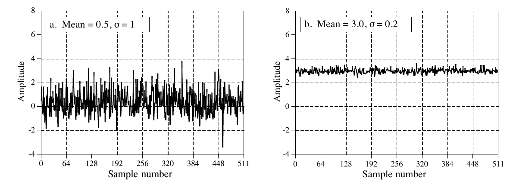

**图 2-1　两个均值和标准差不同的数字化信号示例。**
（a. 均值 = 0.5，σ = 1；b. 均值 = 3.0，σ = 0.2。图中 Amplitude = 幅度，Sample number = 采样序号。）

## 均值与标准差

均值(mean)用 µ（小写希腊字母 mu）表示，是统计学家对信号平均值的行话。它的求法和你想的一样：把所有采样加起来，再除以 N。写成数学形式是：

**公式 2-1　信号均值的计算。** 信号存放在 $x_0$ 到 $x_{N-1}$ 中，i 是遍历这些值的索引，µ 是均值。

$$
\mu = \frac{1}{N}\sum_{i=0}^{N-1} x_i
$$

用文字说：让索引 i 从 0 走到 N−1，把信号的值 $x_i$ 加起来，最后把总和除以 N。这和下面的式子完全相同：$\mu = (x_0 + x_1 + x_2 + \cdots + x_{N-1})/N$。如果你还不熟悉用 Σ（大写希腊字母 sigma）表示求和，请仔细研究这些公式，并和表 2-1 的计算机程序对照。这类求和在 DSP 里比比皆是，你必须彻底弄懂这种记法。

在电子学里，均值通常叫直流(DC, direct current)值。相应地，交流(AC, alternating current)指信号围绕均值的波动。如果信号是简单的重复波形，比如正弦波或方波，它的起伏可以用峰峰值(peak-to-peak amplitude)来描述。可惜大多数采集到的信号没有明确的峰峰值，而是带有随机性，就像图 2-1 中的信号。这时就得用一种更通用的方法，叫标准差(standard deviation)，记作 σ（小写希腊字母 sigma）。

作为起点，表达式 $|x_i - \mu|$ 描述了第 i 个采样偏离(deviate)均值多远。把所有单个采样的偏差加起来，再除以采样数 N，就得到信号的平均偏差(average deviation)。注意求和之前要先对每个偏差取绝对值，否则正负项平均下来会等于零。平均偏差用一个数代表采样离均值的典型距离。它虽然方便直接，但统计学里几乎从不使用。原因是它和信号运作的物理规律不太契合。大多数情况下，重要的参数不是偏离均值的大小，而是这个偏离所代表的功率(power)。例如，随机噪声信号在电子电路中叠加时，合成噪声等于各信号功率之和，而不是幅度之和。

标准差和平均偏差相似，只不过平均的是功率而不是幅度。做法是先把每个偏差平方，再求平均（记住，功率 ∝ 电压²）。最后开平方，抵消最初的平方。写成公式，标准差的计算如下：

**公式 2-2　信号标准差的计算。** 信号存放在 $x_i$ 中，µ 是由公式 2-1 求出的均值，N 是采样数，σ 是标准差。

$$
\sigma^2 = \frac{1}{N-1}\sum_{i=0}^{N-1} (x_i - \mu)^2
$$

另一种写法：$\sigma = \sqrt{\big[(x_0-\mu)^2 + (x_1-\mu)^2 + \cdots + (x_{N-1}-\mu)^2\big] / (N-1)}$。注意这里求平均时除的是 N−1 而不是 N。这是公式里一个微妙的地方，下一节再讨论。$\sigma^2$ 这一项在统计学里经常出现，它有个名字叫方差(variance)。标准差衡量的是信号偏离均值的波动有多大，方差代表这种波动的功率。另一个你应该熟悉的术语是电子学中常用的均方根(rms, root-mean-square)值。按定义，标准差只衡量信号的交流部分，而均方根值同时衡量交流和直流成分。如果信号没有直流成分，它的均方根值就等于标准差。图 2-2 展示了几种常见波形的标准差与峰峰值之间的关系。

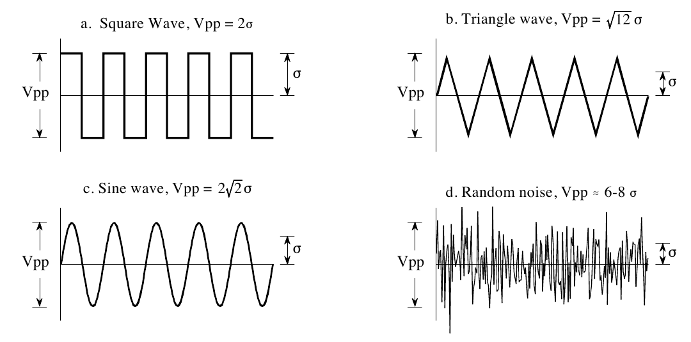

**图 2-2　几种常见波形的峰峰值与标准差之比。** 方波的比值是 2；三角波是 $\sqrt{12} = 3.46$；正弦波是 $2\sqrt{2} = 2.83$。随机噪声没有确切的峰峰值，但大约是标准差的 6 到 8 倍。
（a. 方波(Square Wave)，Vpp = 2σ；b. 三角波(Triangle wave)，Vpp = $\sqrt{12}$σ；c. 正弦波(Sine wave)，Vpp = $2\sqrt{2}$σ；d. 随机噪声(Random noise)，Vpp ≈ 6～8σ。Vpp 即峰峰值。）

表 2-1 列出了一段用公式 2-1 和 2-2 计算均值和标准差的计算机程序。本书的程序只追求用最直接的方式表达算法，其他因素都排在后面。只要能让程序逻辑更清楚，好的编程技巧也可以不顾。例如：使用简化版的 BASIC、带行号、唯一允许的控制结构是 FOR-NEXT 循环、没有输入输出语句等。可以把这些程序看作理解 DSP 公式的另一种途径，一种看不懂，也许另一种能帮上忙。在 BASIC 里，变量名末尾的 % 表示它是整数，其他变量都是浮点数。第 4 章会详细讨论这些变量类型。

**表 2-1**（注释已译成中文）

```basic
100 CALCULATION OF THE MEAN AND STANDARD DEVIATION
110 '
120 DIM X[511]                  '信号存放在 X[0] 到 X[511]
130 N% = 512                    'N% 是信号的点数
140 '
150 GOSUB XXXX                  '虚构的子程序，把信号载入 X[ ]
160 '
170 MEAN = 0                    '用公式 2-1 求均值
180 FOR I% = 0 TO N%-1
190   MEAN = MEAN + X[I%]
200 NEXT I%
210 MEAN = MEAN/N%
220 '
230 VARIANCE = 0                '用公式 2-2 求标准差
240 FOR I% = 0 TO N%-1
250   VARIANCE = VARIANCE + ( X[I%] - MEAN )^2
260 NEXT I%
270 VARIANCE = VARIANCE/(N%-1)
280 SD = SQR(VARIANCE)
290 '
300 PRINT MEAN SD               '打印算出的均值和标准差
310 '
320 END
```

**C 实现**（完整可编译版本见 `c/table2-1_mean_sd.c`）：

```c
/* 表 2-1  用两遍法计算均值与标准差 */
#include <stdio.h>
#include <math.h>

#define N 512 /* 130 N% = 512，X[0] 到 X[511] */

static double x[N];

/* 150 GOSUB XXXX：原书用一个虚构子程序载入信号，
 * 这里改为产生一个可复现的测试信号：正弦 + 均匀噪声 */
static void load_signal(void)
{
    unsigned int seed = 12345u;
    for (int i = 0; i < N; i++) {
        seed = seed * 1664525u + 1013904223u;             /* 线性同余随机数 */
        double noise = ((seed >> 8) & 0xFFFF) / 65535.0;  /* 0 到 1 */
        noise = (noise - 0.5) * 10.0;                     /* -5 到 +5 */
        x[i] = 20.0 * sin(2.0 * 3.14159265358979 * i / 64.0) + noise;
    }
}

int main(void)
{
    load_signal();

    /* 170-210：用公式 2-1 求均值 */
    double mean = 0.0;
    for (int i = 0; i < N; i++) {
        mean = mean + x[i];
    }
    mean = mean / N;

    /* 230-280：用公式 2-2 求标准差 */
    double variance = 0.0;
    for (int i = 0; i < N; i++) {
        double d = x[i] - mean;
        variance = variance + d * d;
    }
    variance = variance / (N - 1);
    double sd = sqrt(variance);

    /* 300 PRINT MEAN SD */
    printf("均值 = %.6f  标准差 = %.6f\n", mean, sd);
    return 0;
}
```

这种计算均值和标准差的方法对许多应用都够用，但它有两个局限。第一，如果均值比标准差大得多，公式 2-2 就要把两个非常接近的数相减。这会让计算产生过大的舍入误差(round-off error)，第 4 章会更详细地讨论这个话题。第二，我们常常希望每采集到一个新采样、加进信号后，就重新计算一次均值和标准差。我们把这种计算叫做滑动统计(running statistics)。公式 2-1 和 2-2 的方法虽然也能用于滑动统计，但每次重新计算都要用到所有采样，这非常浪费计算能力和内存。

解决这些问题的办法是：对公式 2-1 和 2-2 做变形，得到计算标准差的另一个公式：

**公式 2-3　用滑动统计计算标准差。** 这个公式和公式 2-2 结果相同，但舍入噪声更小，计算效率更高。信号用三个累加参数表示：N，采样总数；sum，这些采样之和；sum of squares，这些采样的平方和。均值和标准差都由这三个累加参数算出。

$$
\sigma^2 = \frac{1}{N-1}\left[\sum_{i=0}^{N-1} x_i^2 - \frac{1}{N}\left(\sum_{i=0}^{N-1} x_i\right)^2\right]
$$

或者用更简单的记法：

$$
\sigma^2 = \frac{1}{N-1}\left[\text{sum of squares} - \frac{\text{sum}^2}{N}\right]
$$

在遍历信号的过程中，持续累计三个参数：(1) 已处理的采样数；(2) 这些采样之和；(3) 这些采样的平方和（即把每个采样值平方后加到累计值上）。无论处理了多少个采样，都只需用这三个参数的当前值，就能高效地算出均值和标准差。表 2-2 的程序就是这样，每纳入一个新采样就报告一次均值和标准差。手持计算器求一串数的统计量用的也是这个方法：每输入一个数、按一下 Σ（求和）键，三个参数就更新一次。之后随时都能求出均值和标准差，不必把整串数重新算一遍。

**表 2-2**（注释已译成中文）

```basic
100 'MEAN AND STANDARD DEVIATION USING RUNNING STATISTICS
110 '
120 DIM X[511]                  '信号存放在 X[0] 到 X[511]
130 '
140 GOSUB XXXX                  '虚构的子程序，把信号载入 X[ ]
150 '
160 N% = 0                      '把三个滑动参数清零
170 SUM = 0
180 SUMSQUARES = 0
190 '
200 FOR I% = 0 TO 511           '逐个遍历信号中的采样
210 '
220   N% = N%+1                 '更新三个参数
230   SUM = SUM + X(I%)
240   SUMSQUARES = SUMSQUARES + X(I%)^2
250 '
260   MEAN = SUM/N%             '用公式 2-3 计算均值和标准差
270   VARIANCE = (SUMSQUARES - SUM^2/N%) / (N%-1)
280   SD = SQR(VARIANCE)
290 '
300   PRINT MEAN SD             '打印滑动均值和标准差
310 '
320 NEXT I%
330 '
340 END
```

**C 实现**（完整可编译版本见 `c/table2-2_running_stats.c`）：

```c
/* 表 2-2  用滑动统计（running statistics）计算均值与标准差 */
#include <stdio.h>
#include <math.h>

#define N 512

static double x[N];

/* 140 GOSUB XXXX：载入信号，与表 2-1 相同的测试信号 */
static void load_signal(void)
{
    unsigned int seed = 12345u;
    for (int i = 0; i < N; i++) {
        seed = seed * 1664525u + 1013904223u;
        double noise = ((seed >> 8) & 0xFFFF) / 65535.0;
        noise = (noise - 0.5) * 10.0;
        x[i] = 20.0 * sin(2.0 * 3.14159265358979 * i / 64.0) + noise;
    }
}

int main(void)
{
    load_signal();

    /* 160-180：三个滑动参数清零 */
    int n = 0;
    double sum = 0.0;
    double sumsquares = 0.0;

    /* 200 FOR I% = 0 TO 511 */
    for (int i = 0; i < N; i++) {
        /* 220-240：更新三个参数 */
        n = n + 1;
        sum = sum + x[i];
        sumsquares = sumsquares + x[i] * x[i];

        /* 260-280：用公式 2-3 计算均值和标准差
         * 注意：BASIC 原文在 n = 1 时会除以 (n-1) = 0，
         * 这里加一个判断，只有两个及以上采样时才计算。 */
        double mean = sum / n;
        double sd = 0.0;
        if (n > 1) {
            double variance = (sumsquares - sum * sum / n) / (n - 1);
            sd = sqrt(variance);
        }

        /* 300 PRINT MEAN SD */
        if (i == 0 || i == N - 1) {
            printf("第 %d 个采样后：均值 = %.6f  标准差 = %.6f\n",
                   n, mean, sd);
        }
    }
    return 0;
}
```

结束均值和标准差的讨论之前，还要提两个术语。在某些情况下，均值描述的是被测量的东西，而标准差代表噪声和其他干扰。这时标准差本身并不重要，重要的是它和均值的比较。由此产生了信噪比(SNR, signal-to-noise ratio)这个术语，它等于均值除以标准差。另一个术语是变异系数(CV, coefficient of variation)，定义为标准差除以均值，再乘以 100%。例如，CV 为 2% 的信号（或其他一组测量值），SNR 是 50。数据越好，SNR 越高，CV 越低。

## 信号与其背后的过程

统计是解释数值数据（比如采集到的信号）的科学。相比之下，DSP 用概率来理解产生信号的过程。两者联系紧密，但「采集到的信号」与「背后的过程(underlying process)」之间的区别，是许多 DSP 技术的关键。

例如，设想把硬币抛 1000 次，生成一个 1000 点的信号。正面朝上，对应的采样取值 1；反面朝上，取值 0。产生这个信号的过程，均值恰好是 0.5，这是由每种结果的相对概率决定的：50% 正面，50% 反面。然而，实际的 1000 点信号均值恰好是 0.5 的可能性很小。随机性会让每次生成信号时 1 和 0 的个数略有不同。背后过程的概率是不变的，但每次重复实验，采集到的信号的统计量都会变。实际数据中的这种随机不规则性，有统计变异(statistical variation)、统计涨落(statistical fluctuation)、统计噪声(statistical noise)等叫法。

这就带来一个小小的两难。看到「均值」和「标准差」这些词时，你怎么知道作者说的是实际信号的统计量，还是产生信号的背后过程的概率？遗憾的是，只能靠上下文判断。并不是统计和概率中所有术语都这样。例如，直方图和概率质量函数（下一节讨论）就是一对对应的概念，各有各的名字。

现在回到计算标准差的公式 2-2。前面说过，这个公式在计算偏差平方的平均值时，除的是 N−1 而不是 N。要理解为什么，设想你想求某个产生信号的过程的均值和标准差。为此，你从这个过程采集了一个 N 点的信号，用公式 2-1 算出信号的均值。你可以用它来估计背后过程的均值，但你知道统计噪声会带来误差。特别地，对随机信号来说，N 个点的均值与背后过程的均值之间的典型误差为：

**公式 2-4　用有限的 N 个采样计算背后过程均值时的典型误差。** 参数 σ 是标准差。

$$
\text{典型误差} = \frac{\sigma}{N^{1/2}}
$$

如果 N 很小，算出的均值里的统计噪声就会很大。换句话说，你掌握的数据不够，没法恰当地刻画这个过程。N 越大，预期误差就越小。概率论的一个里程碑——强大数定律(Strong Law of Large Numbers)——保证了当 N 趋于无穷时误差变为零。

下一步，我们想计算采集信号的标准差，并用它来估计背后过程的标准差。问题就出在这里。用公式 2-2 计算标准差之前，你得先知道均值 µ。可你并不知道背后过程的均值，只知道 N 点信号的均值，而它含有统计噪声带来的误差。这个误差往往会让算出的标准差偏小。为了补偿，把 N 换成 N−1。N 很大时，这点差别无关紧要；N 很小时，这样替换能更准确地估计背后过程的标准差。换句话说，公式 2-2 是对背后过程标准差的估计。如果公式里除以 N，得到的就是采集信号本身的标准差。

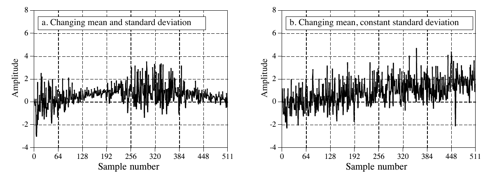

**图 2-3　由非平稳过程产生的信号示例。** (a) 中均值和标准差都在变。(b) 中标准差保持为常数 1，而均值从 0 变到 2。常用的分析方法是把这类信号切成短段，逐段计算统计量。
（a. 均值和标准差都在变化(Changing mean and standard deviation)；b. 均值变化、标准差不变(Changing mean, constant standard deviation)。）

为了说明这些想法，看看图 2-3 中的信号，问问自己：这些信号里的变化，是统计噪声造成的，还是背后的过程在变？不难让自己相信，这些变化太大了，不可能是随机造成的，一定和背后的过程有关。像这样特性会改变的过程称为非平稳(nonstationary)过程。相比之下，前面图 2-1 的信号是由平稳(stationary)过程产生的，其中的变化完全来自统计噪声。图 2-3b 说明了非平稳信号的一个常见问题：缓慢变化的均值会干扰标准差的计算。在这个例子中，信号在短区间内的标准差是 1，但整个信号的标准差是 1.16。把信号切成短段、逐段计算统计量，几乎可以消除这个误差。如果需要，还可以把各段的标准差平均成一个值。

## 直方图、概率质量函数与概率密度函数

假设我们给计算机接上一个 8 比特模数转换器，采集某个信号的 256,000 个采样。举个例子，图 2-4a 是这个数据集中可能的 128 个采样。每个采样的值是 256 种可能（0 到 255）之一。直方图(histogram)显示的是：信号中取每种可能值的采样各有多少个。图 (b) 是 (a) 中 128 个采样的直方图。例如，有 2 个采样的值是 110，有 8 个采样的值是 131，有 0 个采样的值是 170，等等。我们用 $H_i$ 表示直方图，i 是从 0 到 M−1 的索引，M 是每个采样可能取值的个数。例如，$H_{50}$ 是值为 50 的采样个数。图 (c) 是用全部数据集（全部 256k 个点）得到的直方图。可以看到，采样越多，样子就平滑得多。和均值一样，直方图的统计噪声（粗糙程度）与所用采样数的平方根成反比。

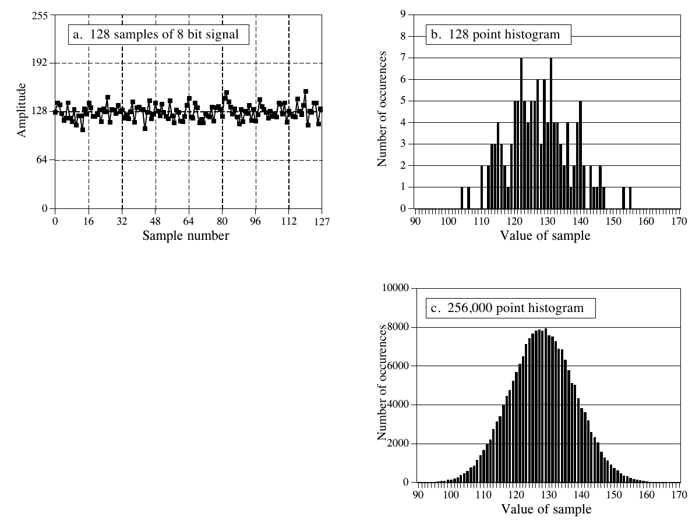

**图 2-4　直方图示例。** 图 (a) 是从一个很长的信号中取出的 128 个采样，每个采样是 0 到 255 之间的整数。图 (b) 和 (c) 分别是用信号中 128 个和 256,000 个采样得到的直方图。可以看到，采样越多，直方图越平滑。
（a. 8 比特信号的 128 个采样；b. 128 点直方图；c. 256,000 点直方图。Number of occurences = 出现次数，Value of sample = 采样值。）

根据定义，直方图所有值之和必然等于信号的点数：

**公式 2-5　直方图所有值之和等于信号的点数。** 式中 $H_i$ 是直方图，N 是信号的点数，M 是直方图的点数。

$$
N = \sum_{i=0}^{M-1} H_i
$$

直方图可以用来高效地计算超大数据集的均值和标准差。这对图像尤其重要，因为一幅图像可能有几百万个采样。直方图把值相同的采样归为一组，这样计算统计量时只需处理少数几组，而不必处理大量单个采样。用这种方法，由直方图计算均值和标准差的公式是：

**公式 2-6　由直方图计算均值。** 可以看作把值相同的采样归成组，再对每组使用公式 2-1。

$$
\mu = \frac{1}{N}\sum_{i=0}^{M-1} i\,H_i
$$

**公式 2-7　由直方图计算标准差。** 思路和公式 2-2 相同，只是对值相同的所有采样一次性处理。

$$
\sigma^2 = \frac{1}{N-1}\sum_{i=0}^{M-1} (i-\mu)^2 H_i
$$

表 2-3 是用这些公式计算直方图、均值和标准差的程序。计算直方图非常快，因为只需要索引和自增。相比之下，计算均值和标准差需要耗时的加法和乘法运算。这个算法的策略是：只对直方图里的少数几个数做这些慢运算，而不是对信号里的大量采样做。这使它比前面介绍的方法快得多。对于很长的信号、在通用计算机上计算时，大约能快十倍。

**表 2-3**（注释已译成中文）

```basic
100 'CALCULATION OF THE HISTOGRAM, MEAN, AND STANDARD DEVIATION
110 '
120 DIM X%[25000]               'X%[0] 到 X%[25000] 存放待处理的信号
130 DIM H%[255]                 'H%[0] 到 H%[255] 存放直方图
140 N% = 25001                  '设置信号的点数
150 '
160 FOR I% = 0 TO 255           '把直方图清零，以便用作累加器
170   H%[I%] = 0
180 NEXT I%
190 '
200 GOSUB XXXX                  '虚构的子程序，把信号载入 X%[ ]
210 '
220 FOR I% = 0 TO 25000         '计算 25001 个点的直方图
230   H%[ X%[I%] ] = H%[ X%[I%] ] + 1
240 NEXT I%
250 '
260 MEAN = 0                    '用公式 2-6 计算均值
270 FOR I% = 0 TO 255
280   MEAN = MEAN + I% * H%[I%]
290 NEXT I%
300 MEAN = MEAN / N%
310 '
320 VARIANCE = 0                '用公式 2-7 计算标准差
330 FOR I% = 0 TO 255
340   VARIANCE = VARIANCE + H[I%] * (I%-MEAN)^2
350 NEXT I%
360 VARIANCE = VARIANCE / (N%-1)
370 SD = SQR(VARIANCE)
380 '
390 PRINT MEAN SD               '打印算出的均值和标准差
400 '
410 END
```

**C 实现**（完整可编译版本见 `c/table2-3_histogram_stats.c`）：

```c
/* 表 2-3  用直方图计算均值与标准差 */
#include <stdio.h>
#include <math.h>

#define NUM_POINTS 25001 /* 140 N% = 25001，X%[0] 到 X%[25000] */
#define NUM_LEVELS 256   /* 150 DIM H%[255]，8 比特信号 */

static int x[NUM_POINTS];
static int h[NUM_LEVELS];

/* 200 GOSUB XXXX：载入整数信号，这里用 0 到 255 均匀分布的测试数据 */
static void load_signal(void)
{
    unsigned int seed = 54321u;
    for (int i = 0; i < NUM_POINTS; i++) {
        seed = seed * 1664525u + 1013904223u;
        x[i] = (int)((seed >> 8) % NUM_LEVELS);
    }
}

int main(void)
{
    /* 160-180：把直方图清零，以便用作累加器 */
    for (int i = 0; i < NUM_LEVELS; i++) {
        h[i] = 0;
    }

    load_signal();

    /* 220-240：计算 25001 个点的直方图 */
    for (int i = 0; i < NUM_POINTS; i++) {
        h[x[i]] = h[x[i]] + 1;
    }

    /* 260-300：用公式 2-6 计算均值 */
    double mean = 0.0;
    for (int i = 0; i < NUM_LEVELS; i++) {
        mean = mean + i * h[i];
    }
    mean = mean / NUM_POINTS;

    /* 320-370：用公式 2-7 计算标准差 */
    double variance = 0.0;
    for (int i = 0; i < NUM_LEVELS; i++) {
        double d = i - mean;
        variance = variance + h[i] * d * d;
    }
    variance = variance / (NUM_POINTS - 1);
    double sd = sqrt(variance);

    /* 390 PRINT MEAN SD */
    printf("均值 = %.6f  标准差 = %.6f\n", mean, sd);
    return 0;
}
```

「采集到的信号是背后过程的带噪版本」这个观念非常重要，重要到有些概念为此取了不同的名字。直方图是由采集到的信号得到的。背后过程对应的曲线叫概率质量函数(pmf, probability mass function)。直方图总是用有限个采样算出来的，而 pmf 是用无限多个采样才能得到的结果。pmf 可以从直方图估计（推断）出来，也可以用某种数学方法推导出来，比如抛硬币的例子。

图 2-5 展示了一个 pmf 的例子，以及和它对应的一个可能的直方图。理解这些概念的关键在于纵轴的单位。前面说过，直方图的纵轴是某个值在信号中出现的次数。pmf 的纵轴包含类似的信息，只不过是以比例表示的。换句话说，把直方图的每个值除以采样总数，就得到 pmf 的近似。这意味着 pmf 的每个值都必须在 0 到 1 之间，并且 pmf 所有值之和等于 1。

pmf 之所以重要，是因为它描述了生成某个值的概率。例如，设想一个 pmf 如图 2-5b 的信号，比如前面图 2-4a 那样的信号。从这个信号中取一个采样，它的值为 120 的概率是多少？图 2-5b 给出了答案：0.03，大约 34 次里有 1 次。随机选一个采样，它的值大于 150 的概率是多少？把 pmf 在 151、152、153、…、255 处的值加起来，答案是 0.0122，大约 82 次里有 1 次。因此，平均每 82 个点，预计会有一个点的值超过 150。任意一个采样的值在 0 到 255 之间的概率是多少？把直方图所有值加起来，得到概率 1.00，即这件事必然发生。

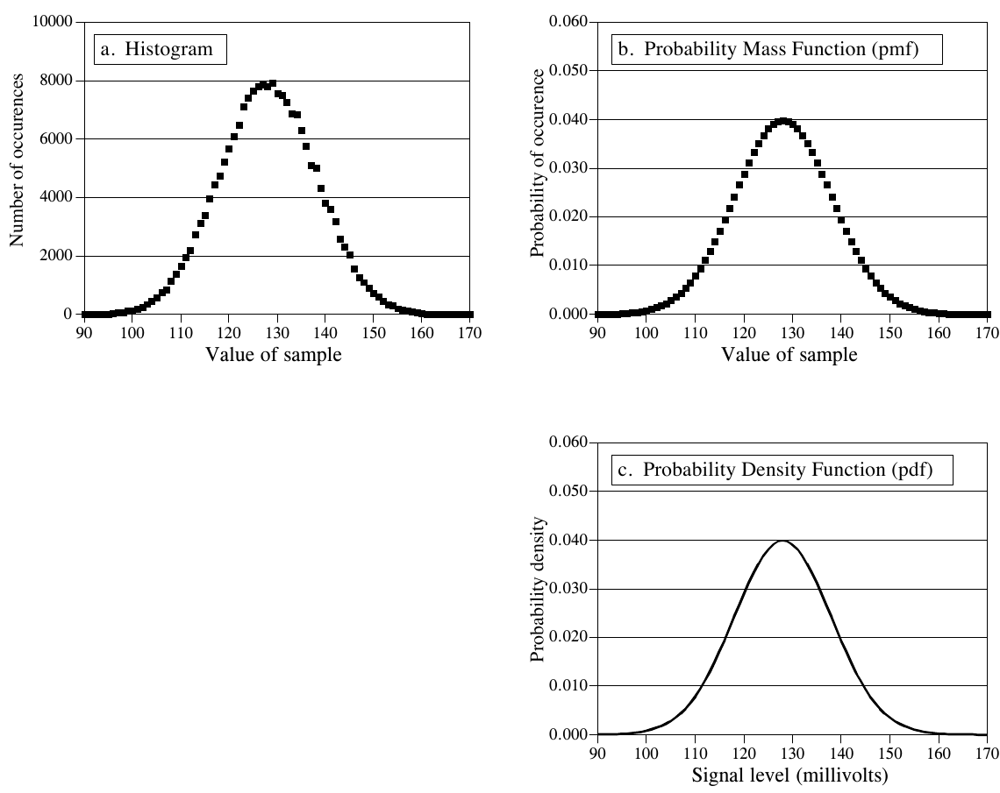

**图 2-5　(a) 直方图、(b) 概率质量函数(pmf) 与 (c) 概率密度函数(pdf) 之间的关系。** 直方图由有限个采样计算得到。pmf 描述背后过程的概率。pdf 与 pmf 相似，但用于连续信号而不是离散信号。虽然 (b) 和 (c) 的纵轴数值相同（0 到 0.06），这只是本例的巧合。三条曲线的高度分别由以下条件决定：(a) 直方图所有值之和等于信号的采样数；(b) pmf 所有值之和等于 1；(c) pdf 曲线下的面积等于 1。
（a. Histogram = 直方图；b. Probability Mass Function = 概率质量函数；c. Probability Density Function = 概率密度函数。Probability of occurence = 出现概率，Probability density = 概率密度，Signal level (millivolts) = 信号电平（毫伏）。）

直方图和 pmf 只能用于离散数据，比如存放在计算机里的数字化信号。连续信号（比如模拟电路中的电压）也有类似的概念。概率密度函数(pdf, probability density function)，也叫概率分布函数(probability distribution function)，它之于连续信号，就像概率质量函数之于离散信号。例如，设想一个模拟信号经过模数转换器，得到图 2-4a 的数字化信号。为简单起见，假设 0 到 255 毫伏之间的电压被数字化成 0 到 255 之间的数字。这个数字信号的 pmf 如图 2-5b 中的标记点所示。类似地，模拟信号的 pdf 如 (c) 中的连续曲线所示，表明信号可以取连续范围内的值，比如电子电路中的电压。

pdf 纵轴的单位是概率密度(probability density)，而不只是概率。例如，pdf 在 120.5 处为 0.03，并不意味着电压为 120.5 毫伏的时间占 3%。事实上，连续信号恰好等于 120.5 毫伏的概率无穷小。这是因为信号要在无穷多个可能的值之间分配它的时间：120.49997、120.49998、120.49999 等等。信号恰好等于 120.50000… 的机会确实微乎其微！

要计算概率，需要把概率密度乘以一个取值范围。例如，信号在任意给定时刻处于 120 到 121 之间的概率是：(121−120) × 0.03 = 0.03。信号处于 120.4 到 120.5 之间的概率是：(120.5−120.4) × 0.03 = 0.003，依此类推。如果 pdf 在关心的范围内不是常数，乘法就变成 pdf 在该范围上的积分。换句话说，就是给定数值所界定的 pdf 曲线下的面积。由于信号总得取某个值，pdf 曲线下的总面积，即从 −∞ 到 +∞ 的积分，总是等于 1。这就像 pmf 所有值之和等于 1、直方图所有值之和等于 N 一样。

直方图、pmf 和 pdf 是非常相似的概念。数学家总能把它们分得清清楚楚，但你会经常看到许多科学家和工程师把它们混用（因此用错）。图 2-6 展示了三种连续波形及其 pdf。如果它们是离散信号（把横轴标注改成「采样序号」即可表示），就要用 pmf。

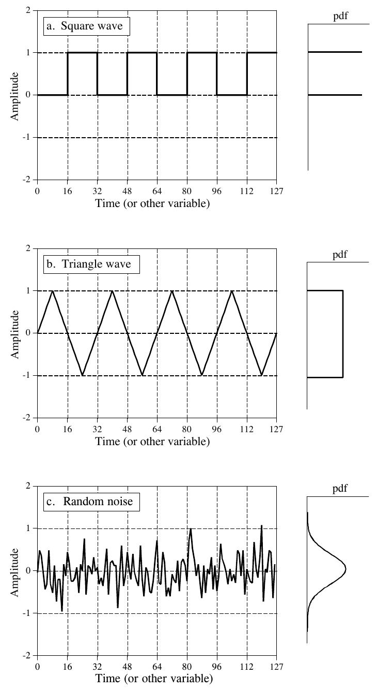

**图 2-6　三种常见波形及其概率密度函数。** 像这些例子一样，pdf 图常被旋转四分之一圈，放在它所描述的信号旁边。(a) 方波的 pdf 由两个无限窄的尖峰组成，对应信号只有两个可能的值。(b) 三角波的 pdf 在一个范围内是常数，常称为均匀分布(uniform distribution)。(c) 随机噪声的 pdf 最有意思，是一条钟形曲线，叫高斯分布(Gaussian)。
（a. Square wave = 方波；b. Triangle wave = 三角波；c. Random noise = 随机噪声。Time (or other variable) = 时间（或其他变量）。）

当每个采样可能取的电平数远多于信号的采样数时，计算直方图就会出问题。用浮点数表示的信号总是如此，因为每个采样都以小数形式存储。例如，整数表示可能要求采样值是 3 或 4，而浮点数允许 3 和 4 之间有几百万个可能的小数值。前面介绍的计算直方图的方法，是统计取每个可能量化电平的采样个数。浮点数据没法这样做，因为要考虑的可能电平有几十亿个。更糟的是，这些可能电平中几乎都没有对应的采样。例如，设想一个 10,000 个采样的信号，每个采样有十亿个可能的值。常规直方图将有十亿个数据点，其中除了大约 10,000 个以外，全都是零。

解决这些问题的技术叫分箱(binning)。做法是：随意选定直方图的长度为某个方便的数，比如 1000 个点，这些点通常叫做箱(bins)。每个箱的值代表信号中落在某个取值范围内的采样总数。例如，设想一个浮点信号的值在 0.0 到 10.0 之间，直方图有 1000 个箱。第 0 个箱是值在 0 到 0.01 之间的采样个数，第 1 个箱是值在 0.01 到 0.02 之间的采样个数，依此类推，直到第 999 个箱，是值在 9.99 到 10.0 之间的采样个数。表 2-4 给出了按这种方式计算分箱直方图的程序。

**表 2-4**（注释已译成中文）

```basic
100 'CALCULATION OF BINNED HISTOGRAM
110 '
120 DIM X[25000]                'X[0] 到 X[25000] 存放浮点信号，
130 '                           '每个采样的范围是 0.0 到 10.0
140 DIM H%[999]                 'H%[0] 到 H%[999] 存放分箱直方图
150 '
160 FOR I% = 0 TO 999           '把分箱直方图清零，以便用作累加器
170   H%[I%] = 0
180 NEXT I%
190 '
200 GOSUB XXXX                  '虚构的子程序，把信号载入 X%[ ]
210 '
220 FOR I% = 0 TO 25000         '计算 25001 个点的分箱直方图
230   BINNUM% = INT( X[I%] * .01 )
240   H%[ BINNUM%] = H%[ BINNUM%] + 1
250 NEXT I%
260 '
270 END
```

> 译注：按正文的设定（每箱宽 0.01），第 230 行应为 `X[I%] * 100`（即除以 0.01），原书写成 `* .01` 是笔误。若照抄原书，所有采样都会落进第 0 个箱。

**C 实现**（完整可编译版本见 `c/table2-4_binned_histogram.c`）：

```c
/* 表 2-4  计算分箱直方图（binned histogram）
 * 原文 230 行写作 BINNUM% = INT( X[I%] * .01 )，按正文“每箱宽 0.01”
 * 的设定应为乘以 100（即除以 0.01）。这里采用译注修正后的写法。
 * 另外采样值 10.0 会算出箱号 1000，越过最后一个箱，故做上限保护。 */
#include <stdio.h>

#define NUM_POINTS 25001 /* X[0] 到 X[25000] */
#define NUM_BINS 1000    /* H%[0] 到 H%[999] */

static double x[NUM_POINTS];
static int h[NUM_BINS];

/* 200 GOSUB XXXX：载入 0.0 到 10.0 的浮点测试信号 */
static void load_signal(void)
{
    unsigned int seed = 98765u;
    for (int i = 0; i < NUM_POINTS; i++) {
        seed = seed * 1664525u + 1013904223u;
        x[i] = 10.0 * ((seed >> 8) & 0xFFFF) / 65536.0;
    }
}

int main(void)
{
    /* 160-180：把分箱直方图清零，以便用作累加器 */
    for (int i = 0; i < NUM_BINS; i++) {
        h[i] = 0;
    }

    load_signal();

    /* 220-250：计算 25001 个点的分箱直方图 */
    for (int i = 0; i < NUM_POINTS; i++) {
        /* 230 BINNUM% = INT( X[I%] * 100 ) */
        int binnum = (int)(x[i] * 100.0);
        if (binnum < 0) binnum = 0;
        if (binnum > NUM_BINS - 1) binnum = NUM_BINS - 1;
        /* 240 累加该箱的计数 */
        h[binnum] = h[binnum] + 1;
    }

    /* 打印几个箱的计数，验证分箱结果 */
    printf("分箱直方图（每箱宽 0.01，共 %d 箱）\n", NUM_BINS);
    for (int bin = 0; bin < NUM_BINS; bin += 100) {
        printf("  箱 %3d [%.2f, %.2f) : %d\n",
               bin, bin / 100.0, (bin + 1) / 100.0, h[bin]);
    }
    return 0;
}
```

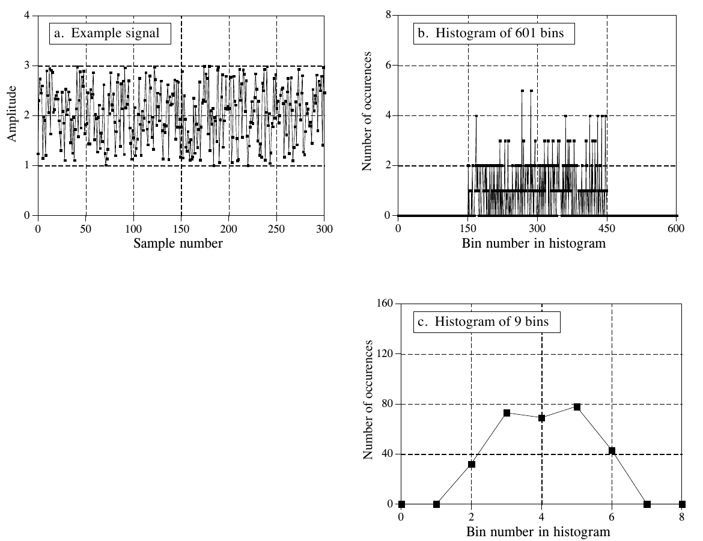

**图 2-7　分箱直方图示例。** 如 (a) 所示，本例所用的信号长 300 个采样，每个采样是在 1 到 3 之间均匀分布的浮点数。图 (b) 和 (c) 分别是用 601 个箱和 9 个箱得到的该信号的分箱直方图。可以看到，箱太多会使纵轴方向的分辨率变差，箱太少则使横轴方向的分辨率变差。用更多的采样能让两个方向的分辨率都变好。
（a. Example signal = 示例信号；b. 601 个箱的直方图；c. 9 个箱的直方图。Bin number in histogram = 直方图中的箱号。）

该用多少个箱？这是两个问题之间的折中。如图 2-7 所示，箱太多，就难以估计背后 pmf 的高度。这是因为每个箱只落进少数几个采样，统计噪声非常大。另一个极端，箱太少，就难以在水平方向上估计背后的 pmf。换句话说，箱数控制着 y 轴分辨率与 x 轴分辨率之间的权衡。

## 正态分布

由随机过程形成的信号，通常有一个钟形的 pdf。这叫正态分布(normal distribution)、高斯分布(Gauss distribution)，或简称高斯(Gaussian)，以伟大的德国数学家卡尔·弗里德里希·高斯(Karl Friedrich Gauss, 1777-1855)命名。这条曲线为什么在自然界中如此常见，稍后结合数字噪声生成来讨论。曲线的基本形状由一个负的平方指数生成：

$$
y(x) = e^{-x^2}
$$

给这条原始曲线加上可调的均值 µ 和标准差 σ，就能变成完整的高斯曲线。此外，还必须对公式做归一化(normalize)，让曲线下的总面积等于 1，这是所有概率分布函数都必须满足的要求。由此得到正态分布的一般形式，它是统计和概率中最重要的关系之一：

**公式 2-8　正态分布公式，也叫高斯分布，或简称高斯。** 在这个关系式中，P(x) 是概率分布函数，µ 是均值，σ 是标准差。

$$
P(x) = \frac{1}{\sqrt{2\pi}\,\sigma}\, e^{-(x-\mu)^2/2\sigma^2}
$$

图 2-8 给出了几个不同均值和标准差的高斯曲线示例。均值让曲线以某个值为中心，标准差控制钟形的宽度。

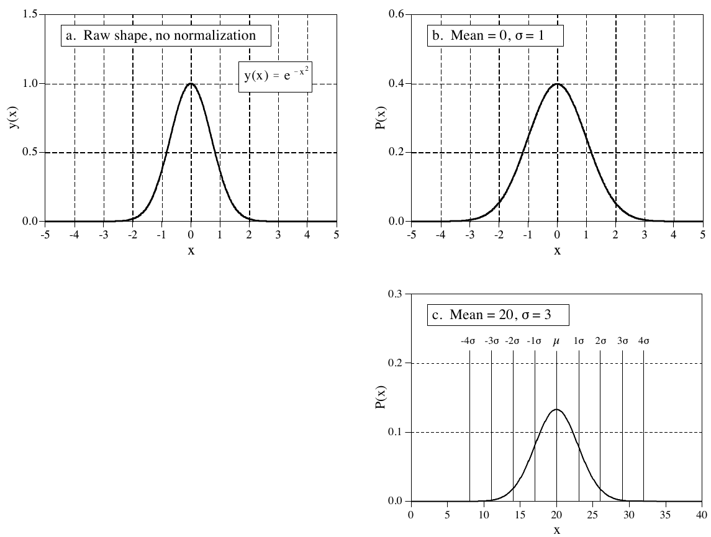

**图 2-8　高斯曲线示例。** 图 (a) 是原始曲线的形状，没有归一化，也没有加入可调参数。(b) 和 (c) 展示了不同均值和标准差下的完整高斯曲线。
（a. 原始形状，未归一化(Raw shape, no normalization)；b. 均值 = 0，σ = 1；c. 均值 = 20，σ = 3，图中竖线标出了 µ 两侧 ±1σ 到 ±4σ 的位置。）

高斯曲线有个有趣的特点：它的尾部下降到零的速度非常快，比衰减指数或 1/x 等其他常见函数快得多。例如，在偏离均值 2、4、6 个标准差的地方，高斯曲线的值分别下降到约 1/19、1/7563 和 1/166,666,666。这就是为什么正态分布的信号（如图 2-6c 所示）看起来有一个大致的峰峰值。原则上，这类信号的起伏幅度可以没有上限。但实际上，高斯 pdf 的急剧下降决定了这些极端值几乎永远不会出现。结果是波形看起来比较有界，表观峰峰值大约是 6～8σ。

前面讲过，要求信号落在某个取值范围内的概率，就要对 pdf 积分。pdf 的积分重要到有了自己的名字：累积分布函数(cdf, cumulative distribution function)。高斯分布有个特别讨厌的问题：它没法用初等方法积分。为了绕开这一点，可以用数值积分(numerical integration)计算高斯的积分。做法是对连续的高斯曲线做非常密的采样，比如在 −10σ 到 +10σ 之间取几百万个点，然后把这个离散信号的采样累加起来，模拟积分。把这样模拟积分得到的离散曲线存进一张表，用来计算概率。

正态分布的 cdf 如图 2-9 所示，数值列在表 2-5 中。这条曲线在概率中用得非常频繁，所以有自己的符号：Φ(x)（大写希腊字母 phi）。例如，Φ(−2) 的值是 0.0228。这表示在任意随机选取的时刻，信号的值处于 −∞ 到「均值以下两个标准差」之间的概率是 2.28%。同样，Φ(1) = 0.8413 表示在随机选取的某一时刻，信号的值处于 −∞ 到「均值以上一个标准差」之间的概率是 84.13%。要计算信号处于两个值之间的概率，需要用 Φ(x) 表中对应的两个数相减。例如，在随机选取的某个时刻，信号的值处于「均值以下两个标准差」与「均值以上一个标准差」之间的概率是：Φ(1) − Φ(−2) = 0.8185，即 81.85%。

用这种方法可以算出：正态分布信号的采样，大约 68% 的时间落在均值 ±1σ 以内，大约 95% 的时间落在 ±2σ 以内，大约 99.75% 的时间落在 ±3σ 以内。信号偏离均值超过 10 个标准差的概率小得离谱，从宇宙诞生到现在（约 100 亿年），预计也只会发生几微秒！

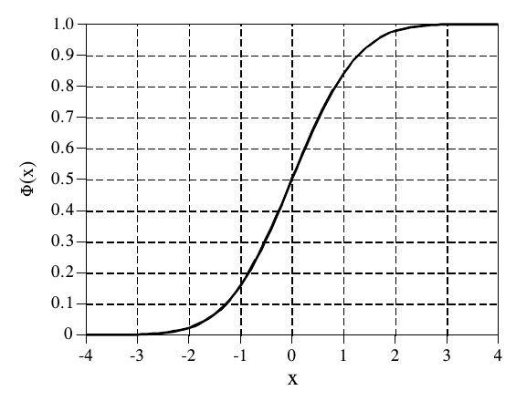

**图 2-9 与表 2-5　Φ(x)，正态分布（均值 = 0，标准差 = 1）的累积分布函数。** 这些值是对图 2-8b 所示的正态分布做数值积分算出来的。用文字说，Φ(x) 是正态分布信号在随机选取的某一时刻，其值小于 x 的概率。表中 x 的值以「相对于均值的标准差个数」为单位。

| x | Φ(x) | x | Φ(x) |
|---:|---:|---:|---:|
| −3.4 | .0003 | 0.0 | .5000 |
| −3.3 | .0005 | 0.1 | .5398 |
| −3.2 | .0007 | 0.2 | .5793 |
| −3.1 | .0010 | 0.3 | .6179 |
| −3.0 | .0013 | 0.4 | .6554 |
| −2.9 | .0019 | 0.5 | .6915 |
| −2.8 | .0026 | 0.6 | .7257 |
| −2.7 | .0035 | 0.7 | .7580 |
| −2.6 | .0047 | 0.8 | .7881 |
| −2.5 | .0062 | 0.9 | .8159 |
| −2.4 | .0082 | 1.0 | .8413 |
| −2.3 | .0107 | 1.1 | .8643 |
| −2.2 | .0139 | 1.2 | .8849 |
| −2.1 | .0179 | 1.3 | .9032 |
| −2.0 | .0228 | 1.4 | .9192 |
| −1.9 | .0287 | 1.5 | .9332 |
| −1.8 | .0359 | 1.6 | .9452 |
| −1.7 | .0446 | 1.7 | .9554 |
| −1.6 | .0548 | 1.8 | .9641 |
| −1.5 | .0668 | 1.9 | .9713 |
| −1.4 | .0808 | 2.0 | .9772 |
| −1.3 | .0968 | 2.1 | .9821 |
| −1.2 | .1151 | 2.2 | .9861 |
| −1.1 | .1357 | 2.3 | .9893 |
| −1.0 | .1587 | 2.4 | .9918 |
| −0.9 | .1841 | 2.5 | .9938 |
| −0.8 | .2119 | 2.6 | .9953 |
| −0.7 | .2420 | 2.7 | .9965 |
| −0.6 | .2743 | 2.8 | .9974 |
| −0.5 | .3085 | 2.9 | .9981 |
| −0.4 | .3446 | 3.0 | .9987 |
| −0.3 | .3821 | 3.1 | .9990 |
| −0.2 | .4207 | 3.2 | .9993 |
| −0.1 | .4602 | 3.3 | .9995 |
| 0.0 | .5000 | 3.4 | .9997 |

公式 2-8 也可以用来表示正态分布离散信号的概率质量函数。这时 x 只能取信号可能的量化电平之一，比如 12 比特模数转换器输出的 4096 个二进制值之一。忽略 $1/\sqrt{2\pi}\,\sigma$ 这一项，它只是用来让 pdf 曲线下的总面积等于 1。你要换成能让 pmf 所有值之和等于 1 的那个系数。大多数情况下，做法是先不管归一化，把曲线生成出来，把所有未归一化的值加起来，再把每个值都除以这个总和。

## 数字噪声的生成

随机噪声在电子学和 DSP 中都是一个重要话题。例如，它限制了仪器能测到多小的信号、无线电系统能通信多远，以及拍一张 X 光片需要多少辐射剂量。DSP 中一个常见的需求是生成类似各种随机噪声的信号。这是测试那些必须在噪声环境下工作的算法的性能所必需的。

数字噪声生成的核心是随机数生成器(random number generator)。大多数编程语言都把它作为标准函数。BASIC 语句 `X = RND` 每执行一次，就给变量 X 装入一个新的随机数。每个随机数的值都在 0 和 1 之间，落在这两个极端之间任何位置的概率都相等。图 2-10a 是从这种随机数生成器取 128 个采样形成的信号。产生这个信号的背后过程，均值是 0.5，标准差是 $1/\sqrt{12} = 0.29$，分布在 0 到 1 之间是均匀的。

算法需要用它在实际运行中会遇到的同类数据来测试。这就需要生成具有高斯 pdf 的数字噪声。用随机数生成器生成这种信号有两种方法。图 2-10 说明了第一种。图 (b) 中每个采样由两个随机数相加得到，即 `X = RND+RND`。每个随机数在 0 到 1 之间，所以和在 0 到 2 之间。均值变成 1，标准差变成 $1/\sqrt{6}$（记住，独立的随机信号相加时，方差也相加）。如图所示，pdf 从均匀分布变成了三角分布(triangular distribution)。也就是说，信号更多时间处在 1 附近，处在 0 或 2 附近的时间较少。

图 (c) 把这个思路再推进一步，每个采样由十二个随机数相加得到。均值变成 6，标准差变成 1。最重要的是，pdf 几乎变成了高斯分布。用这个步骤可以生成任意均值和标准差的正态分布噪声信号。对信号中的每个采样：(1) 把十二个随机数相加；(2) 减去 6，使均值为零；(3) 乘以想要的标准差；(4) 加上想要的均值。

这个算法的数学基础是中心极限定理(Central Limit Theorem)，它是概率论中最重要的概念之一。中心极限定理最简单的表述是：随机数加得越多，它们的和就越接近正态分布。中心极限定理并不要求单个随机数来自某种特定分布，甚至不要求这些随机数来自同一种分布。中心极限定理解释了为什么自然界中如此普遍地见到正态分布的信号：只要有许多不同的随机因素相互作用，得到的 pdf 就会变成高斯分布。

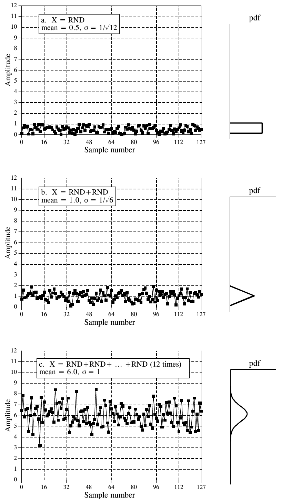

**图 2-10　把均匀分布转换成高斯分布。** 图 (a) 的信号中，每个采样都由随机数生成器产生。如 pdf 所示，每个采样的值在 0 到 1 之间均匀分布。(b) 中每个采样由随机数生成器给出的两个值相加而成。(c) 中每个采样由随机数生成器给出的十二个值相加而成。(c) 的 pdf 非常接近高斯分布，均值为 6，标准差为 1。
（a. X = RND，均值 = 0.5，σ = $1/\sqrt{12}$；b. X = RND+RND，均值 = 1.0，σ = $1/\sqrt{6}$；c. X = RND+RND+…+RND（12 次），均值 = 6.0，σ = 1。右侧小图是各自的 pdf。）

生成正态分布随机数的第二种方法，是调用两次随机数生成器，得到 $R_1$ 和 $R_2$。然后就能求出一个正态分布的随机数 X：

**公式 2-9　生成正态分布的随机数。** $R_1$ 和 $R_2$ 是在 0 到 1 之间均匀分布的随机数。由此得到的 X 服从均值为 0、标准差为 1 的正态分布。log 以 e 为底，余弦以弧度为单位。

$$
X = (-2\log R_1)^{1/2}\cos(2\pi R_2)
$$

和前面一样，这种方法也能生成任意均值和标准差的正态分布随机信号：把公式生成的每个数乘以想要的标准差，再加上想要的均值。

随机数生成器从一个种子(seed)开始工作，种子是 0 到 1 之间的一个数。调用随机数生成器时，种子经过一个固定的算法，得到一个 0 到 1 之间的新数。这个新数作为随机数输出，同时在内部保存起来，下次调用时用作种子。把种子变换成新随机数的算法通常是这种形式：

**公式 2-10　生成 0 到 1 之间均匀分布随机数的常用算法。** 式中 S 是种子，R 是新的随机数，a、b、c 是适当选取的常数。用文字说，就是把 aS+b 除以 c，取余数作为 R。

$$
R = (aS + b) \bmod c
$$

用这种方式，从同一个种子出发可以生成一串连续的随机数。这样程序可以多次运行，每次都使用完全相同的随机数序列。如果你想让随机数序列变化，大多数语言都提供重新设定种子的功能，让你自己选择第一个种子。一种常用的技巧是用时间（系统时钟显示的时间）做种子，这样每次运行程序都会得到新的序列。

从纯数学的角度看，这样生成的数不可能是绝对随机的，因为每个数都完全由前一个数决定。人们常用伪随机(pseudo-random)这个词来描述这种情况。不过你不必担心这一点。随机数生成器生成的序列，在统计意义上随机程度极高。你几乎不可能遇到它们不够用的情况。

## 精密度与准确度

精密度(precision)和准确度(accuracy)这两个术语，用来描述进行测量、估计或预测的系统和方法。在所有这些情况下，都有某个你想知道其数值的参数，这叫真值(true value)，或简称真相(truth)。方法给出一个测量值(measured value)，你希望它尽可能接近真值。精密度和准确度就是描述这两个值之间可能存在的误差的方式。

遗憾的是，在非技术场合，精密度和准确度经常被混用。事实上，词典给它们下定义时互相引用！尽管如此，科学和工程对两者各有非常明确的定义。你应该注意正确使用这两个术语，别人用错时就默默容忍吧。

举个例子，设想一位海洋学家用声呐系统测量水深。船上发出短促的声脉冲，被海底反射，作为回声在海面被接收。声波在水中的传播速度比较恒定，所以可以根据发射脉冲和接收脉冲之间的时间差求出深度。和所有经验测量一样，测量值和真值之间存在一定的误差。这个测量可能受很多因素影响：电子设备中的随机噪声、海面的波浪、海底的植物生长、水温变化导致声速改变等。

为了研究这些影响，海洋学家在一个已知恰好深 1000 米的地点（真值）连续读取许多次数据。然后把这些测量值整理成图 2-11 所示的直方图。正如中心极限定理所预料的，采集到的数据呈正态分布。均值位于分布的中心，代表根据所有测量数据对深度的最佳估计。标准差决定分布的宽度，描述了连续测量之间有多大的变动。

这就产生了系统可能出现的两类一般误差。第一，均值可能偏离真值，偏离的大小称为测量的准确度。第二，单次测量之间可能不太一致，表现为分布的宽度，这称为测量的精密度，用标准差、信噪比或 CV 来表示。

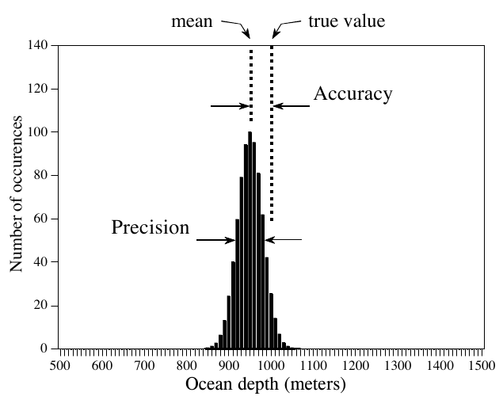

**图 2-11　准确度和精密度的定义。** 准确度是真值与产生数据的背后过程的均值之差。精密度是数值的分散程度，用标准差、信噪比或 CV 表示。
（mean = 均值，true value = 真值，Accuracy = 准确度，Precision = 精密度，Number of occurences = 出现次数，Ocean depth (meters) = 海洋深度（米）。）

设想一个准确度好、精密度差的测量：直方图以真值为中心，但非常宽。虽然这些测量作为一个整体是对的，但每一次单独的读数都不能很好地反映真值。这种情况称为重复性(repeatability)差：连续进行的测量彼此不太一致。精密度差源于随机误差(random errors)，即每次重复测量都会变化的误差。对多次测量取平均，总能改善精密度。简而言之，精密度衡量的是随机噪声。

再设想一个非常精密、但准确度差的测量。这时直方图很窄，但中心不在真值上。连续读数彼此接近，但都有很大的误差。准确度差源于系统误差(systematic errors)，即每次测量都以完全相同方式重复出现的误差。准确度通常取决于你如何校准(calibrate)系统。例如，在海洋深度测量中，直接测得的参数是时间差，它通过一个把毫秒换算成米的校准过程转换成深度。这个过程可能简单到乘以一个固定速度，也可能复杂到包含几十项二阶修正。对单次测量取平均，对改善准确度毫无帮助。简而言之，准确度衡量的是校准。

实际中，精密度和准确度会以许多方式纠缠在一起。例如，设想用精度 1% 的电阻搭建一个电子放大器。这个容差表示，在温度、湿度、老化等很宽的条件范围内，每个电阻的阻值都在标称值的 1% 以内。阻值的这个误差会使放大器的增益产生相应的误差。这个误差是准确度问题还是精密度问题？

答案取决于你怎样进行测量。例如，假设你搭了一个放大器，在几分钟内测试了几次。每次测试增益误差都保持不变，你会得出结论：这是准确度问题。相比之下，假设你搭了一千个这样的放大器，增益会在器件之间随机波动，问题看起来就是精密度问题。同样，其中任何一个放大器的增益都会随温度和其他环境变化而波动，这又会被称为精密度问题。

决定把问题叫做哪一个时，问自己两个问题。第一：对连续读数取平均，能不能得到更好的测量？能，就把这个误差叫精密度；不能，就叫准确度。第二：校准能不能纠正这个误差？能，就叫准确度；不能，就叫精密度。这可能需要好好想一想，尤其要考虑设备将怎样校准、多久校准一次。
