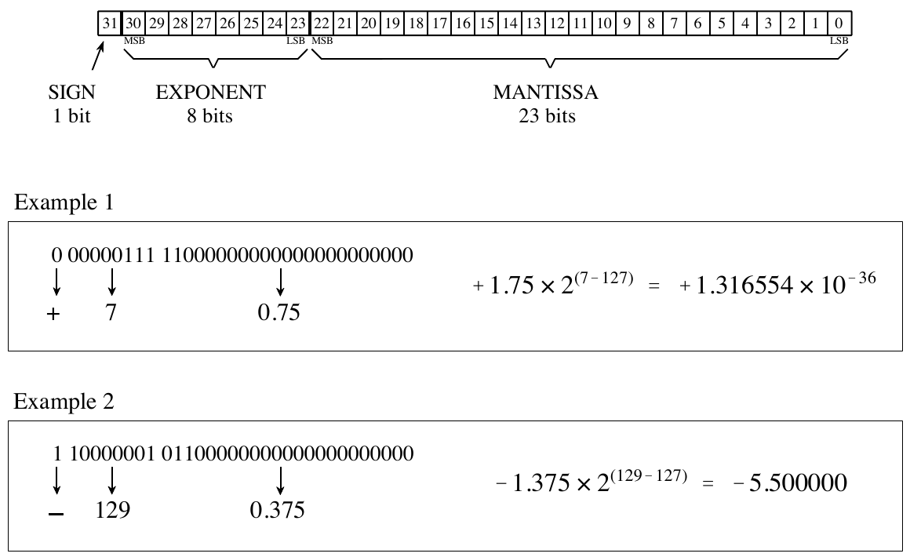
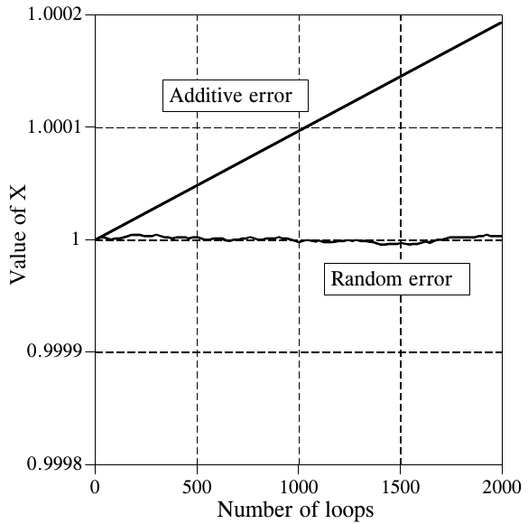
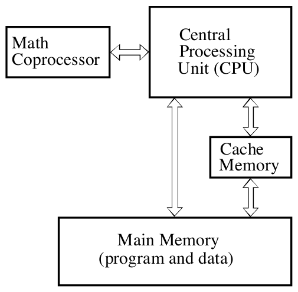

# 《The Scientist and Engineer's Guide to Digital Signal Processing》第 4 章中译

> 原书：上一级目录 `Documents/数学基础/` 下的 `The Scientist and Engineer Guide to Digital Signal Processing.pdf`，对应 PDF 第 78～97 页（原书第 67～86 页）。
> 上一章：[03-DSP指南-第3章中译.md](03-DSP指南-第3章中译.md)。专业名词第一次出现时在括号里附上英文。
> 带图形的插图从原书页面裁出，放在 `assets/ch04/`；纯文字/数字排成的图和表直接转成 Markdown 表格或代码块。原书 PDF 的符号字体抽取时会乱码，公式按原书版面重新用 LaTeX 写出。

---

# 第 4 章　DSP 软件

DSP 应用程序通常和其他科学、工程任务一样，用 C、BASIC 和汇编等语言编写。C 的强大和通用性，使它成为计算机科学家和其他专业程序员的首选语言。另一方面，BASIC 的简单，使它非常适合那些只是偶尔涉足编程世界的科学家和工程师。无论你用什么语言，大多数重要的 DSP 软件问题都深埋在底层那个 0 和 1 飞旋的世界里。这包括这样一些话题：数字怎样用比特模式(bit pattern)表示、计算机运算中的舍入误差、不同类型处理器的计算速度等。本章讲的是你能在高层做些什么，以免被计算机底层的内部运作踩在脚下。

## 计算机里的数

数字计算机非常擅长存储和调取数字，可惜这个过程并非没有误差。例如，你让计算机存储数字 1.41421356。计算机尽力而为，存下它能表示的最接近的数：1.41421354。有时这个误差无关紧要，有时却是灾难性的。再举一个例子，一个经典的计算错误来自两个大小相差悬殊的数相加，比如 1 和 0.00000001。我们希望答案是 1.00000001，计算机却回答 1。理解计算机怎样存储和处理数字，能让你在程序吐出毫无意义的数据之前，就预见并纠正这些问题。

这些问题的根源在于：每个数都只分配了固定数目的比特来存储，通常是 8、16、32 或 64 位。例如，考虑用 8 个比特存储一个变量的值。由于只有 $2^8 = 256$ 种可能的比特模式，这个变量只能取 256 个不同的值。这是这种情况的根本局限，我们对此无能为力。我们能控制的是：规定每个比特模式代表什么值。最简单的情况下，这 256 个比特模式可以代表 0 到 255、1 到 256、−127 到 128 等整数。在一种更不寻常的方案里，这 256 个比特模式可以代表 256 个按指数关系排列的数：1、10、100、1000、…、$10^{254}$、$10^{255}$。每个访问这些数据的人都必须明白每个比特模式代表什么值。这通常由一个算法或公式给出，用来在所代表的值和对应的比特模式之间来回转换。

可能的编码方案虽然很多，但常用的只有两种通用格式：定点数(fixed point，也叫整数)和浮点数(floating point，也叫实数)。在本书的 BASIC 程序中，定点变量用名字最后一个字符为 % 来标示，比如 I%、N%、SUM% 等。其他变量都是浮点数，比如 X、Y、MEAN 等。在评估接下来几页介绍的格式时，试着从两方面去理解它们：范围(range，能表示的最大数和最小数)和精度(precision，相邻两个数之间的间隙大小)。

## 定点数（整数）

定点表示用来存储整数，即正负整数：…、−3、−2、−1、0、1、2、3、…。C 和 BASIC 这样的高级语言，通常给每个整数分配 16 个比特。最简单的情况下，$2^{16} = 65,536$ 种可能的比特模式被分配给 0 到 65,535 这些数。这叫无符号整数(unsigned integer)格式，图 4-1 给出了一个简化的例子（每个数只用 4 个比特）。比特模式与所代表的数之间的转换，无非就是二进制(binary)和十进制(decimal)之间的换算。无符号整数的缺点是不能表示负数。

偏移二进制(offset binary)和无符号整数类似，只是把十进制值整体平移，以便能表示负数。在图 4-1 的 4 比特例子中，十进制数偏移了 7，于是 16 个比特模式对应 −7 到 8 的整数。同样，16 比特表示会用 32,767 作偏移量，得到 −32,767 到 32,768 的范围。偏移二进制不是一种标准化的格式，你也会看到别的偏移量，比如 32,768。偏移二进制最重要的用途是在 ADC 和 DAC 中。例如，对于 12 比特转换，−5 V 到 5 V 的输入电压范围可能被映射到数字 0 到 4095。

原码(sign and magnitude，符号-幅值表示)是另一种表示负整数的简单方法。最左边的比特叫符号位(sign bit)，正数为 0，负数为 1。其余比特是这个数绝对值的标准二进制表示。这会浪费一个比特模式，因为零有两种表示：0000（正零）和 1000（负零）。这种编码方案使 16 比特数的范围是 −32,767 到 32,767。

**图 4-1　定点（整数）表示的常用格式。** 无符号整数是一种简单的二进制格式，但不能表示负数。偏移二进制和原码可以表示负数，但很难用硬件实现。补码最容易设计硬件，是通用计算中最常用的格式。

| 比特模式 | 无符号整数 | 偏移二进制 | 原码 | 补码 |
|:---:|---:|---:|---:|---:|
| 1111 | 15 | 8 | −7 | −1 |
| 1110 | 14 | 7 | −6 | −2 |
| 1101 | 13 | 6 | −5 | −3 |
| 1100 | 12 | 5 | −4 | −4 |
| 1011 | 11 | 4 | −3 | −5 |
| 1010 | 10 | 3 | −2 | −6 |
| 1001 | 9 | 2 | −1 | −7 |
| 1000 | 8 | 1 | 0（负零） | −8 |
| 0111 | 7 | 0 | 7 | 7 |
| 0110 | 6 | −1 | 6 | 6 |
| 0101 | 5 | −2 | 5 | 5 |
| 0100 | 4 | −3 | 4 | 4 |
| 0011 | 3 | −4 | 3 | 3 |
| 0010 | 2 | −5 | 2 | 2 |
| 0001 | 1 | −6 | 1 | 1 |
| 0000 | 0 | −7 | 0 | 0 |
| **16 比特范围** | 0 到 65,535 | −32,767 到 32,768 | −32,767 到 32,767 | −32,768 到 32,767 |

（原图按「十进制值 → 比特模式」分四栏排列，这里改成以比特模式为行，便于横向比较同一个比特模式在四种格式下代表的值。）

前三种表示在概念上很简单，但很难用硬件实现。记住，当你在计算机程序中写下 A=B+C 时，某位硬件工程师得想出办法，让代表 B 的比特模式和代表 C 的比特模式结合，形成代表 A 的比特模式。

补码(two's complement)是硬件工程师钟爱的格式，也是计算机中通常表示整数的方式。要理解它的编码模式，先看图 4-1 中十进制数 0，它对应二进制的零 0000。往上数时，十进制数就是对应的二进制数（0 = 0000，1 = 0001，2 = 0010，3 = 0011，等等）。现在记住，这四个比特存放在由 4 个触发器(flip-flop)组成的寄存器里。如果我们再从 0000 开始往下减，数字硬件会自动按补码计数：0 = 0000，−1 = 1111，−2 = 1110，−3 = 1101，等等。这就像新车的里程表：往前开，它变成 00000、00001、00002、00003……；倒着开，里程表变成 00000、99999、99998、99997……

用 16 个比特，补码能表示 −32,768 到 32,767 的数。如果数是正数或零，最左边的比特为 0；如果是负数，则为 1。因此，最左边的比特也叫符号位，和原码中一样。对于正数，十进制与补码之间的转换很直接，就是简单的十进制转二进制。对于负数，常用下面的算法：(1) 取十进制数的绝对值；(2) 把它转换成二进制；(3) 把所有比特取反（1 变 0，0 变 1）；(4) 二进制数加 1。例如：−5 → 5 → 0101 → 1010 → 1011。补码对人来说很难，对数字电路来说却很容易。

## 浮点数（实数）

浮点数的编码方案比定点数复杂。基本思想和科学记数法(scientific notation)一样：一个尾数(mantissa)乘以 10 的某个指数(exponent)次幂。例如 $5.4321 \times 10^6$，其中 5.4321 是尾数，6 是指数。科学记数法特别擅长表示极大和极小的数。例如：$1.2 \times 10^{50}$，地球上的原子数；或者 $2.6 \times 10^{-23}$，乌龟一秒钟爬过的距离与我们银河系直径之比。注意，用科学记数法表示的数要做规格化(normalize)，使小数点左边只有一位非零数字。这是通过按需调整指数来实现的。

浮点表示和科学记数法类似，只是一切都以 2 为底而不是以 10 为底。类似的格式有好几种在用，最常见的是 ANSI/IEEE Std. 754-1985。这个标准定义了 32 比特数的格式，叫单精度(single precision)；以及 64 比特数的格式，叫双精度(double precision)。如图 4-2 所示，单精度的 32 个比特分成三组：第 0 到 22 位构成尾数，第 23 到 30 位构成指数，第 31 位是符号位。这些比特按下面的关系构成浮点数 v：

**公式 4-1　把比特模式转换成浮点数的公式。** v 是所表示的数，S 是符号位的值，M 是尾数的值，E 是指数的值。

$$
v = (-1)^S \times M \times 2^{E-127}
$$

$(-1)^S$ 这一项的意思就是：符号位 S 为 0 时是正数，为 1 时是负数。变量 E 是八个指数比特所代表的 0 到 255 之间的数。把这个数减去 127，指数项就能从 $2^{-127}$ 变到 $2^{128}$。换句话说，指数是以偏移量 127 的偏移二进制存储的。

尾数 M 由 23 个比特构成一个二进制小数。例如，十进制小数 2.783 解释为 $2 + 7/10 + 8/100 + 3/1000$。二进制小数 1.0101 的意思是 $1 + 0/2 + 1/4 + 0/8 + 1/16$。浮点数和科学记数法一样要规格化，即小数点（在二进制中叫二进制点(binary point)）左边只有一位非零数字。由于二进制中唯一的非零数字是 1，尾数的首位总是 1，因此不必存储。去掉这个冗余，就让数多了一个比特的精度。存储的 23 个比特记作 $m_{22}, m_{21}, m_{20}, \ldots, m_0$，按下式构成尾数：

**公式 4-2　把比特模式转换成公式 4-1 所用的尾数 M 的算法。**

$$
M = 1.m_{22}m_{21}m_{20}m_{19}\cdots m_2m_1m_0
$$

换句话说，$M = 1 + m_{22}2^{-1} + m_{21}2^{-2} + m_{20}2^{-3} + \cdots$。如果第 0 到 22 位全为零，M 的值就是 1。如果第 0 到 22 位全为 1，M 就比 2 小一丁点，即 $2 - 2^{-23}$。



**图 4-2　单精度浮点数的存储格式。** 32 个比特分成三部分：符号位、指数和尾数。公式 4-1 和 4-2 说明了怎样由这三部分求出所表示的数。MSB 和 LSB 分别指「最高有效位」和「最低有效位」。
（SIGN = 符号，1 比特；EXPONENT = 指数，8 比特；MANTISSA = 尾数，23 比特。例 1：符号 +，指数 7，尾数 0.75，表示 $+1.75 \times 2^{(7-127)} = +1.316554 \times 10^{-36}$。例 2：符号 −，指数 129，尾数 0.375，表示 $-1.375 \times 2^{(129-127)} = -5.500000$。）

用这种编码方案，能表示的最大数是 $\pm(2-2^{-23}) \times 2^{128} = \pm 6.8 \times 10^{38}$。同样，能表示的最小数是 $\pm 1.0 \times 2^{-127} = \pm 5.9 \times 10^{-39}$。IEEE 标准把这个范围稍微缩小了一点，腾出一些比特模式赋予特殊含义。具体来说，标准允许的最大数和最小数分别是 $\pm 3.4 \times 10^{38}$ 和 $\pm 1.2 \times 10^{-38}$。腾出来的比特模式用于三类特殊的数：(1) ±0，定义为尾数和指数的所有比特都为零。(2) ±∞，定义为尾数的所有比特为零、指数的所有比特为 1。(3) 一组介于 $\pm 1.2 \times 10^{-38}$ 和 $\pm 1.4 \times 10^{-45}$ 之间的非常小的非规格化数(unnormalized numbers)。这些数去掉了「尾数首位必须为 1」的要求，精度较低。除了这三类特殊数之外，还有一些没有被赋予含义的比特模式，通常称为 NAN（Not A Number，非数）。

IEEE 双精度标准只是给尾数和指数都加了更多比特。存储双精度数的 64 个比特中，第 0 到 51 位是尾数，第 52 到 62 位是指数，第 63 位是符号位。和前面一样，尾数在 1 和略小于 2 之间，即 $M = 1 + m_{51}2^{-1} + m_{50}2^{-2} + m_{49}2^{-3} + \cdots$。11 个指数比特构成 0 到 2047 之间的数，偏移量为 1023，允许指数从 $2^{-1023}$ 到 $2^{1024}$。允许的最大数和最小数分别是 $\pm 1.8 \times 10^{308}$ 和 $\pm 2.2 \times 10^{-308}$。这些数大得和小得不可思议！单精度不够用的应用相当少见。你大概永远不会遇到双精度限制你实现目标的情况。

## 数值精度

数值表示带来的误差，和 ADC 中的量化误差非常相似。你想存储一个连续范围的值，却只能表示有限个量化电平。每生成一个新数（比如做完一次数学计算之后），它都必须被舍入到你所用格式能存储的最接近的值。

举个例子，设想你分配 32 个比特来存储一个数。由于恰好有 $2^{32} = 4,294,967,296$ 种不同的比特模式，你恰好能表示 4,294,967,296 个不同的数。有些编程语言提供一种叫长整型(long integer)的变量，以 32 比特、定点、补码形式存储。这意味着 4,294,967,296 种可能的比特模式代表 −2,147,483,648 到 2,147,483,647 之间的整数。相比之下，单精度浮点数把这 4,294,967,296 种比特模式分布在大得多的范围上：$-3.4 \times 10^{38}$ 到 $3.4 \times 10^{38}$。

对于定点变量，相邻两个数之间的间隙总是恰好为 1。在浮点表示中，相邻数之间的间隙随所表示的数的范围而变化。如果随机选一个浮点数，它旁边的间隙大约比这个数本身小一千万倍（准确地说，是这个数的 $2^{-24}$ 到 $2^{-23}$ 倍）。这是浮点表示的一个关键概念：大数之间的间隙大，小数之间的间隙小。图 4-3 列出了一些连续的浮点数以及分隔它们的间隙，以说明这一点。

**图 4-3　单精度浮点数之间间距的例子。** 相邻数之间的间距，总是大约在数值本身的八百万分之一到一千七百万分之一之间。

| 连续的浮点数 | 间距 | 相对间距 |
|---|---|---|
| 0.00001233862713<br>0.00001233862804<br>0.00001233862895<br>0.00001233862986 | 0.00000000000091 | 约千三百万分之一 |
| 1.000000000<br>1.000000119<br>1.000000238<br>1.000000358 | 0.000000119 | 约八百万分之一 |
| 1.996093750<br>1.996093869<br>1.996093988<br>1.996094108 | 0.000000119 | 约千七百万分之一 |
| 636.0312500<br>636.0313110<br>636.0313720<br>636.0314331 | 0.0000610 | 约千万分之一 |
| 217063424.0<br>217063440.0<br>217063456.0<br>217063472.0 | 16.0 | 约千四百万分之一 |

表 4-1 中的程序说明了舍入误差（数学计算中的量化误差）怎样在 DSP 中造成问题。在程序的循环里，两个随机数被加到浮点变量 X 上，然后再减回去。理想情况下，这什么也不会改变。实际上，每次算术运算的舍入误差都会让 X 的值逐渐偏离初始值。根据误差怎样累加，这种漂移有两种形式。如果舍入误差随机地有正有负，变量的值会随机地增减。如果误差主要是同一个符号，变量的值会更快、更一致地漂移开。

**表 4-1　演示浮点误差累积的程序。** 这个程序先把 X 的值设为 1.000000，然后执行一个理想情况下什么也不做的循环。每次循环中，两个随机数 A 和 B 先加到 X 上，再减回去。这些加减运算累积的误差使 X 偏离初始值。如图 4-4 所示，误差可能是随机的，也可能是累加的。（注释已译成中文）

```basic
100 X = 1                       '初始化 X
110 '
120 FOR I% = 0 TO 2000
130   A = RND                   '把随机数装入
140   B = RND                   'A 和 B
150 '
160   X = X + A                 '把 A 和 B 加到 X 上
170   X = X + B
180   X = X - A                 '撤销这两次加法
190   X = X - B
200 '
210   PRINT X                   '理想情况下，X 应该等于 1
220 NEXT I%
230 END
```

**C 实现**（完整可编译版本见 `c/table4-1_float_error.c`）：

```c
/* 表 4-1  浮点误差的累积
 * 原书 BASIC 的浮点变量是单精度，所以 X、A、B 都用 float。
 * 现代 CPU 默认「就近舍入」，误差有正有负、大体抵消，默认只能看到随机误差；
 * 加 trunc 参数改成「向零截断」舍入，才能复现图 4-4 的累加误差直线。
 * 编译时要加 -frounding-math（Makefile 已加）。 */
#include <fenv.h>
#include <math.h>
#include <stdio.h>
#include <stdlib.h>
#include <string.h>

static float rnd(void) { return (float)(rand() / ((double)RAND_MAX + 1.0)); }

static int has_arg(int argc, char **argv, const char *s)
{
    for (int i = 1; i < argc; i++)
        if (strcmp(argv[i], s) == 0) return 1;
    return 0;
}

int main(int argc, char **argv)
{
    int use_exp = has_arg(argc, argv, "exp");   /* exp：A、B 改为 EXP(RND) */
    int arith_mode = has_arg(argc, argv, "trunc") ? FE_TOWARDZERO : FE_TONEAREST;

    volatile float x = 1.0f;                    /* 100 X = 1 */

    srand(1);
    for (int i = 0; i <= 2000; i++) {           /* 120 FOR I% = 0 TO 2000 */
        fesetround(FE_TONEAREST);               /* 生成随机数时用默认舍入 */
        volatile float a = rnd();               /* 130～140 */
        volatile float b = rnd();
        if (use_exp) { a = expf(a); b = expf(b); }

        fesetround(arith_mode);                 /* 只让下面的加减受舍入模式影响 */
        x = x + a;                              /* 160～170：加上 A 和 B */
        x = x + b;
        x = x - a;                              /* 180～190：再减回去 */
        x = x - b;
        fesetround(FE_TONEAREST);

        if (i % 250 == 0)                       /* 原书每次都打印，这里每 250 次打印一次 */
            printf("%4d  X = %.7f\n", i, x);    /* 210 PRINT X，理想值为 1 */
    }
    return 0;
}
```

在 Apple Silicon Mac 上实测（2000 次循环后 X 的值）：

| 运行方式 | 舍入模式 | A、B 的取值 | 2000 次后 X | 误差类型 |
|---|---|---|---|---|
| `./table4-1_float_error` | 就近舍入 | RND | 1.0000002 | 随机误差 |
| `./table4-1_float_error exp` | 就近舍入 | EXP(RND) | 0.9999993 | 随机误差 |
| `./table4-1_float_error trunc` | 向零截断 | RND | 0.9996856 | 累加误差（稳定下漂） |
| `./table4-1_float_error trunc exp` | 向零截断 | EXP(RND) | 0.9995565 | 累加误差（稳定下漂） |

> 译注：原书图 4-4 中两种误差的差别，来自当年 BASIC 的舍入方式，而不只是 A、B 的取值。在现代 IEEE 754 硬件上，默认的就近舍入让两种取值都只出现随机误差；改成截断舍入后，两种取值都出现累加误差。原书的累加误差是往上漂，截断舍入是往下漂，方向取决于舍入偏向哪一边，道理相同。



**图 4-4　浮点变量中舍入误差的累积。** 这些曲线由表 4-1 的程序生成。当一个浮点变量反复参与算术运算时，累积的舍入误差会使变量的值漂移。如果误差有正有负，值会随机地增减。如果舍入误差主要是同一个符号，值的变化会快得多、一致得多。
（Additive error = 累加误差，Random error = 随机误差，Value of X = X 的值，Number of loops = 循环次数。）

图 4-4 显示了这个示例程序中变量 X 的值是怎样漂移的。一个明显值得担心的地方是：累加误差比随机误差糟糕得多。这是因为随机误差往往会互相抵消，而累加误差只会不断积累。累加误差大约等于单次运算的舍入误差乘以运算的总次数。相比之下，随机误差只按运算次数的平方根增长。如这个例子所示，对常见的 DSP 算法来说，累加误差可能比随机误差糟糕几百倍。

遗憾的是，几乎不可能控制或预测某个特定算法会呈现这两种行为中的哪一种。例如，表 4-1 的程序产生的是累加误差。只要对加减的数稍作修改，就能把它变成随机误差。具体来说，图 4-4 中的随机误差曲线是这样生成的：定义 A = EXP(RND) 和 B = EXP(RND)，而不是 A = RND 和 B = RND。这样 A 和 B 就不再是 0 到 1 之间均匀分布的随机数，而变成 1 到 2.718 之间按指数分布的值。即使这么小的改动，也足以切换误差累积的模式。

既然我们无法控制舍入误差以哪种方式累积，就要记住最坏的情况。预计每个单精度数都会有大约四千万分之一的误差，再乘以它经历过的运算次数。这基于两个假设：误差是累加的，单次运算的平均误差是四分之一个量化电平。按同样的分析，每个双精度数都有大约四亿亿分之一（四十千万亿分之一）的误差，乘以运算次数。

**表 4-2　用浮点变量和整数变量控制循环的比较。** 左边的程序用浮点变量 X 控制 FOR-NEXT 循环。到程序结束时累积了 0.000133 的舍入误差，导致最后一个循环值 X = 10.0 被漏掉。相比之下，右边的程序用整数 I% 作为循环索引。这提供了完美的精度，保证执行正确的循环次数。

左：用浮点数控制循环

```basic
100 'Floating Point Loop Control
110 FOR X = 0 TO 10 STEP 0.01
120   PRINT X
130 NEXT X
```

程序输出：

```text
0.00
0.01
0.02
0.03
 ⋮
9.960132
9.970133
9.980133
9.990133
```

右：用整数控制循环

```basic
100 'Integer Loop Control
110 FOR I% = 0 TO 1000
120   X = I%/100
130   PRINT X
140 NEXT I%
```

程序输出：

```text
0.00
0.01
0.02
0.03
 ⋮
9.96
9.97
9.98
9.99
10.00
```

**C 实现**（两段程序合在一个文件里，完整可编译版本见 `c/table4-2_loop_control.c`）：

```c
/* 表 4-2  用浮点数和整数控制循环的对比
 * 两段都想打印 0 到 10 之间等间距的 1001 个数；为便于对照，
 * 只打印每段的前 4 个和后 4 个值，以及实际循环次数。 */
#include <stdio.h>

static void show(int k, float x, int count)
{
    if (k < 4 || k >= count - 4) printf("  %.6f\n", x);
    else if (k == 4) printf("  ...\n");
}

int main(void)
{
    /* 左：110 FOR X = 0 TO 10 STEP 0.01，X 是单精度浮点数 */
    int count = 0;
    for (float x = 0.0f; x <= 10.0f; x += 0.01f) count++;
    printf("浮点数控制循环：共执行 %d 次（应为 1001）\n", count);
    int k = 0;
    for (float x = 0.0f; x <= 10.0f; x += 0.01f) show(k++, x, count);

    /* 右：110 FOR I% = 0 TO 1000，120 X = I%/100 */
    printf("整数控制循环：共执行 1001 次\n");
    for (int i = 0; i <= 1000; i++) {
        float x = i / 100.0f;
        show(i, x, 1001);
    }
    return 0;
}
```

实测输出和原书一致：浮点数控制的循环只执行了 1000 次，最后几个值是 9.960133、9.970133、9.980133、9.990133，10.00 被漏掉；整数控制的循环执行 1001 次，最后一个值是 10.000000。

表 4-2 说明了舍入误差带来的一个特别恼人的问题。表中两个程序做的是同一件事：打印 0 到 10 之间等间距的 1001 个数。左边的程序用浮点变量 X 作循环索引。执行循环时，计算机先把索引变量设为循环的起始值（本例中为 0）。每次循环结束时，把步长（这里是 0.01）加到索引上。然后做一个判断：还需要更多次循环，还是循环已经完成？当计算机发现索引的值大于终止值（本例中为 10.0）时，循环结束。从生成的输出可以看出，加法中的舍入误差使 X 的值在循环过程中累积了明显的偏差。事实上，累积的误差导致最后一次循环没有执行。在最后一次循环时，X 本该是 10.0，误差却让 X 的最后一个值变成了 10.000133。由于 X 大于终止值，计算机以为活干完了，循环就提前结束了。漏掉最后一个值，是许多计算机程序中常见的 bug。

相比之下，右边的程序用整数变量 I% 控制循环。两个整数相加、相减或相乘，结果总是另一个整数。这意味着定点表示在这些运算中完全没有舍入误差。整数非常适合控制循环，也适合其他要经历多次数学运算的变量。最后一次循环保证会被执行！除非有充分的理由不这么做，循环索引和计数器一律用整数。

如果你一定要用浮点变量作循环索引，尽量用 2 的幂次分数（比如 1/2、1/4、3/8、27/16），而不要用 10 的幂次分数（比如 0.1、0.6、1.4、2.3 等）。例如，用 `FOR X = 1 TO 10 STEP 0.125` 比用 `FOR X = 1 TO 10 STEP 0.1` 好。这样索引总能有精确的二进制表示，从而减少舍入误差。例如，十进制数 1.125 可以在二进制中精确表示：$1.001000000000000000000000 \times 2^0$。相比之下，十进制数 1.1 落在两个浮点数之间：1.0999999046 和 1.1000000238（二进制分别是 $1.00011001100110011001100 \times 2^0$ 和 $1.00011001100110011001101 \times 2^0$）。这导致程序中每次遇到 1.1 都会带有固有误差。

有一个值得记住的事实：单精度浮点数对 ±1680 万（准确地说是 $\pm 2^{24}$）以内的每个整数都有精确的二进制表示。超过这个值，电平之间的间隙就大于 1，有些整数值就会被跳过。这使得（±1680 万以内的）浮点整数之间的加、减、乘没有舍入误差。

## 运行速度：编程语言

DSP 编程大致可以分为三个复杂层次：汇编(Assembly)、编译型(Compiled)和专用应用(Application Specific)。要理解这三者的区别，得从数字电子学最基础的东西讲起。所有微处理器都围绕一组内部二进制寄存器(register)构建，即一组能存储一串 0 和 1 的触发器。例如，原始 IBM PC 的核心——8088 微处理器——有四个通用寄存器，每个 16 位，名字分别是 AX、BX、CX 和 DX。另外还有九个特殊用途的寄存器：SI、DI、SP、BP、CS、DS、SS、ES 和 IP。例如，IP 即指令指针(Instruction Pointer)，记录下一条指令在内存中的位置。

假设你写一个程序，把 1234 和 4321 两个数相加。程序开始时，IP 存放着一段内存的地址，这段内存里是一串 0 和 1 的模式，如表 4-3 所示。虽然在大多数人看来毫无意义，这串 0 和 1 却包含了完成任务所需的全部命令和数据。例如，当微处理器遇到比特模式 00000011 11000011 时，它把它解释为一条命令：取出 BX 寄存器中存储的 16 位，以二进制方式加到 AX 寄存器中存储的 16 位上，并把结果存入 AX 寄存器。这个层次的编程叫机器码(machine code)，只比直接摆弄电子电路高一丁点。

**表 4-3　把 1234 和 4321 相加的机器码程序。** 这是最低层次的编程：直接操纵数字电路。（右栏接续左栏。）

```text
10111001    00000000
11010010    10100001
00000100    00000000
10001001    00000000
00001110    10001011
00000000    00011110
00000000    00000010
10111001    00000000
11100001    00000011
00010000    11000011
10001001    10100011
00001110    00000100
00000010    00000000
```

用二进制干活迟早会把最有耐心的工程师逼疯，所以这些 0 和 1 的模式按它们执行的功能被起了名字。这个层次的编程叫汇编(assembly)，表 4-4 是一个例子。汇编程序虽然容易理解得多，但本质上和用机器码编程是一样的，因为程序命令和微处理器中执行的动作是一一对应的。例如：`ADD AX, BX` 翻译成 00000011 11000011。一个叫汇编器(assembler)的程序，把表 4-4 中的汇编代码（叫源代码(source code)）转换成表 4-3 那样的 0 和 1 模式（叫目标代码(object code)或可执行代码(executable code)）。这种可执行代码可以直接在微处理器上运行。显然，汇编编程要求你对打算使用的那款微处理器的内部结构有深入的了解。

**表 4-4　把 1234 和 4321 相加的汇编程序。** 汇编器是把汇编程序转换成机器码的程序。（注释已译成中文）

```asm
MOV CX,1234      ;把 1234 存入寄存器 CX，然后
MOV DS:[0],CX    ;把它转存到内存地址 DS:[0]

MOV CX,4321      ;把 4321 存入寄存器 CX，然后
MOV DS:[2],CX    ;把它转存到内存地址 DS:[0]

MOV AX,DS:[0]    ;把存放在内存 DS:[0] 和 DS:[2]
MOV BX,DS:[2]    ;的变量分别移入 AX 和 BX
ADD AX,BX        ;AX 与 BX 相加，和存入 AX
MOV DS:[4],AX    ;把和移到内存 DS:[4]
```

> 译注：第 4 行注释原书写的是 DS:[0]，按指令应为 DS:[2]，这里保留原文。

汇编编程直接操纵数字电路：寄存器、内存地址、状态位等。再往上一个层次，可以操纵抽象的变量，完全不涉及具体的硬件。这些叫编译型语言或高级语言(high-level languages)。常用的有十来种，比如 C、BASIC、FORTRAN、PASCAL、APL、COBOL、LISP 等。表 4-5 是一个把 1234 和 4321 相加的 BASIC 程序。程序员只知道变量 A、B 和 C，对硬件一无所知。

**表 4-5　把 1234 和 4321 相加的 BASIC 程序。** 编译器是把这类高级源代码转换成机器码的程序。

```basic
100 A = 1234
110 B = 4321
120 C = A+B
130 END
```

**C 实现**（完整可编译版本见 `c/table4-5_add.c`）：

```c
/* 表 4-5  把 1234 和 4321 相加 */
#include <stdio.h>

int main(void)
{
    float a = 1234;                 /* 100 A = 1234（BASIC 默认单精度浮点） */
    float b = 4321;                 /* 110 B = 4321 */
    float c = a + b;                /* 120 C = A+B */
    printf("C = %.0f\n", c);
    return 0;
}
```

表 4-3 的机器码和表 4-4 的汇编针对的是 1981 年的 8088 处理器，没有对应的 C 版本。想看 C 编译器把上面几行变成了什么汇编，可以在 `c/` 目录下运行 `cc -O0 -S -o - table4-5_add.c`。在 Apple Silicon Mac 上，你会看到 ARM64 指令，而不是书里的 8088 指令（比如浮点加法是 `fadd`，而不是 `ADD AX,BX`）。

一个叫编译器(compiler)的程序把高级源代码直接转换成机器码。这要求编译器给引用到的每个抽象变量分配硬件内存地址。例如，编译器第一次在表 4-5 中遇到变量 A（第 100 行）时，它明白程序员用这个符号表示一个单精度浮点变量。相应地，编译器指定四个字节的内存，专门用来存放这个变量的值。此后程序中每次出现 A，计算机都知道要按需更新这四个字节的值。编译器还会把复杂的数学表达式，比如 Y = LOG(XCOS(Z))，拆成更基本的算术运算。微处理器只会加、减、乘、除，更复杂的运算都必须分解成这四种基本运算的一系列组合来完成。

高级语言把程序员和硬件隔离开。这让编程容易得多，也让源代码可以在不同类型的微处理器之间移植。最重要的是，使用编译型语言的程序员完全不需要了解计算机的内部运作。另一位程序员——编写编译器的那位——承担了这份责任。

大多数编译器在程序执行之前，先把整个程序转换成机器码。一个例外是一类叫解释器(interpreter)的编译器，解释型 BASIC 是最常见的例子。解释器把一行源代码转换成机器码，执行这段机器码，再处理下一行源代码。这为简单程序提供了一个交互式环境，尽管执行速度极慢（大约慢 100 倍）。

最高层次的编程出现在 DSP 应用软件包中。它们形式多样，通常是为支持特定硬件而提供的。假设你买了一款新开发的 DSP 微处理器，要嵌入到你当前的项目中。这些器件往往内置了许多 DSP 功能：模拟输入、模拟输出、数字 I/O、抗混叠和重建滤波器等。问题是：怎么给它编程？最坏的情况，厂商给你一个汇编器，指望你去学这个器件的内部架构。更典型的情况，厂商会提供一个 C 编译器，让你编程时不必操心微处理器实际上怎样运作。

最好的情况，厂商会提供一个功能完善的软件包来帮助编程：算法库、预先写好的 I/O 例程、调试工具等。你也许只需在一个易用的图形界面上把图标连起来，就能构成想要的系统。你操纵的东西是信号通路、处理信号的算法、模拟 I/O 参数等。对设计满意后，它会被转换成合适的机器码，在硬件上执行。其他类型的应用软件包用于图像处理、频谱分析、仪器与控制、数字滤波器设计等。这就是未来的样子。

这三个层次之间的界限可能很模糊。例如，大多数编译型语言都允许你直接操纵硬件。同样，一门配有丰富 DSP 函数库的高级语言，已经非常接近应用软件包了。这三个分类的意义在于让你明白自己在操纵什么：(1) 硬件，(2) 抽象变量，还是 (3) 整个过程和算法。

这些分类背后还有另一个重要概念。使用高级语言时，你依赖的是编写编译器的程序员，指望他们懂得操纵硬件的最佳技术。同样，使用应用软件包时，你依赖的是编写软件包的程序员，指望他们懂得最佳的 DSP 技术。麻烦就在这里：这些程序员从没见过你正在处理的具体问题。因此，他们不一定总能给你最优的解决方案。你在越高的层次上工作，就越要预料到最终的机器码在内存使用、速度和精度方面效率越低。

你应该用哪种编程语言？这取决于你是谁、打算做什么。大多数计算机科学家和程序员用 C（或更先进的 C++）。强大、灵活、模块化，C 样样都有。C 如此流行，以至于问题变成了：为什么有人会用 C 以外的语言来编写 DSP 应用？我想到三个答案。第一，DSP 发展得太快，有些组织和个人还困在其他语言（比如 FORTRAN 和 PASCAL）的模式里。军方和政府机构尤其如此，它们是出了名的改变缓慢。第二，有些应用要求极致的效率，只有汇编编程才能达到。这属于「多下很多功夫，换来快一点点」的类型。第三，C 不是一门特别容易掌握的语言，对兼职程序员来说尤其如此。这包括很多偶尔需要用 DSP 技术辅助研究或设计工作的工程师和科学家。这群人常常因为 BASIC 简单而选择它。

为什么本书选择 BASIC？本书讲的是算法，不是编程风格。你应该专注于 DSP 技术，而不是被某门语言的怪癖分心。例如，本书所有程序都有行号。这样描述程序的运作就很容易：「第 100 行做这个，第 110 行做那个」等等。当然，你在实际程序中大概永远不会用行号。关键在于，学 DSP 和用 DSP 的需求不同。市面上有许多书为 DSP 算法提供了精致的源代码。如果你只是想找现成的代码复制到自己的程序里，那你找错地方了。

比较硬件或软件的运行速度是一件吃力不讨好的事：无论结果如何，输的一方都会哭喊比赛不公平！喜欢高级语言的程序员（比如传统的计算机科学家）会争辩说，汇编只比编译代码快 50%，麻烦却多五倍。喜欢汇编的人（通常是科学家和硬件工程师）则会说反过来：汇编快五倍，难度却只多 50%。和大多数争论一样，双方都能拿出有选择性的数据来支持自己的说法。

作为经验法则，预计用汇编写的子程序比相应的高级语言程序快 1.5 到 3.0 倍。要知道确切的数值，唯一的办法是写出代码，做速度测试。个人计算机的速度每年大约提高 40%，所以用汇编写一个例程，大约相当于硬件技术跃进两年。

大多数专业程序员对使用汇编的想法相当反感，你要是建议用 BASIC，他们会作呕。他们的理由很简单：汇编和 BASIC 不鼓励良好的软件实践。好的代码应该是可移植的（能从一种计算机移到另一种计算机）、模块化的（分解成定义良好的子程序结构）、易于理解的（大量注释和描述性的变量名）。汇编和 BASIC 结构薄弱，很难达到这些标准。更糟的是，被汇编和 BASIC 吸引的人，往往很少受过关于正确软件结构和文档编写的正规训练。

汇编爱好者对这种攻击也有自己的妙语回击。假设你用 C 写了一个程序，你的竞争对手用汇编写了同样的程序。最终用户的第一印象会是：你的程序是垃圾，因为它慢一倍。没有人建议你用汇编写大型程序，只是程序中需要快速执行的那些部分。例如，DSP 软件库中的许多函数都是用汇编写的，再从用 C 写的大程序中调用。即使最坚定的软件纯粹主义者也会用汇编代码，只要不用他们自己写就行。

## 运行速度：硬件

计算能力增长得如此之快，任何关于这个主题的书在出版前就过时了。这是作者的噩梦！最初的 IBM PC 于 1981 年推出，基于时钟频率 4.77 MHz、数据总线 8 位的 8088 微处理器。此后每隔 3～4 年就推出新一代个人计算机：8088 → 80286 → 80386 → 80486 → 80586（Pentium，奔腾）。每一代新系统的计算速度都比上一代提高约五倍。到 1996 年，时钟频率已提高到 200 MHz，数据总线增加到 32 位。加上其他改进，短短 15 年里计算能力提高了近一千倍！你应该预计接下来 15 年还会再提高一千倍。

在这个瞬息万变的领域，获取最新信息的唯一途径就是直接来自厂商：广告、规格书、价目表等。别指望从书里找性能数据，去看杂志和你每天的报纸。预计原始计算速度每两年会翻一番以上。只了解当前的计算机性能状况是不够的，你需要理解并跟踪它是怎样演进的。

记住这一点，我们就可以概览一下运行速度是怎样受计算机硬件限制的。由于计算机由许多子系统组成，执行某项任务所需的时间取决于两个主要因素：(1) 各个子系统的速度；(2) 在这些模块之间传输数据所需的时间。图 4-5 是典型个人计算机中最重要的限速部件的简化示意图。中央处理器(CPU, Central Processing Unit)是系统的心脏。如前所述，它由十来个寄存器组成，每个能存放 32 位（在当代个人计算机中）。CPU 中还包含执行基本操作所需的数字电路，比如搬移比特和定点运算。

更复杂的数学运算，是通过把数据传给一个叫数学协处理器(math coprocessor，也叫算术逻辑单元(ALU, arithmetic logic unit))的专用硬件电路来处理的。数学协处理器可能和 CPU 在同一块芯片上，也可能是一个单独的电子器件。例如，两个浮点数相加，需要 CPU 把 8 个字节（每个数 4 个字节）以及几个描述如何处理这些数据的字节传给数学协处理器。经过短暂的计算后，数学协处理器把四个字节传回 CPU，里面就是作为和的那个浮点数。最便宜的计算机系统没有数学协处理器，或者只把它作为选配件。例如，80486DX 微处理器内置了数学协处理器，而 80486SX 没有。这些性能较低的系统用软件代替硬件：每个数学函数都被分解成 CPU 能直接处理的基本二进制运算。虽然结果相同，执行时间却慢得多，比如慢 10 到 20 倍。



**图 4-5　典型计算机系统的架构。** 计算速度受以下因素限制：(1) 各个子系统的速度；(2) 数据在这些子系统之间传输的速率。
（Math Coprocessor = 数学协处理器，Central Processing Unit (CPU) = 中央处理器，Cache Memory = 高速缓存，Main Memory (program and data) = 主存（存放程序和数据）。）

大多数个人计算机软件有没有数学协处理器都能用。做法是让编译器生成处理两种情况的机器码，全都存放在最终的可执行程序中。如果所用的计算机上有数学协处理器，就运行其中一段代码；没有的话，就用另一段代码。也可以让编译器只为其中一种情况生成代码。例如，你偶尔会遇到要求必须有数学协处理器的程序，在没有协处理器的计算机上运行就会崩溃。文字处理之类的应用通常不会从数学协处理器中获益，因为它们做的是在内存中搬移数据，而不是计算数学表达式。同样，涉及定点变量（整数）的计算也不受有无数学协处理器的影响，因为它们在 CPU 内部处理。另一方面，使用浮点计算的 DSP 和其他计算型程序，有无数学协处理器，执行速度可能相差一个数量级。

在大多数计算机系统中，CPU 和主存(main memory)位于不同的芯片上。出于显而易见的原因，你希望主存非常大、非常快。可惜这会让内存非常贵。主存与 CPU 之间的数据传输，是一个非常常见的速度瓶颈。CPU 向主存索取某个内存地址上的二进制信息，然后必须等待接收。绕开这个问题的常用技术是使用高速缓存(memory cache)。这是一小块非常快的内存，用作 CPU 和主存之间的缓冲区，典型容量是几百 KB。当 CPU 请求主存提供某个地址上的二进制数据时，高速数字电路会把主存中这个地址附近的一段内容复制到高速缓存里。下次 CPU 请求内存信息时，它很可能已经在高速缓存里了，取用就非常快。这是基于这样一个事实：程序往往会访问之前访问过的数据附近的内存位置。在典型的个人计算机应用中，加上高速缓存能把整体速度提高好几倍。高速缓存可能和 CPU 在同一块芯片上，也可能是一个外部电子器件。

子系统之间传输数据的速率，取决于提供了多少条并行数据线，以及每条线上数字信号能传递的最大速率。一般来说，在单块芯片内部传输数字数据，比在芯片之间传输快得多。同样，必须经过电连接器通到其他印刷电路板的数据通路（即总线(bus)结构）还要更慢。这是把尽可能多的电路塞进 CPU 的强大动力。

计算机速度的一个特别讨厌的问题是向后兼容(backward compatibility)。当一家计算机公司推出新产品，比如一块数据采集卡或一个软件程序时，他们想卖进尽可能大的市场。这意味着它必须兼容当前在用的大多数计算机，而这些计算机可能横跨好几代技术。这常常把硬件或软件的性能限制在老旧得多的系统的水平上。例如，假设你买了一块插在 200 MHz 奔腾个人计算机总线上的 I/O 卡，它提供八条数字线，可以一次一个字节地收发数据。然后你写了一个汇编程序，在计算机和某个外部设备（比如一个科学实验装置或另一台计算机）之间快速传输数据。令你大吃一惊的是，最大数据传输速率只有大约每秒 100,000 字节，比微处理器的时钟频率慢一千多倍！罪魁祸首是 ISA 总线，一种向后兼容到 20 世纪 80 年代初计算机的技术。

表 4-6 给出了几代计算机的执行时间。显然，你应该把这些数据当作非常粗略的近似值。如果你想了解自己的系统，就在自己的系统上测量。这很简单：写一个循环，把某个运算执行一百万次，用手表计时看要多久。前三个系统 80286、80486 和奔腾，分别是 1986、1993 和 1996 年的标准台式个人计算机。第四个是 1994 年专为 DSP 任务设计的微处理器：德州仪器(Texas Instruments)的 TMS320C40。

**表 4-6　各种计算机实测的执行时间。** 时间单位为微秒。80286、80486 和奔腾是三代个人计算机，TMS320C40 是专为 DSP 任务设计的微处理器。所有个人计算机都配有数学协处理器。这些时间只能作为大致估计，你的计算机上的时间会因所用的具体硬件和软件而不同。

| 运算 | 80286（12 MHz） | 80486（33 MHz） | 奔腾（100 MHz） | TMS320C40（40 MHz） |
|---|---:|---:|---:|---:|
| **整数** | | | | |
| A% = B%+C% | 1.6 | 0.12 | 0.04 | |
| A% = B%−C% | 1.6 | 0.12 | 0.04 | |
| A% = B%×C% | 2.7 | 0.59 | 0.13 | |
| A% = B%÷C% | 64 | 9.2 | 1.5 | |
| **浮点数** | | | | |
| A = B+C | 33 | 2.5 | 0.50 | 0.10 |
| A = B−C | 35 | 2.5 | 0.50 | 0.10 |
| A = B×C | 35 | 2.5 | 0.50 | 0.10 |
| A = B÷C | 49 | 4.5 | 0.87 | 0.80 |
| A = SQR(B) | 45 | 5.3 | 1.3 | 0.90 |
| A = LOG(B) | 186 | 19 | 3.4 | 1.7 |
| A = EXP(B) | 246 | 25 | 5.5 | 1.7 |
| A = B^C | 311 | 31 | 5.3 | 2.4 |
| A = SIN(B) | 262 | 30 | 6.6 | 1.1 |
| A = ARCTAN(B) | 168 | 21 | 4.4 | 2.2 |

（原表中 TMS320C40 的整数运算一栏为空。）

奔腾比 80286 系统快，有四个原因：(1) 时钟频率更高；(2) 数据总线的线更多；(3) 加了高速缓存；(4) 内部设计更高效，每条指令需要的时钟周期更少。

如果说奔腾是凯迪拉克，那 TMS320C40 就是法拉利：不那么舒适，但速度快得惊人。这款芯片代表了专为缩短 DSP 算法执行时间而设计的一类微处理器。这一类中的其他型号有 Intel i860、AT&T DSP3210、Motorola DSP96002 和 Analog Devices ADSP-2171。它们常被称为 DSP 微处理器、数字信号处理器(Digital Signal Processor)和 RISC（精简指令集计算机，Reduced Instruction Set Computer）。最后这个名字反映出：速度的提高来自提供给程序员的汇编级指令更少。相比之下，更传统的微处理器（比如奔腾）叫 CISC（复杂指令集计算机，Complex Instruction Set Computer）。

DSP 微处理器有两种用法：作为受更传统的计算机控制的从属模块，或者作为专用应用（比如蜂窝电话）中的嵌入式处理器。有些型号只能处理定点数，有些则能处理浮点数。为提高速度而采用的内部架构包括：(1) 片内有大量非常快的高速缓存；(2) 程序和数据使用分开的总线，可以同时访问两者（叫哈佛架构(Harvard Architecture)）；(3) 微处理器内部直接集成了快速的数学运算硬件；(4) 流水线(pipeline)设计。

流水线架构把完成某项任务所需的硬件分成几个连续的阶段。例如，两个数相加可以分成三个流水线阶段完成。流水线的第一阶段只负责从内存中取出要相加的数。第二阶段唯一的任务是把两个数加起来。第三阶段只负责把结果存回内存。如果每个阶段都能在一个时钟周期内完成任务，整个过程需要三个时钟周期。流水线结构的关键特点是：前一个任务完成之前，就可以开始另一个任务。在这个例子中，第一个时钟周期结束、第一阶段一空闲下来，我们就可以开始另外两个数的加法。对于大量运算，系统的速度会被标称为每个时钟周期一次加法，尽管任意两个数相加都需要三个时钟周期才能完成。流水线对速度大有好处，但可能很难编程。算法必须允许在前面计算的结果还拿不到（因为还在流水线里）的情况下开始新的计算。

第 28 章和第 29 章会更详细地讨论 DSP 微处理器。它们是令人惊叹的器件，高性能、低成本，会把 DSP 带进广泛的消费类和科学应用中。这是将会塑造 21 世纪的技术之一。

## 运行速度：编程技巧

计算机硬件和编程语言虽然对最大化运行速度很重要，但不是你天天会更换的东西。相比之下，你怎样编程随时可以改变，而且会极大地影响程序的执行时间。这里有三条建议。

**第一，尽可能用整数代替浮点变量。** 传统的微处理器（比如个人计算机中用的那些）处理整数比处理浮点数快 10 到 20 倍。在没有数学协处理器的系统上，差距可能达到 200 比 1。一个例外是整数除法，它常常是先把值转换成浮点数再完成的。这使得它和其他整数运算相比慢得可怕。详见表 4-6。

**第二，避免使用 sin(x)、log(x)、$y^x$ 这类函数。** 这些超越函数(transcendental functions)是通过一系列加法、减法和乘法计算出来的。例如，麦克劳林幂级数(Maclaurin power series)给出：

**公式 4-3　三个超越函数的麦克劳林幂级数展开。** 计算机就是这样计算这类函数的，这也是它们执行得很慢的原因。

$$
\sin(x) = x - \frac{x^3}{3!} + \frac{x^5}{5!} - \frac{x^7}{7!} + \frac{x^9}{9!} - \frac{x^{11}}{11!} + \cdots
$$

$$
\cos(x) = 1 - \frac{x^2}{2!} + \frac{x^4}{4!} - \frac{x^6}{6!} + \frac{x^8}{8!} - \frac{x^{10}}{10!} + \cdots
$$

$$
e^x = 1 + x + \frac{x^2}{2!} + \frac{x^3}{3!} + \frac{x^4}{4!} + \frac{x^5}{5!} + \cdots
$$

这些式子虽然无限长，但各项很快就小到可以忽略。例如：

$$
\sin(1) = 1 - 0.166666 + 0.008333 - 0.000198 + 0.000002 - \cdots
$$

计算这些函数所需的时间，大约是一次加法或乘法的十倍（见表 4-6）。可以用几种技巧绕开这些计算，比如：$x^3 = x \cdot x \cdot x$；当 x 很小时 $\sin(x) \approx x$；在已知其中一个值、需要求另一个值时，用 $\sin(-x) = -\sin(x)$，等等。大多数语言只提供少数几个超越函数，指望你用表 4-7 中的关系推导出其他函数。不出所料，这些推导出来的计算还要更慢。

**表 4-7　用较常用的函数计算很少用的函数。** 所有角度都以弧度为单位。ATN(X) 是反正切，LOG(X) 是自然对数，SGN(X) 是 X 的符号（即 X<0 时为 −1，X>0 时为 1），EXP(X) 是 $e^X$。

| 函数 | 计算式 |
|---|---|
| 正割 Secant(X) | 1/COS(X) |
| 余割 Cosecant(X) | 1/SIN(X) |
| 余切 Cotangent(X) | 1/TAN(X) |
| 反正弦 Arc Sine(X) | ATN(X/SQR(1-X*X)) |
| 反余弦 Arc Cosine(X) | -ATN(X/SQR(1-X*X)) + PI/2 |
| 反正割 Arc Secant(X) | ATN(SQR(X*X-1)) + (SGN(X)-1) * PI/2 |
| 反余割 Arc Cosecant(X) | ATN(1/SQR(X*X-1)) + (SGN(X)-1) * PI/2 |
| 反余切 Arc Cotangent(X) | -ATN(X) + PI/2 |
| 双曲正弦 Hyperbolic Sine(X) | (EXP(X)-EXP(-X))/2 |
| 双曲余弦 Hyperbolic Cosine(X) | (EXP(X)+EXP(-X))/2 |
| 双曲正切 Hyperbolic Tangent(X) | (EXP(X)-EXP(-X))/(EXP(X)+EXP(-X)) |
| 双曲正割 Hyperbolic Secant(X) | 1/双曲余弦 |
| 双曲余割 Hyperbolic Cosecant(X) | 1/双曲正弦 |
| 双曲余切 Hyperbolic Cotangent(X) | 1/双曲正切 |
| 反双曲正弦 Arc Hyperbolic Sine(X) | LOG(X+SQR(X*X+1)) |
| 反双曲余弦 Arc Hyperbolic Cosine(X) | LOG(X+SQR(X*X-1)) |
| 反双曲正切 Arc Hyperbolic Tangent(X) | LOG((1+X)/(1-X))/2 |
| 反双曲正割 Arc Hyperbolic Secant(X) | LOG((SQR(1-X*X)+1)/X) |
| 反双曲余割 Arc Hyperbolic Cosecant(X) | LOG(1+SGN(X)*SQR(1+X*X))/X |
| 反双曲余切 Arc Hyperbolic Cotangent(X) | LOG((X+1)/(X-1))/2 |
| LOG10(X) | LOG(X)/LOG(10) = 0.4342945 LOG(X) |
| PI | 4*ATN(1) = 3.141592653589794 |

另一个办法是预先算好这些慢函数，把结果存进查找表(LUT, look-up table)。例如，设想一个 8 比特数据采集系统，持续监测某个电阻两端的电压。如果关心的参数是电阻消耗的功率，就可以用测得的电压计算 $P = V^2/R$。更快的替代办法是：预先算好 256 种可能的电压测量值各自对应的功率，存进一个 LUT。系统运行时，测得的电压（0 到 255 之间的一个数字）就作为 LUT 的索引，查出对应的功率。查找表可能比直接计算快几百倍。

**第三，了解在你的具体系统上什么快、什么慢。** 这来自经验和测试，而且总会有意外。要特别留意图形命令和 I/O。处理这些需求通常有好几种方法，速度可能相差极大。例如，BASIC 命令 BLOAD 把一个数据文件直接传进一段内存。用循环一个字节一个字节地把同一个文件读进内存，可能慢 100 倍。再举一个例子，BASIC 命令 LINE 可以在显示屏上画一个彩色方框。一个像素一个像素地画同样的方框，也可能慢 100 倍。即使只是在循环里放一条打印语句（用来跟踪它在做什么），也可能让运算慢上几千倍！
