# 《The Scientist and Engineer's Guide to Digital Signal Processing》第 5 章中译

> 原书：上一级目录 `Documents/数学基础/` 下的 `The Scientist and Engineer Guide to Digital Signal Processing.pdf`，对应 PDF 第 98～117 页（原书第 87～106 页）。
> 上一章：[04-DSP指南-第4章中译.md](04-DSP指南-第4章中译.md)。专业名词第一次出现时在括号里附上英文。
> 插图从原书页面裁出，放在 `assets/ch05/`，图里的英文标注在每张图下方给出对照；纯文字的表格直接转成 Markdown 表格。原书 PDF 的符号字体抽取时会乱码，公式按原书版面重新用 LaTeX 写出。

---

# 第 5 章　线性系统

大多数 DSP 技术都基于一种叫叠加(superposition)的分而治之策略：把要处理的信号拆成简单的分量，逐个处理每个分量，再把结果合起来。这种方法有一个巨大的威力：把一个复杂的问题拆成许多简单的问题。叠加只能用于线性系统(linear systems)，这个术语的意思是某些数学规则成立。幸运的是，科学和工程中遇到的大多数应用都属于这一类。本章介绍 DSP 的基础：系统是线性的意味着什么、把信号拆成更简单分量的各种方式，以及叠加怎样提供多种多样的信号处理技术。

## 信号与系统

信号(signal)描述的是一个参数怎样随另一个参数变化。例如，电子电路中随时间变化的电压，或图像中随距离变化的亮度。系统(system)是任何根据输入信号产生输出信号的过程。图 5-1 的框图说明了这一点。连续系统输入和输出连续信号，比如模拟电子电路。离散系统输入和输出离散信号，比如处理数组中所存数值的计算机程序。

给信号命名有几条规则。DSP 中并不总是遵守它们，但它们非常常见，你应该记住。数学本身已经够难了，没有清晰的记号会更难。第一，连续信号用圆括号，比如 x(t) 和 y(t)；离散信号用方括号，比如 x[n] 和 y[n]。第二，信号用小写字母。大写字母留给频域，后面的章节会讲到。第三，给信号起的名字通常能说明它代表的参数。例如，随时间变化的电压可以叫 v(t)，每天测一次的股价可以叫 p[d]。

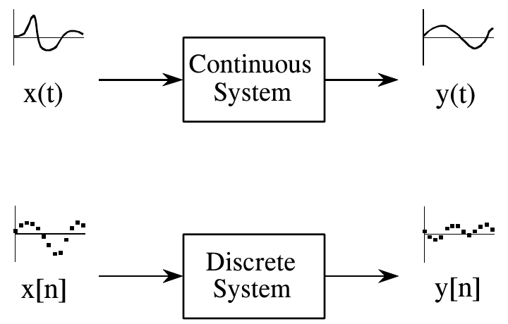

**图 5-1　信号与系统的术语。** 系统是任何根据输入信号生成输出信号的过程。连续信号通常用圆括号表示，离散信号用方括号表示。所有信号都用小写字母，大写字母留给频域（后面的章节介绍）。除非有更好的名字，输入信号叫 x(t) 或 x[n]，输出信号叫 y(t) 或 y[n]。
（Continuous System = 连续系统，Discrete System = 离散系统。）

讨论信号和系统时，常常并不知道所代表的具体参数是什么。这就像代数里用 x 和 y，而不赋予变量物理含义。由此引出给信号命名的第四条规则：如果没有更具描述性的名字，离散系统的输入信号通常叫 x[n]，输出信号叫 y[n]；连续系统则用 x(t) 和 y(t)。

想要理解一个系统的理由有很多。例如，你可能想设计一个系统来去除心电图中的噪声、让失焦的图像变清晰，或者去除录音中的回声。在另一些情况下，系统可能有某种失真或干扰效应，你需要刻画或测量它。例如，你对着电话说话时，期望对方听到的东西像你的声音。可惜传输线的输入信号很少和输出信号完全相同。如果你知道传输线（系统）是怎样改变信号的，也许就能补偿它的影响。还有一些情况，系统可能代表你想研究或分析的某个物理过程。雷达和声呐就是很好的例子。这些方法通过比较发射信号和反射信号，找出远处物体的特性。用系统理论的话说，问题就是找出那个把发射信号变成接收信号的系统。

乍一看，要理解世界上所有可能的系统，似乎是一项不可能完成的任务。幸运的是，大多数有用的系统都属于一个叫线性系统的类别。这个事实极其重要。没有线性系统的概念，我们将不得不逐个考察许多互不相关的系统各自的特性。有了这个概念，我们就能把注意力放在线性系统这一整类的共同特点上。我们的第一个任务，是弄清哪些性质使一个系统成为线性的，以及这些性质怎样对应到电子电路、软件和其他信号处理系统的日常概念上。

## 线性的条件

如果一个系统具有两个数学性质，就称它是线性的：齐次性(homogeneity)和可加性(additivity)。如果你能证明一个系统同时具有这两个性质，就证明了它是线性的。同样，如果你能证明一个系统不具有其中一个或两个性质，就证明了它不是线性的。第三个性质——平移不变性(shift invariance)——不是线性的严格要求，但对大多数 DSP 技术来说是必不可少的。在 DSP 中看到「线性系统」这个词时，除非有理由认为不是，否则你应该假定它包含平移不变性。这三个性质构成了定义和使用线性系统理论的数学基础。本章后面我们会看一些更直观的理解线性的方式。现在先来过一遍这些正式的数学性质。

如图 5-2 所示，齐次性的意思是：输入信号幅度的变化，会导致输出信号幅度相应的变化。用数学语言说，如果输入信号 x[n] 产生输出信号 y[n]，那么对于任何输入信号和任何常数 k，输入 k x[n] 都会产生输出 k y[n]。

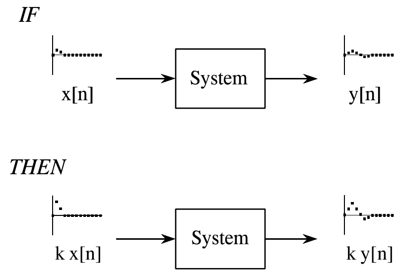

**图 5-2　齐次性的定义。** 如果输入的幅度变化在输出中引起相同的幅度变化，就称系统是齐次的。也就是说，如果 x[n] 产生 y[n]，那么对于任何信号 x[n] 和任何常数 k，k x[n] 都产生 k y[n]。
（IF = 如果，THEN = 那么，System = 系统。）

一个简单的电阻就能很好地说明齐次和非齐次系统。如果系统的输入是电阻两端的电压 v(t)，输出是流过电阻的电流 i(t)，这个系统就是齐次的。欧姆定律(Ohm's law)保证了这一点：电压增大或减小，电流就会相应地增大或减小。现在考虑另一个系统，输入信号仍是电阻两端的电压 v(t)，输出信号却是电阻消耗的功率 p(t)。由于功率与电压的平方成正比，输入信号增大到两倍，输出信号就增大到四倍。这个系统不是齐次的，因此不可能是线性的。

图 5-3 说明了可加性。考虑一个系统，输入 $x_1[n]$ 产生输出 $y_1[n]$。再假设另一个输入 $x_2[n]$ 产生另一个输出 $y_2[n]$。如果对于所有可能的输入信号，输入 $x_1[n] + x_2[n]$ 都产生输出 $y_1[n] + y_2[n]$，就称这个系统是可加的。用文字说，在输入端相加的信号，在输出端产生的也是相加的信号。

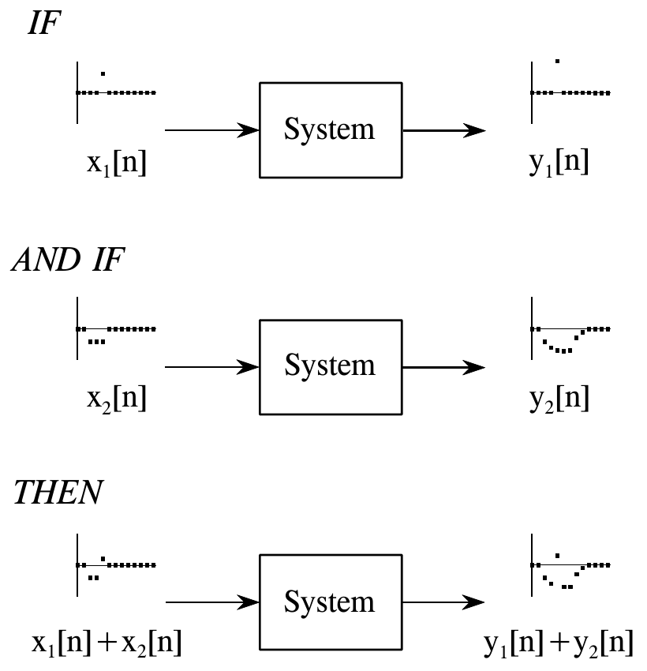

**图 5-3　可加性的定义。** 如果相加的信号通过系统时互不影响，就称系统是可加的。正式地说，如果 $x_1[n]$ 产生 $y_1[n]$，并且 $x_2[n]$ 产生 $y_2[n]$，那么 $x_1[n]+x_2[n]$ 产生 $y_1[n]+y_2[n]$。
（IF = 如果，AND IF = 并且如果，THEN = 那么。原书图注最后一句误写成 $y_2[n]+y_2[n]$，这里按图改正。）

重点在于：相加的信号通过系统时互不影响。举个例子，想想和你的埃德娜姨妈、伯尼姨父打电话。埃德娜姨妈开始讲一个相当冗长的故事，说她今年的萝卜长得多好。背景里，伯尼姨父正冲着狗大吼，因为它在他最喜欢的椅子上闯了祸。两个人的声音信号相加后，通过电话网络以电子方式传输。由于这个系统是可加的，你听到的声音就是两个声音各自单独传输时听起来的样子之和。你听到的是埃德娜和伯尼，而不是一个叫「埃德娜伯尼」的怪物。

一个不可加电路的好例子，是无线电发射机中的混频级(mixer stage)。这里有两个信号：一个是包含语音或音乐的音频信号，另一个是加到天线上就能在空间传播的载波(carrier wave)。两个信号相加后送入一个非线性器件，比如 pn 结二极管。这使两个信号融合成第三个信号——一个能把信息传到很远的已调制无线电波。

如图 5-4 所示，平移不变性的意思是：输入信号的平移，只会导致输出信号同样的平移，别无其他。更正式地说，如果输入信号 x[n] 产生输出 y[n]，那么对于任何输入信号和任何常数 s，输入信号 x[n+s] 都产生输出 y[n+s]。要特别留意这个平移的数学写法，后面的章节会用到。给自变量 n 加上常数 s，就能让波形在水平方向上提前或延后。例如，s = 2 时，信号向左移两个采样；s = −2 时，信号向右移两个采样。

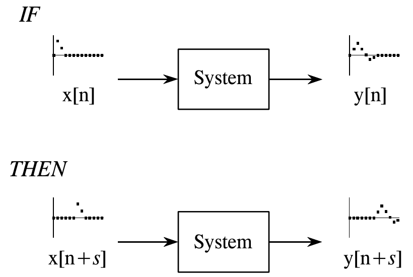

**图 5-4　平移不变性的定义。** 如果输入信号的平移在输出信号中引起相同的平移，就称系统是平移不变的。用数学语言说，如果 x[n] 产生 y[n]，那么对于任何信号 x[n] 和任何常数 s，x[n+s] 都产生 y[n+s]。

平移不变性很重要，因为它意味着系统的特性不随时间（或者不管自变量是什么）而变化。如果输入中的一个「哔」引起输出中的一个「啵」，你就可以确信，另一个「哔」会引起一个一模一样的「啵」。你遇到的大多数系统都是平移不变的。这是件幸事，因为运行中特性会变化的系统很难对付。例如，设想你设计了一个数字滤波器，用来补偿电话传输线的劣化效应。你的滤波器让声音听起来更自然、更容易听懂。让你大吃一惊的是，冬天来了，你发现电话线的特性随温度变了。你的补偿滤波器现在不匹配了，效果也不太好。这种情况可能需要一个更复杂的、能适应条件变化的算法。

为什么齐次性和可加性在线性中起关键作用，而平移不变性只是个附带的东西？这是因为线性是一个非常宽泛的概念，涵盖的远不止信号和系统。例如，设想一个农民卖橙子每箱 2 美元，卖苹果每箱 5 美元。如果他只卖橙子，10 箱收入 20 美元，20 箱收入 40 美元，这样的交易是齐次的。如果他卖 20 箱橙子和 10 箱苹果，收入是 $20 \times \$2 + 10 \times \$5 = \$90$。这和两样东西分开卖的收入相同，这样的交易是可加的。既齐次又可加，这种商品买卖就是一个线性过程。然而，这里不涉及信号，所以它不是一个系统，平移不变性也就没有意义。可以把平移不变性看作涉及信号和系统时，线性所需的一个附加方面。

## 静态线性与正弦保真性

齐次性、可加性和平移不变性很重要，因为它们为定义线性系统提供了数学基础。可惜单靠这些性质，大多数科学家和工程师并不能直观地感受到线性系统是怎么回事。静态线性(static linearity)和正弦保真性(sinusoidal fidelity)这两个性质在这里常常很有帮助。从数学角度看，它们并不特别重要，但它们关系到人们怎样思考和理解线性系统。你应该特别留意这一节。

静态线性定义的是：信号不变化时，即信号是直流或静态时，线性系统的反应。线性系统的静态响应非常简单：输出等于输入乘以一个常数。也就是说，把可能的输入值对应的输出值画成图，是一条通过原点的直线。图 5-5 展示了两个常见的线性系统：电阻的欧姆定律和弹簧的胡克定律(Hooke's law)。作为对比，图 5-6 展示了两个非线性系统的静态关系：pn 结二极管和铁的磁特性。

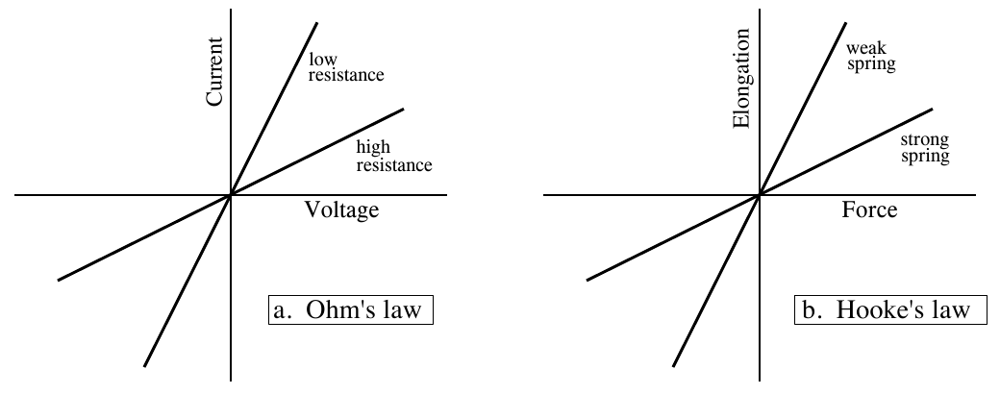

**图 5-5　静态线性的两个例子。** (a) 欧姆定律：流过电阻的电流等于电阻两端的电压除以电阻。(b) 胡克定律：弹簧的伸长量等于所施加的力乘以弹簧的刚度系数。
（a：Voltage = 电压，Current = 电流，low/high resistance = 小/大电阻；b：Force = 力，Elongation = 伸长量，weak/strong spring = 软/硬弹簧。）

所有线性系统都具有静态线性。反过来通常也成立，但并不总是成立。有些系统表现出静态线性，但对于变化的信号却不是线性的。不过，有一类非常常见的系统，单靠静态线性就能完全理解。在这类系统中，输入信号是静态的还是变化的都无所谓。它们叫无记忆系统(memoryless systems)，因为输出只取决于输入的当前状态，而与输入的历史无关。例如，电阻中的瞬时电流只取决于它两端的瞬时电压，而与信号是怎样变成现在这个值的无关。如果一个系统具有静态线性，并且是无记忆的，那么它一定是线性的。这为理解（和证明）这些简单系统的线性提供了一个重要途径。

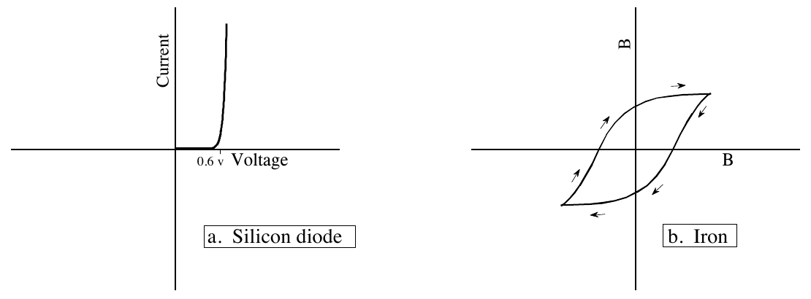

**图 5-6　直流非线性的两个例子。** (a) 硅二极管的电压与电流之间是指数关系。(b) 铁中磁场强度 H 与磁通密度 B 之间的关系取决于样品的历史，这种行为叫磁滞(hysteresis)。
（a. Silicon diode = 硅二极管，0.6 v 处电流开始迅速上升；b. Iron = 铁。）

线性系统的一个重要特性是它们对正弦波的表现，我们把这个性质叫做正弦保真性：如果线性系统的输入是正弦波，输出也会是正弦波，而且频率和输入完全相同。正弦波是唯一具有这个性质的波形。例如，没有理由指望一个方波进入线性系统后，输出还是方波。虽然输入是正弦波保证了输出是正弦波，但两者的幅度和相位可能不同。这从你的电子学知识来看应该很熟悉：一个电路可以用它的频率响应来描述，即电路的增益和相位怎样随频率变化的曲线。

现在问反过来的问题：如果一个系统对正弦输入总是产生正弦输出，能保证这个系统是线性的吗？答案是否定的，但例外很少，而且通常很明显。例如，设想系统里藏着一个邪恶的小鬼，目的是误导你。小鬼有一台示波器观察输入信号，还有一台正弦波发生器产生输出信号。当你输入一个正弦波时，小鬼迅速测出频率，调节信号发生器产生相应的输出。当然，这个系统不是线性的，因为它不可加。要证明这一点，往系统里输入两个正弦波之和，小鬼只能用单个正弦波作为输出来回应。这个例子并不像你想的那么牵强，锁相环(phase lock loops)的工作方式就大致如此。

为了更好地感受线性，设想一位技术员要判断某个电子设备是否线性。技术员会把正弦波发生器接到设备的输入端，把示波器接到输出端。输入正弦波后，技术员会看输出是不是也是正弦波。例如，输出的顶部或底部不能被削平，上半部分不能和下半部分长得不一样，信号过零的地方不能有失真，等等。接着，技术员会改变输入的幅度，观察对输出信号的影响。如果系统是线性的，输出的幅度必须跟随输入的幅度。最后，技术员会改变输入信号的频率，验证输出信号的频率随之改变。改变频率时，输出很可能会出现幅度和相位的变化，但这在线性系统中是完全允许的。在某些频率上，输出甚至可能为零，即幅度为零的正弦波。如果技术员看到了所有这些，他就会断定这个系统是线性的。这个结论虽然不是严格的数学证明，但有理由高度相信它。

## 线性与非线性系统的例子

表 5-1 给出了常见的线性系统和非线性系统的例子。看这些清单时，请同时记住数学家眼中的线性（齐次性、可加性和平移不变性），以及大多数科学家和工程师使用的非正式方式（静态线性和正弦保真性）。

**表 5-1　线性系统和非线性系统的例子。** 正式地说，线性系统由齐次性、可加性和平移不变性定义。非正式地说，大多数科学家和工程师用静态线性和正弦保真性来理解线性系统。

**线性系统的例子**

- 波的传播，比如声波和电磁波
- 由电阻、电容和电感组成的电路
- 电子电路，比如放大器和滤波器
- 质量块、弹簧和阻尼器(dashpot)相互作用产生的机械运动
- 由微分方程描述的系统，比如电阻-电容-电感网络
- 乘以一个常数，即对信号放大或衰减
- 信号的变化，比如回声、共振和图像模糊
- 单位系统：输出总是等于输入
- 零系统：无论输入是什么，输出总是等于零
- 微分和积分，以及离散信号中与之对应的一阶差分(first difference)和累加和(running sum)
- 原本非线性的系统中的小扰动，比如一个偏置得当的晶体管放大的小信号
- 卷积(convolution)：一种数学运算，输出中的每个值都表示为输入中各值乘以一组加权系数后的和
- 递归(recursion)：一种类似卷积的技术，只是除了输入中的值，还用到输出中之前已算出的值

**非线性系统的例子**

- 不具有静态线性的系统，比如电阻中的电压与功率：$P = V^2/R$；炽热物体的辐射能量随温度变化：$R = kT^4$；透过一定厚度半透明材料的光强：$I = e^{-\alpha T}$，等等
- 不具有正弦保真性的系统，比如这些功能的电子电路：峰值检测、平方、正弦波转方波、倍频等
- 常见的电子失真，比如削波(clipping)、交越失真(crossover distortion)和压摆失真(slewing)
- 一个信号乘以另一个信号，比如幅度调制和自动增益控制
- 磁滞现象，比如铁中磁通密度与磁场强度的关系，或硫化橡胶中机械应力与应变的关系
- 饱和，比如被过度驱动的电子放大器和变压器
- 有阈值的系统，比如数字逻辑门，或者强到能把中间岩层震碎的地震振动

（原表把电阻功率写成 $P = V^2R$，按物理关系应为 $P = V^2/R$，这里改正。）

## 线性的特殊性质

线性具有可交换性(commutative)，这是一个涉及两个或更多系统组合的性质。图 5-7 展示了基本思想。设想两个系统级联(cascade)在一起，即一个系统的输出是下一个系统的输入。如果每个系统都是线性的，那么整个组合也是线性的。可交换性指出：级联中系统的顺序可以重新排列，而不影响整个组合的特性。你在电子电路中可能用过这个原理。例如，设想一个由两级组成的电路，一级做放大，一级做滤波。先放大再滤波好，还是先滤波再放大好？如果两级都是线性的，顺序就没有任何影响，总的结果是一样的。要记住，实际的电子电路有非线性效应，可能使顺序变得重要，比如：干扰、直流偏移、内部噪声、压摆率失真等。

（原书正文这里写的是「图 5-10」，按内容应为图 5-7。）

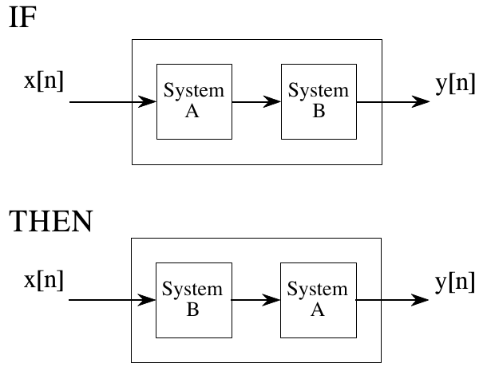

**图 5-7　线性系统的可交换性。** 两个或更多线性系统级联时，系统的顺序不影响整个组合的特性。
（IF = 如果，THEN = 那么，System A / System B = 系统 A / 系统 B。）

图 5-8 展示了线性系统理论的下一步：多输入和多输出。一个具有多个输入和/或多个输出的系统，如果由线性子系统和信号相加组成，它就是线性的。复杂程度无关紧要，只要系统内部不允许有任何非线性的东西。

为了理解线性对于多输入和/或多输出系统意味着什么，考虑下面这个思想实验。先在一个输入端加上一个信号，同时把其他输入端保持为零。这会使多个输出端以某种信号模式作出响应。接着，在另一个输入端加上另一个信号，重复这个过程。和前面一样，其他所有输入端都保持为零。第二个输入信号会使多个输出端出现另一种信号模式。最后，把两个信号同时加到各自的输入端。这时输出端出现的信号，就是两个输入信号分别单独施加时所产生的输出信号的叠加（和）。

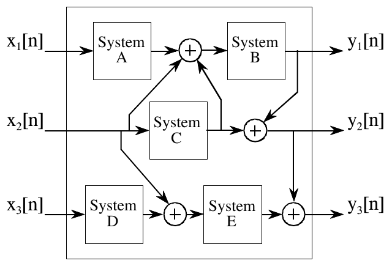

**图 5-8　任何具有多个输入和/或多个输出的系统，只要由线性系统和信号相加组成，就是线性的。**
（System A～E = 系统 A～E。）

线性系统中乘法的使用常常被误解。这是因为乘法可能是线性的，也可能是非线性的，取决于信号乘的是什么。图 5-9 说明了这两种情况。把输入信号乘以一个常数的系统是线性的。这个系统是放大器还是衰减器，取决于常数大于 1 还是小于 1。相反，把一个信号乘以另一个信号是非线性的。设想一个正弦波乘以另一个不同频率的正弦波，得到的波形显然不是正弦波。

另一个常被误解的情况，与电子电路中附加的寄生信号有关，比如直流偏移和热噪声。加入这些外来信号是线性的还是非线性的？答案取决于把这些污染信号看作从哪里来。如果把它们看作来自系统内部，这个过程就是非线性的，因为正弦输入产生的不是纯正弦输出。反过来，也可以把外来信号看作从多输入系统的一个单独输入端从外部进入系统。这样过程就是线性的，因为系统内部只需要做信号相加。

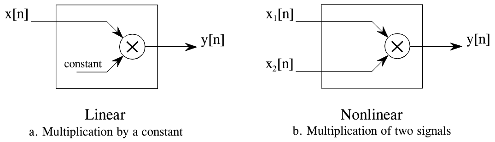

**图 5-9　乘法的线性。** 把信号乘以常数是线性运算。相反，两个信号相乘是非线性的。
（a. 乘以常数(Multiplication by a constant)，Linear = 线性；b. 两个信号相乘(Multiplication of two signals)，Nonlinear = 非线性。constant = 常数。）

## 叠加：DSP 的基石

处理线性系统时，信号唯一的组合方式是先缩放（把信号乘以常数）再相加。例如，一个信号不能乘以另一个信号。图 5-10 展示了一个例子：三个信号 $x_0[n]$、$x_1[n]$ 和 $x_2[n]$ 相加，形成第四个信号 x[n]。这种通过缩放和相加组合信号的过程叫合成(synthesis)。

分解(decomposition)是合成的逆运算：把一个信号拆成两个或更多个相加的分量。这比合成复杂，因为任何给定的信号都有无穷多种可能的分解。例如，15 和 25 两个数只能合成（相加）为 40。相比之下，40 可以分解为 1 + 39，或 2 + 38，或 −30.5 + 60 + 10.5，等等。

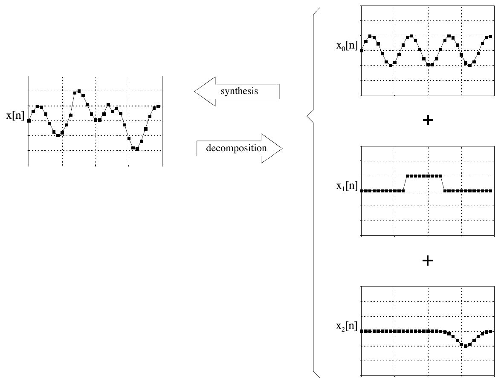

**图 5-10　信号的合成与分解示意。** 合成是把两个或更多信号相加，形成另一个信号。分解是相反的过程，把一个信号拆成两个或更多个相加的分量信号。
（synthesis = 合成，decomposition = 分解。）

现在我们来到了 DSP 的核心：叠加，理解怎样分析信号和系统的总体策略。考虑一个叫 x[n] 的输入信号通过一个线性系统，得到输出信号 y[n]。如图 5-11 所示，输入信号可以分解成一组更简单的信号：$x_0[n]$、$x_1[n]$、$x_2[n]$ 等。我们把它们叫做输入信号分量。接着，让每个输入信号分量单独通过系统，得到一组输出信号分量：$y_0[n]$、$y_1[n]$、$y_2[n]$ 等。然后把这些输出信号分量合成为输出信号 y[n]。

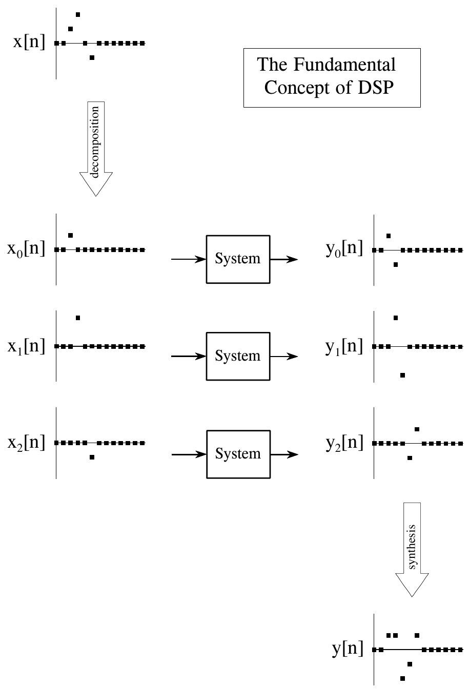

**图 5-11　DSP 的基本概念。** 任何信号，比如 x[n]，都可以分解成一组相加的分量，这里是信号 $x_0[n]$、$x_1[n]$ 和 $x_2[n]$。让这些分量通过线性系统，产生信号 $y_0[n]$、$y_1[n]$ 和 $y_2[n]$。把这些输出信号合成（相加），就得到 y[n]，它和 x[n] 直接通过系统所产生的信号相同。
（The Fundamental Concept of DSP = DSP 的基本概念，decomposition = 分解，System = 系统，synthesis = 合成。原书图注把分量写成 $x_1$～$x_3$、$y_1$～$y_3$，与图中的下标 0～2 不一致，这里按图改正。）

重要的是：用这种方法得到的输出信号，和让输入信号直接通过系统所产生的输出信号完全相同。这是一个非常强大的思想。我们不必去弄懂复杂的信号会被系统怎样改变，只需要知道简单的信号会被怎样改变。用信号处理的行话说，输入和输出信号都被看作更简单波形的叠加（和）。这是几乎所有信号处理技术的基础。

举一个用叠加的简单例子：心算 2041 乘以 4。你是怎么算的？你可能想象脑海中漂浮着 2041 根火柴，把这幅画面变成四份，然后开始数。更可能的是，你用叠加简化了问题：2041 可以分解为 2000 + 40 + 1，把每个分量乘以 4 再合成，就得到最终答案，即 8000 + 160 + 4 = 8164。

## 常见的分解方式

记住，这个方法的目标是用几个简单的问题取代一个复杂的问题。如果分解没有在某种程度上简化情况，那就什么也没得到。信号处理中分解信号的主要方式有两种：冲激分解(impulse decomposition)和傅里叶分解(Fourier decomposition)。后面几章会详细介绍。此外，偶尔也会用到几种次要的分解。下面简要介绍两种主要的分解，以及三种次要的分解。

### 冲激分解

如图 5-12 所示，冲激分解把一个 N 个采样的信号拆成 N 个分量信号，每个分量信号也有 N 个采样。每个分量信号包含原始信号中的一个点，其余的值都为零。一串零中只有一个非零点，这叫冲激(impulse)。冲激分解很重要，因为它让我们可以一次考察信号的一个采样。同样，系统也用它对冲激的响应来刻画。只要知道系统怎样响应一个冲激，就能算出系统对任何给定输入的输出。这种方法叫卷积，是接下来两章的主题。

### 阶跃分解

图 5-13 所示的阶跃分解(step decomposition)，也是把一个 N 个采样的信号拆成 N 个分量信号，每个由 N 个采样组成。每个分量信号是一个阶跃(step)，即前面的采样值为零，后面的采样是某个常数值。考虑把一个 N 点信号 x[n] 分解成分量 $x_0[n], x_1[n], x_2[n], \ldots, x_{N-1}[n]$。第 k 个分量信号 $x_k[n]$ 在第 0 到 k−1 点为零，其余各点的值为 $x[k] - x[k-1]$。例如，第 5 个分量信号 $x_5[n]$ 在第 0 到 4 点为零，其余采样的值为 $x[5] - x[4]$（原始信号第 4 和第 5 个采样之差）。作为特例，$x_0[n]$ 的所有采样都等于 x[0]。正如冲激分解一次看信号的一个点，阶跃分解用相邻采样之间的差来刻画信号。同样，系统也用它对输入信号变化的响应来刻画。

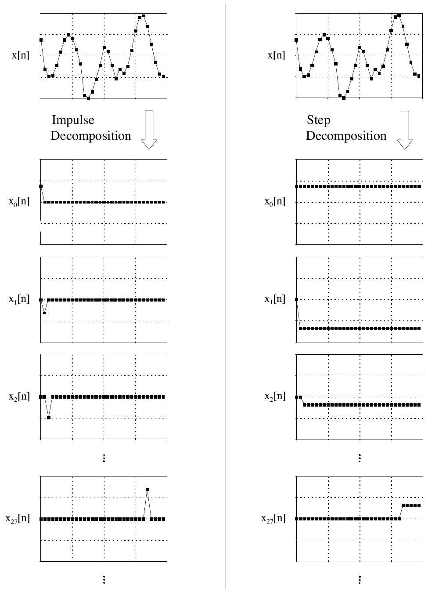

**图 5-12（左栏）　冲激分解的例子。** 一个 N 点信号被拆成 N 个分量，每个分量只有一个非零点。

**图 5-13（右栏）　阶跃分解的例子。** 一个 N 点信号被拆成 N 个信号，每个都是一个阶跃函数。
（Impulse Decomposition = 冲激分解，Step Decomposition = 阶跃分解。两栏都只画出了 $x_0$、$x_1$、$x_2$ 和 $x_{27}$ 几个分量作示意。）

### 偶/奇分解

图 5-14 所示的偶/奇分解(even/odd decomposition)，把一个信号拆成两个分量信号，一个具有偶对称性(even symmetry)，另一个具有奇对称性(odd symmetry)。如果一个 N 点信号以第 N/2 点为中心左右镜像对称，就称它具有偶对称性。也就是说，采样 x[N/2+1] 必须等于 x[N/2−1]，x[N/2+2] 必须等于 x[N/2−2]，依此类推。类似地，如果对应点的幅值相等而符号相反，就是奇对称性，比如 x[N/2+1] = −x[N/2−1]，x[N/2+2] = −x[N/2−2]，等等。这些定义假定信号由偶数个采样组成，索引从 0 到 N−1。分解按下面的关系计算：

**公式 5-1　偶/奇分解的公式。** 这两个公式把信号 x[n] 分成偶部 $x_E[n]$ 和奇部 $x_O[n]$。由于这种分解基于循环对称性，偶信号和奇信号的第 0 个采样这样计算：$x_E[0] = x[0]$，$x_O[0] = 0$。所有信号都长 N 个采样，索引从 0 到 N−1。

$$
x_E[n] = \frac{x[n] + x[N-n]}{2}, \qquad x_O[n] = \frac{x[n] - x[N-n]}{2}
$$

这对左右对称的定义可能显得很奇怪，因为信号真正的中心是 N/2 − ½（在两个采样之间），而不是 N/2。同样，这种偏离中心的对称意味着第 0 个采样需要特殊处理。这是怎么回事？

这种分解是 DSP 中一个叫循环对称性(circular symmetry)的重要概念的一部分。它把信号的末尾看作和信号的开头连在一起。正如 x[4] 挨着 x[5]，x[N−1] 也挨着 x[0]。想象一条咬住自己尾巴的蛇。用这种循环的方式看偶信号和奇信号时，实际上有两条对称轴，一条在 x[N/2]，另一条在 x[0]。例如，在偶信号中，绕 x[0] 的对称意味着 x[1] 等于 x[N−1]，x[2] 等于 x[N−2]，依此类推。在奇信号中，第 0 点和第 N/2 点的值总是零。在偶信号中，第 0 点和第 N/2 点等于原始信号中的对应点。

为什么要把信号的最后一个采样看作挨着第一个采样？常规的数据采集中没有任何东西支持这种循环的观念。事实上，第一个和最后一个采样之间的共同点，一般比序列中任何其他两点都少。这是常识！这个谜题缺失的一块，是一种叫傅里叶分析(Fourier analysis)的 DSP 技术。傅里叶分析的数学本质上就把信号看作循环的，尽管就数据的来源而言，这通常没有物理意义。我们会在第 10 章更详细地讨论这一点。现在需要理解的重点是：公式 5-1 给出的是一个有效的分解，原因很简单：偶部和奇部相加就能重建原始信号。

### 交错分解

如图 5-15 所示，交错分解(interlaced decomposition)把信号拆成两个分量信号：偶数采样信号和奇数采样信号（不要和偶对称、奇对称信号混淆）。求偶数采样信号：从原始信号出发，把所有奇数号采样设为零。求奇数采样信号：从原始信号出发，把所有偶数号采样设为零。就这么简单。

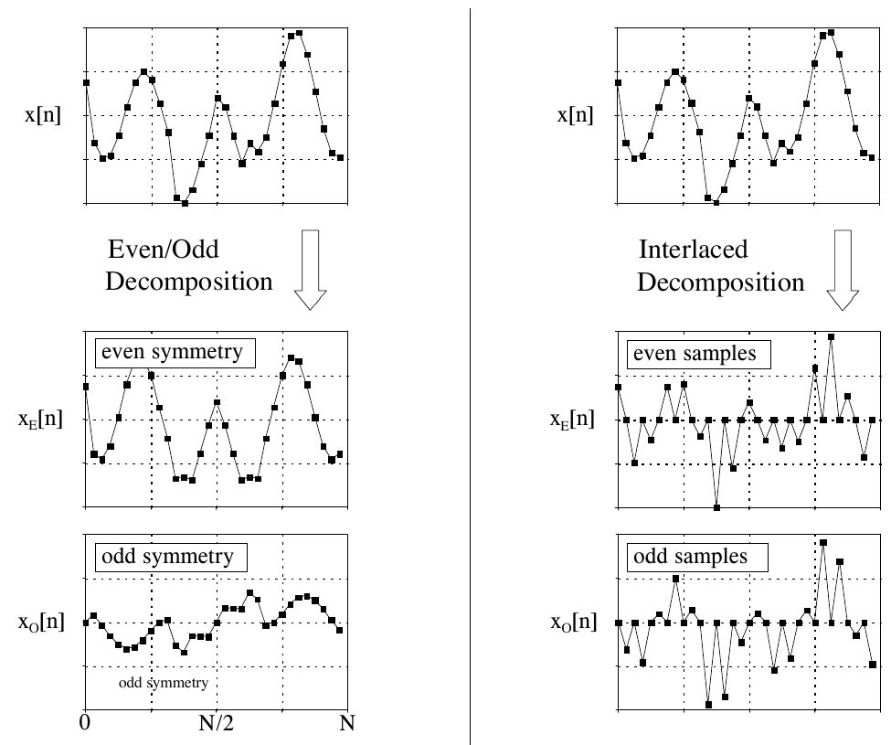

**图 5-14（左栏）　偶/奇分解的例子。** 一个 N 点信号被拆成两个 N 点信号，一个具有偶对称性，另一个具有奇对称性。

**图 5-15（右栏）　交错分解的例子。** 一个 N 点信号被拆成两个 N 点信号，一个把奇数号采样设为零，另一个把偶数号采样设为零。
（Even/Odd Decomposition = 偶/奇分解，even symmetry = 偶对称，odd symmetry = 奇对称；Interlaced Decomposition = 交错分解，even samples = 偶数号采样，odd samples = 奇数号采样。）

乍一看，这种分解可能显得微不足道、毫无趣味。讽刺的是，交错分解正是 DSP 中一个极其重要的算法——快速傅里叶变换(FFT, Fast Fourier Transform)——的基础。计算傅里叶分解的方法已经为人所知几百年了。可惜它慢得让人抓狂，在今天的计算机上常常要运行几分钟甚至几小时。FFT 是 20 世纪 60 年代发展起来的一族算法，用来缩短这个计算时间。它的策略是 DSP 的一个绝妙范例：反复使用交错变换，把信号化简成基本分量；计算各个分量的傅里叶分解；再把结果合成为最终答案。效果非常惊人，速度提高几百倍甚至几千倍是常事。

### 傅里叶分解

傅里叶分解非常数学化，一点也不直观。图 5-16 展示了这种技术的一个例子。任何 N 点信号都可以分解成 N+2 个信号，一半是正弦波，一半是余弦波。频率最低的余弦波（图中叫 $x_{C0}[n]$）在 N 个采样上完成零个完整周期，即它是一个直流信号。接下来的余弦分量 $x_{C1}[n]$、$x_{C2}[n]$ 和 $x_{C3}[n]$，在 N 个采样上分别完成 1、2、3 个完整周期。其余的余弦波以及正弦分量都遵循这个模式。由于每个分量的频率是固定的，对不同的信号做分解时，唯一变化的是每个正弦波和余弦波的幅度。

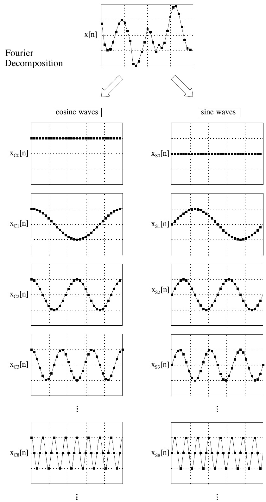

**图 5-16　傅里叶分解示意。** 一个 N 点信号被分解成 N+2 个信号，每个有 N 个点。其中一半是余弦波，一半是正弦波。这些正弦波的频率是固定的，只有幅度可以变化。
（Fourier Decomposition = 傅里叶分解，cosine waves = 余弦波，sine waves = 正弦波。图中只画出了下标 0～3 和 8 的分量作示意。）

傅里叶分解之所以重要，有三个原因。第一，很多信号本来就是由叠加的正弦波产生的，音频信号就是一个很好的例子。傅里叶分解能直接分析这类信号中包含的信息。第二，线性系统对正弦波的响应方式很独特：正弦输入总是产生正弦输出。用这种方法，系统由它怎样改变通过它的正弦波的幅度和相位来刻画。由于输入信号可以分解成正弦波，只要知道系统对正弦波的反应，就能求出系统的输出。第三，傅里叶分解是一个广阔而强大的数学领域——傅里叶分析——的基础，也是更高级的拉普拉斯变换和 z 变换的基础。大多数最前沿的 DSP 算法都基于这些技术的某个方面。

为什么能把任意信号分解成正弦波和余弦波？对于一个具体的信号，这些正弦波的幅度怎样确定？用这种技术能设计出什么样的系统？这些问题要在后面的章节中回答。傅里叶分解的细节太复杂，没法在这个简短的概述中介绍。现在需要理解的重要思想是：把所有正弦分量加在一起，就能精确地重建原始信号。第 8 章会讲得更多。

## 线性之外的替代方案

要体会线性系统的重要性，想想看：分析非线性系统只有一种主要策略，那就是让非线性系统近似成线性系统。常用的做法有三种：

**第一，忽略非线性。** 如果非线性足够小，系统就可以近似为线性的。最初这个假设带来的误差，就当作噪声容忍，或者干脆忽略。

**第二，让信号保持很小。** 许多非线性系统在信号幅度很小时看起来是线性的。例如，晶体管在整个工作范围内非常非线性，但只要信号保持在几毫伏以下，就能提供准确的线性放大。运算放大器把这个思路发挥到了极致：利用非常高的开环增益加上负反馈，运放的输入信号（即反相输入端与同相输入端之间的差）只保持在几微伏。这微乎其微的输入信号，让一个原本非线性得可怕的电路表现出优异的线性。

**第三，施加一个线性化变换。** 例如，考虑两个信号相乘得到第三个信号：$a[n] = b[n] \times c[n]$。对信号取对数，就把乘法这个非线性过程变成了加法这个线性过程：$\log(a[n]) = \log(b[n]) + \log(c[n])$。这种方法有个好听的名字，叫同态信号处理(homomorphic signal processing)。例如，一幅视觉图像可以建模为场景的反射率（一个二维信号）乘以环境光照（另一个二维信号）。同态技术能让光照信号变得更均匀，从而改善图像。

在接下来的几章里，我们考察信号处理的两大主要技术：卷积和傅里叶分析。两者都基于本章介绍的策略：(1) 把信号分解成简单的相加分量；(2) 以某种有用的方式处理这些分量；(3) 把这些分量合成为最终结果。这就是 DSP。
