# 《The Scientist and Engineer's Guide to Digital Signal Processing》第 10 章中译

> 原书：上一级目录 `Documents/数学基础/` 下的 `The Scientist and Engineer Guide to Digital Signal Processing.pdf`，对应 PDF 第 196～219 页（原书第 185～208 页）。
> 上一章：[09-DSP指南-第9章中译.md](09-DSP指南-第9章中译.md)。专业名词第一次出现时在括号里附上英文。
> 插图从原书页面裁出，放在 `assets/ch10/`，图里的英文标注在每张图下方给出对照。原书 PDF 的符号字体抽取时会乱码（π 显示成 B，ω 显示成 T，Ω 显示成 S，φ 显示成 N，θ 显示成 2，Σ 显示成 j，∞ 显示成 4，根号会丢失），公式按原书版面重新用 LaTeX 写出。本章没有 BASIC 程序。

---

# 第 10 章　傅里叶变换的性质

时域和频域是表示信号的两种可以互换的方式。傅里叶变换(Fourier transform)就是这两种表示之间的数学关系。如果信号在一个域里被修改了，它在另一个域里也会随之改变，只是改变的方式通常不一样。例如，上一章说明了：时域信号做卷积，结果是它们的频谱相乘。其他数学运算，比如相加、缩放和平移，在另一个域里也都有对应的运算。这些关系叫做傅里叶变换的性质(properties of the Fourier transform)，讲的是一个域里的数学变化会在另一个域里引起怎样的数学变化。

## 傅里叶变换的线性

傅里叶变换是线性的，也就是说，它具有齐次性(homogeneity)和可加性(additivity)。傅里叶变换家族的全部四个成员（傅里叶变换、傅里叶级数、DFT 和 DTFT）都是如此。

图 10-1 举例说明齐次性是傅里叶变换的一个性质。(a) 是一个任意的时域信号，(b) 是它对应的频谱。我们分别把这两个信号叫做 x[ ] 和 X[ ]。齐次性的意思是：一个域里的幅度变化，会在另一个域里产生同样的幅度变化。这在直觉上应该说得通：时域波形的幅度变了，组成这个波形的正弦波和余弦波的幅度也必然变同样的倍数。

写成数学语言：如果 x[ ] 和 X[ ] 是一对傅里叶变换对(Fourier transform pair)，那么对任意常数 k，k x[ ] 和 k X[ ] 也是一对傅里叶变换对。如果频域用直角坐标表示，k X[ ] 的意思是实部和虚部都乘以 k；如果频域用极坐标表示，k X[ ] 的意思是幅度乘以 k，相位保持不变。

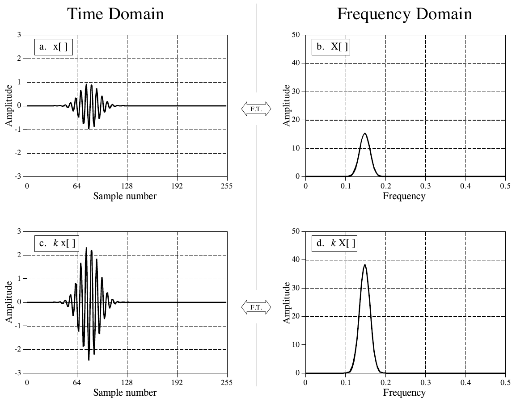

**图 10-1　傅里叶变换的齐次性。** 一个域里的幅度改变多少，另一个域里的幅度也改变同样多。换句话说，一个域里的缩放对应另一个域里的缩放。
（Time Domain = 时域，Frequency Domain = 频域；a. x[ ]，b. X[ ]，c. k x[ ]，d. k X[ ]；中间的 F.T. = 傅里叶变换。Amplitude = 幅度，Sample number = 采样序号，Frequency = 频率。）

傅里叶变换的可加性是指：一个域里的相加对应另一个域里的相加。图 10-2 是一个例子。图中 (a) 和 (b) 是两个时域信号，分别叫 x₁[ ] 和 x₂[ ]。把它们相加，得到第三个时域信号 x₃[ ]，如 (c) 所示。这三个信号每一个的频谱都由实部和虚部组成，见 (d) 到 (i)。由于两个时域信号相加得到第三个时域信号，两个对应的频谱也相加得到第三个频谱。在直角坐标表示下，频谱相加就是实部加实部、虚部加虚部。如果 $x_1[n] + x_2[n] = x_3[n]$，那么 $\mathrm{Re}\,X_1[f] + \mathrm{Re}\,X_2[f] = \mathrm{Re}\,X_3[f]$，并且 $\mathrm{Im}\,X_1[f] + \mathrm{Im}\,X_2[f] = \mathrm{Im}\,X_3[f]$。可以从余弦波和正弦波的角度来想：所有余弦波相加（实部），所有正弦波相加（虚部），两者之间互不干扰。

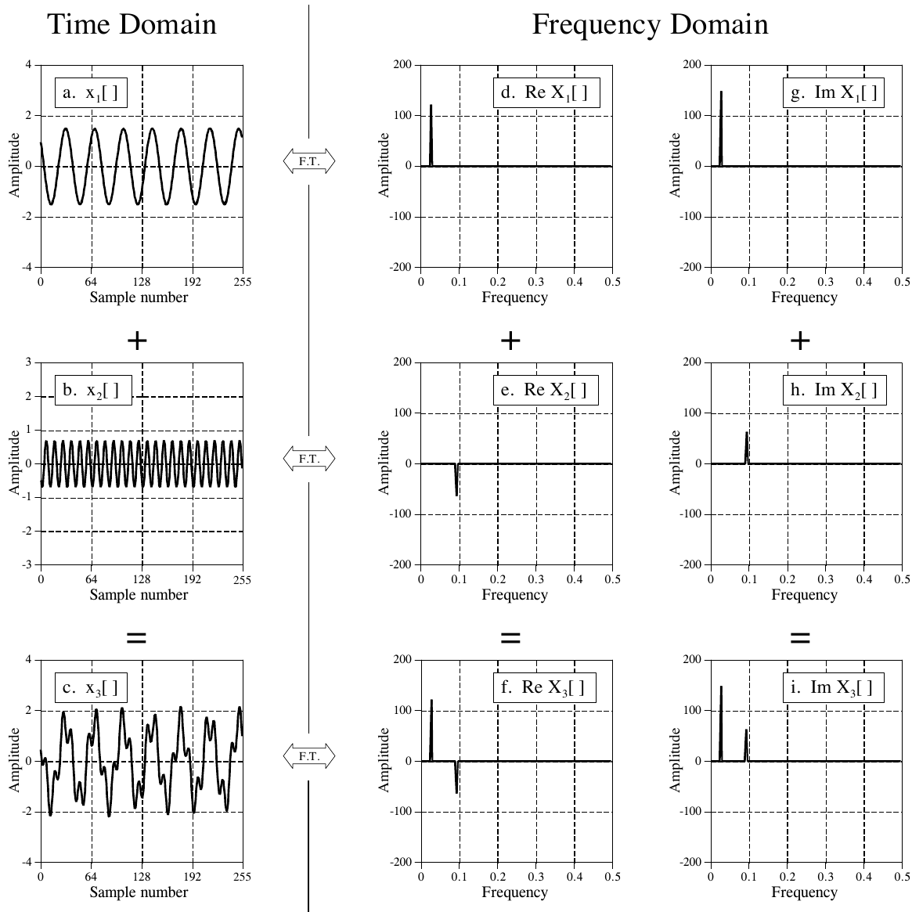

**图 10-2　傅里叶变换的可加性。** 在一个域里把两个或更多信号相加，另一个域里对应的信号也随之相加。本图中，(a) 和 (b) 两个时域信号相加得到 (c)，结果是频谱对应的实部和虚部分别相加。
（Time Domain = 时域，Frequency Domain = 频域；a～c 为 x₁[ ]、x₂[ ]、x₃[ ]，d～f 为三者的实部 Re X[ ]，g～i 为三者的虚部 Im X[ ]。F.T. = 傅里叶变换。Amplitude = 幅度，Sample number = 采样序号，Frequency = 频率。）

极坐标形式的频谱不能直接相加，必须先转成直角坐标，相加后再转回极坐标。这一点也可以从正弦波的行为来理解。设想把两个频率相同、但幅度（A₁ 和 A₂）和相位（φ₁ 和 φ₂）不同的正弦波相加。如果两个相位恰好相同（φ₁ = φ₂），相加时幅度相加（A₁ + A₂）。但如果两个相位恰好相反（φ₁ = −φ₂），相加时幅度相减（A₁ − A₂）。要点是：正弦波（或频谱）处于极坐标形式时，不能简单地把幅度和相位分别相加。

> **译注：** "两个相位恰好相反"严格说应是相差 π（φ₁ = φ₂ ± π），这时两个正弦波反相，幅度才相减；原书写的 φ₁ = −φ₂ 只在 φ₂ = ±π/2 时才成立。这里按原书意思理解即可。

傅里叶变换虽然是线性的，但它不具备平移不变性(shift invariance)。换句话说，时域里的平移并不对应频域里的平移。这是下一节的主题。

## 相位的特性

写成数学语言：如果 $x[n] \leftrightarrow \mathrm{Mag}\,X[f]\ \&\ \mathrm{Phase}\,X[f]$，那么时域平移的结果是：$x[n+s] \leftrightarrow \mathrm{Mag}\,X[f]\ \&\ \mathrm{Phase}\,X[f] + 2\pi s f$（其中 f 用采样率的分数表示，范围是 0 到 0.5）。用文字说，时域平移 s 个采样，幅度不变，但相位加上一个线性项 2πsf。我们来看一个例子。

图 10-3 展示了时域波形向左或向右平移时相位受到的影响。图中没有画幅度，因为它没什么可看的：时域平移不改变幅度。在 (a) 到 (d) 中，波形逐步平移，从峰值位于第 128 个采样，变成峰值位于第 0 个采样。这一组图考虑到了 DFT 把时域看作环形的：波形从右边出去的部分，会从左边重新出现。

图 10-3 中的时域波形关于一条竖轴对称，也就是左右两边互为镜像。第 7 章讲过，具有这种对称性的信号叫线性相位(linear phase)信号，因为它们频谱的相位是一条直线。同样，没有这种左右对称性的信号叫非线性相位(nonlinear phase)信号，它们的相位不是直线。(e) 到 (h) 是 (a) 到 (d) 中各信号的相位。如第 7 章所述，这些相位都已展开(unwrapped)，所以不会出现为了把值保持在 π 到 −π 之间而产生的跳变。

时域波形向右平移时，相位仍是一条直线，但斜率减小；时域向左平移时，斜率增大。这是本节你需要记住的主要性质：时域里的平移，对应相位斜率的改变。

(b) 和 (f) 展示了一个特殊情形：相位完全为零。这发生在时域信号关于第 0 个采样对称的时候。乍一看，(b) 里的这种对称可能不明显，它看起来好像是关于第 256 个采样（即 N/2）对称。记住，DFT 把时域看作环形的，第 0 个采样本来就和第 N−1 个采样连在一起。任何关于第 0 个采样对称的信号，也必然关于第 N/2 个采样对称，反之亦然。如果使用傅里叶变换家族中不把时域看作周期的成员（比如 DTFT），则必须关于第 0 个采样对称才能得到零相位。

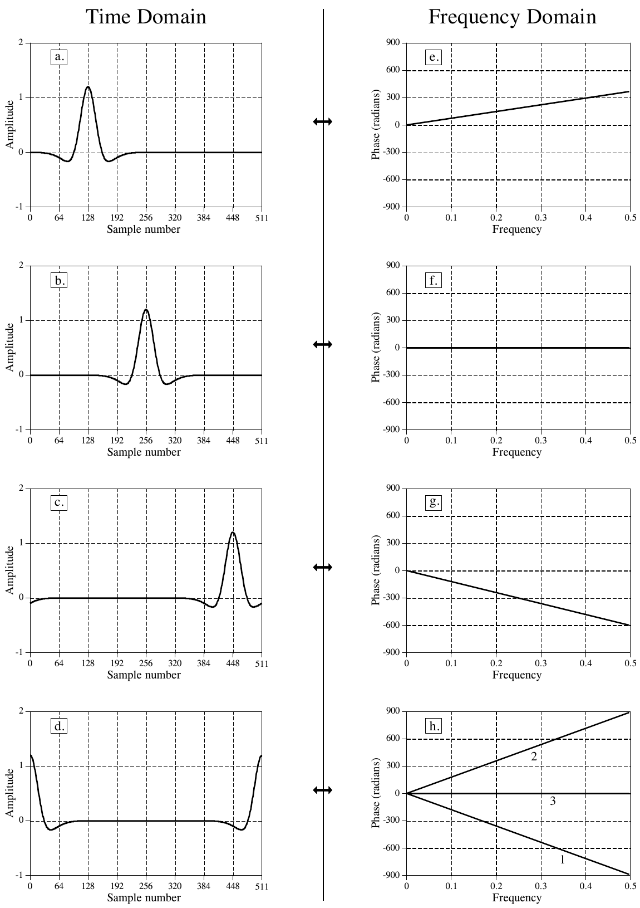

**图 10-3　时域平移引起的相位变化。**
（Time Domain = 时域，Frequency Domain = 频域；左列 a～d 为时域波形，右列 e～h 为对应的相位。(h) 中的 1、2、3 是正文讨论的三条相位线。Amplitude = 幅度，Phase (radians) = 相位（弧度），Sample number = 采样序号，Frequency = 频率。）

(d) 和 (h) 呈现了一个谜题。首先，设想 (d) 是把 (c) 中的波形再往右多移一点得到的。这意味着 (h) 中的相位斜率应该比 (g) 更负一点，如第 1 条线所示。然后，设想 (d) 是从 (a) 开始向左平移得到的。这时相位的斜率应该比 (e) 更正一点，如第 2 条线所示。最后，注意 (d) 关于第 N/2 个采样对称，因此应该是零相位，如第 3 条线所示。这三个相位哪个对？都对，取决于（第 8 章讨论过的）π 和 2π 相位多值性(phase ambiguity)怎样取舍。例如，第 2 条线上的每个采样，与第 1 条线上对应采样都相差 2π 的整数倍，所以两者相等。要把第 3 条线和第 1、2 条线联系起来，还得考虑 π 的多值性。

要理解相位为什么这样变化，设想把一个波形向右平移一个采样。这意味着组成这个波形的所有正弦波也都必须向右平移一个采样。图 10-4 画出了可能组成这个波形的两个正弦波。(a) 中正弦波的频率很低，平移一个采样只是一整个周期中很小的一部分。(b) 中正弦波的频率是采样率的一半，这是采样数据中能存在的最高频率。在这个频率上，平移一个采样相当于整整半个周期，即 π 弧度。也就是说，把平移量用相位变化来表示时，它与被平移的正弦波的频率成正比。

例如，考虑一个关于第 0 个采样对称、因而相位为零的波形。图 10-5a 展示了这个信号向左或向右平移时相位怎样变化。在最高频率（采样率的一半）处，每向左平移一个采样，相位增加 π；每向右平移一个采样，相位减少 π。在零频率处没有相移，中间的所有频率沿一条直线分布。

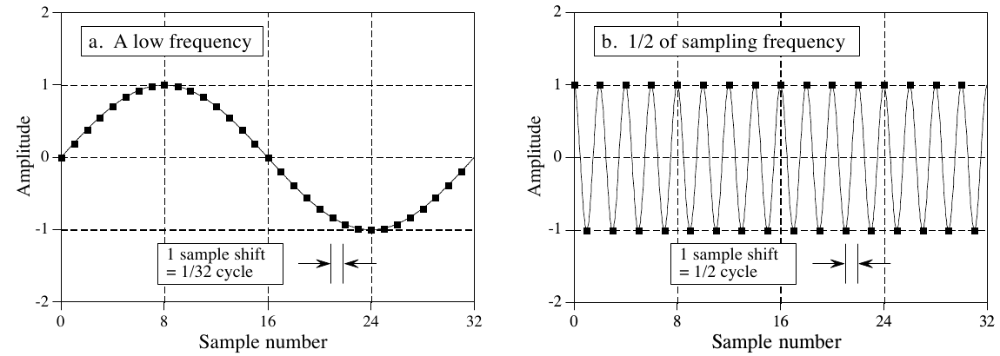

**图 10-4　采样与相位之间的关系。** (a) 和 (b) 分别是低频和高频的正弦波。在 (a) 中，平移一个采样等于 1/32 个周期；在 (b) 中，平移一个采样等于 1/2 个周期。这就是为什么波形平移时，高频处的相位变化比低频处大。
（a. A low frequency = 一个低频；b. 1/2 of sampling frequency = 采样频率的 1/2。图中方框：1 sample shift = 1/32 cycle（或 1/2 cycle）= 平移 1 个采样 = 1/32（或 1/2）个周期。Amplitude = 幅度，Sample number = 采样序号。）

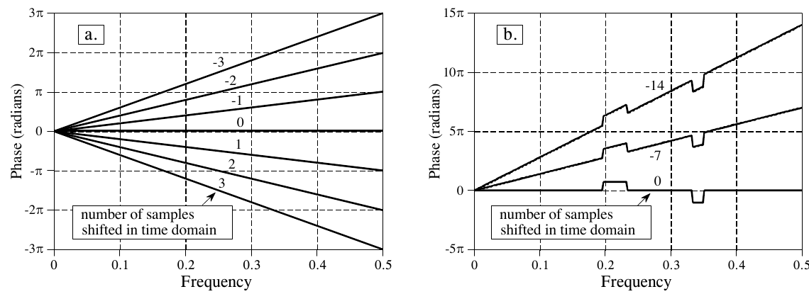

**图 10-5　时域平移产生的相位。** 时域信号每向正方向（即向右）平移一个采样，频率 0.5 处的相位减少 π 弧度；每向负方向（即向左）平移一个采样，频率 0.5 处的相位增加 π 弧度。(a) 展示的是线性相位（一条直线）的情形，(b) 是一个非线性相位的例子。
（各直线旁的数字是时域平移的采样数，方框 number of samples shifted in time domain = 时域中平移的采样数。Phase (radians) = 相位（弧度），Frequency = 频率。）

到目前为止我们用的例子都是线性相位的。图 10-5b 说明非线性相位信号对平移的反应也一样。本例中，非线性相位是一条直线加上两个矩形脉冲。时域平移时，这些非线性特征只是叠加在不断变化的斜率上。

时域波形平移时，实部和虚部会怎样？回想一下，直角坐标表示的频域信号对人来说几乎无法理解。实部和虚部通常看起来像毫无规律的随机振荡。时域信号一平移，实部和虚部那些弯弯曲曲的图案会振荡得更厉害，更难解读。别浪费时间去理解这些信号，或者它们怎样随时域平移而变化。

图 10-6 是一个有趣的演示，说明哪些信息包含在相位里，哪些信息包含在幅度里。(a) 中的波形有两个非常明显的特征：第 55 个采样处的上升沿和第 110 个采样处的下降沿。当信息编码在波形形状里时，边沿非常重要。边沿指明某件事发生的时刻，把它左边的东西和右边的东西分开。这是最纯粹的时域编码信息。演示开始时，先对 (a) 中的信号做 DFT，并把频谱转成极坐标表示。要得到 (b) 中的信号，把相位换成 −π 到 π 之间的随机数，再用逆 DFT 重建时域波形。换句话说，(b) 只基于幅度中包含的信息。同样，(c) 是在使用逆 DFT 之前，把幅度换成很小的随机数得到的。这使得 (c) 的重建只基于相位中包含的信息。

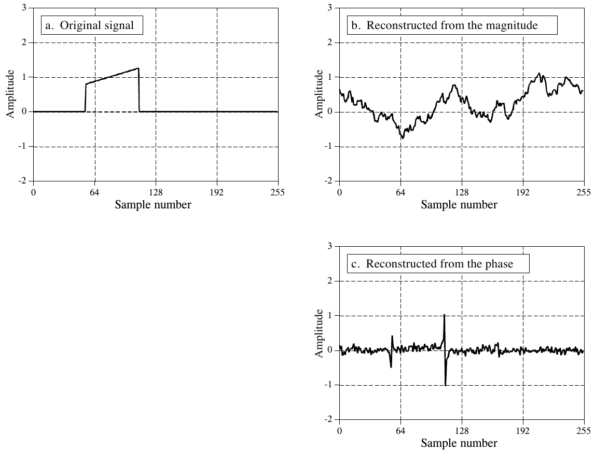

**图 10-6　相位中包含的信息。** (a) 是一个脉冲状的波形。(b) 的做法是：对 (a) 做 DFT，把相位换成随机数，再做逆 DFT。(c) 的做法是：对 (a) 做 DFT，把幅度换成随机数，再做逆 DFT。边沿的位置在 (c) 中保留下来了，在 (b) 中却没有。这说明相位包含了时域信号中事件发生位置的信息。
（a. Original signal = 原信号；b. Reconstructed from the magnitude = 由幅度重建；c. Reconstructed from the phase = 由相位重建。Amplitude = 幅度，Sample number = 采样序号。原书图注排在左下空白处，裁图时已去掉，译文见上。）

结果如何？边沿的位置在 (c) 中清清楚楚，在 (b) 中却完全消失了。这是因为，边沿是许多正弦波在同一位置一起上升形成的，只有当它们的相位相互配合时才可能做到。简而言之，时域波形形状的大部分信息包含在相位中，而不是幅度中。与此形成对比的是信息编码在频域中的信号，比如音频信号。对这类信号，幅度最重要，相位只起次要作用。后面的章节会看到，这种认识为设计滤波器和其他信号处理方法提供了思路。理解信息在信号中是怎样表示的，永远是成功做好 DSP 的第一步。

为什么左右对称对应零（或线性）相位？图 10-7 给出了答案。这样的信号可以分解成左半部分和右半部分，如 (a)、(b)、(c) 所示。位于对称中心（本例中是零点）的采样平均分给左右两半，使两边恰好互为镜像。这两半的幅度完全相同，如 (e) 和 (f) 所示；相位则符号相反，如 (h) 和 (i) 所示。由此得出两个重要概念。第一，每个左右对称的信号都具有线性相位，因为左半部分的非线性相位恰好抵消了右半部分的非线性相位。

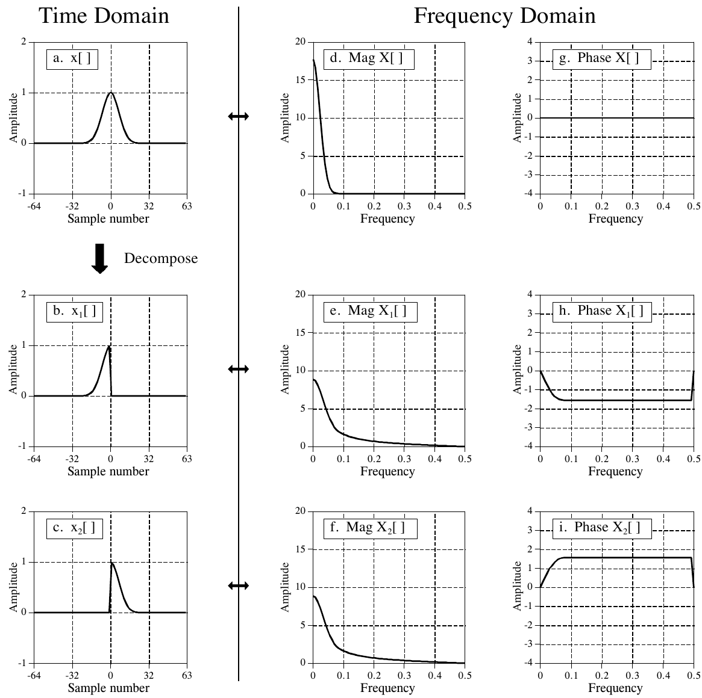

**图 10-7　左右对称的相位特性。** 一个左右对称的信号 (a)，可以分解成左半部分 (b) 和右半部分 (c)。两半的幅度完全相同，见 (e) 和 (f)；相位则互为相反数，见 (h) 和 (i)。
（Time Domain = 时域，Frequency Domain = 频域，Decompose = 分解；a～c 为 x[ ]、x₁[ ]、x₂[ ]，d～f 为它们的幅度 Mag，g～i 为它们的相位 Phase。Amplitude = 幅度，Sample number = 采样序号，Frequency = 频率。）

> **译注：** 原书图注写作"分解成右半部分 (b) 和左半部分 (c)"，与图不符：图中 (b) x₁[ ] 只在负序号处有值，是左半部分；(c) x₂[ ] 是右半部分。正文的说法（左半、右半依次对应 (b)、(c)）是对的，译文按图改正。另外 (g)～(i) 的纵轴标的是 Amplitude，实际画的是相位（弧度）。

第二，设想把 (b) 翻转成 (c)。时域里的这种左右翻转对幅度没有任何影响，但会把相位中每个点的符号都改变。同样，改变相位的符号，就会把时域信号左右翻转。如果信号是连续的，翻转是围绕零点进行的；如果信号是离散的，翻转同时围绕第 0 个采样和第 N/2 个采样进行。

改变相位符号是一种很常用的操作，因此有它自己的名称和符号。名称叫复共轭(complex conjugation)，记法是在变量的右上角加一个星号。例如，若 X[f] 由 Mag X[f] 和 Phase X[f] 组成，那么 X*[f] 叫做它的复共轭，由 Mag X[f] 和 −Phase X[f] 组成。在直角坐标表示中，求复共轭的方法是实部不变、虚部变号。用数学语言说，若 X[f] 由 Re X[f] 和 Im X[f] 组成，那么 X*[f] 由 Re X[f] 和 −Im X[f] 组成。

下面是复共轭在 DSP 中几种用法的例子。如果 x[n] 的傅里叶变换是 X[f]，那么 x[−n] 的傅里叶变换是 X*[f]。用文字说，时域左右翻转对应相位变号。再举一个例子，回想第 7 章讲过，相关可以通过卷积来完成，做法是把其中一个信号左右翻转。写成数学式，$a[n] * b[n]$ 是卷积，而 $a[n] * b[-n]$ 是相关。在频域中，这两种运算分别对应 $A[f] \times B[f]$ 和 $A[f] \times B^*[f]$。最后一个例子，考虑一个任意信号 x[n] 及其频谱 X[f]。把频谱乘以它的复共轭，即 $X[f] \times X^*[f]$，就能把频谱变成零相位。用文字说，不论 X[f] 原来的相位是什么，加上它的相反数后都会被抵消（记住，频谱相乘时，相位相加）。在时域中，这意味着 $x[n] * x[-n]$（信号与它自身左右翻转的版本做卷积）无论 x[n] 是什么，结果都关于第 0 个采样左右对称。

对许多工程师和数学家来说，这类运算就是 DSP。如果你想和这群人交流，就得习惯使用他们的语言。

## DFT 的周期性

与其他三种傅里叶变换不同，DFT 把时域和频域都看作周期的。这可能让人困惑、也不方便，因为 DSP 中用到的大多数信号都不是周期的。尽管如此，如果你想用 DFT，就必须遵从 DFT 看待世界的方式。

图 10-8 给出了对时域信号的两种不同理解。首先看上面的信号，即把时域看作 N 个点。这代表了科学实验和工程应用中数字信号通常的采集方式。例如，这 128 个采样可能是按固定的时间间隔对某个参数采样得到的。第 0 个采样和第 127 个采样是彼此独立、互不相干的，因为它们是在不同时刻采集的。从这个信号的形成方式看，没有理由认为信号左边的采样和右边的采样有任何关系。

遗憾的是，DFT 不是这样看问题的。如下图所示，DFT 把这 128 个点看作一个无限长周期信号的一个周期。这意味着采集到的信号的左边，与一个复制信号的右边相连；同样，采集到的信号的右边，与一个相同周期的左边相连。也可以理解为：采集到的信号的右边绕回来，接到它自己的左边。在这种观点下，第 127 个采样紧挨着第 0 个采样，就像第 43 个采样紧挨着第 44 个采样一样。这叫做环形(circular)，与把信号看作周期的完全等价。

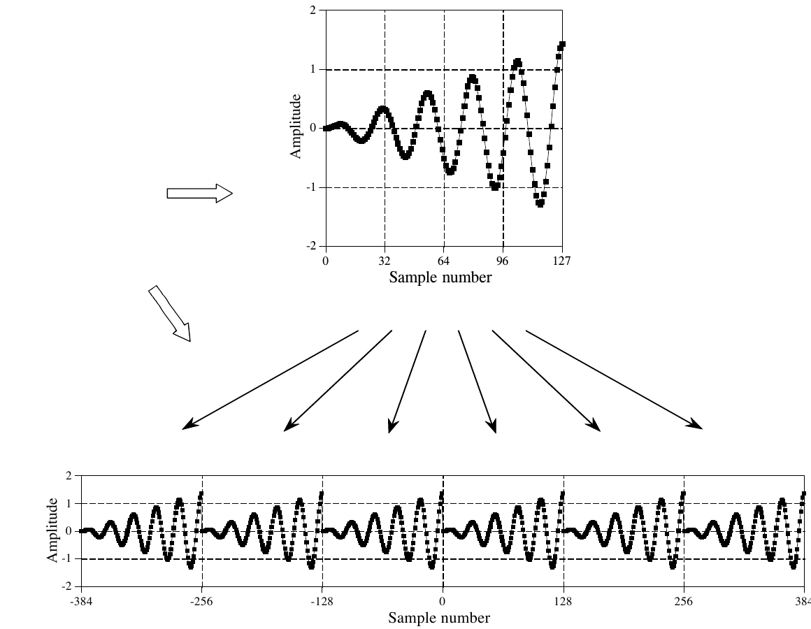

**图 10-8　DFT 时域信号的周期性。** 时域既可以看作长度为 N 个采样（上图），也可以看作一个无限长的周期信号（下图）。
（原书在图左侧有两段说明文字，裁图时已去掉：指向上图的箭头旁是 The time domain viewed as N points = 把时域看作 N 个点；指向下图的箭头旁是 The time domain viewed as periodic = 把时域看作周期的。Amplitude = 幅度，Sample number = 采样序号。）

时域周期性最严重的后果是时域混叠(time domain aliasing)。为说明这一点，假设我们把一个时域信号送进 DFT 求出它的频谱。我们可以立刻把这个频谱送进逆 DFT 重建出原来的时域信号，但这整个过程没什么意思。我们改为在使用逆 DFT 之前，以某种方式修改频谱。例如，删掉某些频率，改变它们的幅度或相位，把它们挪来挪去，等等。这些都是 DSP 中的家常便饭。遗憾的是，频域中的这些改动可能产生一个太长、一个周期装不下的时域信号。这迫使信号从一个周期溢出到相邻的周期中。把时域看作环形时，信号从右边溢出的部分会突然出现在信号的左边，反之亦然。也就是说，信号溢出的部分把自己混叠到了时域中的一个新位置。如果这个新位置上恰好已经有信号，两者就会搅在一起相加，造成信息丢失。由频域相乘导致的环形卷积(circular convolution，第 9 章讨论过)，就是这类混叠的绝佳例子。

频域中的周期性表现大体相同，但更复杂一些。图 10-9 是一个例子。上面两幅图是频谱的幅度和相位，看作由分布在采样率 0 到 0.5 之间的 N/2 + 1 个采样组成。这是看待频谱最简单的方式，但它解释不了 DFT 的许多性质。

下面两幅图展示了 DFT 怎样把这个频谱看作周期的。关键特征是：0 到 0.5 之间的频谱，似乎在 0 到 −0.5 之间有一个镜像。这个负频率的镜像，对幅度和相位来说略有不同。对幅度，信号左右翻转；对相位，信号左右翻转并且变号。你应该还记得，这两种对称各有名称：幅度称为偶信号(even signal，具有偶对称性)，相位称为奇信号(odd signal，具有奇对称性)。如果把频谱转成实部和虚部，实部总是偶的，虚部总是奇的。

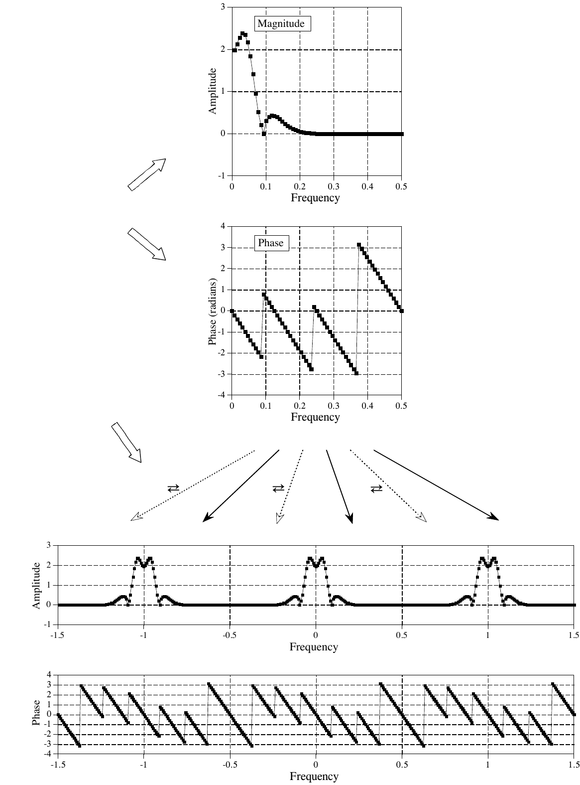

**图 10-9　DFT 频域的周期性。** 频域既可以看作从采样率的 0 延伸到 0.5（上面两幅图），也可以看作一个无限长的周期信号，其中每隔一段 0～0.5 的区间就左右翻转一次（下面两幅图）。
（原书在图左侧有两段说明文字，裁图时已去掉：指向上面两幅图的箭头旁是 The frequency domain viewed as 0 to 0.5 of the sampling rate = 把频域看作采样率的 0 到 0.5；指向下面两幅图的箭头旁是 The frequency domain viewed as periodic = 把频域看作周期的。Magnitude = 幅度，Phase = 相位，Amplitude = 幅度，Phase (radians) = 相位（弧度），Frequency = 频率；⇄ 表示该段左右翻转。原书图注把 infinitely 误印成 infinity。）

把这些负频率考虑在内，DFT 把频域看作周期的，周期为采样率的 1.0 倍，比如 −0.5 到 0.5，或者 0 到 1.0。用采样序号表示，频域一个周期的长度等于 N，与时域相同。

频域的周期性使它容易发生频域混叠(frequency domain aliasing)，这与前面讲的时域混叠完全类似。设想一个时域信号对应某个频谱。如果修改了这个时域信号，频谱显然也会改变。如果修改后的频谱在给定的空间里放不下，它就会挤进相邻的周期。和前面一样，这种混叠造成两个问题：频率不在它们该在的位置上；来自不同周期的重叠频率相加，破坏了信息。

频域混叠比时域混叠更难理解，因为频域中的周期图案更复杂。考虑一个单一频率，被迫在频域中从 0.01 移动到 0.49。相应的负频率因此从 −0.01 移动到 −0.49。当正频率越过 0.5 这道界线时，负频率也被推过 −0.5 这道界线。由于频域是周期的，同样的事件也在其他周期中发生，比如 0.5 到 1.5 之间。正频率的一个复制品从左向右越过频率 1.5，而负频率的一个复制品从右向左越过 0.5。现在想象一下，如果你只能看到 0 到 0.5 这个频带，会是什么样子：一个从右边离开的频率，又从右边重新出现，但运动方向相反。

图 10-10 说明了只看一个周期时，混叠在时域和频域中是怎样表现的。如 (a) 所示，如果时域信号的一端太长、一个周期装不下，伸出去的那一端会被剪下来贴到另一边。相比之下，(b) 表明频域信号溢出周期时，伸出去的那一端会被折回来。不论混叠的那一段最后落在哪里，它都会与那里原有的信号相加，破坏信息。

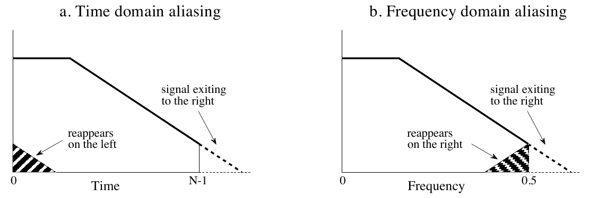

**图 10-10　只考虑一个周期时，时域和频域中混叠的例子。** 在时域中，如 (a) 所示，信号从右边出去的部分会从左边重新出现。在频域中，如 (b) 所示，信号从右边出去的部分会从右边重新出现，就像被折回来了一样。
（a. Time domain aliasing = 时域混叠；b. Frequency domain aliasing = 频域混叠。signal exiting to the right = 从右边出去的信号，reappears on the left = 从左边重新出现，reappears on the right = 从右边重新出现。Time = 时间，Frequency = 频率。）

我们来仔细看看这些叫做负频率(negative frequency)的怪东西。它们只是数学的某种古怪产物，还是有真实世界的意义？图 10-11 说明了它们是怎么回事。(a) 是一个由 32 个采样组成的离散信号。设想你的任务是找出这 32 个点对应的频谱。为了让你轻松点，告诉你这些点代表一个离散余弦波。换句话说，你必须找到频率和相移（f 和 θ），使得 $x[n] = \cos(2\pi n f/N + \theta)$ 与给定的采样相符。你很快就会得到 (b) 所示的解，即 f = 3、θ = −π/4。

如果你的分析到此为止，这道题你只能得 1/3 的分。这是因为还有两个解被你漏掉了。如 (c) 所示，第二个解是 f = −3、θ = π/4。即使负频率这个想法冒犯了你的感受，也改变不了它是这道题在数学上合法的解这一事实。每个正频率的正弦波，都可以等价地表示成一个负频率的正弦波。这对连续信号和离散信号都适用。

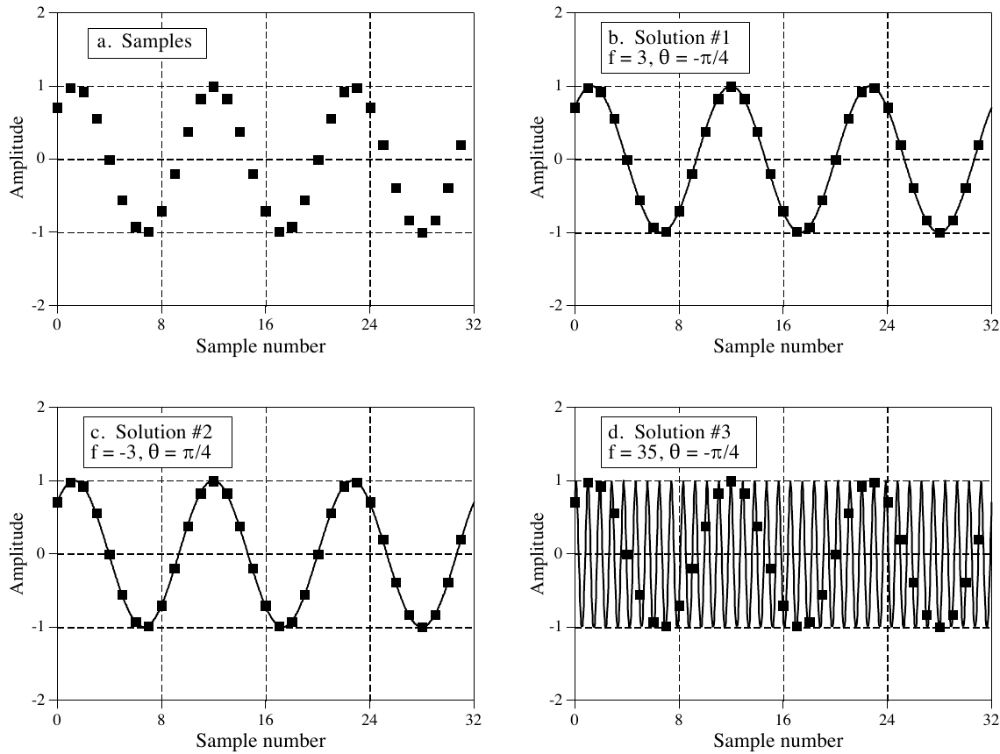

**图 10-11　负频率的含义。** 问题是求 (a) 中离散信号的频谱，也就是找出穿过所有采样的那个正弦波的频率和相位。(b) 是用正频率得到的解，(c) 是用负频率得到的解。(d) 代表这个问题的一族解。
（a. Samples = 采样点；b. Solution #1 = 解 1；c. Solution #2 = 解 2；d. Solution #3 = 解 3。Amplitude = 幅度，Sample number = 采样序号。）

第三个解不是单个答案，而是无穷多个解组成的一族。如 (d) 所示，f = 35、θ = −π/4 的正弦波穿过所有离散点，因此是一个正确的解。它在采样之间来回振荡，这可能让人困惑，但并不妨碍它成为真正的答案。同样，f = ±29、f = ±35、f = ±61、f = ±67 都是在点与点之间振荡多次的解。

这三个解各自对应频谱的不同部分。对离散信号来说，第一个解对应采样率 0 到 0.5 之间的频率；第二个解给出 0 到 −0.5 之间的频率；最后，第三个解构成了 −0.5 以下和 0.5 以上无穷多个重复的频率。如果被分析的信号是连续的，第一个解给出从零到正无穷的频率，第二个解给出从零到负无穷的频率，第三组解对连续信号不存在。

许多 DSP 技术不需要使用负频率，也不需要理解 DFT 的周期性。例如，上一章讲的两种常见技术：频谱分析(spectral analysis)和系统的频率响应(frequency response)。对这些应用，把时域看作从第 0 个采样到第 N−1 个采样、把频域看作从零到采样频率的一半，就完全够用了。这些技术之所以能用这种更简单的世界观，是因为它们从不会让一个周期的内容跑进另一个周期。在这些情况下，只看一个周期和看整个周期信号效果一样好。

然而，某些处理过程只有考虑信号怎样在周期之间溢出才能分析清楚。前面已经介绍过两个例子：环形卷积和模数转换(analog-to-digital conversion)。在环形卷积中，频谱相乘导致时域信号做卷积。如果得到的时域信号太长、一个周期装不下，它就会溢出到相邻周期中，造成时域混叠。相反，模数转换是频域混叠的一个例子。在时域中进行了一个非线性操作，即通过采样把连续信号变成离散信号。问题在于，原始模拟信号的频谱可能太长，离散信号的频谱装不下。硬要这样做，频谱的两端就会伸进相邻的周期。我们再看两个 DFT 周期性很重要的例子：信号的压缩与扩展，以及幅度调制。

## 压缩与扩展，多速率方法

如图 10-12 所示，信号在一个域里压缩，就会在另一个域里扩展，反之亦然。对连续信号，如果 X(f) 是 x(t) 的傅里叶变换，那么 $\frac{1}{k} X(f/k)$ 就是 $x(kt)$ 的傅里叶变换，其中 k 是控制扩展或压缩的参数。如果一个事件发生得更快（在时间上被压缩），它必然由更高的频率组成；如果一个事件发生得更慢（在时间上被扩展），它必然由更低的频率组成。把这个规律推向两个极端也成立。也就是说，如果时域信号被压缩得变成了一个冲激，相应的频谱就被扩展得变成一个常数。同样，如果时域被扩展得变成一个常数，频域就变成一个冲激。

> **译注：** 原书写的是 1/k × X(f/k)。严格地说，当 k 为负数时系数应为 1/|k|；这里 k 只表示压缩或扩展的倍数，取正数即可。

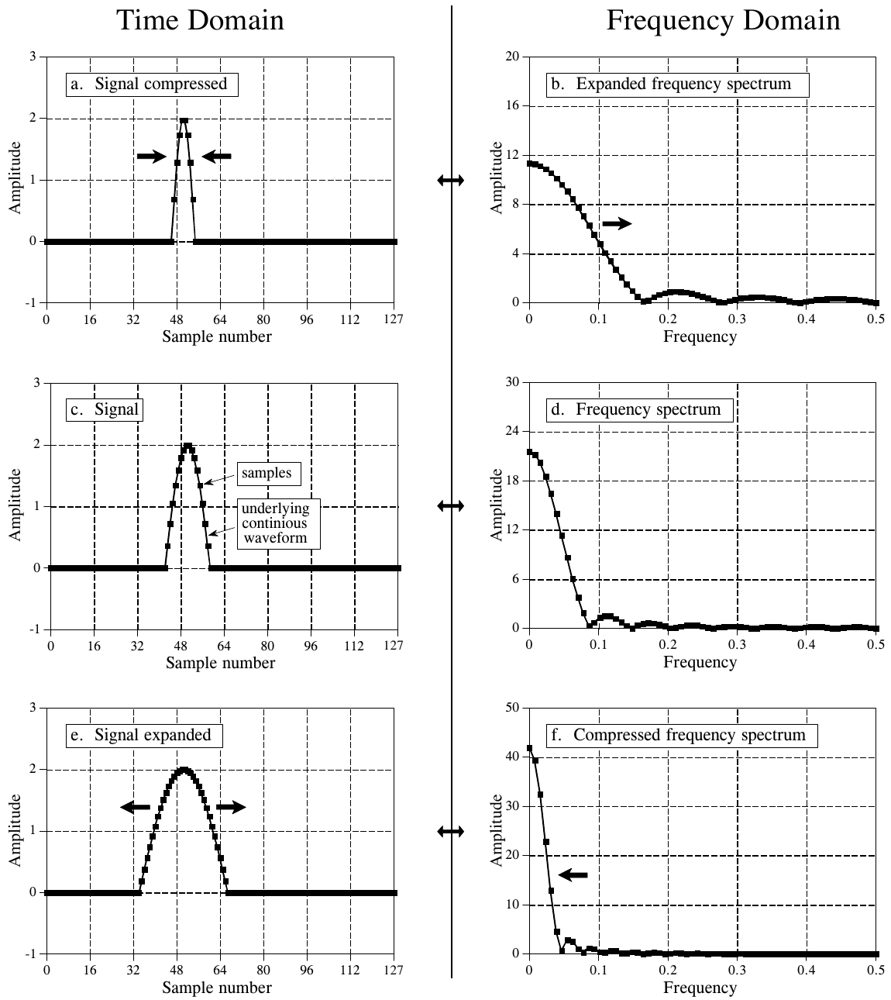

**图 10-12　压缩与扩展。** 在一个域里压缩信号，会使信号在另一个域里扩展，反之亦然。(c) 和 (d) 分别是一个离散信号及其频谱。在 (a) 和 (b) 中，时域信号被压缩，导致频谱被扩展。(e) 和 (f) 展示的是相反的过程。如图所示，离散信号的扩展或压缩，是通过扩展或压缩其背后的连续波形来实现的，然后对这条背后的波形重新采样，得到新的离散信号。
（Time Domain = 时域，Frequency Domain = 频域；a. Signal compressed = 压缩后的信号，b. Expanded frequency spectrum = 扩展后的频谱，c. Signal = 信号，d. Frequency spectrum = 频谱，e. Signal expanded = 扩展后的信号，f. Compressed frequency spectrum = 压缩后的频谱；samples = 采样点，underlying continuous waveform = 背后的连续波形（图中误拼为 continious）。Amplitude = 幅度，Sample number = 采样序号，Frequency = 频率。）

离散信号的表现与此类似，但有更多细节。离散信号的第一个问题是混叠。设想 (a) 中的脉冲比图中所示再压缩好几倍。频谱会扩展同样的倍数，(b) 中的几个驼峰会被推到 0.5 以上的频率。由此产生的混叠，打破了简单的扩展/压缩关系。这类混叠也可能发生在时域中。设想 (f) 中的频谱被压缩得更狠，导致 (e) 中的时域信号扩展到相邻的周期里。

第二个问题是要准确定义压缩或扩展一个离散信号是什么意思。如图 10-12a 所示，压缩离散信号的方法是：把采样点所在的那条背后的连续曲线压缩，再对新的连续曲线重新采样，得到新的离散信号。同样，(e) 展示了用同样的过程扩展离散信号。离散信号被压缩时，信号中的事件（比如脉冲的宽度）在更少的采样内发生；同样，扩展后的信号中的事件在更多的采样内发生。

看待这一过程的另一种等价方式是：背后的连续波形保持不变，但以不同的采样率重新采样。例如，看图 10-13a，一个由 50 个采样组成的离散高斯波形。在 (b) 中，同一条背后的曲线用 400 个采样来表示。(a) 到 (b) 的变化可以从两方面看：(1) 采样率保持不变，但背后的波形被扩展到八倍宽；或者 (2) 背后的波形保持不变，但采样率提高到八倍。以这种方式改变采样率的方法叫多速率技术(multirate techniques)。如果增加了采样，叫插值(interpolation)；如果用更少的采样表示信号，叫抽取(decimation)。第 3 章讲过多速率技术在 ADC 和 DAC 中的应用。

问题来了：给定一个任意的离散信号，我们怎么知道它背后的连续曲线是什么？这取决于信号的信息是编码在时域中还是频域中。对于时域编码的信号，我们希望背后的连续波形是一条穿过所有采样的平滑曲线。最简单的做法，可以在点与点之间画直线，再把粗糙的拐角磨圆。更进一步，可以用曲线拟合算法，比如样条函数(spline function)或多项式拟合。这个问题没有唯一"正确"的答案。这种方法的出发点是让时域波形中的不规则性最小，完全不考虑频域。

当信号的信息编码在频域中时，我们不管时域波形，而专注于频谱。上一章讲过，在做 DFT 之前给时域信号补零，就能得到更精细的频谱采样（频率 0 到 0.5 之间的采样更多）。对偶性(duality)让这一做法可以反过来用：如果想在时域中得到更精细的采样（插值），就在做逆 DFT 之前给频谱补零。假设我们想把一个 50 点的信号插值成 400 点的信号，做法如下：(1) 取这 50 个采样，补零使信号长 64 个采样。(2) 用 64 点 DFT 求出频谱，它由 33 点的实部和 33 点的虚部组成。(3) 在频谱的右边（实部和虚部都要）补 224 个零，使频谱长 257 点。(4) 用 512 点逆 DFT 把数据变回时域。这样得到一个 512 点的信号，它是那个 64 点信号的高分辨率版本。这个信号的前 400 个采样，就是原来 50 个采样的插值版本。

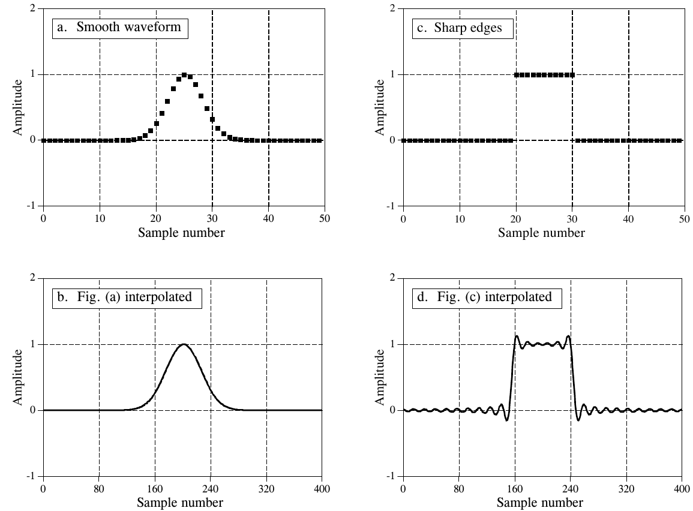

**图 10-13　通过在频域补零来插值。** (a) 和 (c) 各由 50 个采样组成。通过在频域补零，把它们插值成 400 个采样，分别得到 (b) 和 (d)。（(b) 和 (d) 是离散信号，但因为采样数很多，画成了连续的线。）
（a. Smooth waveform = 平滑波形；b. Fig. (a) interpolated = 图 (a) 插值后；c. Sharp edges = 陡峭的边沿；d. Fig. (c) interpolated = 图 (c) 插值后。Amplitude = 幅度，Sample number = 采样序号。）

这种技术的关键特点是：插值后的信号与原信号由完全相同的频率组成。这在时域中不一定能给出一个表现良好的拟合。例如，图 10-13 (a) 和 (b) 展示了用这种方法把一个 50 点信号插值成 400 点信号。插值结果是原始点之间的一条平滑拟合，就像用了曲线拟合程序一样。相比之下，(c) 和 (d) 展示了另一个例子，时域一团糟！(d) 中的振荡出现在信号的边沿或其他不连续处。由于时域被看作环形的，这也包括第 0 个采样与第 N−1 个采样之间的任何不连续。这种在不连续处的过冲叫吉布斯效应(Gibbs effect)，第 11 章会讨论。第 3 章还介绍了另一种频域插值技术：在时域采样之间插入零，再做低通滤波。

## 信号相乘（幅度调制）

傅里叶变换的一个重要性质是：一个域里的卷积对应另一个域里的相乘。上一章讨论了其中一面：时域信号可以通过把它们的频谱相乘来卷积。幅度调制(amplitude modulation)是相反情形的一个例子：时域里的相乘对应频域里的卷积。此外，幅度调制还是一个极好的例子，说明难以捉摸的负频率是怎样进入日常科学和工程问题的。

音频信号很适合短距离通信：你说话时，屋子那头的人能听见。另一方面，无线电频率非常擅长远距离传播。例如，把一个 100 伏、1 MHz 的正弦波送进天线，产生的无线电波在隔壁房间、隔壁国家，甚至隔壁星球都能被探测到。调制(modulation)就是把两个信号融合成第三个信号、让它兼具两者理想特性的过程。这总要用到非线性过程，比如相乘；不能只是把两个信号加起来。在无线电通信中，调制得到的无线电信号既能远距离传播，又能携带音频或其他信息。

无线电通信是一门极其成熟的学科，人们开发了许多调制方案。最简单的一种叫幅度调制。图 10-14 是幅度调制在时域和频域中表现的一个例子。本例使用连续信号，因为调制通常在模拟电子电路中完成。不过如果需要，整个过程也可以用离散形式完成（这是未来的方向！）。

(a) 是一个加了直流偏置、使信号始终为正值的音频信号。(b) 显示它的频谱由 300 Hz 到 3 kHz 的频率（语音通信所需的频率范围）以及代表直流分量的一根尖峰组成。其他所有频率都已被模拟滤波去掉。(c) 和 (d) 是载波(carrier wave)，一个频率比音频信号高得多的纯正弦波。在时域中，幅度调制就是把音频信号乘以载波。如 (e) 所示，结果是一个振荡波形，它的瞬时幅度与原音频信号成正比。用这一行的行话说，载波的包络(envelope)等于调制信号。这个信号可以送到天线，变成无线电波，再被接收天线探测到。这样，在无线电接收机的电子电路中就会产生一个与 (e) 相同的信号。然后用检波器(detector)或解调器(demodulator)电路，把 (e) 中的波形变回 (a) 中的波形。

由于时域信号相乘，对应的频谱就做卷积。也就是说，(f) 是 (b) 与 (d) 卷积得到的。由于载波的频谱是一个平移过的冲激函数，调制信号的频谱就等于把音频频谱平移到载波频率处。这样得到的调制频谱由三个分量组成：载波、上边带(upper sideband)和下边带(lower sideband)。

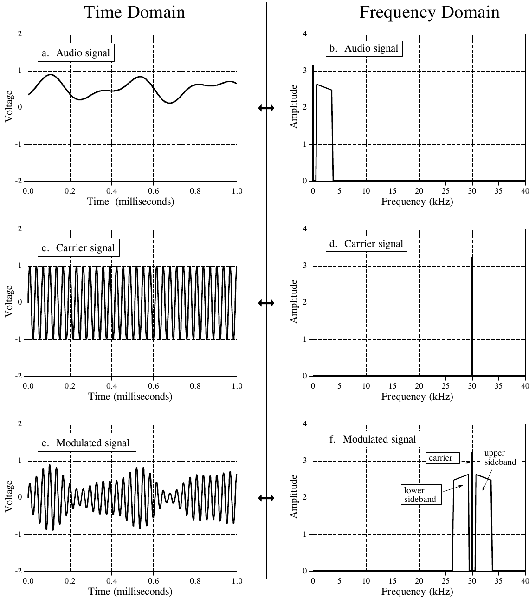

**图 10-14　幅度调制。** 在时域中，幅度调制是把音频信号 (a) 乘以载波信号 (c)，得到调制信号 (e)。由于时域相乘对应频域卷积，调制信号的频谱就是把音频信号的频谱平移到载波频率处。
（Time Domain = 时域，Frequency Domain = 频域；a、b. Audio signal = 音频信号，c、d. Carrier signal = 载波信号，e、f. Modulated signal = 调制信号；carrier = 载波，upper sideband = 上边带，lower sideband = 下边带。Voltage = 电压，Amplitude = 幅度，Time (milliseconds) = 时间（毫秒），Frequency (kHz) = 频率（kHz）。）

这三个分量依次对应原音频信号的三个部分：直流分量、0.3 到 3 kHz 之间的正频率，以及 −0.3 到 −3 kHz 之间的负频率。尽管原音频信号中的负频率有些难以捉摸、比较抽象，下边带里的频率却真实得不能再真实了。幽灵化成人形了！

通信工程师的饭碗就靠这类频域分析。例如，考虑电视传输的频谱。一路标准电视信号的频谱从直流到 6 MHz。利用这些频率平移技术，82 个这样 6 MHz 宽的频道首尾相接地排列起来。例如，第 3 频道是 60 到 66 MHz，第 4 频道是 66 到 72 MHz，第 83 频道是 884 到 890 MHz，等等。电视接收机把想看的频道挪回直流到 6 MHz 的频带，再显示到屏幕上。这种方案叫频分复用(frequency domain multiplexing)。

## 离散时间傅里叶变换

离散时间傅里叶变换（Discrete Time Fourier Transform，DTFT）是傅里叶变换家族中处理非周期离散信号的成员。理解 DTFT 最好的方式，是看它和 DFT 的关系。首先，设想你采集了一个 N 点信号，想求它的频谱。用 DFT 可以把信号分解成 N/2 + 1 个正弦波和余弦波，它们的频率在零到采样率一半之间等间隔分布。上一章讲过，给时域信号补零，会让时域的周期变长，同时让频域采样之间的间隔变窄。当 N 趋于无穷大时，时域变成非周期的，频域变成连续信号。这就是 DTFT：把一个非周期的离散信号，与一个周期的连续频谱联系起来的傅里叶变换。

理解 DTFT 的数学，可以从 DFT 的合成和分析公式（公式 8-2、8-3 和 8-4）出发，让 N 趋于无穷大：

**公式 10-1**　DTFT 的分析公式。式中 x[n] 是时域信号，频谱存放在 Re X(ω) 和 Im X(ω) 中，ω 的取值范围是 0 到 π。

$$\mathrm{Re}\,X(\omega) = \sum_{n=-\infty}^{+\infty} x[n]\cos(\omega n)$$

$$\mathrm{Im}\,X(\omega) = -\sum_{n=-\infty}^{+\infty} x[n]\sin(\omega n)$$

**公式 10-2**　DTFT 的合成公式。

$$x[n] = \frac{1}{\pi}\int_{0}^{\pi} \big[\mathrm{Re}\,X(\omega)\cos(\omega n) - \mathrm{Im}\,X(\omega)\sin(\omega n)\big]\,d\omega$$

> **译注：** 原书公式 10-1 的说明写"n 从 0 到 N−1"，与公式本身的求和范围（−∞ 到 +∞）不一致；DTFT 处理的是无限长的非周期信号，应以公式为准。说明的最后一句在原书版面上只印到"ω 的取值"就断了，按正文补为 0 到 π。

这些关系中有许多微妙的细节。首先，时域信号 x[n] 仍然是离散的，因此用方括号表示。相比之下，频域信号 Re X(ω) 和 Im X(ω) 是连续的，因此用圆括号表示。由于频域是连续的，合成公式必须写成积分，而不是求和。

第 8 章讲过，在 DFT 的频域中，频率用三个变量之一来表示：k，一个从 0 到 N/2 的索引；f，采样率的分数，从 0 到 0.5；或者 ω，用自然频率表示的采样率分数，从 0 到 π。DTFT 的频谱是连续的，所以 f 或 ω 都可以用。常见的选择是 ω，因为它省掉了总是出现的 2π 因子，让公式更短。记住，用 ω 时，频谱从 0 延伸到 π，对应直流到采样率的一半。更复杂的是，许多作者在 DTFT 中用 Ω（大写的 omega）而不是 ω（小写的 omega）来表示这个频率。

计算逆 DFT 时，必须先把第 0 个和第 N/2 个采样除以二（公式 8-3），才能进行合成（公式 8-2）。DTFT 不需要这一步。你应该还记得，DFT 中的这一操作与把频谱定义为谱密度(spectral density)有关，即单位带宽上的幅度。当频谱变成连续的，对端点的特殊处理就消失了。不过，仍然有一个必须包含的归一化因子：DFT 中的 2/N（公式 8-3）在 DTFT 中变成了 1/π（公式 10-2）。有的作者把这些项放在合成公式前面，有的放在分析公式前面。假设你从某个时域信号出发，做傅里叶变换，再做逆傅里叶变换，你希望最后得到的就是开始的那个信号。也就是说，1/π 这一项（或者 2/N 这一项）必须在正变换或逆变换的某个环节出现。有的作者甚至把这一项拆开放到两个变换中，在两者前面都放上 $1/\sqrt{\pi}$。

由于 DTFT 涉及无穷求和与积分，它无法用数字计算机算出来。它的主要用途是在理论问题中替代 DFT。例如，假设你想由系统的冲激响应求出它的频率响应。如果冲激响应是一个数组，比如由实验测量或计算机仿真得到的，就在计算机上运行 DFT 程序。这会得到另一个数组形式的频谱，在采样率的 0 到 0.5 之间等间隔分布。

在另一些情况下，冲激响应可能是以公式的形式已知的，比如 sinc 函数（下一章介绍）或指数衰减的正弦波。这时就用 DTFT，以数学方法把频域算成另一个公式，给出 0 到 0.5 之间整条连续曲线。虽然这个计算也可以用 DFT 来做，但 DFT 只能给出频率响应采样点的公式，而不是整条曲线。

## 帕塞瓦尔关系

既然时域和频域是同一个信号的两种等价表示，它们就必须具有相同的能量。这叫帕塞瓦尔关系(Parseval's relation)，对傅里叶变换家族的所有成员都成立。对 DFT，帕塞瓦尔关系表示为：

**公式 10-3**　帕塞瓦尔关系。式中 x[i] 是时域信号，i 从 0 到 N−1；X[k] 是它修正后的频谱，k 从 0 到 N/2。修正后的频谱这样得到：对信号做 DFT，再把第一个和最后一个频率（第 0 个和第 N/2 个采样）除以 2 的平方根。

$$\sum_{i=0}^{N-1} x[i]^2 = \frac{2}{N}\sum_{k=0}^{N/2} \mathrm{Mag}\,X[k]^2$$

等式左边是时域信号包含的总能量，通过把 N 个单独采样的能量加起来得到。同样，右边是频域包含的能量，通过把 N/2 + 1 个正弦波的能量加起来得到。物理学告诉我们，能量与幅度的平方成正比。例如，弹簧中的能量与位移的平方成正比，电容器中储存的能量与电压的平方成正比。在公式 10-3 中，X[f] 是 x[n] 的频谱，只有一点小修改：第一个和最后一个频率分量 X[0] 和 X[N/2] 被除以了 $\sqrt{2}$。这一修改，加上等式右边的 2/N 因子，处理了计算和累加能量时的几个微妙细节。

要理解这些修正，先用 DFT 求出信号的频域表示。然后，把频域转换成重建信号所需的正弦波幅度，即公式 8-3 中定义的那样：把第一个和最后一个点（第 0 个和第 N/2 个采样）除以 2，再把所有点除以 N/2。这样得到的是正弦波的幅度，但它们是峰值幅度(peak amplitude)，而不是计算能量所需的均方根(root-mean-square，rms)幅度。对正弦波，把峰值幅度除以 $\sqrt{2}$ 就转换成 rms 值。除了第 0 个和第 N/2 个采样，所有频域值都必须做这个修正。这是因为这两个正弦波很特殊：一个是常数，另一个在两个常数值之间交替。对这两个特殊情形，峰值幅度本来就等于 rms 值。频域中所有的值平方后再求和。最后一步是把求和结果除以 N，这是因为频域中的每个采样都被转换成一个覆盖时域 N 个值的正弦波。把这些细节都处理完，就得到公式 10-3。

帕塞瓦尔关系所描述的物理（能量守恒）很有意思，但它在 DSP 中的实际用处不多。
