# 《The Scientist and Engineer's Guide to Digital Signal Processing》第 12 章中译

> 原书：上一级目录 `Documents/数学基础/` 下的 `The Scientist and Engineer Guide to Digital Signal Processing.pdf`，对应 PDF 第 236～253 页（原书第 225～242 页）。
> 上一章：[11-DSP指南-第11章中译.md](11-DSP指南-第11章中译.md)。专业名词第一次出现时在括号里附上英文。
> 插图从原书页面裁出，放在 `assets/ch12/`，图里的英文标注在每张图下方给出对照。原书 PDF 的符号字体抽取时会乱码（+ 显示成 %，− 显示成 &，= 显示成 '），公式按原书版面重新用 LaTeX 写出。BASIC 和 FORTRAN 程序的 C 版本在 `c/` 目录。

---

# 第 12 章　快速傅里叶变换

计算离散傅里叶变换（DFT）的方法有好几种，比如解联立线性方程组，或者第 8 章介绍的相关法。快速傅里叶变换（Fast Fourier Transform，FFT）是计算 DFT 的另一种方法。它得到的结果与其他方法相同，但效率高得惊人，计算时间常常能缩短几百倍。这就像坐喷气式飞机和走路的差别！如果没有 FFT，本书介绍的许多技术都没法实用。FFT 虽然只需要几十行代码，却是 DSP 中最复杂的算法之一。不过别泄气！你完全可以直接使用现成的 FFT 程序，而不必彻底弄懂它的内部原理。

## 用复数 DFT 计算实数 DFT

J.W. Cooley 和 J.W. Tukey 被公认为把 FFT 带给世界的人，他们的论文是："An algorithm for the machine calculation of complex Fourier Series"（一种用机器计算复数傅里叶级数的算法），Mathematics Computation，第 19 卷，1965 年，第 297～301 页。回头来看，其他人早在许多年前就发现了这一技术。例如，伟大的德国数学家卡尔·弗里德里希·高斯（1777–1855）一个多世纪以前就用过这种方法。这些早期工作基本被遗忘了，因为当时缺少让它变得实用的工具：数字计算机。Cooley 和 Tukey 之所以享有盛誉，是因为他们在正确的时间发现了 FFT——计算机革命的开端。

FFT 基于复数 DFT(complex DFT)，它是前四章讨论的实数 DFT(real DFT) 的一个更复杂的版本。这两种变换按各自表示数据的方式命名，也就是用复数还是用实数。"复数"(complex) 这个词并不是说这种表示方法困难或复杂，而是说它用到了一种特定的数学。复数数学确实常常困难又复杂，但名字不是从这儿来的。第 29 章讨论复数 DFT，并提供理解 FFT 算法细节所需的背景知识。本章的主题要简单些：怎样用 FFT 来计算实数 DFT，而不陷进高深数学的泥潭。

> **译注：** 原书本章两处提到"第 29 章"讲复数 DFT，实际是第 31 章《复数傅里叶变换》（第 29 章是《DSP 上手实践》）。

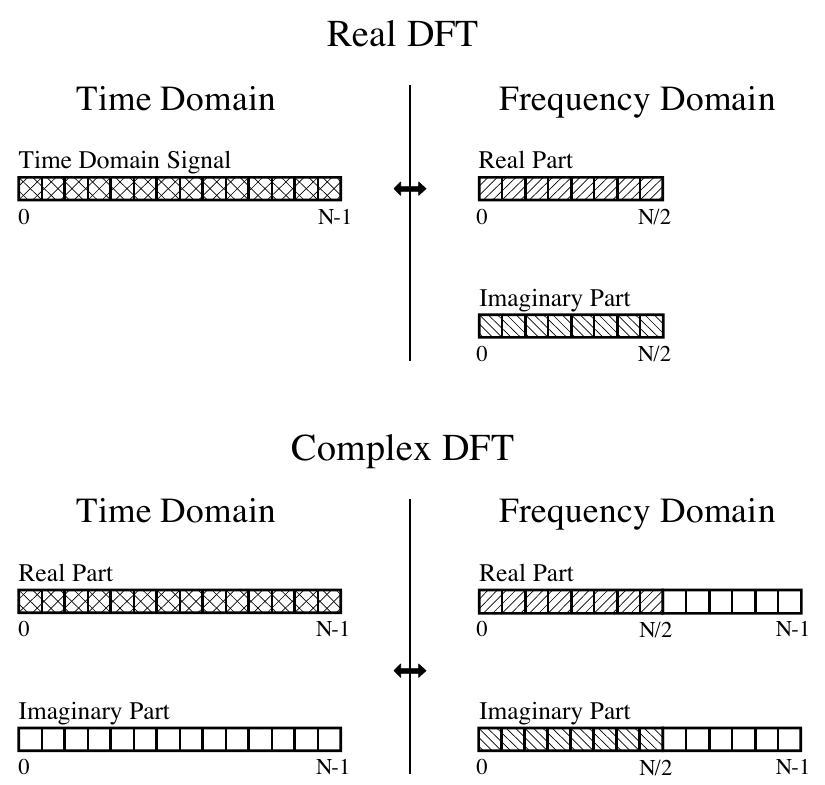

**图 12-1　实数 DFT 与复数 DFT 的比较。** 实数 DFT 把一个 N 点时域信号变成两个 N/2+1 点的频域信号。复数 DFT 把两个 N 点时域信号变成两个 N 点频域信号。画了斜线的区域表示两种变换共有的数值。
（Real DFT = 实数 DFT，Complex DFT = 复数 DFT；Time Domain = 时域，Frequency Domain = 频域；Time Domain Signal = 时域信号，Real Part = 实部，Imaginary Part = 虚部。）

既然 FFT 是计算复数 DFT 的算法，弄清楚怎样把实数 DFT 的数据转入和转出复数 DFT 的格式就很重要。图 12-1 比较了实数 DFT 和复数 DFT 存放数据的方式。实数 DFT 把一个 N 点时域信号变换成两个 N/2+1 点的频域信号。这个时域信号就叫时域信号；频域中的两个信号分别叫实部(real part)和虚部(imaginary part)，存放余弦波和正弦波的幅度。这些在前几章都应该很熟悉了。

相比之下，复数 DFT 把两个 N 点时域信号变换成两个 N 点频域信号。两个时域信号也叫实部和虚部，和频域信号一样。尽管名字如此，这些数组中的所有值都只是普通的数。（如果你熟悉复数：数组值里不包含 j，j 是数学表达式的一部分。回忆一下，算子 Im( ) 返回的是一个实数。）

假设你有一个 N 点信号，需要借助复数 DFT（比如用 FFT 算法）来计算实数 DFT。首先，把这个 N 点信号放进复数 DFT 时域的实部，再把虚部的所有采样设为零。计算复数 DFT 后，频域得到一个实部信号和一个虚部信号，各有 N 个点。这两个信号的第 0～N/2 个采样，就对应实数 DFT 的频谱。

第 10 章讲过，把负频率包括进来时，DFT 的频域是周期性的（见图 10-9）。选哪一个周期是任意的，可以选 −1.0 到 0、−0.5 到 0.5、0 到 1.0，或者以采样率为参照的任何其他一个单位长的区间。复数 DFT 的频谱按 0 到 1.0 的方式包含负频率。也就是说，一个完整周期从第 0 个采样延伸到第 N−1 个采样，对应采样率的 0 到 1.0 倍。正频率位于第 0 到 N/2 个采样之间，对应 0 到 0.5。其余采样，即第 N/2+1 到 N−1 个，存放负频率的值（通常被忽略）。

用复数逆 DFT 计算实数逆 DFT 稍微难一点，因为你要保证负频率按正确的格式装入。记住，复数 DFT 的第 0～N/2 点与实数 DFT 相同，实部虚部都是如此。对于实部，第 N/2+1 点与第 N/2−1 点相同，第 N/2+2 点与第 N/2−2 点相同，依此类推，一直到第 N−1 点与第 1 点相同。虚部也是同样的基本模式，只是符号相反：第 N/2+1 点是第 N/2−1 点的相反数，第 N/2+2 点是第 N/2−2 点的相反数，等等。注意，第 0 点和第 N/2 点在这种复制模式中没有配对的点。可以参照图 10-9 来理解这种对称性。实际操作时，把实数 DFT 的频谱装入复数 DFT 数组的第 0～N/2 个采样，再用一个子程序生成第 N/2+1 到 N−1 个采样之间的负频率。表 12-1 就是这样一个程序。要检查对称性是否正确，可以在做完逆 FFT 后看时域的虚部：如果一切正确，它将全是零（用单精度计算时，会有百万分之几的噪声）。

**表 12-1**（注释已译成中文）

```basic
6000 'NEGATIVE FREQUENCY GENERATION
6010 '本子程序由实数频域生成复数频域。
6020 '进入本子程序时，N% 是信号的点数，
6030 'REX[ ] 和 IMX[ ] 的第 0 到 N%/2 个采样存放实数频域。
6040 '返回时，REX[ ] 和 IMX[ ] 的第 0 到 N%-1 个采样存放复数频域。
6050 '
6060 FOR K% = (N%/2+1) TO (N%-1)
6070 REX[K%] = REX[N%-K%]
6080 IMX[K%] = -IMX[N%-K%]
6090 NEXT K%
6100 '
6110 RETURN
```

**C 实现**（完整可编译版本见 `c/table12-1_negative_freq.c`，其中用相关法复数 DFT 做对照，并按上文的方法检查逆变换后虚部是否为零）：

```c
/* 6000：由实数频域生成复数频域。进入时 rex/imx 的 0～n/2 点有效，返回时 0～n-1 点都有效 */
static void negative_frequency_generation(double *rex, double *imx, int n)
{
    for (int k = n / 2 + 1; k <= n - 1; k++) {  /* 6060：遍历负频率的每个点 */
        rex[k] = rex[n - k];                    /* 6070：实部偶对称 */
        imx[k] = -imx[n - k];                   /* 6080：虚部奇对称 */
    }
}
```

运行结果（N=64 随机实信号）：补出的负频率与完整频谱最大偏差 1.05e-13；逆 DFT 后时域虚部最大幅度 6.6e-15，实部与原信号最大偏差 1.3e-14。作为反例，不补负频率直接做逆变换，时域虚部最大幅度达到 0.44。

## FFT 的工作原理

FFT 是一个复杂的算法，它的细节通常留给专门研究这类问题的人。本节介绍 FFT 的大致运作，但回避了一个关键问题：复数的使用。如果你有复数数学的背景，可以从字里行间读出这个算法的真正本质。细节看不明白也不用担心；在用 FFT 的科学家和工程师中，能从零写出这个程序的人寥寥无几。

在复数记法中，时域和频域各包含一个由 N 个复数点组成的信号。每个复数点由两个数组成：实部和虚部。例如，说到复数采样 X[42] 时，指的是 Re X[42] 和 Im X[42] 的组合。换句话说，每个复数变量存放两个数。两个复数变量相乘时，四个分量必须组合成乘积的两个分量（如公式 9-1）。下面关于"FFT 的工作原理"的讨论使用这种复数记法的行话。也就是说，单数的术语——信号、点、采样、值——都指实部和虚部的组合。

FFT 的工作方式是：把一个 N 点时域信号分解成 N 个时域信号，每个只含一个点。第二步，算出这 N 个时域信号对应的 N 个频谱。最后，把这 N 个频谱合成为一个频谱。

图 12-2 是 FFT 中所用时域分解的一个例子。本例中，一个 16 点信号经过四个独立的阶段分解。第一阶段把 16 点信号拆成两个各含 8 点的信号。第二阶段把数据分解成四个 4 点信号。这一模式一直继续，直到得到 N 个单点信号为止。每次把一个信号一分为二时，都用交错分解(interlaced decomposition)，也就是把信号分成偶数号采样和奇数号采样。理解这一点最好的办法，是盯着图 12-2 看，直到你看出其中的规律。这种分解需要 $\log_2 N$ 个阶段，例如 16 点信号（$2^4$）需要 4 个阶段，512 点信号（$2^9$）需要 9 个阶段，4096 点信号（$2^{12}$）需要 12 个阶段，等等。记住 $\log_2 N$ 这个值，本章会多次提到它。

> **译注：** 原书此处写"a 512 point signal ($2^7$) requires 7 stages"，有误：512 = $2^9$，需要 9 个阶段（$2^7$ = 128）。译文已改正。

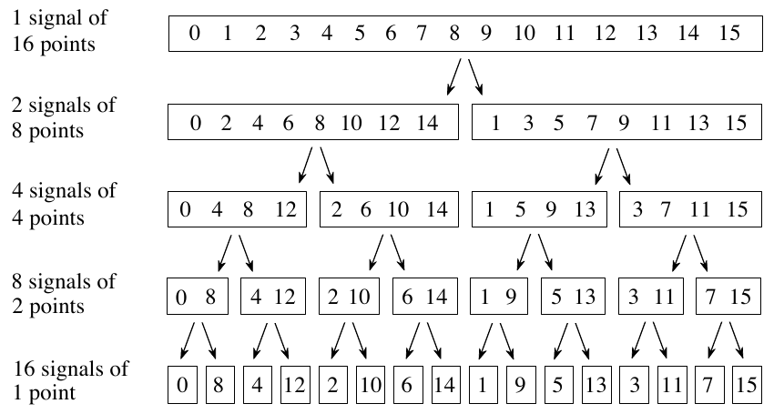

**图 12-2　FFT 的分解。** 一个 N 点信号被分解成 N 个各含一个点的信号。每个阶段都使用交错分解，把偶数号和奇数号采样分开。
（左侧从上到下：1 signal of 16 points = 1 个 16 点信号，2 signals of 8 points = 2 个 8 点信号，4 signals of 4 points = 4 个 4 点信号，8 signals of 2 points = 8 个 2 点信号，16 signals of 1 point = 16 个 1 点信号。）

明白了分解的结构，就可以大大简化它。这种分解不过是把信号中的采样重新排序。图 12-3 给出了所需的重排规律。左边列出原信号的采样序号及其二进制形式；右边列出重排后的采样序号，也附上二进制形式。关键在于：左右两边的二进制数互为位反转。例如，第 3 个采样（0011）与第 12 个采样（1100）交换；同样，第 14 个采样（1110）与第 7 个采样（0111）交换，依此类推。FFT 的时域分解通常用位反转排序(bit reversal sorting)算法完成，也就是把二进制数的位左右颠倒后计数，按这个顺序重排 N 个时域采样（就像图 12-3 最右一列那样）。

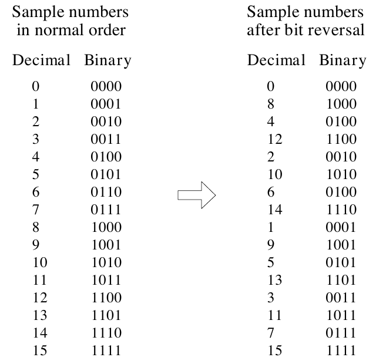

**图 12-3　FFT 的位反转排序。** FFT 的时域分解可以通过按位反转顺序给采样排序来实现。
（Sample numbers in normal order = 正常顺序的采样序号，Sample numbers after bit reversal = 位反转后的采样序号；Decimal = 十进制，Binary = 二进制。原图右栏第 7 行十进制 6 的二进制印成了 0100，应为 0110。）

FFT 算法的下一步，是求这些 1 点时域信号的频谱。这再简单不过了：1 点信号的频谱就等于它自己。这意味着这一步什么都不用做。虽然不用做任何工作，别忘了：现在每个 1 点信号都是一个频谱，而不再是时域信号了。

FFT 的最后一步，是按与时域分解完全相反的顺序，把这 N 个频谱合并起来。算法从这里开始变得麻烦。可惜位反转这条捷径在这里用不上，我们必须一次退回一个阶段。在第一阶段，16 个频谱（每个 1 点）合成 8 个频谱（每个 2 点）。在第二阶段，8 个频谱（每个 2 点）合成 4 个频谱（每个 4 点），依此类推。最后一个阶段产生 FFT 的输出：一个 16 点频谱。

图 12-4 展示了两个各含 4 点的频谱怎样合并成一个 8 点频谱。这种合成必须撤销时域中所做的交错分解。换句话说，频域中的操作必须对应时域中"把两个 4 点信号交错合并"的过程。考虑两个时域信号 abcd 和 efgh。可以分两步得到一个 8 点时域信号：先在每个 4 点信号中插入零，把它稀释(dilute)成 8 点信号，然后把两个信号相加。也就是说，abcd 变成 a0b0c0d0，efgh 变成 0e0f0g0h，这两个 8 点信号相加得到 aebfcgdh。如图 12-4 所示，在时域中插零稀释，对应频谱的复制。因此，FFT 中合并频谱的方法，就是把它们复制一遍，再把复制后的频谱相加。

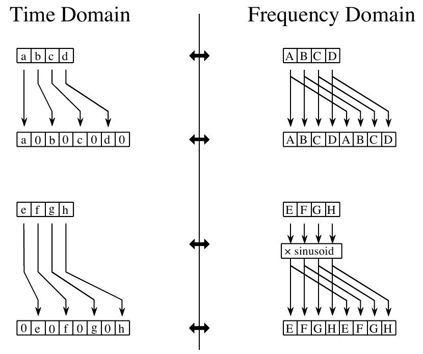

**图 12-4　FFT 的合成。** 时域信号插零稀释时，频域被复制一遍。如果稀释时时域信号还平移了一个采样，频谱还要再乘上一个正弦曲线。
（Time Domain = 时域，Frequency Domain = 频域，× sinusoid = 乘以正弦曲线。）

为了相加时能对上，两个时域信号的插零方式略有不同：一个信号的奇数点为零，另一个信号的偶数点为零。换句话说，其中一个时域信号（图 12-4 中的 0e0f0g0h）向右平移了一个采样。时域的这个平移，对应频谱乘上一个正弦曲线(sinusoid)。要看清这一点，回忆一下：时域中的平移等价于把信号与一个平移过的冲激函数卷积，这相当于把信号的频谱乘以平移冲激函数的频谱，而平移冲激函数的频谱是一条正弦曲线（见图 11-2）。

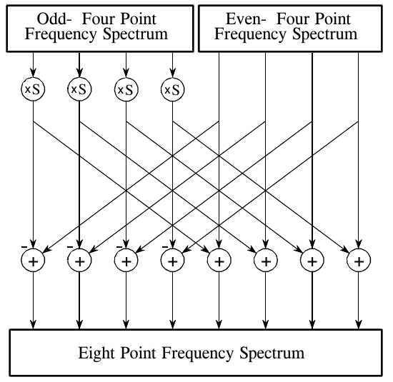

**图 12-5　FFT 合成流程图。** 这里展示了把两个 4 点频谱合并成一个 8 点频谱的方法。×S 运算表示把信号乘以一个频率选取得当的正弦曲线。
（Odd- Four Point Frequency Spectrum = 奇数点的 4 点频谱，Even- Four Point Frequency Spectrum = 偶数点的 4 点频谱，Eight Point Frequency Spectrum = 8 点频谱；加号旁的 − 表示该路相减。）

图 12-5 是把两个 4 点频谱合并成一个 8 点频谱的流程图。再进一步简化：注意图 12-5 是由图 12-6 中的基本模式一再重复构成的。这个简单的流程图因为形似翅膀而被称为蝶形(butterfly)。蝶形是 FFT 的基本计算单元，它把两个复数点变换成另外两个复数点。

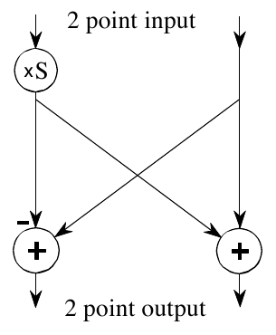

**图 12-6　FFT 蝶形。** 这是 FFT 的基本计算单元，取两个复数点，把它们变换成另外两个复数点。
（2 point input = 2 点输入，2 point output = 2 点输出，×S = 乘以正弦曲线。）

图 12-7 展示了整个 FFT 的结构。时域分解由位反转排序算法完成。把分解后的数据变换到频域不需要做任何事，所以图中没有出现这一步。

频域合成需要三重循环。外层循环遍历 $\log_2 N$ 个阶段（即图 12-2 中的每一层，从下往上）。中层循环遍历当前阶段中的每个频谱（即图 12-2 中任意一层上的每个方框）。最内层循环用蝶形计算每个频谱中的各个点（即遍历图 12-2 中任意一个方框里的采样）。图 12-7 中的"开销"(overhead)方框负责确定循环的起止下标，并计算蝶形所需的正弦曲线。现在我们来到本章的核心：实际的 FFT 程序。

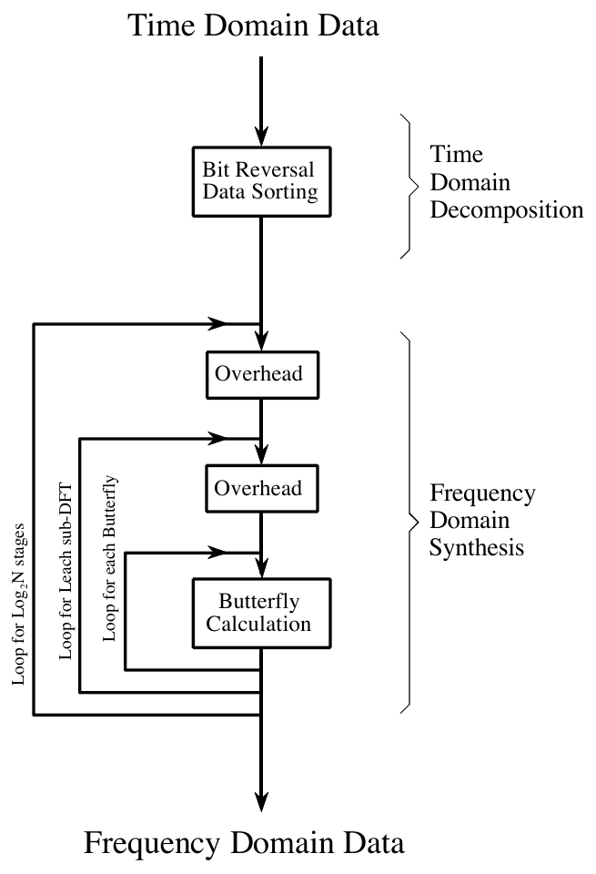

**图 12-7　FFT 流程图。** 它基于三个步骤：(1) 把一个 N 点时域信号分解成 N 个各含一个点的信号；(2) 求这 N 个点信号各自的频谱（什么都不用做）；(3) 把这 N 个频谱合成为一个频谱。
（Time Domain Data = 时域数据，Bit Reversal Data Sorting = 位反转数据排序，Time Domain Decomposition = 时域分解；Overhead = 开销（准备循环下标和正弦值），Butterfly Calculation = 蝶形计算，Frequency Domain Synthesis = 频域合成，Frequency Domain Data = 频域数据。三个循环从外到内：Loop for Log₂N stages = 遍历 log₂N 个阶段，Loop for each sub-DFT = 遍历每个子 DFT（原图误印为 Leach），Loop for each Butterfly = 遍历每个蝶形。）

## FFT 程序

第 8 章讲过，实数 DFT 可以通过把时域信号与正弦波和余弦波做相关来计算（见表 8-2）。表 12-2 给出了用同样的方法计算复数 DFT 的程序。公平对比的话，FFT 改进的正是这个程序。

**表 12-2**（注释已译成中文）

```basic
5000 'COMPLEX DFT BY CORRELATION
5010 '进入时，N% 是 DFT 的点数，
5020 'XR[ ] 和 XI[ ] 是时域的实部和虚部。
5030 '返回时，REX[ ] 和 IMX[ ] 存放频域数据。
5040 '所有信号都从 0 到 N%-1。
5050 '
5060 PI = 3.14159265                           '设置常数
5070 '
5080 FOR K% = 0 TO N%-1                        '把 REX[ ] 和 IMX[ ] 清零，
5090 REX[K%] = 0                               '以便相关时当累加器用
5100 IMX[K%] = 0
5110 NEXT K%
5120 '
5130 FOR K% = 0 TO N%-1                        '遍历频域的每个值
5140 FOR I% = 0 TO N%-1                        '与复正弦 SR 和 SI 做相关
5150 '
5160 SR = COS(2*PI*K%*I%/N%)                   '计算复正弦
5170 SI = -SIN(2*PI*K%*I%/N%)
5180 REX[K%] = REX[K%] + XR[I%]*SR - XI[I%]*SI
5190 IMX[K%] = IMX[K%] + XR[I%]*SI + XI[I%]*SR
5200 '
5210 NEXT I%
5220 NEXT K%
5230 '
5240 RETURN
```

**C 实现**（完整可编译版本见 `c/table12-2_complex_dft_correlation.c`）：

```c
/* 5000：相关法复数 DFT。xr/xi 是时域，rex/imx 是频域，下标都是 0～n-1 */
static void complex_dft(const double *xr, const double *xi, int n, double *rex, double *imx)
{
    for (int k = 0; k < n; k++) {           /* 5080～5110：REX[]、IMX[] 清零，相关时当累加器用 */
        rex[k] = 0.0;
        imx[k] = 0.0;
    }
    for (int k = 0; k < n; k++)             /* 5130：遍历频域的每个点 */
        for (int i = 0; i < n; i++) {       /* 5140：与复正弦 SR、SI 做相关 */
            double sr = cos(2.0 * PI * k * i / n);      /* 5160～5170：算出复正弦 */
            double si = -sin(2.0 * PI * k * i / n);
            rex[k] += xr[i] * sr - xi[i] * si;          /* 5180～5190：复数乘法后累加 */
            imx[k] += xr[i] * si + xi[i] * sr;
        }
}
```

运行结果（N=64）：冲激的频谱处处为 1+0j（偏差为 0）；频率为 5 的复正弦只在 X[5] 处得到 64，其余点幅度不超过 1.1e-13；实信号的频谱满足"实部偶对称、虚部奇对称"，偏差 1.0e-13。

表 12-3 和表 12-4 是两个不同的 FFT 程序，一个用 FORTRAN 写，一个用 BASIC 写。先看表 12-4 的 BASIC 子程序。它产生的输出与表 12-2 的相关法完全相同，只是快得多。可以用图 12-7 的方框图来辨认这个程序的各个部分。数据通过数组 REX[ ] 和 IMX[ ] 传给这个 FFT 子程序，下标都从 0 到 N−1。从子程序返回时，REX[ ] 和 IMX[ ] 被频域数据覆盖。这是 FFT 高度优化的又一个体现：输入、中间存储和输出都用同一组数组。这种高效的内存使用，对设计计算 FFT 的高速硬件很重要。描述这种内存用法的术语叫原地计算(in-place computation)。

所有 FFT 程序得到的数值结果都一样，但在编程上有些细微差别需要留意。表 12-3 的 FORTRAN 程序体现了其中几种差别。这个程序使用一种叫按频率抽取(decimation in frequency)的算法，而前面介绍的算法叫按时间抽取(decimation in time)。在按频率抽取的算法中，位反转排序放在三重嵌套循环之后进行。还有一些 FFT 程序完全省掉了位反转排序。这些变体都不能显著提高 FFT 的性能，你不必操心用的是哪一种。

FFT 算法之间重要的差别，在于数据怎样传入和传出子程序。在 BASIC 程序中，数据通过数组 REX[ ] 和 IMX[ ] 进出子程序，采样下标从 0 到 N−1。在 FORTRAN 程序中，数据通过复数数组 X( ) 传递，采样下标从 1 到 N。由于这是一个复数变量数组，X( ) 中的每个采样都由两个数组成：实部和虚部。DFT 的长度也必须传给这些子程序。BASIC 程序用变量 N% 来传；相比之下，FORTRAN 程序用变量 M，它定义为 $\log_2 N$。例如，256 点 DFT 的 M 是 8，4096 点 DFT 的 M 是 12，等等。要点是，写 FFT 子程序的程序员在怎样与主程序对接方面有很多选择。像 FORTRAN 程序这样从 1 到 N 的数组尤其让人恼火。大多数 DSP 文献（包括本书）都假定数组从第 0 到第 N−1 个采样来讲解算法。例如，如果数组从 1 到 N，频域的对称中心就是第 1 点和第 N/2+1 点，而不是第 0 点和第 N/2 点。

**表 12-3　用 FORTRAN 写的快速傅里叶变换。** 数据通过变量 X( ) 和 M 传给这个子程序。整数 M 是 DFT 长度的以 2 为底的对数，例如 256 点 DFT 的 M = 8，4096 点 DFT 的 M = 12，等等。复数数组 X( ) 在进入时存放时域数据，从子程序返回时被频域数据覆盖。注意：这个子程序要求输入和输出信号从 X(1) 到 X(N)，而不是通常的 X(0) 到 X(N−1)。

```fortran
      SUBROUTINE FFT(X,M)
      COMPLEX X(4096),U,S,T
      PI=3.14159265
      N=2**M
      DO 20 L=1,M
      LE=2**(M+1-L)
      LE2=LE/2
      U=(1.0,0.0)
      S=CMPLX(COS(PI/FLOAT(LE2)),-SIN(PI/FLOAT(LE2)))
      DO 20 J=1,LE2
      DO 10 I=J,N,LE
      IP=I+LE2
      T=X(I)+X(IP)
      X(IP)=(X(I)-X(IP))*U
 10   X(I)=T
 20   U=U*S
      ND2=N/2
      NM1=N-1
      J=1
      DO 50 I=1,NM1
      IF(I.GE.J) GO TO 30
      T=X(J)
      X(J)=X(I)
      X(I)=T
 30   K=ND2
 40   IF(K.GE.J) GO TO 50
      J=J-K
      K=K/2
      GO TO 40
 50   J=J+K
      RETURN
      END
```

**C 实现**（完整可编译版本见 `c/table12-3_fft_fortran.c`。为了逐行对照，C 版本同样用从 1 开始的下标，复数用 C99 的 `double complex`）：

```c
/* SUBROUTINE FFT(X,M)：x[1]～x[n] 进为时域、出为频域 */
static void fft_fortran(double complex *x, int m)
{
    int n = 1 << m;                                         /* N=2**M */
    for (int l = 1; l <= m; l++) {                          /* DO 20 L=1,M：遍历每一级 */
        int le = 1 << (m + 1 - l);                          /* LE=2**(M+1-L)：本级子 DFT 的长度，从 N 开始逐级减半 */
        int le2 = le / 2;
        double complex u = 1.0;                             /* U=(1.0,0.0) */
        double complex s = cos(PI / le2) - I * sin(PI / le2);   /* S=CMPLX(COS(PI/LE2),-SIN(PI/LE2)) */
        for (int j = 1; j <= le2; j++) {                    /* DO 20 J=1,LE2 */
            for (int i = j; i <= n; i += le) {              /* DO 10 I=J,N,LE：遍历每个蝶形 */
                int ip = i + le2;
                double complex t = x[i] + x[ip];            /* T=X(I)+X(IP) */
                x[ip] = (x[i] - x[ip]) * u;                 /* X(IP)=(X(I)-X(IP))*U：先相减再乘正弦，与按时间抽取的蝶形相反 */
                x[i] = t;                                   /* 10 X(I)=T */
            }
            u = u * s;                                      /* 20 U=U*S：标号 20 属于 J 循环，每个 J 转一次 */
        }
    }

    int nd2 = n / 2, nm1 = n - 1, j = 1;                    /* ND2=N/2，NM1=N-1，J=1 */
    for (int i = 1; i <= nm1; i++) {                        /* DO 50 I=1,NM1：位反转排序 */
        if (i < j) {                                        /* IF(I.GE.J) GO TO 30 */
            double complex t = x[j];
            x[j] = x[i];
            x[i] = t;
        }
        int k = nd2;                                        /* 30 K=ND2 */
        while (k < j) {                                     /* 40 IF(K.GE.J) GO TO 50 */
            j -= k;                                         /* J=J-K */
            k /= 2;                                         /* K=K/2，GO TO 40 */
        }
        j += k;                                             /* 50 J=J+K */
    }
}
```

运行结果：随机复信号与相关法复数 DFT 逐点比较，最大偏差 N=8 时 1.9e-15，N=64 时 1.4e-13，N=1024 时 1.0e-11。

**表 12-4　用 BASIC 写的快速傅里叶变换。**（注释已译成中文）

```basic
1000 'THE FAST FOURIER TRANSFORM
1010 '进入时，N% 是 DFT 的点数，REX[ ] 和
1020 'IMX[ ] 是输入的实部和虚部。返回时，
1030 'REX[ ] 和 IMX[ ] 存放 DFT 的输出。所有信号都从 0 到 N%-1。
1040 '
1050 PI = 3.14159265                                    '设置常数
1060 NM1% = N%-1
1070 ND2% = N%/2
1080 M% = CINT(LOG(N%)/LOG(2))
1090 J% = ND2%
1100 '
1110 FOR I% = 1 TO N%-2                                 '位反转排序
1120 IF I% >= J% THEN GOTO 1190
1130 TR = REX[J%]
1140 TI = IMX[J%]
1150 REX[J%] = REX[I%]
1160 IMX[J%] = IMX[I%]
1170 REX[I%] = TR
1180 IMX[I%] = TI
1190 K% = ND2%
1200 IF K% > J% THEN GOTO 1240
1210 J% = J%-K%
1220 K% = K%/2
1230 GOTO 1200
1240 J% = J%+K%
1250 NEXT I%
1260 '
1270 FOR L% = 1 TO M%                                   '遍历每一级
1280 LE% = CINT(2^L%)
1290 LE2% = LE%/2
1300 UR = 1
1310 UI = 0
1320 SR = COS(PI/LE2%)                                  '计算正弦和余弦值
1330 SI = -SIN(PI/LE2%)
1340 FOR J% = 1 TO LE2%                                 '遍历每个子 DFT
1350 JM1% = J%-1
1360 FOR I% = JM1% TO NM1% STEP LE%                     '遍历每个蝶形
1370     IP% = I%+LE2%
1380     TR = REX[IP%]*UR - IMX[IP%]*UI                 '蝶形计算
1390     TI = REX[IP%]*UI + IMX[IP%]*UR
1400     REX[IP%] = REX[I%]-TR
1410     IMX[IP%] = IMX[I%]-TI
1420     REX[I%] = REX[I%]+TR
1430     IMX[I%] = IMX[I%]+TI
1440 NEXT I%
1450 TR = UR
1460 UR = TR*SR - UI*SI
1470 UI = TR*SI + UI*SR
1480 NEXT J%
1490 NEXT L%
1500 '
1510 RETURN
```

**C 实现**（完整可编译版本见 `c/table12-4_fft.c`）：

```c
/* 1110～1250：位反转排序 */
static void bit_reversal_sort(double *rex, double *imx, int n)
{
    int nd2 = n / 2, j = nd2;                   /* 1070、1090：ND2% = N%/2，J% = ND2% */
    for (int i = 1; i <= n - 2; i++) {          /* 1110：第 0 点和第 N-1 点不用动 */
        if (i < j) {                            /* 1120：I% >= J% 时跳过，保证每对只交换一次 */
            double tr = rex[j], ti = imx[j];    /* 1130～1180：交换第 I、J 点 */
            rex[j] = rex[i];
            imx[j] = imx[i];
            rex[i] = tr;
            imx[i] = ti;
        }
        int k = nd2;                            /* 1190 */
        while (k <= j) {                        /* 1200：K% > J% 时跳出 */
            j -= k;                             /* 1210 */
            k /= 2;                             /* 1220～1230 */
        }
        j += k;                                 /* 1240：J 是 I+1 的位反转值 */
    }
}

/* 1000：FFT */
static void fft(double *rex, double *imx, int n)
{
    int nm1 = n - 1;                            /* 1060 */
    int m = (int)lround(log(n) / log(2));       /* 1080：M% = log2 N，级数 */

    bit_reversal_sort(rex, imx, n);

    for (int l = 1; l <= m; l++) {              /* 1270：遍历每一级 */
        int le = 1 << l;                        /* 1280：本级合成后每个频谱的点数 */
        int le2 = le / 2;                       /* 1290 */
        double ur = 1.0, ui = 0.0;              /* 1300～1310：正弦因子 U 从 1 开始 */
        double sr = cos(PI / le2);              /* 1320～1330：每步把 U 转过的角度 */
        double si = -sin(PI / le2);
        for (int j = 1; j <= le2; j++) {        /* 1340：遍历每个子 DFT 中的点位 */
            int jm1 = j - 1;                    /* 1350 */
            for (int i = jm1; i <= nm1; i += le) {      /* 1360：遍历每个蝶形 */
                int ip = i + le2;                       /* 1370 */
                double tr = rex[ip] * ur - imx[ip] * ui;    /* 1380～1390：下面那个点乘正弦（图 12-6 的 ×S） */
                double ti = rex[ip] * ui + imx[ip] * ur;
                rex[ip] = rex[i] - tr;                  /* 1400～1410：蝶形的减法分支 */
                imx[ip] = imx[i] - ti;
                rex[i] = rex[i] + tr;                   /* 1420～1430：蝶形的加法分支 */
                imx[i] = imx[i] + ti;
            }
            double tr = ur;                     /* 1450～1470：U 乘以 S，转到下一个角度 */
            ur = tr * sr - ui * si;
            ui = tr * si + ui * sr;
        }
    }
}
```

运行结果：
- 16 点位反转排序后的顺序是 0 8 4 12 2 10 6 14 1 9 5 13 3 11 7 15，与图 12-3 右栏一致。
- 随机复信号与相关法复数 DFT 逐点比较，最大偏差 N=16 时 1.5e-14，N=256 时 1.1e-12，N=4096 时 7.5e-11。
- 在这台机器上（双精度），N=4096 时 FFT 约 0.1 ms，相关法约 97 ms，快了大约 900 倍。

用复数 DFT 计算实数 DFT 还有一个有趣的好处：复数 DFT 在时域和频域之间比实数 DFT 更对称，也就是说对偶性更强。这意味着，逆 DFT 和正 DFT 几乎一模一样。事实上，计算逆 FFT 最简单的办法，就是计算一次正向 FFT，再调整一下数据。表 12-5 给出了用这种方法计算逆 FFT 的子程序。

**表 12-5**（注释已译成中文）

```basic
2000 'INVERSE FAST FOURIER TRANSFORM SUBROUTINE
2010 '进入时，N% 是 IDFT 的点数，REX[ ] 和
2020 'IMX[ ] 是复数频域的实部和虚部。
2030 '返回时，REX[ ] 和 IMX[ ] 存放复数时域。
2040 '所有信号都从 0 到 N%-1。
2050 '
2060 FOR K% = 0 TO N%-1                       '把 IMX[ ] 取反
2070 IMX[K%] = -IMX[K%]
2080 NEXT K%
2090 '
2100 GOSUB 1000                               '计算正向 FFT（表 12-3）
2110 '
2120 FOR I% = 0 TO N%-1                       '时域除以 N%，
2130 REX[I%] = REX[I%]/N%                     '并把 IMX[ ] 取反
2140 IMX[I%] = -IMX[I%]/N%
2150 NEXT I%
2160 '
2170 RETURN
```

> **译注：** 第 2100 行注释写"表 12-3"，但 GOSUB 1000 调用的是表 12-4 的 BASIC 版 FFT（表 12-3 是 FORTRAN 版）。

**C 实现**（完整可编译版本见 `c/table12-5_inverse_fft.c`。原书 BASIC 用单精度，这个文件也全程用 `float`，以便重做图 12-9 的精度实验）：

```c
/* 2000：逆 FFT */
static void inverse_fft(real_t *rex, real_t *imx, int n)
{
    for (int k = 0; k < n; k++)                 /* 2060～2080：IMX[] 取反 */
        imx[k] = -imx[k];

    fft(rex, imx, n);                           /* 2100：做一次正向 FFT（原书注释写的是表 12-3，实为表 12-4） */

    for (int i = 0; i < n; i++) {               /* 2120～2150：时域除以 N，IMX[] 再取反 */
        rex[i] = rex[i] / n;
        imx[i] = -imx[i] / n;
    }
}
```

假设你把其中一个 FFT 算法抄进自己的程序并运行起来，怎么知道它工作正常？常用的调试技巧有两个。第一，从某个任意的时域信号开始，比如用随机数发生器产生的信号，让它通过 FFT。然后把得到的频谱送进逆 FFT，把结果与原信号比较。除了舍入噪声（单精度下为百万分之几），两者应该完全相同。

第二个检查是信号的对称性是否正确。当时域信号的虚部全为零时（通常情况），复数 DFT 的频域会关于第 0 个和第 N/2 个采样对称，如前所述。同样，当频域中存在这种正确的对称性时，逆 DFT 产生的时域虚部全为零（加上舍入噪声）。这些调试技巧是使用 FFT 必不可少的，要熟练掌握。

## 速度与精度比较

用相关法计算 DFT 时（如表 12-2），程序使用两个嵌套循环，每个都遍历 N 个点。这意味着总运算次数正比于 N 乘以 N。因此，程序完成所需的时间为：

**公式 12-1**　DFT 执行时间。用相关法计算 DFT 所需的时间正比于 DFT 长度的平方。

$$\text{执行时间} = k_{DFT}\, N^2$$

其中 N 是 DFT 的点数，$k_{DFT}$ 是比例常数。如果在嵌套循环内部计算正弦和余弦值，在 100 MHz 的奔腾上 $k_{DFT}$ 约为 25 微秒。如果预先算好正弦和余弦值并存进查找表(look-up-table)，$k_{DFT}$ 降到约 7 微秒。例如，一个 1024 点 DFT 大约需要 25 秒，即每个点将近 25 毫秒。太慢了！

用同样的思路可以推出 FFT 的执行时间。位反转所需的时间可以忽略不计。在 $\log_2 N$ 个阶段中，每个阶段有 N/2 次蝶形运算。这意味着程序的执行时间近似为：

**公式 12-2**　FFT 执行时间。用 FFT 计算 DFT 所需的时间正比于 N 乘以 N 的对数。

$$\text{执行时间} = k_{FFT}\, N \log_2 N$$

在 100 MHz 的奔腾系统上，$k_{FFT}$ 约为 10 微秒。一个 1024 点 FFT 执行大约需要 70 毫秒，即每个点 70 微秒。这比用相关法计算 DFT 快 300 多倍！

> **译注：** 按公式 12-2 和 $k_{FFT}$ ≈ 10 微秒，1024 点 FFT 应约为 10 μs × 1024 × 10 ≈ 100 毫秒，与原书说的 70 毫秒对不太上；数量级一致，不影响结论。

$N \log_2 N$ 不仅比 $N^2$ 小，而且随 N 增大增长得慢得多。例如，32 点 FFT 比相关法快约十倍，而 4096 点 FFT 快一千倍。N 较小时（比如 32 到 128），FFT 很重要；N 较大时（1024 及以上），FFT 绝对关键。图 12-8 以图形方式比较了两种算法的执行时间。

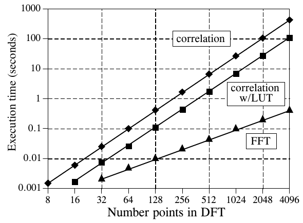

**图 12-8　计算 DFT 的执行时间。** 相关法指表 12-2 描述的算法。预先算好正弦和余弦值并存进查找表（LUT），可以让这种方法更快。当 DFT 长于 16 点时，FFT（表 12-3）是最快的算法。图中的时间是在 100 MHz 奔腾处理器上测得的。
（Execution time (seconds) = 执行时间（秒），Number points in DFT = DFT 的点数；correlation = 相关法，correlation w/LUT = 使用查找表的相关法，FFT = FFT。）

FFT 除了速度快，还有另一个优点：因为计算次数少，舍入误差更小，所以 FFT 算得更精确。这可以这样演示：对一个任意信号做 FFT，再把得到的频谱送进逆 FFT。这就重建了原始时域信号，只是多了计算带来的舍入噪声。计算两个信号之差的标准差，就能得到刻画这种噪声的一个数。作为对比，可以用相关法计算的 DFT 及相应的逆 DFT 重复同样的过程。FFT 的舍入噪声与相关法 DFT 相比如何？请看图 12-9。

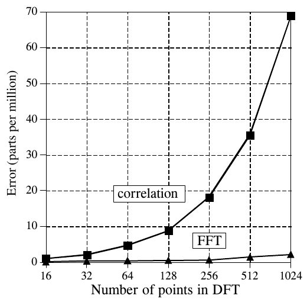

**图 12-9　DFT 的精度。** FFT 计算 DFT 比相关法快，同时舍入误差也更小。
（Error (parts per million) = 误差（百万分之一，ppm），Number of points in DFT = DFT 的点数；correlation = 相关法，FFT = FFT。）

`c/table12-5_inverse_fft.c` 按上文的方法重做了这个实验：全程单精度，随机信号正变换再逆变换，取原信号与还原信号之差的标准差。实测结果如下（ppm）：

| DFT 点数 | 16 | 32 | 64 | 128 | 256 | 512 | 1024 |
|---|---|---|---|---|---|---|---|
| FFT | 0.04 | 0.10 | 0.12 | 0.22 | 0.25 | 0.72 | 0.92 |
| 相关法 | 0.24 | 0.93 | 2.2 | 3.3 | 8.2 | 14 | 32 |

趋势与图 12-9 一致：相关法的误差随 N 快速增长，FFT 一直维持在 1 ppm 左右。具体数值比书上小（书上 1024 点时约 69 ppm 和 2 ppm），这与随机信号的幅度和编译器、浮点库的实现有关。相关法误差大的一个主要原因是它要算 sin(2πki/N)，角度最大接近 2πN，单精度表示这么大的角度本身就有舍入误差；如果先用双精度算好正弦值再转成单精度，两种方法的误差就差不多了。

## 进一步提速

有几种技术能让 FFT 更快，不过提升只有 20～40% 左右。其中一种方法是让时域分解提前两个阶段停下来，此时每个信号只有四个点。不再计算最后两个阶段，而是利用四点正弦、余弦波的简单性，用高度优化的代码直接跳到频域。

另一种流行的算法消除了因时域虚部为零、频谱对称而造成的无用计算。换句话说，把 FFT 修改成计算实数 DFT，而不是复数 DFT。这类算法叫实数 FFT(real FFT) 和实数逆 FFT(real Inverse FFT)（或类似的名字）。可以预期它们比常规 FFT 程序快 30% 左右。表 12-6 和表 12-7 给出了这两种算法的程序。

**表 12-6　实数信号的逆 FFT。**（注释已译成中文）

```basic
4000 'INVERSE FFT FOR REAL SIGNALS
4010 '进入时，N% 是 IDFT 的点数，REX[ ] 和
4020 'IMX[ ] 是频域的实部和虚部，下标从
4030 '0 到 N%/2。REX[ ] 和 IMX[ ] 的其余采样被忽略。
4040 '返回时，REX[ ] 存放实时域信号，IMX[ ] 全为零。
4050 '
4060 '
4070 FOR K% = (N%/2+1) TO (N%-1)                        '让频域对称
4080 REX[K%] = REX[N%-K%]                               '（同表 12-1）
4090 IMX[K%] = -IMX[N%-K%]
4100 NEXT K%
4110 '
4120 FOR K% = 0 TO N%-1                                 '把实部和虚部相加
4130 REX[K%] = REX[K%]+IMX[K%]
4140 NEXT K%
4150 '
4160 GOSUB 3000                                         '计算正向实数 DFT（表 12-6）
4170 '
4180 FOR I% = 0 TO N%-1                                 '把实部和虚部相加，
4190 REX[I%] = (REX[I%]+IMX[I%])/N%                     '并把时域除以 N%
4200 IMX[I%] = 0
4210 NEXT I%
4220 '
4230 RETURN
```

> **译注：** 第 4160 行注释写"表 12-6"，即本表自己；实际调用的第 3000 行子程序是表 12-7 的实数 FFT。另外，"实部加虚部、做正变换、再实部加虚部"之所以能完成逆变换，用的是哈特利变换(Hartley transform)的性质，原书没有解释。

**C 实现**（完整可编译版本见 `c/table12-6_real_inverse_fft.c`，文件里自带一份表 12-4 的 FFT 和表 12-7 的实数 FFT）：

```c
/* 4000：实数逆 FFT */
static void real_inverse_fft(double *rex, double *imx, int n)
{
    for (int k = n / 2 + 1; k <= n - 1; k++) {  /* 4070～4100：让频域对称（同表 12-1） */
        rex[k] = rex[n - k];
        imx[k] = -imx[n - k];
    }

    for (int k = 0; k <= n - 1; k++)            /* 4120～4140：实部和虚部相加 */
        rex[k] = rex[k] + imx[k];

    real_fft(rex, imx, n);                      /* 4160：做正向实数 FFT（原书注释误写为表 12-6，实为表 12-7） */

    for (int i = 0; i <= n - 1; i++) {          /* 4180～4210：实部虚部相加，再除以 N */
        rex[i] = (rex[i] + imx[i]) / n;
        imx[i] = 0;
    }
}
```

运行结果：随机实信号经实数 FFT 变到频域，只把第 0～N/2 点交给实数逆 FFT（其余点故意写成垃圾值 999），还原结果与原信号最大偏差 N=8 时 1.1e-16，N=64 时 5.3e-16，N=1024 时 1.8e-14。

使用实数 FFT 有两个小缺点。第一，代码长了大约一倍。你的计算机并不在乎，但你得花时间把别人的程序改到自己的机器上运行。第二，调试这些程序稍难一些，因为你不能再用对称性来检查它是否工作正常：这些算法强制时域虚部为零、频域左右对称。调试时，要检查它们的输出与常规 FFT 算法是否一致。

图 12-10 和图 12-11 说明了实数 FFT 的工作原理。在图 12-10 中，(a) 和 (b) 是一个时域信号：实部是一个脉冲，虚部全为零。(c) 和 (d) 是对应的频谱。如前所述，频域的实部关于第 0 个和第 N/2 个采样偶对称(even symmetry)，虚部关于同样这两点奇对称(odd symmetry)。

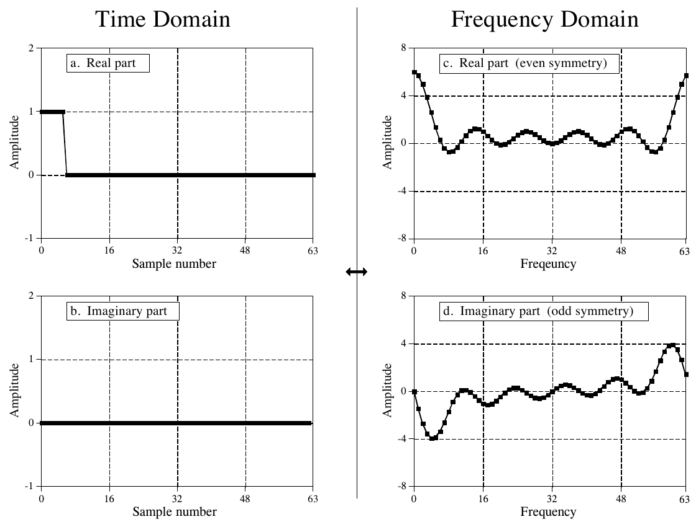

**图 12-10　DFT 的实部对称性。**
（Time Domain = 时域，Frequency Domain = 频域；a. Real part = 实部，b. Imaginary part = 虚部，c. Real part (even symmetry) = 实部（偶对称），d. Imaginary part (odd symmetry) = 虚部（奇对称）。Amplitude = 幅度，Sample number = 采样序号，Frequency = 频率（(c) 的横轴标注原书误拼为 Freqeuncy）。）

再看图 12-11，这时脉冲在时域的虚部，实部全为零。频域的对称性反了过来：实部是奇对称，虚部是偶对称。这种情况将在第 29 章讨论（译注：实为第 31 章）。眼下就先接受复数 DFT 是这样表现的。

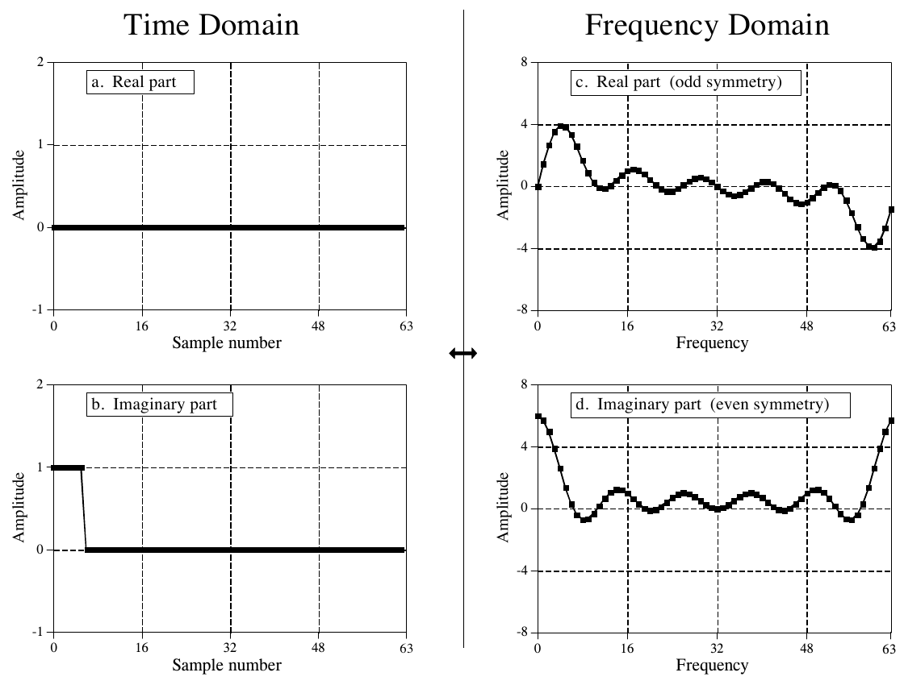

**图 12-11　DFT 的虚部对称性。**
（a. Real part = 实部，b. Imaginary part = 虚部，c. Real part (odd symmetry) = 实部（奇对称），d. Imaginary part (even symmetry) = 虚部（偶对称）。其余标注同图 12-10。）

如果时域的两部分都有信号呢？根据可加性，频域就是两个频谱之和。关键在于：由这两种对称性组成的频谱，可以完美地分离成两个分量信号。这可以用偶/奇分解(even/odd decomposition)来实现，该方法在第 6 章讨论过（译注：实为第 5 章）。换句话说，花一次 FFT 的代价就能算出两个实数 DFT。把一个信号放进时域实部，另一个信号放进时域虚部。计算复数 DFT（当然是用 FFT）之后，再用偶/奇分解把两个频谱分开。当需要让两个或更多信号通过 FFT 时，这种技术能把执行时间减少约 40%。之所以达不到整整两倍，是因为偶/奇分解本身也要花计算时间。这是一种相对简单、陷阱很少的技术，完全不像从零写一个 FFT 程序那样难。

下一步是修改算法，让单个 DFT 算得更快。方法很难看，但做法如下。用交错分解把输入信号一分为二：N/2 个偶数点放进时域信号的实部，N/2 个奇数点放进虚部。然后计算一个 N/2 点 FFT，所需时间大约是 N 点 FFT 的一半。再用偶/奇分解把得到的频域分开，得到两个交错时域信号的频谱。最后，像 FFT 的最后一个合成阶段那样，把这两个频谱合并成一个频谱。

作为本章的结尾，不妨这样看：FFT 之于数字信号处理，就像晶体管之于电子学。它是这门技术的基石；这一领域里人人都知道它的特性和用法，但真正懂得其内部工作细节的，只有少数专家。

**表 12-7　实数信号的 FFT。**（注释已译成中文）

```basic
3000 'FFT FOR REAL SIGNALS
3010 '进入时，N% 是 DFT 的点数，REX[ ] 存放
3020 '实输入信号，IMX[ ] 中的值被忽略。返回时，
3030 'REX[ ] 和 IMX[ ] 存放 DFT 的输出。所有信号都从 0 到 N%-1。
3040 '
3050 NH% = N%/2-1                                   '把偶数点和奇数点分开
3060 FOR I% = 0 TO NH%
3070 REX(I%) = REX(2*I%)
3080 IMX(I%) = REX(2*I%+1)
3090 NEXT I%
3100 '
3110 N% = N%/2                                      '计算 N%/2 点 FFT
3120 GOSUB 1000                                     '（GOSUB 1000 是表 12-3 的 FFT）
3130 N% = N%*2
3140 '
3150 NM1% = N%-1                                    '频域的偶/奇分解
3160 ND2% = N%/2
3170 N4% = N%/4-1
3180 FOR I% = 1 TO N4%
3190 IM% = ND2%-I%
3200 IP2% = I%+ND2%
3210 IPM% = IM%+ND2%
3220 REX(IP2%) = (IMX(I%) + IMX(IM%))/2
3230 REX(IPM%) = REX(IP2%)
3240 IMX(IP2%) = -(REX(I%) - REX(IM%))/2
3250 IMX(IPM%) = -IMX(IP2%)
3260 REX(I%) = (REX(I%) + REX(IM%))/2
3270 REX(IM%) = REX(I%)
3280 IMX(I%) = (IMX(I%) - IMX(IM%))/2
3290 IMX(IM%) = -IMX(I%)
3300 NEXT I%
3310 REX(N%*3/4) = IMX(N%/4)
3320 REX(ND2%) = IMX(0)
3330 IMX(N%*3/4) = 0
3340 IMX(ND2%) = 0
3350 IMX(N%/4) = 0
3360 IMX(0) = 0
3370 '
3380 PI = 3.14159265                                          '补做 FFT 的最后一级
3390 L% = CINT(LOG(N%)/LOG(2))
3400 LE% = CINT(2^L%)
3410 LE2% = LE%/2
3420 UR = 1
3430 UI = 0
3440 SR = COS(PI/LE2%)
3450 SI = -SIN(PI/LE2%)
3460 FOR J% = 1 TO LE2%
3470 JM1% = J%-1
3480 FOR I% = JM1% TO NM1% STEP LE%
3490 IP% = I%+LE2%
3500 TR = REX[IP%]*UR - IMX[IP%]*UI
3510 TI = REX[IP%]*UI + IMX[IP%]*UR
3520 REX[IP%] = REX[I%]-TR
3530 IMX[IP%] = IMX[I%]-TI
3540 REX[I%] = REX[I%]+TR
3550 IMX[I%] = IMX[I%]+TI
3560 NEXT I%
3570 TR = UR
3580 UR = TR*SR - UI*SI
3590 UI = TR*SI + UI*SR
3600 NEXT J%
3610 RETURN
```

> **译注：** 第 3120 行注释写"表 12-3"，实际调用的是表 12-4 的 BASIC 版 FFT。原程序中数组括号 ( ) 和 [ ] 混用，含义相同。

**C 实现**（完整可编译版本见 `c/table12-7_real_fft.c`，文件里自带一份表 12-4 的 FFT）：

```c
/* 3000：实数 FFT。进入时 rex[] 是实信号（imx[] 内容忽略），返回时 rex/imx 是 0～n-1 的完整频谱 */
static void real_fft(double *rex, double *imx, int n)
{
    int nh = n / 2 - 1;                         /* 3050：拆开偶数点和奇数点 */
    for (int i = 0; i <= nh; i++) {             /* 3060～3090：偶数点进实部，奇数点进虚部 */
        rex[i] = rex[2 * i];                    /* 从小下标往上写，不会覆盖还没读的点 */
        imx[i] = rex[2 * i + 1];
    }

    fft(rex, imx, n / 2);                       /* 3110～3130：做 N/2 点 FFT */

    int nm1 = n - 1, nd2 = n / 2, n4 = n / 4 - 1;   /* 3150～3170：频域的偶/奇分解 */
    for (int i = 1; i <= n4; i++) {             /* 3180：每次处理一对对称点 I 和 N/2-I */
        int im = nd2 - i;                       /* 3190 */
        int ip2 = i + nd2;                      /* 3200 */
        int ipm = im + nd2;                     /* 3210 */
        rex[ip2] = (imx[i] + imx[im]) / 2;      /* 3220～3250：奇数点信号的频谱，放在后半段 */
        rex[ipm] = rex[ip2];
        imx[ip2] = -(rex[i] - rex[im]) / 2;
        imx[ipm] = -imx[ip2];
        rex[i] = (rex[i] + rex[im]) / 2;        /* 3260～3290：偶数点信号的频谱，留在前半段 */
        rex[im] = rex[i];
        imx[i] = (imx[i] - imx[im]) / 2;
        imx[im] = -imx[i];
    }
    rex[n * 3 / 4] = imx[n / 4];                /* 3310～3360：自身对称的 0 和 N/4 两点单独处理 */
    rex[nd2] = imx[0];
    imx[n * 3 / 4] = 0;
    imx[nd2] = 0;
    imx[n / 4] = 0;
    imx[0] = 0;

    int l = (int)lround(log(n) / log(2));       /* 3380～3600：补做 FFT 的最后一级 */
    int le = 1 << l;                            /* 3400：最后一级 LE = N */
    int le2 = le / 2;
    double ur = 1.0, ui = 0.0, sr = cos(PI / le2), si = -sin(PI / le2);
    for (int j = 1; j <= le2; j++) {            /* 3460 */
        int jm1 = j - 1;
        for (int i = jm1; i <= nm1; i += le) {  /* 3480：最后一级每个 J 只有一个蝶形 */
            int ip = i + le2;
            double tr = rex[ip] * ur - imx[ip] * ui;    /* 3500～3550：蝶形运算 */
            double ti = rex[ip] * ui + imx[ip] * ur;
            rex[ip] = rex[i] - tr;
            imx[ip] = imx[i] - ti;
            rex[i] = rex[i] + tr;
            imx[i] = imx[i] + ti;
        }
        double tr = ur;                         /* 3570～3590 */
        ur = tr * sr - ui * si;
        ui = tr * si + ui * sr;
    }
}
```

运行结果：
- 随机实信号用实数 FFT 计算，与普通复数 FFT（虚部填 0）逐点比较，最大偏差 N=8 时 1.1e-16，N=64 时 1.8e-15，N=1024 时 1.2e-13。进入时故意在 IMX[ ] 里填了垃圾值，确认它确实被忽略。
- 1024 点各算 20000 次：复数 FFT 154 ms，实数 FFT 80 ms。这台机器上快了约一倍，比书上说的 30% 还多。
