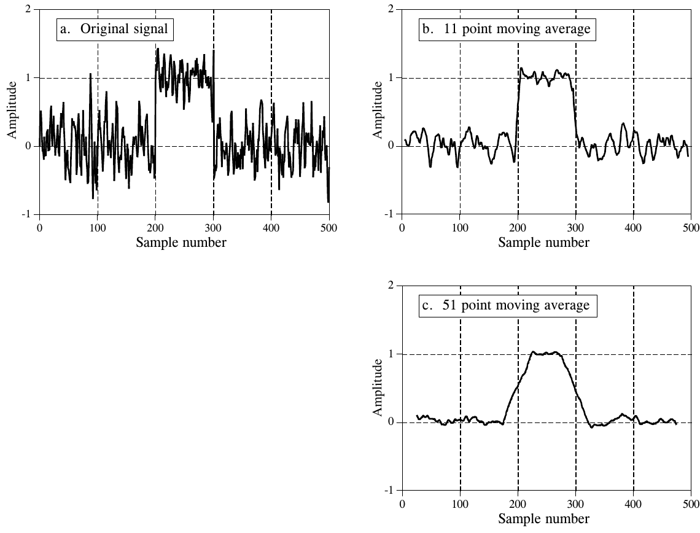
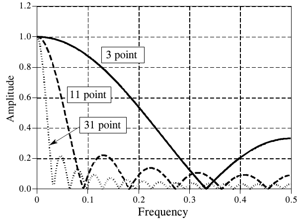
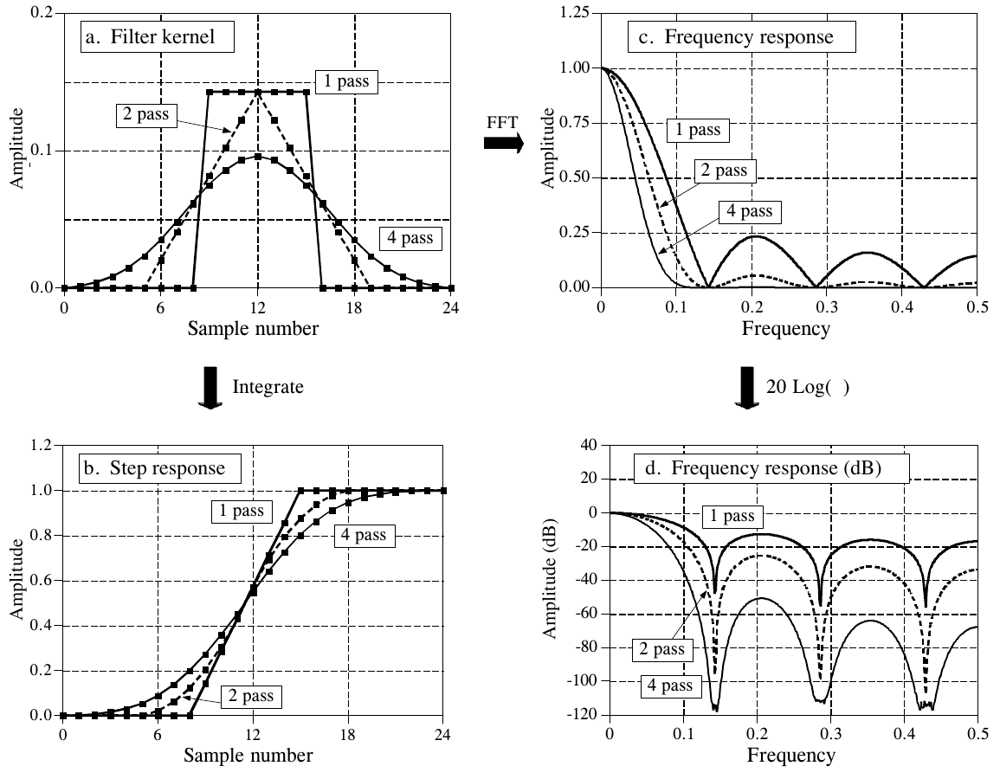
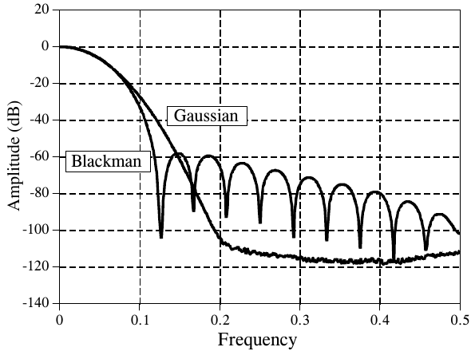

# 《The Scientist and Engineer's Guide to Digital Signal Processing》第 15 章中译

> 原书：上一级目录 `Documents/数学基础/` 下的 `The Scientist and Engineer Guide to Digital Signal Processing.pdf`，对应 PDF 第 288～295 页（原书第 277～284 页）。
> 上一章：[14-DSP指南-第14章中译.md](14-DSP指南-第14章中译.md)。专业名词第一次出现时在括号里附上英文。
> 插图从原书页面裁出，放在 `assets/ch15/`，图里的英文标注在每张图下方给出对照。原书 PDF 的符号字体抽取时会乱码（π 显示成 B，Σ 显示成 j，= 显示成 '，+ 显示成 %，− 显示成 &），公式按原书版面重新用 LaTeX 写出。BASIC 程序的 C 版本在 `c/` 目录。

---

# 第 15 章　移动平均滤波器

移动平均(moving average)是 DSP 中最常用的滤波器，主要因为它是最容易理解和使用的数字滤波器。别看它简单，移动平均滤波器对一项常见任务却是最优的：在保持阶跃响应陡峭的同时降低随机噪声。这使它成为时域编码信号(time domain encoded signal)的首选滤波器。然而，对于频域编码信号(frequency domain encoded signal)，移动平均是最差的滤波器，几乎没有能力把一个频带与另一个频带分开。移动平均滤波器的亲戚包括高斯(Gaussian)滤波器、布莱克曼(Blackman)滤波器和多次移动平均(multiple-pass moving average)滤波器。它们在频域的表现稍好一些，代价是计算时间更长。

## 用卷积实现

顾名思义，移动平均滤波器的做法是：把输入信号中若干个点取平均，得到输出信号中的每一个点。写成公式：

**公式 15-1**　移动平均滤波器的公式。式中 x[ ] 是输入信号，y[ ] 是输出信号，M 是参与平均的点数。这个公式只用到正在计算的输出采样一侧的点。

$$y[i] = \frac{1}{M} \sum_{j=0}^{M-1} x[i+j]$$

其中 x[ ] 是输入信号，y[ ] 是输出信号，M 是平均的点数。例如，在 5 点移动平均滤波器中，输出信号的第 80 点由下式给出：

$$y[80] = \frac{x[80] + x[81] + x[82] + x[83] + x[84]}{5}$$

另一种做法是，从输入信号中围绕输出点对称地选取这组点：

$$y[80] = \frac{x[78] + x[79] + x[80] + x[81] + x[82]}{5}$$

这相当于把公式 15-1 中的求和范围从 $j = 0$ 到 $M-1$ 改成 $j = -(M-1)/2$ 到 $(M-1)/2$。例如，在 11 点移动平均滤波器中，下标 j 可以从 0 到 10（单侧平均），也可以从 −5 到 5（对称平均）。对称平均要求 M 是奇数。只取一侧的点编程稍微容易一点，但会使输入和输出信号之间产生相对平移。

> **译注：** 原书这里写 "from 0 to 11"，11 点的单侧下标应为 0 到 10，译文已改正。

你应该看出来了，移动平均滤波器就是用一个非常简单的滤波器核做卷积。例如，5 点滤波器的滤波器核是：⋯ 0, 0, 1/5, 1/5, 1/5, 1/5, 1/5, 0, 0 ⋯。也就是说，移动平均滤波器就是输入信号与一个面积为一的矩形脉冲(rectangular pulse)做卷积。表 15-1 是实现移动平均滤波器的程序。

**表 15-1**（注释已译成中文）

```basic
100 'MOVING AVERAGE FILTER
110 '这个程序用 101 点移动平均滤波器处理 5000 个采样，
120 '得到 4900 个滤波后的数据。
130 '
140 DIM X[4999]                        'X[ ] 存放输入信号
150 DIM Y[4999]                        'Y[ ] 存放输出信号
160 '
170 GOSUB XXXX                         '虚构的子程序，载入 X[ ]
180 '
190 FOR I% = 50 TO 4949                '遍历输出信号的每个点
200 Y[I%] = 0                          '清零，用作累加器
210 FOR J% = -50 TO 50                 '计算求和
220 Y[I%] = Y[I%] + X(I%+J%]
230 NEXT J%
240 Y[I%] = Y[I%]/101                  '除以点数，完成平均
250 NEXT I%
260 '
270 END
```

> **译注：** 第 220 行原书印成 `X(I%+J%]`，左右括号不配对，应为 `X[I%+J%]`。

**C 实现**（完整可编译版本见 `c/table15-1_moving_average.c`，其中按图 15-1a 的样子生成信号：幅度 1 的矩形脉冲埋在标准差 0.5 的高斯白噪声里）：

```c
#define N    5000                           /* 140 DIM X[4999]：输入 5000 点 */
#define HALF 50                             /* 210：J% 从 -50 到 50，共 101 点 */
#define M    (2 * HALF + 1)

/* 190～250：每个输出点取输入中以它为中心的 101 点求平均 */
static void moving_average(const float *x, float *y)
{
    for (int i = 0; i < N; i++) y[i] = 0.0f; /* 两端 50 点没有完整窗口，不计算，置 0 */
    for (int i = HALF; i < N - HALF; i++) { /* 190：FOR I% = 50 TO 4949 */
        y[i] = 0.0f;                        /* 200：清零，当累加器用 */
        for (int j = -HALF; j <= HALF; j++) /* 210：FOR J% = -50 TO 50 */
            y[i] += x[i + j];               /* 220：原书印成 X(I%+J%]，括号不配对 */
        y[i] /= M;                          /* 240：除以 101 完成平均 */
    }
}
```

运行结果：平坦区的噪声标准差从 0.4905 降到 0.0500，降低 9.81 倍，与理论值 √101 ≈ 10.05 相符；去掉噪声后，脉冲上升沿从第 1950 点离开 0、第 2050 点到达 1，正好 101 点，中点 y[2000] = 0.5050 = 51/101，即阶跃响应是一条直线。

## 降噪与阶跃响应

许多科学家和工程师用移动平均滤波器时会有负罪感。因为它实在太简单，遇到问题时往往第一个就拿它来试。即使问题已经完全解决，心里还是觉得应该再多做点什么。这种情形实在很讽刺。移动平均滤波器不仅在许多应用中表现很好，而且对一个常见问题是最优的：在保持最陡阶跃响应的同时降低随机白噪声(random white noise)。



**图 15-1　移动平均滤波器的例子。** (a) 中一个矩形脉冲埋在随机噪声里。(b) 和 (c) 分别用 11 点和 51 点移动平均滤波器处理这个信号。滤波器的点数越多，噪声越低，但边沿也越不陡峭。对这个问题，移动平均滤波器是最优解：在给定的边沿陡峭度下，它给出可能的最低噪声。
（a. Original signal = 原信号；b. 11 point moving average = 11 点移动平均；c. 51 point moving average = 51 点移动平均。Amplitude = 幅度，Sample number = 采样序号。原书图注把 "become" 印成了 "becoming"。）

图 15-1 是一个说明其作用的例子。(a) 中的信号是埋在随机噪声中的一个脉冲。在 (b) 和 (c) 中，移动平均滤波器的平滑作用降低了随机噪声的幅度（好），但也降低了边沿的陡峭度（坏）。在所有可用的线性滤波器中，对于给定的边沿陡峭度，移动平均产生的噪声最低。降噪的倍数等于平均点数的平方根。例如，100 点移动平均滤波器把噪声降低到原来的十分之一。

要理解移动平均为什么是最好的方案，设想我们要设计一个边沿陡峭度固定的滤波器。比如说，规定阶跃响应的上升段有 11 个点，以此固定边沿陡峭度。这要求滤波器核有 11 个点。优化的问题是：怎样选择滤波器核中的这 11 个值，使输出信号上的噪声最小？由于我们要降低的噪声是随机的，输入中没有哪个点是特殊的，每个点都和它的邻居一样嘈杂。因此，在滤波器核里给某个输入点更大的系数、对它特别优待是没有用的。所有输入采样一视同仁时噪声最低，这就是移动平均滤波器。（本章后面会说明，其他滤波器基本上一样好。重点是，没有哪种滤波器比简单的移动平均更好。）

## 频率响应

图 15-2 是移动平均滤波器的频率响应(frequency response)。如第 11 章所讲，它在数学上由矩形脉冲的傅里叶变换描述：

**公式 15-2**　M 点移动平均滤波器的频率响应。频率 f 在 0 到 0.5 之间。f = 0 时取 H[f] = 1。

$$H[f] = \frac{\sin(\pi f M)}{M \sin(\pi f)}$$

它的滚降(roll-off)非常慢，阻带衰减(stopband attenuation)糟糕透顶。显然，移动平均滤波器无法把一个频带与另一个频带分开。记住，时域表现好会导致频域表现差，反之亦然。简而言之，移动平均是一个格外好的平滑滤波器（时域上的作用），却是一个格外差的低通滤波器（频域上的作用）。



**图 15-2　移动平均滤波器的频率响应。** 由于滚降慢、阻带衰减差，移动平均是一个很差的低通滤波器。这些曲线由公式 15-2 生成。
（3 point / 11 point / 31 point = 3 点 / 11 点 / 31 点。Amplitude = 幅度，Frequency = 频率。）

## 移动平均滤波器的亲戚

在理想世界里，滤波器设计者只需要处理时域编码或频域编码的信息，同一个信号里永远不会两者混杂。可惜，有些应用两个域同时都重要。例如，电视信号就属于这个讨厌的类别。视频信息是在时域编码的，即波形的形状对应图像的亮度分布。然而在传输过程中，视频信号又要按它的频率组成来处理，比如总带宽、伴音和彩色载波怎样加入、直流分量的去除与恢复等。再举一个例子，电磁干扰最好在频域里理解，即使信号的信息是在时域编码的。例如，科学实验中的温度监测信号可能被电源线的 60 Hz、开关电源的 30 kHz 或者本地 AM 电台的 1320 kHz 干扰。移动平均滤波器的亲戚们在频域表现更好，在这类混合域应用中可能很有用。

多次移动平均滤波器(multiple-pass moving average filter)让输入信号两次或更多次通过移动平均滤波器。图 15-3a 给出了通过一次、两次和四次后得到的总滤波器核。两次相当于使用三角形滤波器核（矩形滤波器核与自身卷积）。四次或更多次之后，等效滤波器核看起来就像高斯曲线（回想中心极限定理）。如 (b) 所示，与一次通过的直线相比，多次通过产生 "S" 形的阶跃响应。(c) 和 (d) 中的频率响应等于公式 15-2 自乘通过的次数。也就是说，时域中的每一次卷积，都对应频谱的一次相乘。



**图 15-3　多次移动平均滤波器的特性。** (a) 是让 7 点移动平均滤波器对数据作用一次、两次和四次所得的滤波器核。(b) 是对应的阶跃响应，(c) 和 (d) 是对应的频率响应。
（a. Filter kernel = 滤波器核；b. Step response = 阶跃响应；c. Frequency response = 频率响应；d. Frequency response (dB) = 频率响应（分贝）。1 pass / 2 pass / 4 pass = 一次 / 两次 / 四次；FFT 箭头表示 (a) 经 FFT 得 (c)；Integrate = 积分，表示 (a) 经累加得 (b)；20 Log( ) 表示 (c) 取 20 lg 得 (d)。Amplitude = 幅度，Sample number = 采样序号，Frequency = 频率。）

图 15-4 是移动平均滤波器另外两个亲戚的频率响应。如第 11 章所讲，用纯高斯曲线作滤波器核时，频率响应也是高斯曲线。高斯曲线很重要，因为它是许多自然和人造系统的冲激响应。例如，一个短促的光脉冲进入一条很长的光纤传输线，由于光子在光纤内走的路径各不相同，出来时会变成一个高斯脉冲。高斯滤波器核在图像处理中也用得很广，因为它有一些独特的性质，能实现快速的二维卷积（见第 24 章）。图 15-4 中的第二条频率响应，对应用布莱克曼窗(Blackman window)作滤波器核。（这里"窗"一词没有任何含义，只是这条曲线公认名称的一部分。）布莱克曼窗的确切形状在第 16 章给出（公式 16-2、图 16-2），不过它看起来很像高斯曲线。



**图 15-4　布莱克曼窗和高斯滤波器核的频率响应。** 这两种滤波器的阻带衰减都比移动平均滤波器好。这对去除时域编码信号中的随机噪声没有好处，但在混合域问题中可能有用。这两种滤波器的缺点是必须用卷积，而卷积是一种极慢的算法。
（Gaussian = 高斯，Blackman = 布莱克曼。Amplitude (dB) = 幅度（分贝），Frequency = 频率。）

这些移动平均滤波器的亲戚比移动平均本身好在哪里？有三点。第一，也是最重要的一点，它们的阻带衰减比移动平均滤波器好。第二，滤波器核在两端逐渐收窄到较小的幅度。回想一下，输出信号的每个点都是输入中一组采样的加权和。如果滤波器核逐渐收窄，输入信号中离得较远的采样得到的权重就比离得近的小。第三，阶跃响应是平滑的曲线，而不是移动平均那种生硬的直线。后两点通常益处有限，不过你也可能遇到它们确实成为优势的应用。

在保持阶跃响应陡峭的同时降低随机噪声方面，移动平均滤波器和它的亲戚们差不多一样好。分歧在于阶跃响应的上升时间(risetime)怎么量。如果上升时间从阶跃的 0% 量到 100%，那么如前所示，移动平均滤波器是你能做到的最好结果。相比之下，如果从 10% 量到 90%，布莱克曼窗就比移动平均滤波器好。重点是，这只是理论上的争论；在这个指标上，把这些滤波器看作相同即可。

这些滤波器最大的区别在于执行速度。用递归算法（下面介绍），移动平均滤波器在你的计算机上会快如闪电。事实上，它是现有最快的数字滤波器。多次移动平均会相应地慢一些，但仍然很快。相比之下，高斯和布莱克曼滤波器慢得令人难以忍受，因为它们必须用卷积。可以按"滤波器核点数的十倍"来估计（依据是乘法大约比加法慢 10 倍）。例如，100 点的高斯滤波器预计比用递归实现的移动平均慢 1000 倍。

## 递归实现

移动平均滤波器的一大优势是，它可以用一种非常快的算法来实现。要理解这个算法，设想让输入信号 x[ ] 通过一个 7 点移动平均滤波器，得到输出信号 y[ ]。看看相邻两个输出点 y[50] 和 y[51] 是怎么算的：

$$y[50] = x[47] + x[48] + x[49] + x[50] + x[51] + x[52] + x[53]$$

$$y[51] = x[48] + x[49] + x[50] + x[51] + x[52] + x[53] + x[54]$$

这两个计算几乎相同：x[48] 到 x[53] 这几个点算 y[50] 时要加一遍，算 y[51] 时还要再加一遍。如果 y[50] 已经算出来了，计算 y[51] 最高效的办法是：

$$y[51] = y[50] + x[54] - x[47]$$

用 y[50] 求出 y[51] 之后，就可以由 y[51] 算出 y[52]，依此类推。算出 y[ ] 的第一个点之后，其余每个点都只需要一次加法和一次减法。这可以写成公式：

**公式 15-3**　移动平均滤波器的递归实现。式中 x[ ] 是输入信号，y[ ] 是输出信号，M 是移动平均的点数（奇数）。使用这个公式之前，信号的第一个点必须用普通求和算出。

$$y[i] = y[i-1] + x[i+p] - x[i-q], \qquad p = (M-1)/2, \quad q = p + 1$$

> **译注：** 上面 y[50]、y[51] 的两个式子是 7 个点的和，原书为了简洁省略了除以 7；公式 15-3 同样省略了 1/M。照字面算，y 是窗口内的和而不是平均，实际使用时要再除以 M（或者在加减时就用 x/M）。

注意这个公式用两种数据来源计算输出中的每个点：输入中的点，以及输出中先前算好的点。这叫做递归方程(recursive equation)，意思是一次计算的结果会用于以后的计算。（"递归"一词也有别的含义，尤其在计算机科学中。）第 19 章会更详细地讨论各种递归滤波器。要注意，移动平均递归滤波器与典型的递归滤波器很不一样。特别是，大多数递归滤波器的冲激响应无限长（无限冲激响应，infinite impulse response，IIR），由正弦和指数组成。而移动平均的冲激响应是一个矩形脉冲（有限冲激响应，finite impulse response，FIR）。

这个算法比其他数字滤波器快，原因有几个。第一，无论滤波器核多长，每个点都只有两次运算。第二，只需要加法和减法，而大多数数字滤波器需要耗时的乘法。第三，索引方式非常简单。公式 15-3 中的每个下标，都是加上或减去一个在滤波开始前就能算好的整数常数（即 p 和 q）。第四，整个算法可以全部用整数表示来完成。根据所用的硬件，整数运算可能比浮点运算快一个数量级以上。

> **译注：** 原书把 "Fourth" 拼成了 "Forth"。

出人意料的是，对这个算法而言，整数表示不但更快，效果也比浮点更好。如果不小心，浮点运算的舍入误差(round-off error)会造成意想不到的结果。例如，设想用这种方法处理一个 10,000 个采样的信号。滤波后信号的最后一个采样，带有 10,000 次加法和 10,000 次减法累积下来的误差。这在输出信号中表现为一个漂移的偏移量。整数没有这个问题，因为整数运算没有舍入误差。如果你必须在这个算法中用浮点数，表 15-2 的程序展示了怎样用双精度累加器来消除这种漂移。

**表 15-2**（注释已译成中文）

```basic
100 'MOVING AVERAGE FILTER IMPLEMENTED BY RECURSION
110 '这个程序用 101 点移动平均滤波器处理 5000 个采样，
120 '得到 4900 个滤波后的数据。
130 '使用双精度累加器，防止舍入造成的漂移。
140 '
150 DIM X[4999]                        'X[ ] 存放输入信号
160 DIM Y[4999]                        'Y[ ] 存放输出信号
170 DEFDBL ACC                         '把变量 ACC 定义为双精度
180 '
190 GOSUB XXXX                         '虚构的子程序，载入 X[ ]
200 '
210 ACC = 0                            '把 X[0] 到 X[100] 平均，求出 Y[50]
220 FOR I% = 0 TO 100
230 ACC = ACC + X[I%]
240 NEXT I%
250 Y[[50] = ACC/101
260 '                                  '递归移动平均滤波器（公式 15-3）
270 FOR I% = 51 TO 4949
280 ACC = ACC + X[I%+50] - X[I%-51]
290 Y[I%] = ACC
300 NEXT I%
310 '
320 END
```

> **译注：** 第 250 行 `Y[[50]` 多了一个左括号，应为 `Y[50]`。第 290 行原书写成 `Y[I%] = ACC`，漏了除以 101：ACC 是 101 个点的和，第 250 行算 Y[50] 时除了 101，这里也应写成 `Y[I%] = ACC/101`，否则从第 51 点起输出会突然变成 101 倍。

**C 实现**（完整可编译版本见 `c/table15-2_recursive_moving_average.c`，信号与表 15-1 的 C 版本相同；程序还附带一个单精度累加器的版本，用来复现书里说的舍入漂移）：

```c
#define HALF 50                             /* p = 50，q = 51 */
#define M    (2 * HALF + 1)                 /* 101 点 */

/* 表 15-2：递归实现，累加器 ACC 用 double（第 170 行 DEFDBL ACC） */
static void recursive_double(const float *x, float *y, int n)
{
    double acc = 0.0;                       /* 210：ACC = 0 */
    for (int i = 0; i <= 2 * HALF; i++)     /* 220～240：先把 X[0]～X[100] 加起来 */
        acc += x[i];
    y[HALF] = (float)(acc / M);             /* 250：Y[50] = ACC/101 */
    for (int i = HALF + 1; i < n - HALF; i++) { /* 270：FOR I% = 51 TO 4949 */
        acc += x[i + HALF] - x[i - HALF - 1];   /* 280：加上新进窗口的点，减去刚出窗口的点 */
        y[i] = (float)(acc / M);            /* 290：原书漏了 /101，这里补上 */
    }
}
```

运行结果（与直接求和逐点比较）：

| 信号 | 累加器 | 最大偏差 | 最后一点偏差 |
|---|---|---|---|
| 5000 点（原书设定） | double | 7.5e-8 | 1.4e-8 |
| 5000 点（原书设定） | float | 5.6e-7 | 1.1e-7 |
| 100 万点，带 100 的直流偏置 | double | 3.8e-6 | 3.3e-6 |
| 100 万点，带 100 的直流偏置 | float | 0.0056 | 0.0041 |

5000 点时两种累加器都和直接求和一致（偏差在单精度输出的舍入量级）。信号一长、数值一大，float 累加器的误差就逐点累积，最大偏差比 double 大约 1500 倍，这就是书中说的"漂移的偏移量"。double 那一行的 3.8e-6 只是输出存成 float 时的舍入（100 附近 float 的分辨率约 7.6e-6），不是漂移。
