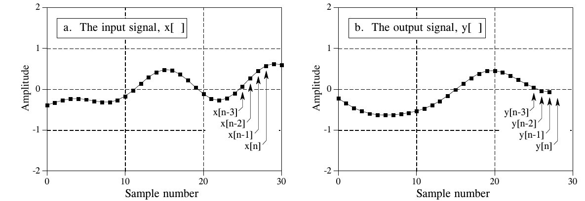
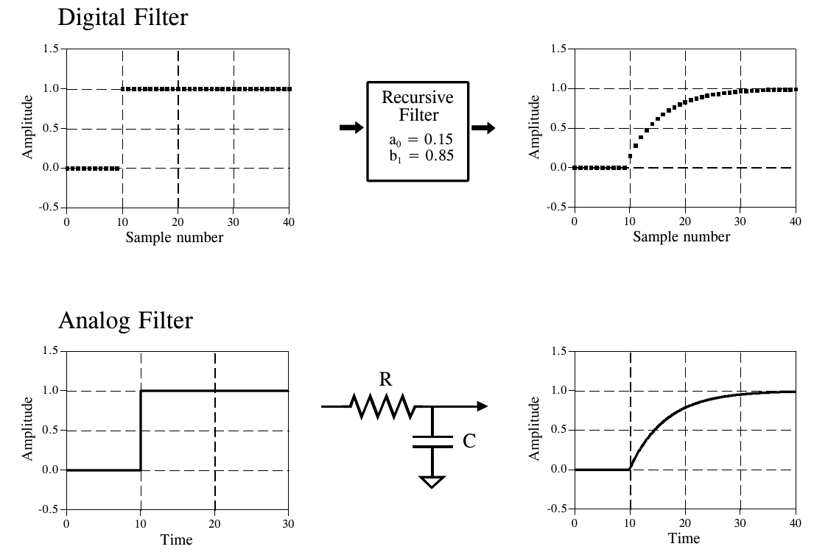
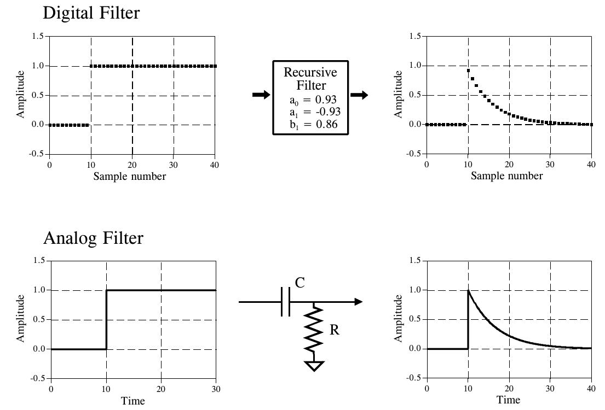
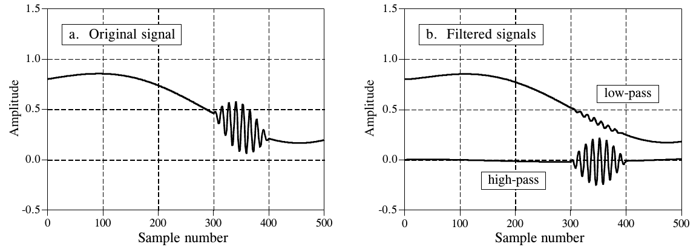
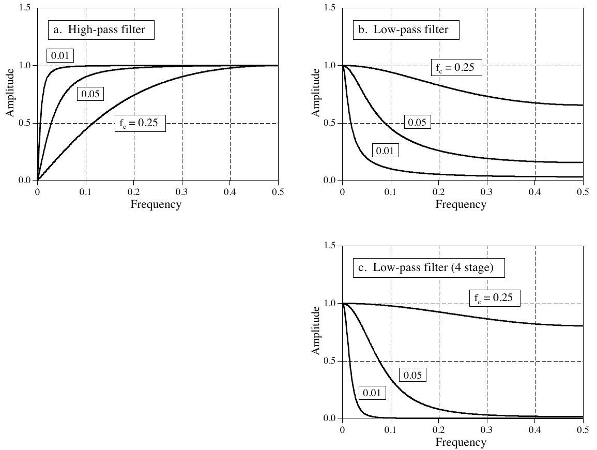
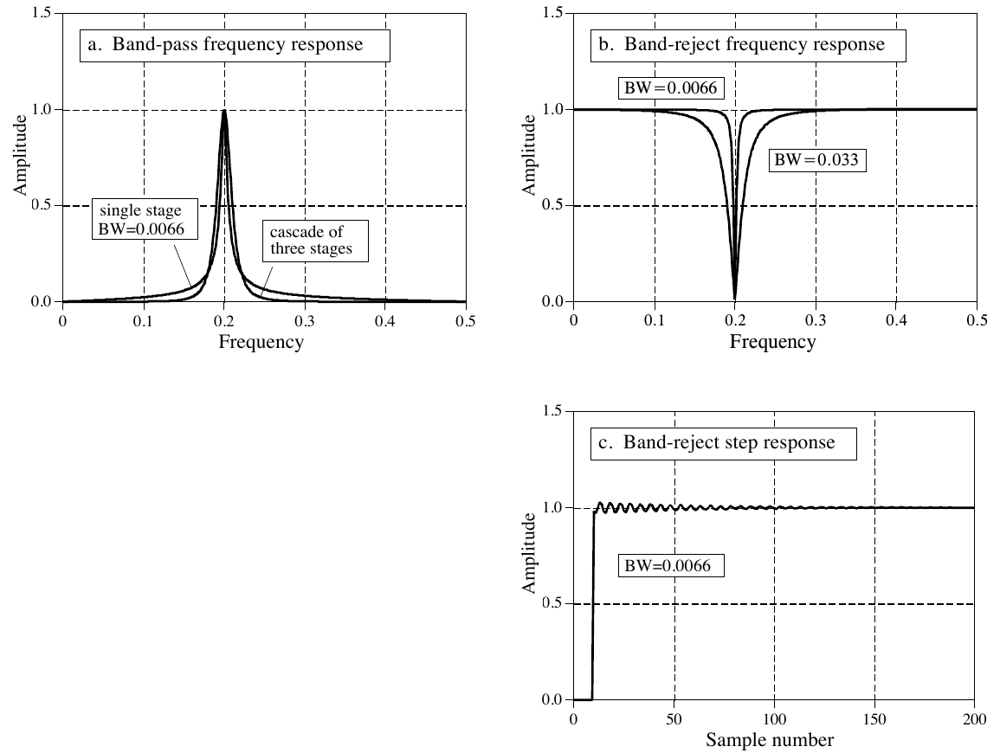
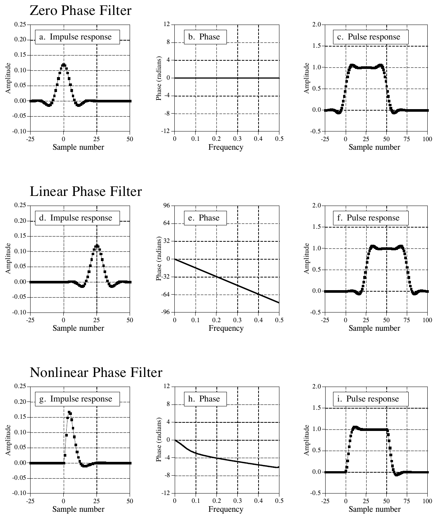
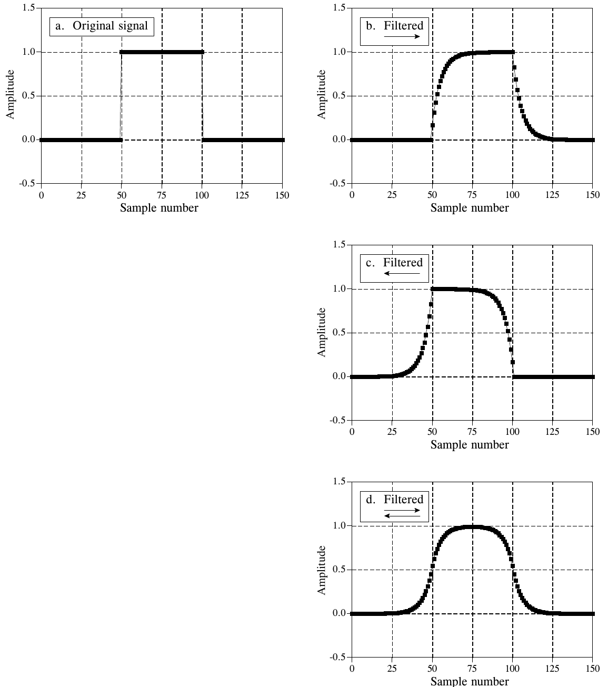

# 《The Scientist and Engineer's Guide to Digital Signal Processing》第 19 章中译

> 原书：上一级目录 `Documents/数学基础/` 下的 `The Scientist and Engineer Guide to Digital Signal Processing.pdf`，对应 PDF 第 330～343 页（原书第 319～332 页）。
> 上一章：[18-DSP指南-第18章中译.md](18-DSP指南-第18章中译.md)。专业名词第一次出现时在括号里附上英文。
> 插图从原书页面裁出，放在 `assets/ch19/`，图里的英文标注在每张图下方给出对照。原书 PDF 的符号字体抽取时会乱码（= 显示成 '，+ 显示成 %，− 显示成 &，π 显示成 B，⋯ 显示成 þ），公式按原书版面重新用 LaTeX 写出。BASIC 程序的 C 版本在 `c/` 目录。

---

# 第 19 章　递归滤波器

递归滤波器(recursive filter)是一种不必做很长的卷积、就能得到很长冲激响应的高效方法。它们执行起来非常快，但性能和灵活性不如其他数字滤波器。递归滤波器也叫无限冲激响应(Infinite Impulse Response，IIR)滤波器，因为它们的冲激响应由衰减的指数函数组成。这把它们和用卷积实现的数字滤波器区分开来，后者叫有限冲激响应(Finite Impulse Response，FIR)滤波器。本章介绍递归滤波器怎样工作，以及怎样设计这个家族中的简单成员。第 20、26 和 33 章会介绍更精巧的设计方法。

## 递归方法

为了开始讨论递归滤波器，设想你需要从某个信号 x[ ] 中提取信息。你的需求如此迫切，以至于雇了一位老数学教授来替你处理数据。教授的任务是对 x[ ] 滤波，得到 y[ ]，你希望 y[ ] 里包含你感兴趣的信息。教授开始工作，按照锁在他过度发达的大脑里的某种算法，逐点计算 y[ ]。做到一半，发生了一件极其不幸的事：教授开始念叨解析奇点、分数阶变换，以及数学家噩梦里的其他妖魔鬼怪。很明显，教授疯了。你焦急地看着教授——连同你的算法——被几个穿白大褂的人带走了。

你发疯似地翻阅教授的笔记，想找出他用的算法。你发现他已经算完了 y[0] 到 y[27]，正要开始算 y[28]。如图 19-1 所示，我们用变量 n 表示当前正在计算的点。这意味着 y[n] 是输出信号的第 28 个采样，y[n−1] 是第 27 个，y[n−2] 是第 26 个，依此类推。同样，x[n] 是输入信号的第 28 个点，x[n−1] 是第 27 个点，依此类推。为了理解所用的算法，我们问自己："教授在计算正在处理的采样 y[n] 时，手头有哪些信息？"



**图 19-1　递归滤波器的记法。** 正在计算的输出采样 y[n]，由输入信号的值 x[n]、x[n−1]、x[n−2]、⋯，以及输出信号中先前已算出的值 y[n−1]、y[n−2]、y[n−3]、⋯ 决定。图中 n = 28。
（a. The input signal, x[ ] = 输入信号 x[ ]；b. The output signal, y[ ] = 输出信号 y[ ]。Amplitude = 幅度，Sample number = 采样序号。）

最明显的信息来源是输入信号，即这些值：x[n]、x[n−1]、x[n−2]、⋯。教授可能是把输入信号的每个点乘以一个系数，再把乘积加起来：

$$y[n] = a_0\,x[n] + a_1\,x[n-1] + a_2\,x[n-2] + a_3\,x[n-3] + \cdots$$

你应该认得出来，这无非是简单的卷积，系数 a₀、a₁、a₂、⋯ 构成卷积核。如果教授做的只是这些，这个故事、乃至这一章就没什么必要了。但教授还能用到另一个信息来源：输出信号中先前已算出的值，存放在 y[n−1]、y[n−2]、y[n−3]、⋯ 中。用上这些额外的信息，算法的形式就是：

**公式 19-1**　递归方程。式中 x[ ] 是输入信号，y[ ] 是输出信号，a 和 b 是系数。

$$\begin{aligned} y[n] = {}& a_0\,x[n] + a_1\,x[n-1] + a_2\,x[n-2] + a_3\,x[n-3] + \cdots \\ & + b_1\,y[n-1] + b_2\,y[n-2] + b_3\,y[n-3] + \cdots \end{aligned}$$

用文字说，输出信号的每个点，是把输入信号的值乘以"a"系数、把输出信号中先前已算出的值乘以"b"系数，再把这些乘积加起来得到的。注意没有 b₀，因为它对应的正是正在计算的那个采样。公式 19-1 叫做递归方程(recursion equation)，使用它的滤波器叫做递归滤波器。定义滤波器的"a"和"b"值叫做递归系数(recursion coefficients)。实际使用中，递归系数一般不超过十来个，否则滤波器会变得不稳定（即输出不断增大或振荡）。表 19-1 给出了一个递归滤波器程序的例子。

递归滤波器之所以有用，是因为它们绕开了更长的卷积。例如，想想把一个冲激函数送进递归滤波器会发生什么。输出就是滤波器的冲激响应，通常是一个按指数衰减的正弦振荡。由于这个冲激响应无限长，递归滤波器常被称为无限冲激响应(IIR)滤波器。实际上，递归滤波器是在用一个非常长的滤波器核与输入信号卷积，尽管只涉及寥寥几个系数。

递归系数与滤波器响应之间的关系，由一种叫 z 变换(z-transform)的数学技术给出，这是第 33 章的主题。例如，z 变换可以用来：在递归系数和频率响应之间相互转换、把级联和并联的各级合成单个滤波器、设计模仿模拟滤波器的递归系统，等等。遗憾的是，z 变换数学味很重，比大多数 DSP 使用者愿意打交道的东西复杂得多。这是 DSP 专家的领地。

不懂 z 变换也能求出递归系数，有三种办法。第一，本章给出几种简单递归滤波器的设计公式。第二，第 20 章提供一个"菜谱式"的计算机程序，用来设计更精巧的切比雪夫(Chebyshev)低通和高通滤波器。第三，第 26 章介绍一种迭代方法，可以设计具有任意频率响应的递归滤波器。

**表 19-1**（注释已译成中文）

```basic
100 'RECURSIVE FILTER
110 '
120 DIM X[499]                '存放输入信号
130 DIM Y[499]                '存放滤波后的输出信号
140 '
150 GOSUB XXXX                '虚构的子程序，计算递归系数：
160 '                         'A0、A1、A2、B1、B2
170 '
180 GOSUB XXXX                '虚构的子程序，把输入数据载入 X[ ]
190 '
200 FOR I% = 2 TO 499
210 Y[I%] = A0*X[I%] + A1*X[I%-1] + A2*X[I%-2] + B1*Y[I%-1] + B2*Y[I%-2]
220 NEXT I%
230 '
240 END
```

**C 实现**（完整可编译版本见 `c/table19-1_recursive_filter.c`，其中用本章的设计公式 19-2～19-8 算出系数，逐一检查书中描述的现象）：

```c
typedef struct { double a0, a1, a2, b1, b2; } Coef;   /* 150 行虚构子程序给出的五个系数 */

/* 原书第 200～220 行：公式 19-1 截到 a2、b2 的递归滤波 */
static void recursive_filter(const Coef *c, const double *x, double *y, int n)
{
    y[0] = c->a0 * x[0];                    /* 原书从第 2 点算起，前两点没定义；这里把 n<0 的项当 0 补上 */
    if (n > 1) y[1] = c->a0 * x[1] + c->a1 * x[0] + c->b1 * y[0];
    for (int i = 2; i < n; i++)             /* 200：FOR I% = 2 TO 499 */
        y[i] = c->a0 * x[i] + c->a1 * x[i - 1] + c->a2 * x[i - 2]
             + c->b1 * y[i - 1] + c->b2 * y[i - 2];   /* 210 */
}
```

> **译注：** 原书循环从 I% = 2 开始，Y[0]、Y[1] 没有赋值（BASIC 数组默认为 0）。C 版本把下标为负的项当 0，补算了这两点，其余各点与原程序完全相同。

运行结果（全部为实测）：

| 检查项 | 实测 | 书中说法 |
|---|---|---|
| 图 19-2 低通（a₀=0.15，b₁=0.85）阶跃响应 y[10]、y[20]、y[40] | 0.1500、0.8327、0.9935，与 1−0.85ⁿ 逐点相同 | 平滑上升到稳态 |
| 图 19-3 高通（公式 19-3，x=0.86） | a₀=0.93，a₁=−0.93；相邻两点之比 0.8600 | 每个采样是前一个的 0.86 |
| 公式 19-4：x=0.86 的时间常数 | 6.63 个采样 | 6.63 |
| 公式 19-5：fc = 0.01 / 0.05 / 0.25 处的增益 | 0.7072 / 0.7100 / 0.7755 | 应为 0.7071（−3 dB） |
| 公式 19-6 四级低通 vs 四个单极点低通级联 | 频率响应最大差 1.2e-12 | 两者相同 |
| 公式 19-7 带通（f=0.2，BW=0.0066） | 中心增益 1.0000；f±BW/2 处 0.692 / 0.697；直流 0 | BW 在幅度 0.707 处量 |
| 公式 19-8 带阻（同参数） | 中心增益 3.6e-15；直流 1.0000 | 陷波 |
| 图 19-8 双向滤波（第 50～100 点的矩形脉冲） | 关于第 75 点左右最大差：单向 0.896，双向 0.0022 | 双向为零相位，左右对称 |

> 公式 19-5 只在截止频率较低时准确，fc 升到 0.25 时 −3 dB 点已明显偏离，这和图 19-5 中"fc = 0.25 的曲线几乎没用"一致。带通的 −3 dB 带宽（约 0.69～0.70）也只是近似 0.707，因为公式 19-7、19-8 中 R = 1 − 3BW 本身是个近似。双向滤波剩下的 0.0022 来自信号末端：第 100 点之后只有 50 个采样，衰减还没完全结束（0.9⁵⁰ ≈ 0.005）就被截断了。



**图 19-2　单极点低通滤波器。** 数字递归滤波器可以模仿由电阻和电容组成的模拟滤波器。如本例所示，单极点低通递归滤波器会把阶跃输入的边沿变平滑，就像电子 RC 滤波器一样。
（Digital Filter = 数字滤波器，Recursive Filter = 递归滤波器，Analog Filter = 模拟滤波器；R = 电阻，C = 电容。Amplitude = 幅度，Sample number = 采样序号，Time = 时间。）

## 单极点递归滤波器

图 19-2 是一个所谓单极点低通滤波器(single pole low-pass filter)的例子。这个递归滤波器只用两个系数：a₀ = 0.15 和 b₁ = 0.85。本例的输入信号是一个阶跃函数。正如你对低通滤波器的预期，输出平滑地上升到稳态值。这张图还展示了和你的电子学知识相关的一点：这个低通递归滤波器与由一个电阻和一个电容组成的电子低通滤波器完全相似。

递归方法的妙处在于，只改变少数几个参数，就能产生各种各样的响应。例如，图 19-3 是一个有三个系数的滤波器：a₀ = 0.93，a₁ = −0.93，b₁ = 0.86。从相似的阶跃响应可以看出，这个数字滤波器模仿的是电子 RC 高通滤波器。



**图 19-3　单极点高通滤波器。** 选择合适的系数，也能让递归滤波器模仿电子 RC 高通滤波器。在 DSP 中可以像在模拟电子学里使用 RC 电路那样使用这些单极点递归滤波器。
（Digital Filter = 数字滤波器，Recursive Filter = 递归滤波器，Analog Filter = 模拟滤波器；C = 电容，R = 电阻。Amplitude = 幅度，Sample number = 采样序号，Time = 时间。）

这些单极点递归滤波器绝对值得放进你的 DSP 工具箱。你可以像用 RC 网络处理模拟电子信号那样，用它们处理数字信号。这包括你能想到的一切：去除直流、抑制高频噪声、波形整形、平滑等等。它们容易编程，执行快，很少出乎意料。系数由下面这些简单公式求出：

**公式 19-2**　单极点低通滤波器。滤波器的响应由参数 x 控制，x 取 0 到 1 之间的值。

$$a_0 = 1 - x \qquad b_1 = x$$

**公式 19-3**　单极点高通滤波器。

$$a_0 = \frac{1+x}{2} \qquad a_1 = -\frac{1+x}{2} \qquad b_1 = x$$

这些滤波器的特性由参数 x 控制，x 取 0 到 1 之间的值。物理上，x 是相邻采样之间的衰减量。例如，图 19-3 中 x 是 0.86，意思是输出信号中每个采样的值是它前一个采样的 0.86 倍。x 越大，衰减越慢。注意，如果 x 大于一，滤波器就会变得不稳定。也就是说，输入上任何一个非零值都会让输出不断增大，直到溢出。

x 的值可以直接指定，也可以从想要的滤波器时间常数(time constant)求出。正如 R×C 是 RC 电路衰减到其最终值的 36.8% 所需的秒数，d 是递归滤波器衰减到同样水平所需的采样数：

**公式 19-4**　单极点滤波器的时间常数。这个公式把相邻采样间的衰减量 x，与滤波器的时间常数 d（滤波器衰减到 36.8% 所需的采样数）联系起来。

$$x = e^{-1/d}$$

例如，采样间衰减 x = 0.86 对应时间常数 d = 6.63 个采样（如图 19-3 所示）。x 与数字滤波器的 −3dB 截止频率 f_C 之间也有一个固定关系：

**公式 19-5**　单极点滤波器的截止频率。采样间衰减量 x 与滤波器的截止频率 f_C 相关，f_C 取 0 到 0.5 之间的值。

$$x = e^{-2\pi f_C}$$

这样，求"a"和"b"系数就有了三种途径：从时间常数出发、从截止频率出发，或者直接挑一个 x。

图 19-4 是使用单极点递归滤波器的一个例子。(a) 中的原信号是一条平滑曲线，只是中间夹了一段高频正弦波的猝发(burst)。(b) 是信号经过低通和高通滤波器后的结果。两个信号分得相当好，但不完美，就像对模拟信号使用简单的 RC 电路一样。



**图 19-4　单极点递归滤波器的例子。** (a) 中，一段高频猝发叠加在一个缓慢变化的信号上。(b) 中，用单极点低通和高通滤波器把这两个成分分开。低通滤波器用 x = 0.95，高通滤波器用 x = 0.86。
（a. Original signal = 原信号；b. Filtered signals = 滤波后的信号；low-pass = 低通，high-pass = 高通。Amplitude = 幅度，Sample number = 采样序号。）

图 19-5 给出了几种单极点递归滤波器的频率响应。这些曲线的求法是：把一个冲激函数送进滤波器，得到滤波器的冲激响应，再用 FFT 把冲激响应变换成频率响应。原则上冲激响应无限长；但大约 15 到 20 个时间常数之后，它就衰减到单精度舍入噪声以下了。例如，滤波器的时间常数为 d = 6.63 个采样时，冲激响应大约 128 个采样就能装下。



**图 19-5　单极点滤波器的频率响应。** (a) 和 (b) 分别是单极点高通和低通递归滤波器的频率响应。(c) 是四个低通滤波器级联的频率响应。递归滤波器的频率响应并不总是如你所料，尤其是把滤波器推到极限时。例如，(c) 中 f_C = 0.25 的曲线几乎没用。原因有很多，包括：混叠、舍入噪声和非线性相位响应。
（a. High-pass filter = 高通滤波器；b. Low-pass filter = 低通滤波器；c. Low-pass filter (4 stage) = 低通滤波器（四级）。曲线旁的 0.01、0.05、f_c = 0.25 是截止频率。Amplitude = 幅度，Frequency = 频率。）

图 19-5 的关键特点是：单极点递归滤波器分离不同频带的能力很差。换句话说，它们在时域表现很好，在频域表现很差。把几级级联起来，频率响应可以稍有改善。这有两种做法。第一，让信号多次通过同一个滤波器。第二，用 z 变换求出把级联合成单级的递归系数。两种方法都行得通，也都常用。(c) 是四个低通滤波器级联的频率响应。虽然阻带衰减显著改善，但滚降(roll-off)仍然很糟。如果你需要在频域有更好的性能，去看下一章的切比雪夫滤波器。

四级低通滤波器可以和布莱克曼(Blackman)滤波器、高斯(Gaussian)滤波器（移动平均滤波器的亲戚，见第 15 章）相媲美，但执行速度快得多。四级低通滤波器的设计公式是：

**公式 19-6**　四级低通滤波器。这些公式给出四个单极点低通滤波器级联后的"a"和"b"系数。x 与这个滤波器截止频率之间的关系由公式 19-5 给出，只是要把其中的 2π 换成 14.445。

$$a_0 = (1-x)^4 \qquad b_1 = 4x \qquad b_2 = -6x^2 \qquad b_3 = 4x^3 \qquad b_4 = -x^4$$

## 窄带滤波器

电子学和 DSP 中一个常见的需求，是从一个带宽较宽的信号中分离出一个窄频带。例如，你可能想消除仪器系统中的 60 赫兹干扰，或者分离出电话网络中的信令音。可用的频率响应有两类：带通(band-pass)和带阻（band-reject，也叫陷波滤波器(notch filter)）。图 19-6 给出了这些滤波器的频率响应，递归系数由下面的公式给出：

**公式 19-7**　带通滤波器。频率响应的例子见图 19-6a。使用这些公式时，先选定中心频率 f 和带宽 BW，两者都用采样率的分数表示，因此在 0 到 0.5 之间。然后算出 R，再算出 K，最后算出递归系数。

$$a_0 = 1 - K \qquad a_1 = 2(K-R)\cos(2\pi f) \qquad a_2 = R^2 - K \qquad b_1 = 2R\cos(2\pi f) \qquad b_2 = -R^2$$

**公式 19-8**　带阻滤波器。这种滤波器通常叫陷波滤波器。频率响应的例子见图 19-6b。

$$a_0 = K \qquad a_1 = -2K\cos(2\pi f) \qquad a_2 = K \qquad b_1 = 2R\cos(2\pi f) \qquad b_2 = -R^2$$

其中：

$$K = \frac{1 - 2R\cos(2\pi f) + R^2}{2 - 2\cos(2\pi f)} \qquad R = 1 - 3\,BW$$



**图 19-6　窄带滤波器的特性。** (a) 和 (b) 是几种带通和带阻滤波器的频率响应。(c) 是带阻滤波器的阶跃响应。带阻（陷波）滤波器适合从时域编码的波形中去除 60 Hz 之类的干扰。
（a. Band-pass frequency response = 带通频率响应，single stage = 单级，cascade of three stages = 三级级联；b. Band-reject frequency response = 带阻频率响应；c. Band-reject step response = 带阻阶跃响应。BW = 带宽。Amplitude = 幅度，Frequency = 频率，Sample number = 采样序号。原书图注 "Figure (a) and (b) shows" 主谓不一致，应为 show。）

使用这些公式之前，必须选定两个参数：中心频率 f，以及带宽 BW（在幅度 0.707 处测量）。两者都用采样频率的分数表示，因此必须在 0 到 0.5 之间。由这两个指定值先算出中间变量 R 和 K，再算出递归系数。

如 (a) 所示，带通滤波器的主峰两侧拖着相当大的尾巴。级联几级可以改善这一点。由于设计公式很长，实现这种级联更简单的办法是让信号多次通过滤波器，而不是去求单个滤波器所需的系数。

(b) 是带阻滤波器的例子。用单精度能得到的最窄带宽约为采样频率的 0.0003。超过这个极限，陷波的衰减就会变差。(c) 是带阻滤波器的阶跃响应。有明显的过冲(overshoot)和振铃(ringing)，但幅度很小。这使得这种滤波器能去除窄带干扰（60 Hz 之类），而对时域波形只造成很小的失真。

## 相位响应

滤波器的相位响应有三种类型：零相位、线性相位和非线性相位。图 19-7 给出了每种类型的一个例子。如 (a) 所示，零相位滤波器的特征是冲激响应关于第 0 个采样对称。具体形状无关紧要，只要负序号的采样是正序号采样的镜像就行。对这种对称波形做傅里叶变换，相位将全部为零，如 (b) 所示。

零相位滤波器的缺点是需要用负下标，处理起来可能不方便。线性相位滤波器是绕开这个问题的办法。(d) 中的冲激响应与 (a) 完全相同，只是平移到只用正序号的采样。冲激响应仍然左右对称，但对称位置从零移开了。这个平移使得相位 (e) 成为一条直线，"线性相位"由此得名。这条直线的斜率与平移量成正比。由于冲激响应的平移只会让输出信号产生同样的平移，在大多数用途中，线性相位滤波器与零相位滤波器是等价的。

(g) 是一个左右不对称的冲激响应。相应地，相位 (h) 不是一条直线，也就是非线性相位。别把"非线性相位"和"线性相位"这两个术语，与第 5 章讨论的系统线性的概念混淆。虽然都用了"线性"这个词，它们毫无关系。

为什么有人在乎相位是不是线性的？(c)、(f) 和 (i) 给出了答案。这些是三个滤波器各自的脉冲响应(pulse response)。脉冲响应无非是一个向上的阶跃响应，后面跟着一个向下的阶跃响应。这里用脉冲响应，是因为它能同时显示信号的上升沿和下降沿发生了什么。重点来了：零相位和线性相位滤波器的左右边沿看起来一样，而非线性相位滤波器的左右边沿看起来不一样。许多应用无法容忍左右边沿不一样。一个例子是示波器的显示，这种差异可能被误认为是被测信号本身的特征。另一个例子是视频处理。你能想象打开电视，发现你最喜欢的演员左耳和右耳长得不一样吗？



**图 19-7　零相位、线性相位和非线性相位滤波器。** 零相位滤波器的冲激响应关于第 0 个采样左右对称，如 (a)。这使得频率响应的相位全部为零，如 (b)。零相位冲激响应很理想，因为它们的阶跃响应上下对称，使脉冲的左右边沿看起来一样，如 (c) 所示。线性相位滤波器左右对称，但对称轴不在第 0 个采样，如 (d) 所示。这使得相位是线性的，即一条直线，如 (e) 所示。(f) 所示的线性相位脉冲响应具有零相位脉冲响应的所有优点。相比之下，非线性相位滤波器的冲激响应左右不对称，如 (g)，相位也不是直线，如 (h)。最糟的是，脉冲响应的左右边沿不一样，如 (i) 所示。
（Zero Phase Filter = 零相位滤波器，Linear Phase Filter = 线性相位滤波器，Nonlinear Phase Filter = 非线性相位滤波器；Impulse response = 冲激响应，Phase = 相位，Pulse response = 脉冲响应。Amplitude = 幅度，Phase (radians) = 相位（弧度），Frequency = 频率，Sample number = 采样序号。(d) 横轴最左边的刻度在原书中显示为 25，应为 −25。）

让 FIR（有限冲激响应）滤波器具有线性相位很容易。这是因为在设计过程中冲激响应（滤波器核）是直接指定的，只要让滤波器核左右对称就行了。IIR（递归）滤波器则不然，因为指定的是递归系数，而不是冲激响应。递归滤波器的冲激响应左右不对称，因此是非线性相位的。

模拟电子电路在相位响应上也有同样的问题。设想你桌上放着一个由电阻和电容组成的电路。如果输入一直是零，输出也一直是零。给输入加一个冲激时，电容迅速充电到某个值，然后开始通过电阻按指数放电。冲激响应（即输出信号）是这些衰减指数的组合。冲激响应不可能对称，因为冲激之前输出为零，而指数衰减永远不会完全回到零。模拟滤波器设计者用贝塞尔滤波器(Bessel filter)来对付这个问题，见第 3 章。贝塞尔滤波器被设计成相位尽可能线性，但远远比不上数字滤波器的性能。能够提供精确的线性相位，是数字滤波器的一个明显优势。

幸运的是，有一种简单的方法可以把递归滤波器改造成零相位。图 19-8 是这种方法的一个例子。(a) 是要滤波的输入信号。(b) 是经过单极点低通滤波器后的信号。由于这是非线性相位滤波器，左右边沿看起来不一样，它们互为倒置的版本。如前所述，这个递归滤波器的实现方式是从第 0 个采样开始，向第 150 个采样推进，沿途逐个计算每个采样。

现在假设我们不从第 0 个采样向第 150 个推进，而是从第 150 个采样开始向第 0 个推进。换句话说，输出信号的每个采样，由正在计算的采样右边的输入和输出采样算出。这意味着递归方程（公式 19-1）变为：

**公式 19-9**　反向递归方程。它与公式 19-1 相同，只是信号从右往左滤波，而不是从左往右。

$$\begin{aligned} y[n] = {}& a_0\,x[n] + a_1\,x[n+1] + a_2\,x[n+2] + a_3\,x[n+3] + \cdots \\ & + b_1\,y[n+1] + b_2\,y[n+2] + b_3\,y[n+3] + \cdots \end{aligned}$$

> **译注：** 原书公式 19-9 的说明写成 "filtered from left-to-right, instead of right-to-left"（从左往右、而不是从右往左），方向正好说反了。公式里用的是 n+1、n+2 等右边的点，应为从右往左滤波，译文已按正确方向翻译。

(c) 是这种反向滤波的结果。这相当于让模拟信号通过一个电子 RC 电路，同时让时间倒流。原书这里有一句倒着写的玩笑话，正过来读是："Caution- time reversal can screw-up the universe!"（注意：时间倒流可能会把宇宙搞乱！）

反向滤波本身没有任何好处：滤波后的信号左右边沿仍然不一样。奇迹发生在正向和反向滤波结合起来的时候。(d) 是先正向滤波、再反向滤波一次的结果。瞧！这就得到了一个零相位递归滤波器。实际上，任何递归滤波器都能用这种双向滤波(bidirectional filtering)技术变成零相位。为这种性能提升付出的唯一代价，是执行时间和程序复杂度都变成两倍。



**图 19-8　双向递归滤波。** (a) 是矩形脉冲输入信号。(b) 是用单极点递归低通滤波器从左往右滤波后的信号。(c) 中信号以同样方式处理，只是滤波器从右往左移动。(d) 是先从左往右、再从右往左滤波后的信号。任何递归滤波器都能用这种技术变成零相位。
（a. Original signal = 原信号；b、c、d. Filtered = 滤波后，框中箭头表示滤波方向：→ 从左往右，← 从右往左，⇄ 双向。Amplitude = 幅度，Sample number = 采样序号。）

整个滤波器的冲激响应和频率响应怎么求？频率响应的幅度在两个方向上相同，而相位符号相反。两个方向合起来时，幅度变成平方，相位相互抵消为零。在时域中，这相当于把原冲激响应与它自身左右翻转的版本做卷积。例如，单极点低通滤波器的冲激响应是一个单边指数。相应的双向滤波器的冲激响应，是一个向右衰减的单边指数，与一个向左衰减的单边指数的卷积。推一下数学，结果是一个向左右两边都衰减的双边指数，衰减常数与原滤波器相同。

有些应用在某一时刻只有信号的一部分在计算机里，比如持续交替输入和输出数据的系统。这种情况下，可以把双向滤波与上一章讲的重叠相加法(overlap-add method)结合使用。当你遇到冲激响应有多长这个问题时，别说"无限长"。要是这么说，你就得给每个信号段补上无限多个零。记住，冲激响应衰减到舍入噪声水平以下（大约 15 到 20 个时间常数）后就可以截断。每一段都需要在左右两边补零，以容纳双向滤波过程中的扩展。

## 使用整数

单精度浮点数非常适合实现这些简单的递归滤波器。用整数也可以，但要难得多。主要有两个问题。第一，有限位数带来的舍入误差会降低滤波器的响应，甚至使它不稳定。第二，递归系数的小数值必须用整数运算来处理。解决这个问题的一种办法，是把每个系数表示成一个分数。例如，0.15 变成 19/128。不再乘以 0.15，而是先乘以 19，再除以 128。另一种办法是用查找表(look-up table)代替乘法。例如，一个 12 位 ADC 产生的采样值在 0 到 4095 之间。不必把每个采样乘以 0.15，而是让采样通过一个 4096 项长的查找表，从表里取出的值就等于进入查找表的值乘以 0.15。这种方法非常快，但需要额外的内存：每个系数都需要一张单独的查找表。在尝试这两种整数方法之前，先确认移动平均滤波器的递归算法满足不了你的需求。它最爱整数。
