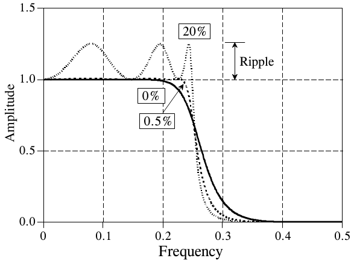
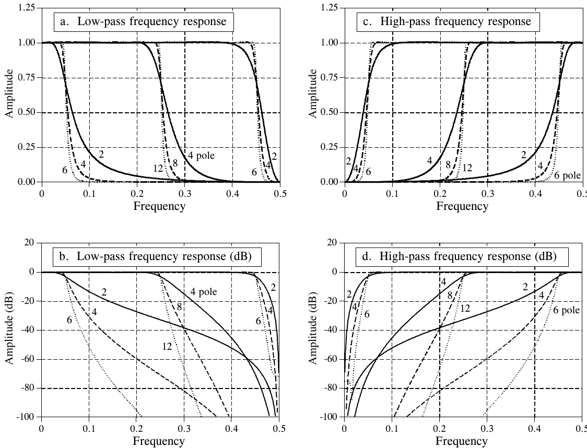
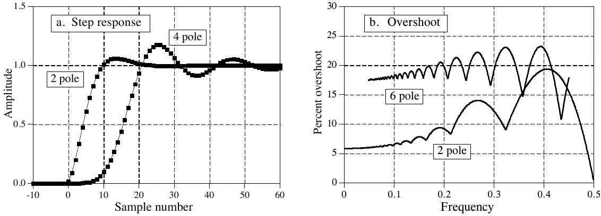

# 《The Scientist and Engineer's Guide to Digital Signal Processing》第 20 章中译

> 原书：上一级目录 `Documents/数学基础/` 下的 `The Scientist and Engineer Guide to Digital Signal Processing.pdf`，对应 PDF 第 344～353 页（原书第 333～342 页）。
> 上一章：[19-DSP指南-第19章中译.md](19-DSP指南-第19章中译.md)。专业名词第一次出现时在括号里附上英文。
> 插图从原书页面裁出，放在 `assets/ch20/`，图里的英文标注在每张图下方给出对照。原书 PDF 的符号字体抽取时会乱码（= 显示成 '，− 显示成 &，π 显示成 B），公式按原书版面重新写出。BASIC 程序的 C 版本在 `c/` 目录。

---

# 第 20 章　切比雪夫滤波器

切比雪夫滤波器(Chebyshev filter)用来把一个频带与另一个频带分开。它们的性能虽然比不上加窗 sinc 滤波器，但对许多应用来说已经绰绰有余。切比雪夫滤波器最主要的优点是速度快，通常比加窗 sinc 滤波器快一个数量级以上。这是因为它们靠递归(recursion)而不是卷积来实现。这类滤波器的设计基于一种叫 z 变换(z-transform)的数学技术，第 33 章会讲到。本章给出使用切比雪夫滤波器所需的信息，让你不必在高等数学的泥潭里跋涉。

## 切比雪夫响应与巴特沃斯响应

切比雪夫响应(Chebyshev response)是一种数学策略：允许频率响应中出现纹波(ripple)，以换取更快的滚降(roll-off)。采用这种方法的模拟和数字滤波器都叫切比雪夫滤波器。例如，第 3 章中的模数转换和数模转换就用到了模拟切比雪夫滤波器。这些滤波器的名字来自它们使用的切比雪夫多项式(Chebyshev polynomials)，由俄国数学家帕夫努季·切比雪夫(Pafnuti Chebyshev，1821–1894)提出。这个名字是从俄语音译过来的，在文献中有多种拼法，比如 Chebychev、Tschebyscheff、Tchebysheff 和 Tchebichef。

图 20-1 给出了通带纹波分别为 0%、0.5% 和 20% 的低通切比雪夫滤波器的频率响应。纹波越大（坏事），滚降就越陡（好事）。切比雪夫响应是这两个参数之间的最优折中。纹波设为 0% 时，这种滤波器叫最大平坦(maximally flat)滤波器或巴特沃斯滤波器(Butterworth filter)，以英国工程师 S. Butterworth 的名字命名，他在 1930 年描述了这种响应。对数字滤波器来说，0.5% 的纹波往往是个好选择，这与信号之前经过的模拟电路的典型精度和准确度相当。



**图 20-1　切比雪夫响应。** 切比雪夫滤波器通过允许通带中出现纹波，来获得更快的滚降。纹波设为 0% 时，叫最大平坦滤波器或巴特沃斯滤波器。设计时可以考虑用 0.5% 的纹波：这么小的通带不平坦在这张图里根本看不出来，但滚降比巴特沃斯快得多。
（Amplitude = 幅度，Frequency = 频率，Ripple = 纹波；曲线旁的 0%、0.5%、20% 是通带纹波。）

本章讨论的切比雪夫滤波器叫 I 型(type 1)滤波器，意思是只允许通带中有纹波。相比之下，II 型(type 2)切比雪夫滤波器只在阻带中有纹波。II 型滤波器很少用，我们不讨论。不过，有一种重要的设计叫椭圆滤波器(elliptic filter)，它在通带和阻带中都有纹波。对给定的极点数，椭圆滤波器的滚降最快，但设计起来难得多。这里不讨论椭圆滤波器，但要知道，无论在模拟电子学还是 DSP 中，它常常是专业滤波器设计师的首选。如果你需要这种级别的性能，就去买一个设计数字滤波器的软件包吧。

## 设计滤波器

设计一个切比雪夫滤波器要选定四个参数：(1) 高通还是低通响应，(2) 截止频率，(3) 通带纹波的百分比，(4) 极点(pole)数。极点到底是什么？这里有两个答案，不喜欢其中一个，也许另一个能帮上忙：

**答案 1：** 拉普拉斯变换(Laplace transform)和 z 变换，是把冲激响应分解为正弦波和衰减指数的数学方法。具体做法是把系统的特性表示为一个复多项式除以另一个复多项式。分子的根叫零点(zero)，分母的根叫极点。由于极点和零点可以是复数，人们常说它们在复平面上有一个"位置"。复杂的系统比简单的系统有更多的极点和零点。设计递归滤波器时，先选定极点和零点的位置，再求出相应的递归系数（或模拟元件参数）。例如，巴特沃斯滤波器的极点位于复平面上的一个圆上，而切比雪夫滤波器的极点位于一个椭圆上。这是第 32 章和第 33 章的主题。

**答案 2：** 极点是装满魔粉的容器。滤波器里的极点越多，滤波器就越好用。



**图 20-2　切比雪夫频率响应。** (a) 和 (b) 是纹波 0.5% 的低通切比雪夫滤波器的频率响应，(c) 和 (d) 是对应的高通滤波器响应。
（a. Low-pass frequency response = 低通频率响应；b. Low-pass frequency response (dB) = 低通频率响应（分贝）；c. High-pass frequency response = 高通频率响应；d. High-pass frequency response (dB) = 高通频率响应（分贝）。Amplitude = 幅度，Amplitude (dB) = 幅度（分贝），Frequency = 频率；曲线旁的数字是极点数，"4 pole" = 4 极点。）

玩笑归玩笑，要点是：你完全可以不懂背后那套讨厌的数学，照样把这些滤波器用得很好。滤波器设计是一门专门的学问。实际工作中，按答案 2 思考的工程师、科学家和程序员，比按答案 1 思考的多。

图 20-2 给出了几个纹波为 0.5% 的切比雪夫滤波器的频率响应。对这里用的方法来说，极点数必须是偶数。每个滤波器的截止频率，在幅度穿过 0.707（−3 dB）的地方测量。截止频率靠近 0 或 0.5 的滤波器，比位于频率范围中部的滤波器滚降更陡。例如，$f_C = 0.05$ 的两极点滤波器，和 $f_C = 0.25$ 的四极点滤波器滚降差不多。这很幸运：由于舍入噪声(round-off noise)的缘故，在 0 和 0.5 附近只能用较少的极点。后面会细说。

不用 z 变换求递归系数的办法有两种。第一种是懦夫的办法：查表。表 20-1 和表 20-2 给出了通带纹波 0.5% 的低通和高通滤波器的递归系数。如果你只需要一个快速粗糙的设计，把相应的系数抄进程序就完事了。

**表 20-1　低通切比雪夫滤波器（纹波 0.5%）**

原书按截止频率 $f_C$ 分行、按极点数分三栏排列，这里改成每种极点数一张表。为便于阅读，科学计数法写成 `1.234567e-4` 的形式（原书写作 `1.234567E-04`），数值逐位照抄原书。标 ⚠ 的行原书注明 "!! Unstable !!"（不稳定），见后面"稳定性"一节。

**2 极点**

| fC | a0 | a1 | a2 | b1 | b2 |
|---|---|---|---|---|---|
| 0.01 | 8.663387e-4 | 1.732678e-3 | 8.663387e-4 | 1.919129 | -9.225943e-1 |
| 0.025 | 5.112374e-3 | 1.022475e-2 | 5.112374e-3 | 1.797154 | -8.176033e-1 |
| 0.05 | 1.868823e-2 | 3.737647e-2 | 1.868823e-2 | 1.593937 | -6.686903e-1 |
| 0.075 | 3.869430e-2 | 7.738860e-2 | 3.869430e-2 | 1.392667 | -5.474446e-1 |
| 0.1 | 6.372802e-2 | 1.274560e-1 | 6.372802e-2 | 1.194365 | -4.492774e-1 |
| 0.15 | 1.254285e-1 | 2.508570e-1 | 1.254285e-1 | 8.070778e-1 | -3.087918e-1 |
| 0.2 | 1.997396e-1 | 3.994792e-1 | 1.997396e-1 | 4.291048e-1 | -2.280633e-1 |
| 0.25 | 2.858110e-1 | 5.716221e-1 | 2.858110e-1 | 5.423258e-2 | -1.974768e-1 |
| 0.3 | 3.849163e-1 | 7.698326e-1 | 3.849163e-1 | -3.249116e-1 | -2.147536e-1 |
| 0.35 | 5.001024e-1 | 1.000205 | 5.001024e-1 | -7.158993e-1 | -2.845103e-1 |
| 0.40 | 6.362308e-1 | 1.272462 | 6.362308e-1 | -1.125379 | -4.195441e-1 |
| 0.45 | 8.001101e-1 | 1.600220 | 8.001101e-1 | -1.556269 | -6.441713e-1 |

**4 极点**

| fC | a0 | a1 | a2 | a3 | a4 | b1 | b2 | b3 | b4 |
|---|---|---|---|---|---|---|---|---|---|
| 0.01 ⚠ | 4.149425e-7 | 1.659770e-6 | 2.489655e-6 | 1.659770e-6 | 4.149425e-7 | 3.893453 | -5.688233 | 3.695783 | -9.010106e-1 |
| 0.025 | 1.504626e-5 | 6.018503e-5 | 9.027754e-5 | 6.018503e-5 | 1.504626e-5 | 3.725385 | -5.226004 | 3.270902 | -7.705239e-1 |
| 0.05 | 2.141509e-4 | 8.566037e-4 | 1.284906e-3 | 8.566037e-4 | 2.141509e-4 | 3.425455 | -4.479272 | 2.643718 | -5.933269e-1 |
| 0.075 | 9.726342e-4 | 3.890537e-3 | 5.835806e-3 | 3.890537e-3 | 9.726342e-4 | 3.103944 | -3.774453 | 2.111238 | -4.562908e-1 |
| 0.1 | 2.780755e-3 | 1.112302e-2 | 1.668453e-2 | 1.112302e-2 | 2.780755e-3 | 2.764031 | -3.122854 | 1.664554 | -3.502232e-1 |
| 0.15 | 1.180009e-2 | 4.720034e-2 | 7.080051e-2 | 4.720034e-2 | 1.180009e-2 | 2.039039 | -2.012961 | 9.897915e-1 | -2.046700e-1 |
| 0.2 | 3.224554e-2 | 1.289821e-1 | 1.934732e-1 | 1.289821e-1 | 3.224554e-2 | 1.265912 | -1.203878 | 5.405908e-1 | -1.185538e-1 |
| 0.25 | 7.015301e-2 | 2.806120e-1 | 4.209180e-1 | 2.806120e-1 | 7.015301e-2 | 4.541481e-1 | -7.417536e-1 | 2.361222e-1 | -7.096476e-2 |
| 0.3 | 1.335566e-1 | 5.342263e-1 | 8.013394e-1 | 5.342263e-1 | 1.335566e-1 | -3.904486e-1 | -6.784138e-1 | -1.412021e-2 | -5.392238e-2 |
| 0.35 | 2.340973e-1 | 9.363892e-1 | 1.404584 | 9.363892e-1 | 2.340973e-1 | -1.263672 | -1.080487 | -3.276296e-1 | -7.376791e-2 |
| 0.40 | 3.896966e-1 | 1.558787 | 2.338180 | 1.558787 | 3.896966e-1 | -2.161179 | -2.033992 | -8.789098e-1 | -1.610655e-1 |
| 0.45 | 6.291693e-1 | 2.516677 | 3.775016 | 2.516677 | 6.291693e-1 | -3.077062 | -3.641323 | -1.949229 | -3.990945e-1 |

**6 极点**

| fC | a0 | a1 | a2 | a3 | a4 | a5 | a6 | b1 | b2 | b3 | b4 | b5 | b6 |
|---|---|---|---|---|---|---|---|---|---|---|---|---|---|
| 0.01 ⚠ | 1.391351e-10 | 8.348109e-10 | 2.087027e-9 | 2.782703e-9 | 2.087027e-9 | 8.348109e-10 | 1.391351e-10 | 5.883343 | -1.442798e1 | 1.887786e1 | -1.389914e1 | 5.459909 | -8.939932e-1 |
| 0.025 ⚠ | 3.136210e-8 | 1.881726e-7 | 4.704314e-7 | 6.272419e-7 | 4.704314e-7 | 1.881726e-7 | 3.136210e-8 | 5.691653 | -1.353172e1 | 1.719986e1 | -1.232689e1 | 4.722721 | -7.556340e-1 |
| 0.05 | 1.771089e-6 | 1.062654e-5 | 2.656634e-5 | 3.542179e-5 | 2.656634e-5 | 1.062654e-5 | 1.771089e-6 | 5.330512 | -1.196611e1 | 1.447067e1 | -9.937710 | 3.673283 | -5.707561e-1 |
| 0.075 | 1.797538e-5 | 1.078523e-4 | 2.696307e-4 | 3.595076e-4 | 2.696307e-4 | 1.078523e-4 | 1.797538e-5 | 4.921746 | -1.035734e1 | 1.189764e1 | -7.854533 | 2.822109 | -4.307710e-1 |
| 0.1 | 9.086148e-5 | 5.451688e-4 | 1.362922e-3 | 1.817229e-3 | 1.362922e-3 | 5.451688e-4 | 9.086148e-5 | 4.470118 | -8.755594 | 9.543712 | -6.079376 | 2.140062 | -3.247363e-1 |
| 0.15 | 8.618665e-4 | 5.171199e-3 | 1.292800e-2 | 1.723733e-2 | 1.292800e-2 | 5.171199e-3 | 8.618665e-4 | 3.455239 | -5.754735 | 5.645387 | -3.394902 | 1.177469 | -1.836195e-1 |
| 0.2 | 4.187408e-3 | 2.512445e-2 | 6.281112e-2 | 8.374816e-2 | 6.281112e-2 | 2.512445e-2 | 4.187408e-3 | 2.315806 | -3.293726 | 2.904826 | -1.694128 | 6.021426e-1 | -1.029147e-1 |
| 0.25 | 1.434449e-2 | 8.606697e-2 | 2.151674e-1 | 2.868899e-1 | 2.151674e-1 | 8.606697e-2 | 1.434449e-2 | 1.076052 | -1.662847 | 1.191063 | -7.403087e-1 | 2.752158e-1 | -5.722251e-2 |
| 0.3 | 3.997487e-2 | 2.398492e-1 | 5.996231e-1 | 7.994975e-1 | 5.996231e-1 | 2.398492e-1 | 3.997487e-2 | -2.441152e-1 | -1.130306 | 1.063167e-1 | -3.463299e-1 | 8.882992e-2 | -3.278741e-2 |
| 0.35 | 9.792321e-2 | 5.875393e-1 | 1.468848 | 1.958464 | 1.468848 | 5.875393e-1 | 9.792321e-2 | -1.627573 | -1.955020 | -1.075051 | -5.106501e-1 | -7.239843e-2 | -2.639193e-2 |
| 0.40 | 2.211834e-1 | 1.327100 | 3.317751 | 4.423668 | 3.317751 | 1.327100 | 2.211834e-1 | -3.058672 | -4.390465 | -3.523254 | -1.684185 | -4.414881e-1 | -5.767513e-2 |
| 0.45 | 4.760635e-1 | 2.856381 | 7.140952 | 9.521270 | 7.140952 | 2.856381 | 4.760635e-1 | -4.522403 | -8.676844 | -9.007512 | -5.328429 | -1.702543 | -2.303303e-1 |

**表 20-2　高通切比雪夫滤波器（纹波 0.5%）**

排法同表 20-1。

**2 极点**

| fC | a0 | a1 | a2 | b1 | b2 |
|---|---|---|---|---|---|
| 0.01 | 9.567529e-1 | -1.913506 | 9.567529e-1 | 1.911437 | -9.155749e-1 |
| 0.025 | 8.950355e-1 | -1.790071 | 8.950355e-1 | 1.777932 | -8.022106e-1 |
| 0.05 | 8.001102e-1 | -1.600220 | 8.001102e-1 | 1.556269 | -6.441715e-1 |
| 0.075 | 7.142028e-1 | -1.428406 | 7.142028e-1 | 1.338264 | -5.185469e-1 |
| 0.1 | 6.362307e-1 | -1.272461 | 6.362307e-1 | 1.125379 | -4.195440e-1 |
| 0.15 | 5.001024e-1 | -1.000205 | 5.001024e-1 | 7.158993e-1 | -2.845103e-1 |
| 0.2 | 3.849163e-1 | -7.698326e-1 | 3.849163e-1 | 3.249116e-1 | -2.147536e-1 |
| 0.25 | 2.858111e-1 | -5.716222e-1 | 2.858111e-1 | -5.423243e-2 | -1.974768e-1 |
| 0.3 | 1.997396e-1 | -3.994792e-1 | 1.997396e-1 | -4.291049e-1 | -2.280633e-1 |
| 0.35 | 1.254285e-1 | -2.508570e-1 | 1.254285e-1 | -8.070777e-1 | -3.087918e-1 |
| 0.40 | 6.372801e-2 | -1.274560e-1 | 6.372801e-2 | -1.194365 | -4.492774e-1 |
| 0.45 | 1.868823e-2 | -3.737647e-2 | 1.868823e-2 | -1.593937 | -6.686903e-1 |

**4 极点**

| fC | a0 | a1 | a2 | a3 | a4 | b1 | b2 | b3 | b4 |
|---|---|---|---|---|---|---|---|---|---|
| 0.01 ⚠ | 9.121579e-1 | -3.648632 | 5.472947 | -3.648632 | 9.121579e-1 | 3.815952 | -5.465026 | 3.481295 | -8.322529e-1 |
| 0.025 | 7.941874e-1 | -3.176750 | 4.765125 | -3.176750 | 7.941874e-1 | 3.538919 | -4.722213 | 2.814036 | -6.318300e-1 |
| 0.05 | 6.291694e-1 | -2.516678 | 3.775016 | -2.516678 | 6.291694e-1 | 3.077062 | -3.641324 | 1.949230 | -3.990947e-1 |
| 0.075 | 4.965350e-1 | -1.986140 | 2.979210 | -1.986140 | 4.965350e-1 | 2.617304 | -2.749252 | 1.325548 | -2.524546e-1 |
| 0.1 | 3.896966e-1 | -1.558786 | 2.338179 | -1.558786 | 3.896966e-1 | 2.161179 | -2.033991 | 8.789094e-1 | -1.610655e-1 |
| 0.15 | 2.340973e-1 | -9.363892e-1 | 1.404584 | -9.363892e-1 | 2.340973e-1 | 1.263672 | -1.080487 | 3.276296e-1 | -7.376791e-2 |
| 0.2 | 1.335566e-1 | -5.342262e-1 | 8.013393e-1 | -5.342262e-1 | 1.335566e-1 | 3.904484e-1 | -6.784138e-1 | 1.412016e-2 | -5.392238e-2 |
| 0.25 | 7.015302e-2 | -2.806121e-1 | 4.209182e-1 | -2.806121e-1 | 7.015302e-2 | -4.541478e-1 | -7.417535e-1 | -2.361221e-1 | -7.096475e-2 |
| 0.3 | 3.224553e-2 | -1.289821e-1 | 1.934732e-1 | -1.289821e-1 | 3.224553e-2 | -1.265912 | -1.203878 | -5.405908e-1 | -1.185538e-1 |
| 0.35 | 1.180009e-2 | -4.720035e-2 | 7.080051e-2 | -4.720035e-2 | 1.180009e-2 | -2.039039 | -2.012961 | -9.897915e-1 | -2.046700e-1 |
| 0.40 | 2.780754e-3 | -1.112302e-2 | 1.668453e-2 | -1.112302e-2 | 2.780754e-3 | -2.764031 | -3.122854 | -1.664554 | -3.502233e-1 |
| 0.45 | 2.141509e-4 | -8.566037e-4 | 1.284906e-3 | -8.566037e-4 | 2.141509e-4 | -3.425455 | -4.479272 | -2.643718 | -5.933269e-1 |

**6 极点**

| fC | a0 | a1 | a2 | a3 | a4 | a5 | a6 | b1 | b2 | b3 | b4 | b5 | b6 |
|---|---|---|---|---|---|---|---|---|---|---|---|---|---|
| 0.01 ⚠ | 8.630195e-1 | -5.178118 | 1.294529e1 | -1.726039e1 | 1.294529e1 | -5.178118 | 8.630195e-1 | 5.705102 | -1.356935e1 | 1.722231e1 | -1.230214e1 | 4.689218 | -7.451429e-1 |
| 0.025 ⚠ | 6.912863e-1 | -4.147718 | 1.036929e1 | -1.382573e1 | 1.036929e1 | -4.147718 | 6.912863e-1 | 5.261399 | -1.157800e1 | 1.363599e1 | -9.063840 | 3.223738 | -4.793541e-1 |
| 0.05 | 4.760636e-1 | -2.856382 | 7.140954 | -9.521272 | 7.140954 | -2.856382 | 4.760636e-1 | 4.522403 | -8.676846 | 9.007515 | -5.328431 | 1.702544 | -2.303304e-1 |
| 0.075 | 3.259100e-1 | -1.955460 | 4.888651 | -6.518201 | 4.888651 | -1.955460 | 3.259100e-1 | 3.787397 | -6.288362 | 5.747801 | -3.041570 | 8.808669e-1 | -1.122464e-1 |
| 0.1 | 2.211833e-1 | -1.327100 | 3.317750 | -4.423667 | 3.317750 | -1.327100 | 2.211833e-1 | 3.058671 | -4.390464 | 3.523252 | -1.684184 | 4.414878e-1 | -5.767508e-2 |
| 0.15 | 9.792321e-2 | -5.875393e-1 | 1.468848 | -1.958464 | 1.468848 | -5.875393e-1 | 9.792321e-2 | 1.627573 | -1.955020 | 1.075051 | -5.106501e-1 | 7.239843e-2 | -2.639193e-2 |
| 0.2 | 3.997486e-2 | -2.398492e-1 | 5.996230e-1 | -7.994973e-1 | 5.996230e-1 | -2.398492e-1 | 3.997486e-2 | 2.441149e-1 | -1.130306 | -1.063169e-1 | -3.463299e-1 | -8.882996e-2 | -3.278741e-2 |
| 0.25 | 1.434450e-2 | -8.606701e-2 | 2.151675e-1 | -2.868900e-1 | 2.151675e-1 | -8.606701e-2 | 1.434450e-2 | -1.076051 | -1.662847 | -1.191062 | -7.403085e-1 | -2.752156e-1 | -5.722250e-2 |
| 0.3 | 4.187407e-3 | -2.512444e-2 | 6.281111e-2 | -8.374815e-2 | 6.281111e-2 | -2.512444e-2 | 4.187407e-3 | -2.315806 | -3.293726 | -2.904827 | -1.694129 | -6.021426e-1 | -1.029147e-1 |
| 0.35 | 8.618665e-4 | -5.171200e-3 | 1.292800e-2 | -1.723733e-2 | 1.292800e-2 | -5.171200e-3 | 8.618665e-4 | -3.455239 | -5.754734 | -5.645387 | -3.394902 | -1.177469 | -1.836195e-1 |
| 0.40 | 9.086141e-5 | -5.451685e-4 | 1.362921e-3 | -1.817228e-3 | 1.362921e-3 | -5.451685e-4 | 9.086141e-5 | -4.470118 | -8.755595 | -9.543712 | -6.079377 | -2.140062 | -3.247363e-1 |
| 0.45 | 1.771089e-6 | -1.062654e-5 | 2.656634e-5 | -3.542179e-5 | 2.656634e-5 | -1.062654e-5 | 1.771089e-6 | -5.330512 | -1.196611e1 | -1.447067e1 | -9.937710 | -3.673283 | -5.707561e-1 |

> **译注：** 两张表的 648 个系数都用下面表 20-4/20-5 的 C 版本重新算过，与原书逐个对比，最大相对差 2.5×10⁻⁵，差异来自原书用单精度计算，没有发现印刷错误。另外可以注意到，截止频率为 $f_C$ 的低通滤波器与截止频率为 $0.5 - f_C$ 的高通滤波器，系数绝对值相同、只是符号交替变化（例如低通 0.1 与高通 0.4）——这正是把频率轴左右翻转的结果。

用表来设计数字滤波器有两个问题。第一，表中可选的参数有限。例如，表 20-1 只提供 12 个截止频率、每个滤波器最多 6 个极点，而且纹波不能选。参数不能在一个连续范围内取值，滤波器设计就没法优化。第二，系数必须手工从表里抄进程序。这非常费时，会让你懒得去试别的取值。

与其用列表的数值，不如在程序里放一个计算系数的子程序。表 20-4 就是这样一个程序。好消息是，这个程序结构相对简单：输入四个滤波器参数后，程序就把 "a" 和 "b" 系数吐到数组 A[ ] 和 B[ ] 里。坏消息是，这个程序要调用表 20-5 中的子程序。乍一看，这个子程序实在难看。别灰心，它没看上去那么糟！第 1120 行有一个简单的分支，子程序里其余的都是直来直去的数值计算。六个变量进入子程序，五个变量离开子程序，内部用到十五个临时变量（外加循环下标）。表 20-6 提供了两组测试数据，用于调试这个子程序。第 33 章会详细讨论这个程序的原理。

> **译注：** 原文此处写"Table 20-5 provides two sets of test data"和"Chapter 31 discusses"。测试数据实际在表 20-6（表 20-4/20-5 的图注也这么说）；讲这个程序原理的是第 33 章（本章开头和表 20-4/20-5 的图注都说是第 33 章）。译文按正确的表号和章号写。

## 阶跃响应的过冲

巴特沃斯和切比雪夫滤波器的阶跃响应(step response)有 5% 到 30% 的过冲(overshoot)，极点数越多过冲越大。图 20-3a 给出了两个切比雪夫滤波器例子的阶跃响应。图 (b) 展示了数字滤波器独有、在模拟电子学中没有对应物的现象：阶跃响应的过冲量在小范围内还取决于滤波器的截止频率。阶跃响应中过大的过冲和振铃(ringing)，是因为切比雪夫滤波器以牺牲时域为代价，对频域做了优化。



**图 20-3　切比雪夫阶跃响应。** 切比雪夫滤波器阶跃响应的过冲在 5% 到 30% 之间，取决于极点数（见 (a)）和截止频率（见 (b)）。图 (a) 的截止频率为 0.05，可以按比例换算到其他截止频率。
（a. Step response = 阶跃响应；b. Overshoot = 过冲。Amplitude = 幅度，Sample number = 采样序号，Percent overshoot = 过冲百分比，Frequency = 频率；"2 pole" = 2 极点，"4 pole" = 4 极点，"6 pole" = 6 极点。）

> **译注：** 用本章的 C 程序（纹波 0.5%、$f_C = 0.05$）实测：2 极点过冲 6.0%，在第 5 个采样升到 50%，与图 (a) 中的 "2 pole" 曲线吻合；4 极点过冲 13.9%，在第 10 个采样升到 50%；6 极点过冲 17.7%，在第 16 个采样升到 50%、第 26 个采样达到峰值。图 (a) 中标 "4 pole" 的那条曲线约在第 16 个采样过 50%、峰值约 1.17，与 6 极点的实测结果吻合，与 4 极点的不符，所以这个标签很可能应为 "6 pole"（图 (b) 画的也正是 2 极点和 6 极点）。这只是根据数值比对的推测。

## 稳定性

用卷积实现的数字滤波器，主要限制是执行时间：只要你愿意等，几乎任何滤波器响应都能做到。递归滤波器正好相反：它们快如闪电，但性能有限。例如，考虑一个 6 极点、纹波 0.5%、截止频率 0.01 的低通滤波器。它的递归系数可以从表 20-1 中查到：

| | a | b |
|---|---|---|
| 0 | 1.391351e-10 | |
| 1 | 8.348109e-10 | 5.883343 |
| 2 | 2.087027e-9 | −1.442798e+1 |
| 3 | 2.782703e-9 | 1.887786e+1 |
| 4 | 2.087027e-9 | −1.389914e+1 |
| 5 | 8.348109e-10 | 5.459909 |
| 6 | 1.391351e-10 | −8.939932e-1 |

仔细看这些系数。"b" 系数的绝对值大约是十。用单精度时，每个数的舍入噪声大约是数值本身的一千万分之一，即 $10^{-6}$ 量级。再看 "a" 系数，数值大约是 $10^{-9}$。显然出问题了：来自输入信号（经由 "a" 系数）的贡献，会比来自之前算出的输出信号（经由 "b" 系数）的噪声小 1000 倍。这个滤波器没法工作！简而言之，舍入噪声限制了滤波器能用的极点数。实际数字还会稍微取决于纹波大小，以及是高通还是低通滤波器。单精度下的大致数字是：

**表 20-3　单精度下的最大极点数**

| 截止频率 | 0.02 | 0.05 | 0.10 | 0.25 | 0.40 | 0.45 | 0.48 |
|---|---|---|---|---|---|---|---|
| 最大极点数 | 4 | 6 | 10 | 20 | 10 | 6 | 4 |

接近这个极限时，滤波器的性能就开始变差：阶跃响应的过冲变大，阻带衰减变差，频率响应的纹波过大。如果把滤波器推得太过头，或者系数有错，输出很可能会一直振荡，直到溢出。

有两种方法可以提高能用的最大极点数。第一，使用双精度。这要求系数计算也用双精度（包括 π 的值）。

第二种方法是分级实现滤波器。例如，一个六极点滤波器原本就是三个两极点级的级联(cascade)。表 20-4 的程序把这三级合成一组递归系数，以便编程。然而，如果按原来分开的三级来实现，滤波器会更稳定。这需要知道每一级的 "a" 和 "b" 系数，这些可以从表 20-4 的程序中得到：表 20-5 中的子程序对级联中的每一级各调用一次，例如对六极点滤波器调用三次。子程序结束时，有五个变量返回主程序：A0、A1、A2、B1 和 B2。它们就是正在处理的那个两极点级的递归系数，可以用来分级实现滤波器。

**表 20-4**（主程序，注释已译成中文）

```basic
100 'CHEBYSHEV FILTER- RECURSION COEFFICIENT CALCULATION
110 '
120                         '初始化变量
130 DIM A[22]               '程序结束时存放 "a" 系数
140 DIM B[22]               '程序结束时存放 "b" 系数
150 DIM TA[22]              '内部使用，用于合并各级
160 DIM TB[22]              '内部使用，用于合并各级
170 '
180 FOR I% = 0 TO 22
190 A[I%] = 0
200 B[I%] = 0
210 NEXT I%
220 '
230 A[2] = 1
240 B[2] = 1
250 PI = 3.14159265
260                         '输入四个滤波器参数
270 INPUT "Enter cutoff frequency (0 to .5): ", FC
280 INPUT "Enter 0 for LP, 1 for HP filter: ", LH
290 INPUT "Enter percent ripple (0 to 29): ", PR
300 INPUT "Enter number of poles (2,4,...20): ", NP
310 '
320 FOR P% = 1 TO NP/2      '每个极点对循环一次
330 '
340 GOSUB 1000              '表 20-5 中的子程序
350 '
360 FOR I% = 0 TO 22        '把这一级的系数加进级联
370 TA[I%] = A[I%]
380 TB[I%] = B[I%]
390 NEXT I%
400 '
410 FOR I% = 2 TO 22
420 A[I%] = A0*TA[I%] + A1*TA[I%-1] + A2*TA[I%-2]
430 B[I%] =    TB[I%] - B1*TB[I%-1] - B2*TB[I%-2]
440 NEXT I%
450 '
460 NEXT P%
470 '
480 B[2] = 0                '完成系数合并
490 FOR I% = 0 TO 20
500 A[I%] = A[I%+2]
510 B[I%] = -B[I%+2]
520 NEXT I%
530 '
540 SA = 0                  '归一化增益
550 SB = 0
560 FOR I% = 0 TO 20
570 IF LH = 0 THEN SA = SA + A[I%]
580 IF LH = 0 THEN SB = SB + B[I%]
590 IF LH = 1 THEN SA = SA + A[I%] * (-1)^I%
600 IF LH = 1 THEN SB = SB + B[I%] * (-1)^I%
610 NEXT I%
620 '
630 GAIN = SA / (1 - SB)
640 '
650 FOR I% = 0 TO 20
660 A[I%] = A[I%] / GAIN
670 NEXT I%
680 '                       '最终的递归系数在 A[ ] 和 B[ ] 中
690 END
```

**表 20-5**（子程序，注释已译成中文）

```basic
1000 'THIS SUBROUTINE IS CALLED FROM TABLE 20-4, LINE 340
1010 '
1020 ' 进入子程序的变量：   PI, FC, LH, PR, HP, P%
1030 ' 离开子程序的变量：   A0, A1, A2, B1, B2
1040 ' 内部使用的变量：     RP, IP, ES, VX, KX, T, W, M, D, K,
1050 '                      X0, X1, X2, Y1, Y2
1060 '
1070 '                      '计算极点在单位圆上的位置
1080 RP = -COS(PI/(NP*2) + (P%-1) * PI/NP)
1090 IP = SIN(PI/(NP*2) + (P%-1) * PI/NP)
1100 '
1110 '                      '把圆压成椭圆
1120 IF PR = 0 THEN GOTO 1210
1130 ES = SQR( (100 / (100-PR))^2 -1 )
1140 VX = (1/NP) * LOG( (1/ES) + SQR( (1/ES^2) + 1) )
1150 KX = (1/NP) * LOG( (1/ES) + SQR( (1/ES^2) - 1) )
1160 KX = (EXP(KX) + EXP(-KX))/2
1170 RP = RP * ( (EXP(VX) - EXP(-VX) ) /2 ) / KX
1180 IP = IP * ( (EXP(VX) + EXP(-VX) ) /2 ) / KX
1190 '
1200 '                      's 域到 z 域的转换
1210 T = 2 * TAN(1/2)
1220 W = 2*PI*FC
1230 M = RP^2 + IP^2
1240 D = 4 - 4*RP*T + M*T^2
1250 X0 = T^2/D
1260 X1 = 2*T^2/D
1270 X2 = T^2/D
1280 Y1 = (8 - 2*M*T^2)/D
1290 Y2 = (-4 - 4*RP*T - M*T^2)/D
1300 '
1310 '                      '低通到低通，或低通到高通的变换
1320 IF LH = 1 THEN K = -COS(W/2 + 1/2) / COS(W/2 - 1/2)
1330 IF LH = 0 THEN K = SIN(1/2 - W/2) / SIN(1/2 + W/2)
1340 D = 1 + Y1*K - Y2*K^2
1350 A0 = (X0 - X1*K + X2*K^2)/D
1360 A1 = (-2*X0*K + X1 + X1*K^2 - 2*X2*K)/D
1370 A2 = (X0*K^2 - X1*K + X2)/D
1380 B1 = (2*K + Y1 + Y1*K^2 - 2*Y2*K)/D
1390 B2 = (-(K^2) - Y1*K + Y2)/D
1400 IF LH = 1 THEN A1 = -A1
1410 IF LH = 1 THEN B1 = -B1
1420 '
1430 RETURN
```

**表 20-4 和 20-5 的说明：** 计算切比雪夫递归滤波器 "a" 和 "b" 系数的程序。第 270～300 行输入四个参数。截止频率 FC 以采样频率的分数表示，因此必须在 0 到 0.5 之间。变量 LH 设为 1 表示高通滤波器，设为 0 表示低通滤波器。PR 的取值必须在 0 到 29 之间，对应滤波器频率响应中 0 到 29% 的纹波。滤波器的极点数存放在变量 NP 中，必须是 2 到 20 之间的偶数。程序结束时，"a" 和 "b" 系数存放在数组 A[ ] 和 B[ ] 中（a0 = A[0]，a1 = A[1]，依此类推）。表 20-5 是主程序第 340 行调用的子程序。传给这个子程序六个变量，返回五个变量。表 20-6（下一页）包含两组帮助调试这个子程序的数据。函数 COS 和 SIN 使用弧度而不是角度。函数 LOG 是自然（以 e 为底的）对数。把所有浮点变量（包括 π 的值）都声明为双精度，就能使用更多的极点。表 20-1 和 20-2 就是用这个程序生成的，可以用来检验程序是否正确运行。第 33 章讲这个程序的数学原理。

> **译注：** 表 20-5 第 1020 行列出的进入变量 "HP" 是笔误，子程序实际用到的是极点数 NP（第 1080、1090、1140、1150 行），应为 "PI, FC, LH, PR, NP, P%"。

**C 实现**（完整可编译版本见 `c/table20-4_chebyshev_design.c`，把表 20-4 主程序和表 20-5 子程序合成一个文件。带四个参数运行时打印系数；不带参数时运行自检）：

```c
/* 表 20-5：计算第 p 个极点对（两极点级）的递归系数 */
static Stage chebyshev_stage(double fc, int lh, double pr, int np, int p)
{
    Stage s = {0};
    /* 1080～1090：极点在单位圆上的位置 */
    s.rp = -cos(PI / (np * 2) + (p - 1) * PI / np);
    s.ip =  sin(PI / (np * 2) + (p - 1) * PI / np);

    /* 1120～1180：有纹波时，把圆压成椭圆；纹波为 0 就是巴特沃斯，跳过 */
    if (pr != 0) {
        s.es = sqrt(pow(100.0 / (100.0 - pr), 2) - 1);
        s.vx = (1.0 / np) * log((1 / s.es) + sqrt((1 / (s.es * s.es)) + 1));
        s.kx = (1.0 / np) * log((1 / s.es) + sqrt((1 / (s.es * s.es)) - 1));
        s.kx = (exp(s.kx) + exp(-s.kx)) / 2;
        s.rp = s.rp * ((exp(s.vx) - exp(-s.vx)) / 2) / s.kx;
        s.ip = s.ip * ((exp(s.vx) + exp(-s.vx)) / 2) / s.kx;
    }

    /* 1210～1290：s 域到 z 域的转换 */
    s.t  = 2 * tan(0.5);
    s.w  = 2 * PI * fc;
    s.m  = s.rp * s.rp + s.ip * s.ip;
    s.d  = 4 - 4 * s.rp * s.t + s.m * s.t * s.t;
    s.x0 = s.t * s.t / s.d;
    s.x1 = 2 * s.t * s.t / s.d;
    s.x2 = s.t * s.t / s.d;
    s.y1 = (8 - 2 * s.m * s.t * s.t) / s.d;
    s.y2 = (-4 - 4 * s.rp * s.t - s.m * s.t * s.t) / s.d;

    /* 1320～1410：低通到低通，或低通到高通的变换 */
    double k = lh ? -cos(s.w / 2 + 0.5) / cos(s.w / 2 - 0.5)
                  :  sin(0.5 - s.w / 2) / sin(0.5 + s.w / 2);
    double d = 1 + s.y1 * k - s.y2 * k * k;
    s.a0 = (s.x0 - s.x1 * k + s.x2 * k * k) / d;
    s.a1 = (-2 * s.x0 * k + s.x1 + s.x1 * k * k - 2 * s.x2 * k) / d;
    s.a2 = (s.x0 * k * k - s.x1 * k + s.x2) / d;
    s.b1 = (2 * k + s.y1 + s.y1 * k * k - 2 * s.y2 * k) / d;
    s.b2 = (-(k * k) - s.y1 * k + s.y2) / d;
    if (lh) { s.a1 = -s.a1; s.b1 = -s.b1; }
    return s;
}

/* 表 20-4：把 np/2 个两极点级合成一组递归系数，结果 a[0..np]、b[1..np] */
static void chebyshev_design(double fc, int lh, double pr, int np, double *a, double *b)
{
    double ta[NC], tb[NC];
    for (int i = 0; i < NC; i++) a[i] = b[i] = 0;    /* 180～210 */
    a[2] = 1;                                        /* 230～240：从 1 开始做多项式乘法 */
    b[2] = 1;

    for (int p = 1; p <= np / 2; p++) {              /* 320：每个极点对循环一次 */
        Stage s = chebyshev_stage(fc, lh, pr, np, p);    /* 340：GOSUB 1000 */
        for (int i = 0; i < NC; i++) { ta[i] = a[i]; tb[i] = b[i]; }   /* 360～390 */
        for (int i = 2; i < NC; i++) {               /* 410～440：把这一级串进级联 */
            a[i] = s.a0 * ta[i] + s.a1 * ta[i - 1] + s.a2 * ta[i - 2];
            b[i] =        tb[i] - s.b1 * tb[i - 1] - s.b2 * tb[i - 2];
        }
    }

    b[2] = 0;                                        /* 480～520：收尾，下标左移 2 位，b 取反 */
    for (int i = 0; i <= 20; i++) { a[i] = a[i + 2]; b[i] = -b[i + 2]; }

    double sa = 0, sb = 0;                           /* 540～610：归一化增益 */
    for (int i = 0; i <= 20; i++) {
        double sign = (lh && (i & 1)) ? -1.0 : 1.0;  /* 高通在 0.5 处归一化，乘 (-1)^i */
        sa += a[i] * sign;
        sb += b[i] * sign;
    }
    double gain = sa / (1 - sb);                     /* 630 */
    for (int i = 0; i <= 20; i++) a[i] /= gain;      /* 650～670 */
}
```

运行结果（双精度）：
- **对照表 20-6 的调试数据：** 两组数据各 19 个变量，与表中数值的最大差分别为 8.5×10⁻⁷ 和 8.7×10⁻⁷，即表中给出的六位小数全部吻合。
- **对照表 20-1 和 20-2：** 低通、高通各 12 个截止频率 × 3 种极点数，共 648 个系数，与原书最大相对差 2.5×10⁻⁵。
- **频率响应：** 截止频率 0.1、纹波 0.5% 的 2、4、6 极点低通和高通滤波器，在截止频率处的幅度都是 0.7107，与"截止频率在幅度穿过 0.707 处测量"一致；通带最大值都是 1.0050，即 0.5% 的纹波。离截止频率 0.1 处的阻带衰减：低通 2/4/6 极点分别为 −14.8、−33.8、−56.1 dB，极点越多滚降越陡，与图 20-2 一致。

**表 20-6　调试数据。** 这张表包含两组数据，用于调试表 20-5 中的子程序。

| | 数据组 1 | 数据组 2 |
|---|---|---|
| **进入子程序时的值** | | |
| FC | 0.1 | 0.1 |
| LH | 0 | 1 |
| PR | 0 | 10 |
| NP | 4 | 4 |
| P% | 1 | 2 |
| PI | 3.141592 | 3.141592 |
| **第 1200 行处应有的值** | | |
| RP | −0.923879 | −0.136178 |
| IP | 0.382683 | 0.933223 |
| ES | 不使用 | 0.484322 |
| VX | 不使用 | 0.368054 |
| KX | 不使用 | 1.057802 |
| **第 1310 行处应有的值** | | |
| T | 1.092605 | 1.092605 |
| W | 0.628318 | 0.628318 |
| M | 1.000000 | 0.889450 |
| D | 9.231528 | 5.656972 |
| X0 | 0.129316 | 0.211029 |
| X1 | 0.258632 | 0.422058 |
| X2 | 0.129316 | 0.211029 |
| Y1 | 0.607963 | 1.038784 |
| Y2 | −0.125227 | −0.789584 |
| **返回主程序的值** | | |
| A0 | 0.061885 | 0.922919 |
| A1 | 0.123770 | −1.845840 |
| A2 | 0.061885 | 0.922919 |
| B1 | 1.048600 | 1.446913 |
| B2 | −0.296140 | −0.836653 |
