# 《The Scientist and Engineer's Guide to Digital Signal Processing》第 25 章中译

> 原书：上一级目录 `Documents/数学基础/` 下的 `The Scientist and Engineer Guide to Digital Signal Processing.pdf`，对应 PDF 第 434～461 页（原书第 423～450 页）。
> 上一章：[24-DSP指南-第24章中译.md](24-DSP指南-第24章中译.md)。专业名词第一次出现时在括号里附上英文。
> 插图从原书页面裁出，放在 `assets/ch25/`，图里的英文标注在每张图下方给出对照。原书 PDF 的符号字体抽取时会乱码（π 显示成 B，σ 显示成 F，= 显示成 '，° 显示成 E，√ 丢失），公式按原书版面重新用 LaTeX 写出。BASIC 程序的 C 版本在 `c/` 目录。

---

# 第 25 章　特殊成像技术

本章介绍图像处理的四个具体方面。第一，讨论刻画空间分辨率(spatial resolution)的方法，它描述一个物体至少要多大才能在图像中被看到。第二，考察信噪比(signal-to-noise ratio, SNR)，说明一个物体可以暗淡到什么程度仍能被检测出来。第三，介绍形态学(morphological)技术，这是一类用来处理二值图像（每个像素非黑即白）的非线性运算。第四，介绍了不起的计算机断层成像(computed tomography)技术，它能提供人体内部的详细图像，给医学诊断带来了革命性的变化。

## 空间分辨率

假设我们要比较两个成像系统，看哪个的空间分辨率更好。换句话说，我们想知道哪个系统能检测到最小的物体。为了简单起见，我们希望每个系统的答案只是一个数字，这样就能直接比较，据此做设计决策。可惜，单个参数并不总能刻画成像的所有细微方面。更复杂的是，空间分辨率受两种不同但相互关联的效应限制：采样间距(sample spacing)和采样孔径(sampling aperture)的大小。本节包含两个主题：(1) 怎样最好地用单个参数刻画空间分辨率；(2) 采样间距与采样孔径大小之间的关系。

图 25-1a 给出了三种圆对称点扩散函数（point spread function, PSF）的剖面：圆柱形(pillbox)、高斯形(Gaussian)和指数形(exponential)。它们是成像系统中常见 PSF 的代表。上一章讲过，圆柱形 PSF 可能来自没有对准焦的透镜系统。高斯形 PSF 产生于多个随机误差的叠加，比如透过湍动的大气看星星。指数形 PSF 产生于电子或 X 射线打到荧光层(phosphor layer)上并被转换成光的过程，这用在辐射探测器、夜视光放大器和 CRT 显示器中。对本讨论来说，这三种 PSF 的确切形状并不重要，重要的是它们大致代表了实际应用中见到的 PSF。

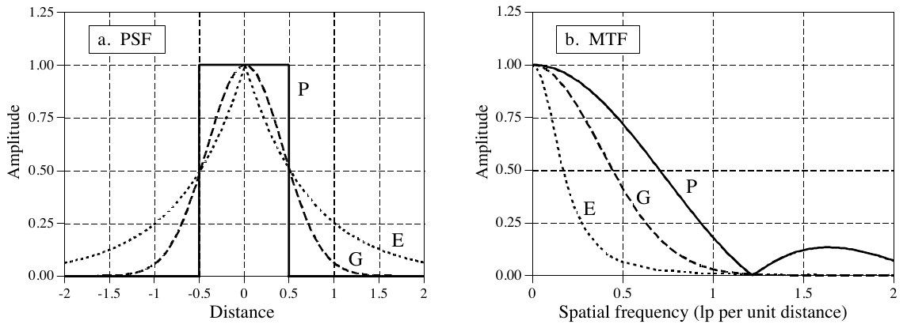

**图 25-1　半高全宽与 MTF 的对比。** (a) 给出了成像系统中三种常见 PSF 的剖面：(P) 圆柱形、(G) 高斯形、(E) 指数形，它们的半高全宽都是一个单位。(b) 是对应的 MTF。遗憾的是，半高全宽相近，并不意味着 MTF 曲线相近。
（a. PSF = 点扩散函数；b. MTF = 调制传递函数。Amplitude = 幅度，Distance = 距离，Spatial frequency (lp per unit distance) = 空间频率（每单位距离的线对数）。）

PSF 包含了空间分辨率的全部信息。要用一个数字表示空间分辨率，可以不管 PSF 的形状，只测量它的宽度。最常用的指标是半高全宽（Full-Width-at-Half-Maximum, FWHM）。例如，(a) 中所有 PSF 的半高全宽都是 1 个单位。

可惜这种方法有两个明显的缺点。第一，它和其他空间分辨率指标对不上，包括观察者看图像时的主观判断。第二，直接测量 PSF 通常非常困难。设想给成像系统输入一个冲激，也就是拍一张黑背景上一个极小白点的图像。按定义，拍到的图像就是系统的 PSF。问题是，测得的 PSF 只占几个像素，对比度又低。除非非常小心，随机噪声会淹没测量结果。例如，设想冲激图像是一个 512×512 的数组，除一个像素值为 255 外全为零。再拿它和一幅普通图像比，后者 512×512 个像素的平均值约为 128。粗略地说，冲激图像中的信号比普通图像弱大约 100,000 倍。难怪信噪比会很差，几乎就没有信号！

贯穿本书的一个基本主题是：信号应该在信息被编码的那个域里去理解。例如，音频信号应该在频域里处理，而图像信号应该在空间域里处理。尽管如此，测量图像分辨率的一种方法却是看频率响应。这违背了本书的基本理念，但它是一种常用方法，你需要熟悉它。

对 PSF 做二维傅里叶变换，就得到二维频率响应。如果 PSF 是圆对称的，它的频率响应也是圆对称的。这时频率响应的全部信息都包含在它的剖面里。也就是说，用 FFT 方法算出频域之后，只需要第 0 行的第 0 到 N/2 列。在成像行话里，频率响应的这种展示方式叫调制传递函数（Modulation Transfer Function, MTF）。图 25-1b 给出了 (a) 中三种 PSF 对应的 MTF。如果 PSF 不是圆对称的，整个二维频率响应都含有信息。不过，通常知道垂直和水平方向的 MTF 曲线就够了（即第 0 行的第 0 到 N/2 列，以及第 0 列的第 0 到 N/2 行）。注意：从二维频谱中取出一行或一列的做法，并不等同于对 (a) 中的剖面做一维 FFT。我们很快会回到这个问题。如图 25-1 所示，半高全宽相近并不意味着 MTF 曲线相近。

图 25-2 是一个线对卡(line pair gauge)，这是一种通过 MTF 测量图像分辨率的工具。线对卡根据具体应用有不同的形式。例如，图中这种黑白图案可以直接用来测试摄像机。对于 X 射线成像系统，栅条可以用铅做，栅条之间用 X 射线能穿透的材料。关键特征是黑白线条在一端排得更密。给线对卡拍一张图像时，排得紧密那一端的线条会糊在一起，另一端的线条则清晰可辨。在中间某处，线条刚好勉强能分开。观察者看着图像找到这个位置，在校准刻度上读出对应的分辨率。

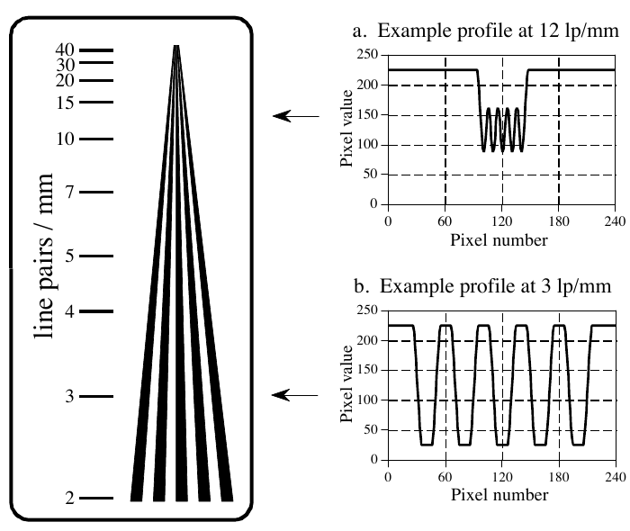

**图 25-2　线对卡。** 线对卡是测量成像系统分辨率的工具。一组黑白栅条逐渐靠拢，形成连续变化的空间频率。系统的分辨率取为眼睛刚好不能再分辨单根栅条时的频率。图中这个线对卡画得比校准刻度所示的尺寸大好几倍。
（line pairs / mm = 线对/毫米；a. Example profile at 12 lp/mm = 12 线对/毫米处的剖面示例；b. Example profile at 3 lp/mm = 3 线对/毫米处的剖面示例。Pixel value = 像素值，Pixel number = 像素序号。原书图注排在图左侧，裁图时已去掉，译文见上。）

栅条糊在一起的方式，对理解这种测量的局限很重要。设想给图 25-2 的线对卡拍一张图像。(a) 和 (b) 给出了高、低空间频率处剖面的例子。在低频处，如 (b) 所示，曲线顶部和底部是平的，但边缘模糊了。在较高的空间频率处，如 (a) 所示，调制的幅度减小了。这正是图 25-1b 的 MTF 曲线所描述的：空间频率越高，幅度被削减得越多。只要幅度大于原高度的约 3% 到 10%，就能在图像中分辨出单根栅条。这和眼睛在图像噪声中分辨峰谷之间低对比度差别的能力有关。

线对卡测量的一大优点是简单快速。最大的缺点是它依赖人眼，因此带有一定的主观成分。即使测出了整条 MTF 曲线，表示系统分辨率最常用的方式，也是给出 MTF 降到 3%、5% 或 10% 时的频率。可惜别人不一定告诉你用的是哪一个；产品说明书常用"极限分辨率(limiting resolution)"之类含糊的说法。既然厂商都希望自己的指标越好看越好（不管器件实际表现如何），保险起见，把这些含糊的说法理解成 MTF 曲线上的 3%。

需要注意一个微妙之处：MTF 是用正弦波定义的，而线对卡用的是方波。也就是说，栅条是均匀的暗区与均匀的亮区相间。这样做是为了便于制造，要做出暗度按正弦变化的线条非常困难。用方波测 MTF 会有什么后果？在高空间频率处，方波除基波以外的频率成分都被去掉了，这使调制看起来是正弦形的，如图 25-2a 所示。在低频处，如图 25-2b 所示，波形看起来是方的。方波中所含基波正弦的幅度是方波幅度的 $4/\pi \approx 1.27$ 倍（见表 13-10）。结果是：线对卡的起始有效幅度比纯黑到纯白还大，因此会略微高估系统的真实分辨率。有意思，但几乎总是被忽略。

由于测 MTF 时方波和正弦波可以互换使用，就产生了一个专门术语。成像领域的人不说"周期"，而说线对(line pair)（一条暗线紧挨一条亮线）。例如，空间频率会说成每毫米 25 线对，而不是每毫米 25 个周期。

PSF 的宽度和人的感知对不太上，而且难以测量。MTF 方法所在的域，又不适合理解分辨率怎样影响被编码的信息。有没有更好的选择？答案是有：线扩散函数（line spread function, LSF）和边缘响应(edge response)。如图 25-3 所示，线扩散函数是系统对横贯图像的一条细线的响应。同样，边缘响应是系统对一个锐利的直线间断（一条边缘）的响应。由于线是边缘的导数（或一阶差分），LSF 就是边缘响应的导数（或一阶差分）。这里用作单参数指标的，是边缘响应从 10% 上升到 90% 所需的距离。

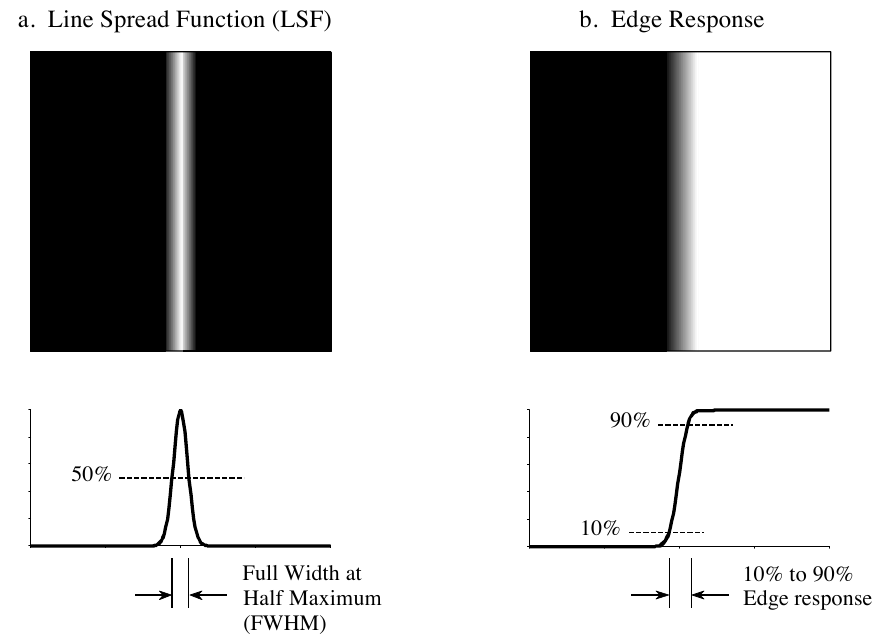

**图 25-3　线扩散函数与边缘响应。** 线扩散函数（LSF）是边缘响应的导数。LSF 的宽度通常用半高全宽（FWHM）表示，边缘响应的宽度通常用 10% 到 90% 的距离表示。
（a. Line Spread Function (LSF) = 线扩散函数；b. Edge Response = 边缘响应；Full Width at Half Maximum (FWHM) = 半高全宽；10% to 90% Edge response = 边缘响应的 10% 到 90% 距离。）

用边缘响应测量分辨率有很多优点。第一，测量的形式和图像信息的编码形式相同。事实上，想知道系统分辨率的主要原因，就是要了解图像中的边缘被模糊成什么样。第二，边缘响应容易测量，因为在图像中很容易造出边缘。需要的话，对边缘响应取一阶差分就能轻松得到 LSF。

第三，所有常见的边缘响应形状都相似，即使它们来自截然不同的 PSF。图 25-4a 展示了这一点，图中是圆柱形、高斯形和指数形 PSF 的边缘响应。既然形状相似，10%-90% 距离就是一个极好的单参数分辨率指标。第四，对 LSF 做一维 FFT 就能直接得到 MTF（不像从 PSF 算 MTF 那样必须用二维傅里叶变换）。图 25-4b 给出了 (a) 中边缘响应对应的 MTF。换句话说，(a) 中的曲线先取一阶差分（得到 LSF），再做 FFT，就变成了 (b) 中的曲线。

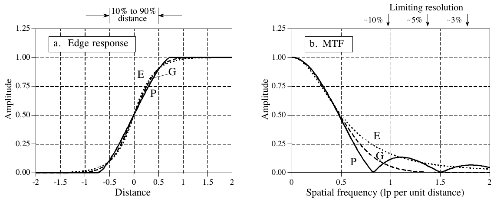

**图 25-4　边缘响应与 MTF。** (a) 给出了三种 PSF 的边缘响应：(P) 圆柱形、(G) 高斯形、(E) 指数形，每条边缘响应从 10% 到 90% 的上升距离都是 1 个单位。(b) 是对应的 MTF 曲线，它们在 10% 以上的部分很相似。极限分辨率是个含糊的说法，指 MTF 幅度为 3% 到 10% 时的频率。
（a. Edge response = 边缘响应；b. MTF；10% to 90% distance = 10% 到 90% 距离；Limiting resolution = 极限分辨率，~10%、~5%、~3% 为对应的 MTF 幅度。Amplitude = 幅度，Distance = 距离，Spatial frequency (lp per unit distance) = 空间频率（每单位距离的线对数）。）

第五，如图 25-4 (a) 和 (b) 所示，相似的边缘响应对应相似的 MTF 曲线。这让我们能在两种测量之间轻松换算。具体地说，一个 10%-90% 边缘响应为 x 距离的系统，其极限分辨率（10% 对比度）约为每 x 距离 1 线对。"距离"的单位取决于所处理的系统类型。例如，考虑三个不同的成像系统，它们的 10%-90% 边缘响应分别为 0.05 mm、0.2 毫弧度和 3.3 像素，对应 MTF 曲线上 10% 对比度的位置分别约在：20 lp/mm、5 lp/毫弧度和 0.33 lp/像素。

图 25-5 说明了 PSF 与 LSF 之间的数学关系。(a) 是一个圆柱形 PSF：一个值为 1 的圆形区域（显示为白色），周围是全零区域（显示为灰色）。PSF 的剖面（即沿穿过图像中心的一条直线的像素值）是一个矩形脉冲。(b) 是对应的 LSF。如图所示，LSF 在数学上等于 PSF 的积分剖面(integrated profile)。求法是沿某个方向扫过图像，如图中射线（箭头）所示。积分剖面中的每个值，是沿对应射线的像素值之和。

在这个射线为垂直方向的例子里，积分剖面中的每个点是把每一列的所有像素值加起来得到的。这对应图像中一条竖线的 LSF。图像中横线的 LSF，则是把每一行的所有像素值加起来得到的。对连续图像，这些概念相同，只是求和换成了积分。

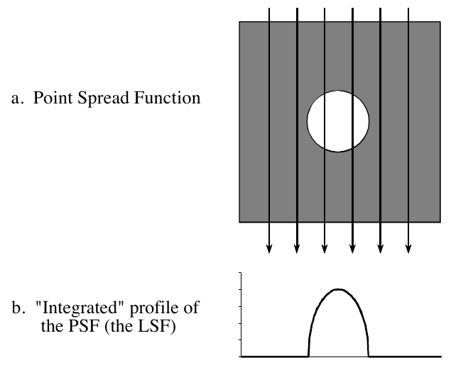

**图 25-5　PSF 与 LSF 的关系。** (a) 是一个圆柱形 PSF，穿过白色中心的任一行或任一列都是一个矩形脉冲。(b) 是对应的 LSF，等于 PSF 的积分剖面。也就是说，LSF 是沿某个方向扫过图像、把每条射线上的像素值加起来（积分）得到的。在图示方向上，就是把每一列的所有像素加起来。
（a. Point Spread Function = 点扩散函数；b. "Integrated" profile of the PSF (the LSF) = PSF 的"积分"剖面（即 LSF）。原书图注排在图左侧，裁图时已去掉，译文见上。）

如这个例子所示，LSF 可以直接从 PSF 算出来。但 PSF 并不总能从 LSF 算出来。这是因为 PSF 包含所有方向上的空间分辨率信息，而 LSF 只限于某一个特定方向。一个系统只有一个 PSF，却有无穷多个 LSF，每个角度一个。例如，设想一个系统的 PSF 是长圆形的，这使得垂直和水平方向的空间分辨率不同，LSF 在这两个方向上也就不同。只在一个角度测量 LSF，提供的信息不足以算出完整的 PSF，除非 PSF 恰好是圆对称的。在多个角度测量 LSF，就有可能算出非圆对称的 PSF，但数学相当复杂，通常不值得。事实上，从若干个 LSF 测量值算出 PSF，和本章后面讨论的计算机断层成像面临的正是同一个问题。

从实用角度说，对大多数成像系统，LSF 和 PSF 差别不大，常常拿一个当另一个的近似。考虑到有两种常见情况下两者完全相同，这样做就更有道理了：矩形 PSF 的 LSF 也是矩形（宽度相同），高斯 PSF 的 LSF 也是高斯（标准差相同）。

这些概念可以归结为两项技能：怎样评估别人给你的分辨率指标，以及怎样测量你自己的分辨率指标。假设你看到一则广告说："本系统可分辨每毫米 40 线对。"你应该把它理解为："40 lp/mm 的正弦，幅度会降到真实值的 3%～10%，在图像中刚好勉强可见。"你还应该心算一下：10% 对比度下的 40 lp/mm，相当于 10%-90% 边缘响应为 1/(40 lp/mm) = 0.025 mm。如果 MTF 指标是按 3% 对比度给的，边缘响应会宽约 1.5 到 2 倍。

测量一个成像系统的空间分辨率时，步骤反过来做。在图像中放一条锐利的边缘，测量所得的边缘响应。这条曲线的 10%-90% 距离，是系统分辨率最好的单参数指标。为了让老板和市场部的人满意，再对边缘响应取一阶差分得到 LSF，然后用 FFT 求出 MTF。

### 采样间距与采样孔径

图 25-6 给出了两个极端的采样例子，我们称之为理想探测器和模糊探测器。设想 (a) 是一个成像探测器（比如 CCD）的表面。光落在某个方形像素内部的任何地方，都只对该像素的值有贡献，对其他像素没有贡献。图中用一个恰好填满一个方形像素的黑色采样孔径来表示这一点。这对图像探测器是最理想的情况，因为所有的光都被探测到了，相邻像素之间也没有重叠或串扰。换句话说，采样孔径恰好等于采样间距。

另一个例子画在 (e) 中。采样孔径比采样间距大得多，并且服从高斯分布。换句话说，探测器的每个像素都接收落在该像素周围一片区域内的光的贡献。这听起来应该很熟悉，因为这正是卷积的输出端视角。从对应的输入端视角看，一束打到探测器上的窄光束，会按同样的高斯分布对几个相邻像素的值都有贡献。

现在来看两个例子的边缘响应。每张图中的标记点是你在图像中会实际得到的像素值，连线则是被采样的那条底层曲线。一个重要的概念是：这条底层曲线的形状只由采样孔径决定。这意味着最终图像的分辨率可能受两方面限制。第一，底层曲线本身分辨率差，原因是采样孔径太大。第二，采样间距太大，导致细节在采样点之间丢失。每个例子给出了两条边缘响应曲线，说明实际采样点可以落在底层曲线上的任何位置。换句话说，被成像的边缘可能恰好落在某个像素上，也可能跨在两个像素之间。注意，理想探测器在边缘的上升段上有零个或一个采样点；模糊探测器则有三到四个。

这两个系统的分辨率受什么限制？答案由采样定理给出。第 3 章讲过，采样能保留低于采样率一半的所有频率成分，更高的频率则因混叠而丢失。现在看 (h) 中的 MTF 曲线。模糊探测器的采样孔径已经去掉了所有高于采样率一半的频率，因此采样过程中没有丢失任何东西。这意味着该系统的分辨率完全受采样孔径限制，而不是采样间距。换句话说，采样孔径起到了抗混叠滤波器的作用，使无损采样得以实现。

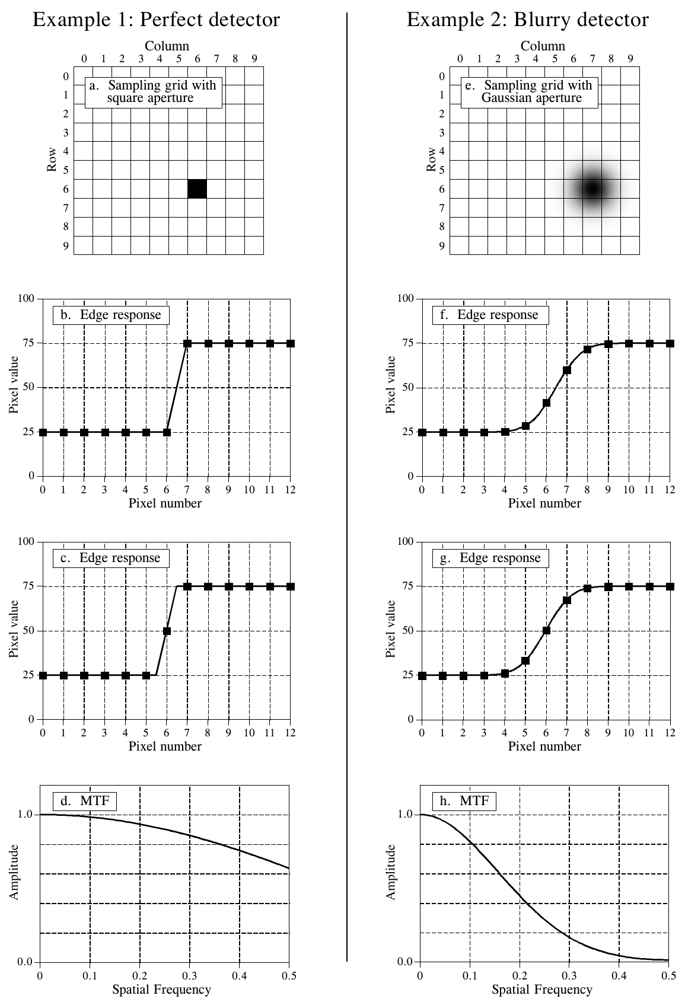

**图 25-6　理想探测器与模糊探测器的采样。** 左栏为例 1：理想探测器；右栏为例 2：模糊探测器。(a)(e) 为采样网格，(b)(c)(f)(g) 为边缘落在不同位置时的边缘响应，(d)(h) 为 MTF。
（Example 1: Perfect detector = 例 1：理想探测器；Example 2: Blurry detector = 例 2：模糊探测器；a. Sampling grid with square aperture = 方形孔径的采样网格；e. Sampling grid with Gaussian aperture = 高斯孔径的采样网格；Edge response = 边缘响应；MTF = 调制传递函数。Row = 行，Column = 列，Pixel value = 像素值，Pixel number = 像素序号，Amplitude = 幅度，Spatial Frequency = 空间频率。原书此图只有编号"FIGURE 25-6"，没有图注文字，上面的图注是译者按正文补的。）

相比之下，(d) 中的 MTF 曲线表明，两种过程都在限制这个系统的分辨率。MTF 曲线的高频衰减代表因采样孔径而丢失的信息。由于 MTF 曲线在频率 0.5 之前没有降到零，采样过程中也有信息丢失，这是有限采样间距造成的。哪个对分辨率的限制更大？很难用一个数字回答，因为它们损伤图像的方式不同。只能说，理想探测器（例 1）的分辨率主要受采样间距限制。

这些概念看起来也许很难，但在实际使用中可以归结为一条很简单的规则。考虑一个 10%-90% 边缘响应距离为某个值的系统，比如 1 mm。如果采样间距大于 1 mm（边缘上不到一个采样点），系统受采样间距限制。如果采样间距小于 0.33 mm（边缘上多于 3 个采样点），分辨率受采样孔径限制。如果每条边缘上有 1～3 个采样点，两个因素都会起限制作用。

## 信噪比

一个物体之所以能在图像中被看到，是因为它的亮度和周围不同。也就是说，物体的对比度（即信号）必须压过图像噪声。这可以分成两类：眼睛的局限和数据的局限。

图 25-7 是一个测量眼睛检测微弱信号能力的实验。根据观察条件的不同，人眼能检测到的最小对比度为 0.5% 到 5%。换句话说，在最黑的黑和最白的白之间，人能分辨大约 20 到 200 个灰度等级。确切数目取决于多种因素，比如环境光的亮度、被比较的两个区域之间的距离，以及灰度图像是怎样形成的（视频监视器、照片、半色调印刷等）。

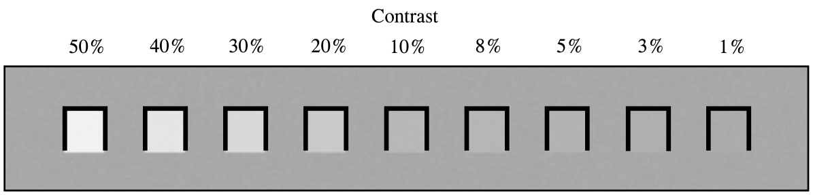

**图 25-7　对比度检测。** 根据观察条件的不同，人眼能检测到的最小对比度约为 0.5% 到 5%。100% 对比度是纯黑与纯白之差。
（Contrast = 对比度。）

第 23 章的灰度变换可以用来提升选定像素值范围内的对比度，这是克服人眼局限的一个有力工具。它以降低另一个亮度水平上的对比度为代价，提高某个亮度水平上的对比度。不过，这只有在物体的对比度没有淹没在随机图像噪声中时才管用。后者是更严重的情况：不论眼睛表现多好，信号本身都不包含足够的信息来显示出这个物体。

图 25-8 是一幅含三个方块的图像，三个方块的对比度分别为 5%、10% 和 20%。背景含有正态分布的随机噪声，标准差约为 10% 对比度。信噪比定义为对比度除以噪声的标准差，于是三个方块的 SNR 分别为 0.5、1.0 和 2.0。一般来说，SNR 低于约 1.0 时就开始有麻烦了。

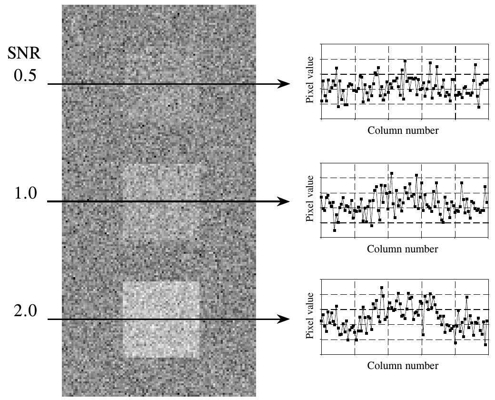

**图 25-8　最小可检测 SNR。** 只有当物体的对比度大到足以压过随机图像噪声时，它才能在图像中被看到。本例中三个方块的 SNR 分别为 2.0、1.0 和 0.5（这里 SNR 定义为物体的对比度除以噪声的标准差）。
（SNR = 信噪比；Pixel value = 像素值，Column number = 列号。右侧三条曲线是左图中箭头所在行的剖面。）

最小可检测 SNR 的确切值取决于物体的大小：物体越大越容易检测。要理解这一点，设想用 3×3 的方形滤波器核平滑图 25-8 的图像。这样对比度不变，噪声却降为三分之一（即核内像素数的平方根）。SNR 提高到三倍，对比度更低的物体也能看到了。要看到更暗淡的物体，可以把滤波器核再做大。例如，5×5 的核把 SNR 提高 $\sqrt{25} = 5$ 倍。这种做法可以一直继续，直到滤波器核和被检测物体一样大。这意味着检测一个物体的能力，与它面积的平方根成正比。物体直径加倍，它就能在两倍的噪声中被检测出来。

大脑中的视觉处理也大致如此：用各种大小的滤波器核平滑所见的图像，试图认出低对比度的物体。图 25-8 中的三条剖面说明了人在噪声环境中检测物体的本领有多强。尽管在剖面中几乎认不出这些物体，它们在图像中却一目了然。要真正体会人类视觉系统的能力，可以试着写一些在这种低 SNR 环境下工作的算法。你会对大脑能做到而你的代码做不到的事心生谦卑！

随机图像噪声常见的有两种形式。第一种如图 25-9a 所示，幅度恒定，也就是说图像中暗区和亮区一样嘈杂。相比之下，(b) 中的噪声随信号电平增大，亮区比暗区更嘈杂。大多数图像中两种噪声源都存在，但通常其中一种占主导。例如，常见的情况是噪声随信号电平降低而减小，直到降到一个恒定幅度噪声的平台为止。

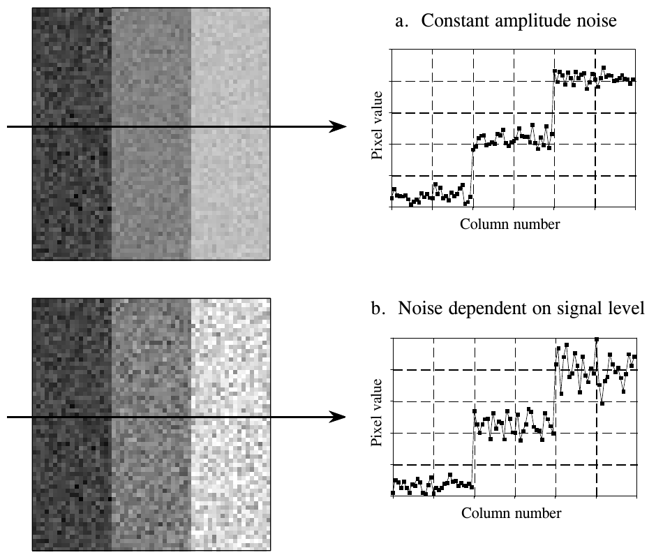

**图 25-9　图像噪声。** 图像中的随机噪声一般有两种形式。(a) 中噪声幅度不随信号电平变化，这是电子噪声的典型特征。(b) 中噪声幅度随信号电平的平方根增大，这种噪声源于对少量粒子的探测，比如光子、电子或 X 射线。
（a. Constant amplitude noise = 恒定幅度噪声；b. Noise dependent on signal level = 依赖信号电平的噪声。Pixel value = 像素值，Column number = 列号。）

恒定幅度噪声的一个常见来源是视频前置放大器。所有模拟电子电路都会产生噪声，但在被放大信号最小的地方，也就是紧挨 CCD 或其他成像传感器的地方，噪声危害最大。前置放大器噪声源于晶体管中电子的随机运动。这使噪声水平取决于电子电路的设计，而与被放大信号的电平无关。例如，一台典型的 CCD 相机的 SNR 约为 300 到 1000（40 到 60 dB），这里 SNR 定义为满量程信号电平除以恒定幅度噪声的标准差。

当图像由少量单个粒子表示时，就会出现随信号电平增大的噪声。例如，这些粒子可能是穿过病人身体的 X 射线、进入相机的光子，或 CCD 势阱中的电子。支配这些涨落的数学叫做计数统计(counting statistics)或泊松统计(Poisson statistics)。假设 CCD 表面被均匀照射，使每个势阱平均产生 10,000 个电子。纯属偶然，有些势阱的电子多一些，有些少一些。更确切地说，电子数服从均值为 10,000 的正态分布，其标准差描述了势阱之间的差异有多大。泊松统计的一个关键特点是：标准差等于单个粒子数的平方根。也就是说，如果每个像素有 N 个粒子，均值就等于 N，标准差等于 $\sqrt{N}$。这使信噪比等于 $N/\sqrt{N}$，也就是 $\sqrt{N}$。写成公式：

**公式 25-1**　泊松统计。在服从泊松分布的信号中，均值 μ 是单个粒子的平均个数 N；标准差 σ 等于单个粒子平均个数的平方根；信噪比（SNR）是均值除以标准差。

$$\mu = N \qquad \sigma = \sqrt{N} \qquad \mathrm{SNR} = \sqrt{N}$$

在 CCD 的例子中，标准差是 $\sqrt{10{,}000} = 100$，信噪比同样是 $\sqrt{10{,}000} = 100$。如果每个势阱的平均电子数增加到一百万，标准差和 SNR 都增加到 1,000。也就是说，信号变大时噪声也变大，如图 25-9b 所示。但信号增长得比噪声快，总体上 SNR 提高了。别误以为信号低一些噪声就小、信息就更好。记住，你的目标不是降低噪声，而是从噪声中提取信号。这使 SNR 成为关键参数。

许多成像系统的工作方式是把一种粒子转换成另一种。例如，想想医用 X 射线成像系统里发生了什么。在 X 射线管内，电子撞击金属靶，产生 X 射线。X 射线穿过病人后，打到一个叫影像增强器(image intensifier)的真空管探测器上。在这里，X 射线先后被转换成光子、电子，再转换回光子。这些光子进入相机，在 CCD 势阱中被转换成电子。在每种中间形式下，图像都由有限个粒子表示，按公式 25-1 会引入额外的噪声。最终的 SNR 反映所有环节的综合噪声，但通常有一个环节占主导。这就是 SNR 最差的那个环节，因为它的粒子最少。这个限制性环节叫做量子汇(quantum sink)。

在夜视系统中，量子汇是相机能捕获的光子数。夜越黑，最终图像越嘈杂。医用 X 射线成像是类似的例子，量子汇是打到探测器上的 X 射线数。辐射水平越高，图像噪声越小，代价是病人受到更多辐射。

什么时候泊松统计带来的噪声是图像中的主要噪声？只要量子汇产生的噪声大于系统中的其他噪声源（比如电子电路），它就占主导。例如，考虑一台典型的 CCD 相机，SNR 为 300，也就是说 CCD 前置放大器的噪声是满量程信号的 1/300。如果系统的量子汇每个像素有 90,000 个粒子，就会产生同样大小的噪声。如果量子汇的粒子数更少，泊松噪声将在系统中占主导；如果更多，前置放大器噪声将占主导。因此，大多数 CCD 的满阱容量设计为 100,000 到 1,000,000 个电子，以尽量减小泊松噪声。

## 形态学图像处理

在图像中识别物体可能是一项非常困难的任务。简化问题的一种办法，是把灰度图像变成二值图像(binary image)，每个像素只能取 0 或 1。用于这类二值图像的技术有各种名称：斑点分析(blob analysis)、连通性分析(connectivity analysis)，以及形态学图像处理(morphological image processing)（源自希腊语 morphe，意为形状或形态）。形态学处理的基础是数学上严格的集合论，但很少需要这么高深。大多数形态学算法只是简单的逻辑运算，而且非常因事而异(ad hoc)。换句话说，每个应用都需要通过反复试验摸索出专门的方案。这通常更像一门艺术而不是科学，用的是一袋子技巧，而不是标准算法和正式的数学性质。下面是一些例子。

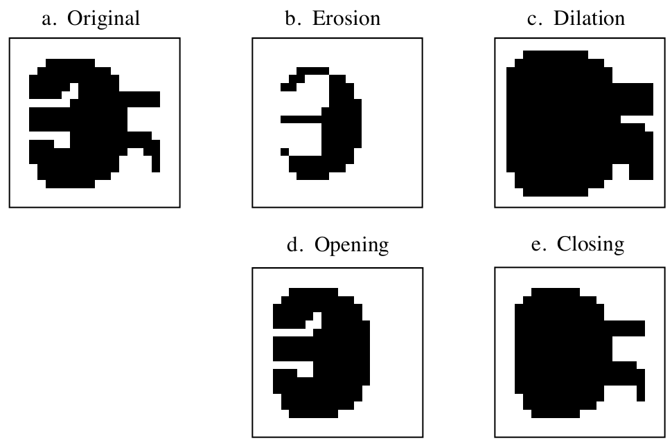

**图 25-10　形态学运算。** 二值图像处理中用到四种基本的形态学运算：腐蚀、膨胀、开运算和闭运算。(a) 是一幅示例二值图像，(b) 到 (e) 是对 (a) 施加这些运算的结果。
（a. Original = 原图；b. Erosion = 腐蚀；c. Dilation = 膨胀；d. Opening = 开运算；e. Closing = 闭运算。原书图注排在图左下方，裁图时已去掉，译文见上。）

图 25-10a 是一幅示例二值图像。它可能代表红外图像中的一辆敌方坦克、太空照片中的一颗小行星，或医用 X 光片中一个可疑的肿瘤。背景中的每个像素显示为白色，物体中的每个像素显示为黑色。二值图像常常通过对灰度图像做阈值处理得到：值大于阈值的像素设为 1，小于阈值的设为 0。在阈值处理之前，通常先用线性技术处理灰度图像。例如，照度展平（illumination flattening，第 24 章介绍过）往往能改善初始二值图像的质量。

(b) 和 (c) 展示了图像在两种最常用的形态学运算——腐蚀(erosion)和膨胀(dilation)——下的变化。腐蚀时，每个接触到背景像素的物体像素都被改成背景像素。膨胀时，每个接触到物体像素的背景像素都被改成物体像素。腐蚀使物体变小，并可能把一个物体断成多个；膨胀使物体变大，并可能把多个物体合并成一个。

如 (d) 所示，开运算(opening)定义为先腐蚀后膨胀。(e) 是相反的闭运算(closing)，定义为先膨胀后腐蚀。如这些例子所示，开运算去掉物体像素构成的小岛和细丝；同样，闭运算去掉背景像素构成的小岛和细丝。这些技术适合处理有些像素二值取错了的噪声图像。例如，可能已知物体不能有"洞"，或者物体的边界必须光滑。

图 25-11 是形态学处理的一个例子。(a) 是一枚指纹的二值图像。人们已经开发出分析这类纹路的算法，可以把单个指纹与数据库中的指纹进行比对。这些算法中常见的一步如 (b) 所示，这种运算叫骨架化(skeletonization)。它通过去掉多余的像素（即把适当的像素从黑改成白）来简化图像，结果是每条脊线都变成只有一个像素宽的线。

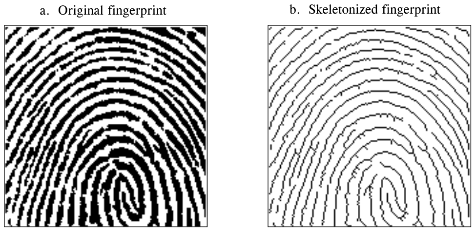

**图 25-11　二值骨架化。** 指纹的二值图像 (a) 中，脊线有好几个像素宽。骨架化后的 (b) 中，脊线只有一个像素宽。
（a. Original fingerprint = 原始指纹；b. Skeletonized fingerprint = 骨架化后的指纹。）

表 25-1 和 25-2 是骨架化程序。指纹图像虽然是二值的，却存放在每个像素可取 0 到 255 的数组中。黑像素用 0 表示，白像素用 255 表示。如表 25-1 所示，算法由 6 轮迭代组成，逐步把脊线腐蚀成细线。迭代次数是反复试验选定的。另一种做法是在某轮迭代不再产生任何变化时停止。

在一轮迭代中，图像中的每个像素都要接受评估，看它是否可删除，即是否满足从黑改成白的一组条件。第 200～240 行遍历图像中的每个像素，由表 25-2 的子程序做评估。如果当前像素不可删除，子程序什么也不做；如果可删除，子程序把它的值从 0 改成 1。这表示该像素仍是黑的，但会在本轮迭代结束时改成白色。所有像素评估完之后，第 260～300 行把标记过的像素的值从 1 改成 255。这种两阶段的做法使粗脊线从各个方向均匀地被腐蚀，而不是形成取决于行列扫描顺序的图样。

**表 25-1**（注释已译成中文）

```basic
100 'SKELETONIZATION PROGRAM
110 '物体像素的值为 0（显示为黑色）
120 '背景像素的值为 255（显示为白色）
130 '
140 DIM X%[149,149]                   'X%[ , ] 存放正在处理的图像
150 '
160 GOSUB XXXX                        '虚构的子程序，载入 X%[ , ]
170 '
180 FOR ITER% = 0 TO 5                '做 6 轮迭代
190 '
200 FOR R% = 1 TO 148                 '遍历图像中的每个像素。
210 FOR C% = 1 TO 148                 '子程序 5000（表 25-2）找出可以从黑改成白的像素，
220 GOSUB 5000                        '把它们标记为 1。
230 NEXT C%
240 NEXT R%
250 '
260 FOR R% = 0 TO 149                 '遍历图像中的每个像素，
270 FOR C% = 0 TO 149                 '把标记过的像素从黑改成白。
280 IF X%(R%,C%) = 1 THEN X%(R%,C%) = 255
290 NEXT C%
300 NEXT R%
310 '
320 NEXT ITER%
330 '
340 END
```

删除一个像素的决定基于四条规则，见表 25-2 的子程序。四条规则必须全部满足，像素才会从黑改成白。前三条比较简单，第四条相当复杂。如图 25-12a 所示，位于 [R,C] 的像素有八个邻居。水平和垂直方向上的四个邻居（编号 2、4、6、8）常称为近邻(close neighbors)；对角线上的像素（编号 1、3、5、7）相应地称为远邻(distant neighbors)。四条规则如下：

**规则一：** 当前像素必须是黑的。如果它已经是白的，就无需任何操作。

**规则二：** 该像素的近邻中至少有一个是白的。这保证粗脊线的腐蚀从外面开始。换句话说，如果一个黑像素被黑像素完全包围，本轮迭代就不动它。为什么只看近邻而不看所有邻居？答案很简单：两种做法都试过，这种效果更好。记住，这在形态学图像处理中非常常见：靠反复试验来确定一种技术是否比另一种好。

**规则三：** 该像素必须有不止一个黑色邻居。如果只有一个，它一定是一条线的端点，因此不应删除。

**规则四：** 如果删除一个像素会导致它的邻居不再连通，就不能删除。这是为了让每条脊线变成一条连续的线，而不是一段段断开的线段。如图 25-12 的例子所示，连通(connected)是指所有黑色邻居都彼此接触；不连通(unconnected)则是指黑色邻居形成两组或更多组。

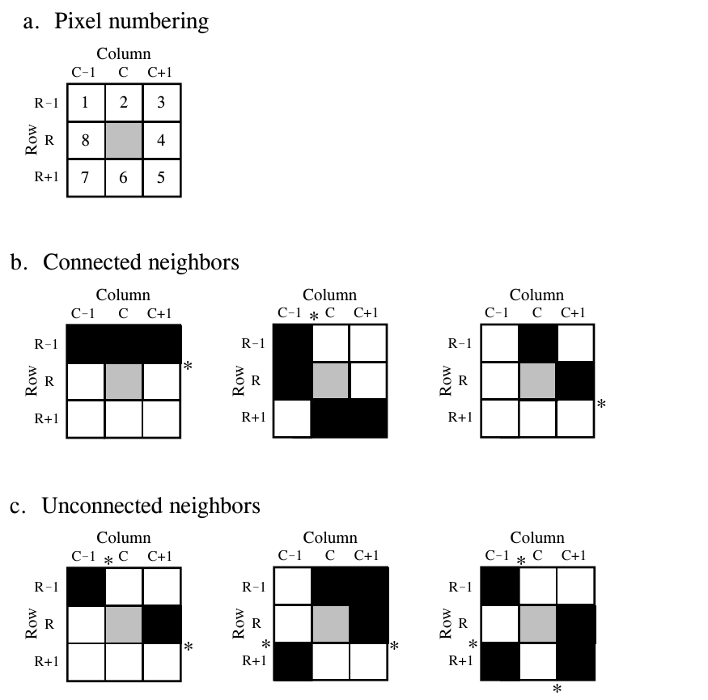

**图 25-12　相邻像素。** 位于第 R 行第 C 列 [R,C] 的像素有八个邻居，用 (a) 中的编号指代。(b) 和 (c) 分别给出了相邻像素连通和不连通的例子。骨架化算法的规则四用到了这个定义。
（a. Pixel numbering = 像素编号；b. Connected neighbors = 连通的邻居；c. Unconnected neighbors = 不连通的邻居。Row = 行，Column = 列；星号 * 标出每一处"黑→白"跳变。原书图注排在图右上方，裁图时已去掉，译文见上。）

判断邻居连通还是不连通的算法，基于按顺时针方向数相邻邻居像素之间的"黑→白"跳变。例如，如果像素 1 是黑的、像素 2 是白的，就算一次黑→白跳变。同样，如果像素 2 是黑的、像素 3 和 4 都是白的，也算一次黑→白跳变。总共有八个位置可能出现黑→白跳变。为了进一步说明这个定义，(b) 和 (c) 的例子在每处黑→白跳变旁都标了一个星号。这个算法的关键在于：如果邻居是连通的，黑→白跳变恰好只有一次；多于一次，就说明邻居不连通。

**表 25-2**（注释已译成中文）

```basic
5000 '子程序：判断位于 X%[R%,C%] 的像素能否删除。
5010 '如果四条规则都满足，就把 X%(R%,C%) 设为 1，
5020 '表示它应在本轮迭代结束时被删除。
5030 '
5040 '规则一：像素已经是白的，什么都不做
5050 IF X%(R%,C%) = 255 THEN RETURN
5060 '
5070 '
5080 '规则二：四个近邻全是黑的，什么都不做
5090 IF X%[R% -1,C% ] <> 255 AND X%[R% ,C%+1] <> 255 AND
          X%[R%+1,C% ] <> 255 AND X%[R% ,C% -1] <> 255 THEN RETURN
5100 '
5110 '
5120 '规则三：只有一个邻居是黑的，什么都不做
5130 COUNT% = 0
5140 IF X%[R% -1,C% -1] = 0 THEN COUNT% = COUNT% + 1
5150 IF X%[R% -1,C%   ] = 0 THEN COUNT% = COUNT% + 1
5160 IF X%[R% -1,C%+1] = 0 THEN COUNT% = COUNT% + 1
5170 IF X%[R%   ,C%+1] = 0 THEN COUNT% = COUNT% + 1
5180 IF X%[R%+1,C%+1] = 0 THEN COUNT% = COUNT% + 1
5190 IF X%[R%+1,C%   ] = 0 THEN COUNT% = COUNT% + 1
5200 IF X%[R%+1,C% -1] = 0 THEN COUNT% = COUNT% + 1
5210 IF X%[R%   ,C% -1] = 0 THEN COUNT% = COUNT% + 1
5220 IF COUNT% = 1 THEN RETURN
5230 '
5240 '
5250 '规则四：邻居不连通，什么都不做。
5260 '判断方法：顺时针绕 8 个邻居一圈，
5270 '数「黑→白」跳变的次数
5280 COUNT% = 0
5290 IF X%[R% -1,C% -1] = 0 AND X%[R% -1,C%   ] > 0 THEN COUNT% = COUNT% + 1
5300 IF X%[R% -1,C%   ] = 0 AND X%[R% -1,C%+1] > 0 AND X%[R%   ,C%+1] > 0
          THEN COUNT% = COUNT% + 1
5310 IF X%[R% -1,C%+1] = 0 AND X%[R%   ,C%+1] > 0 THEN COUNT% = COUNT% + 1
5320 IF X%[R%   ,C%+1] = 0 AND X%[R%+1,C%+1] > 0 AND X%[R%+1,C%   ] > 0
          THEN COUNT% = COUNT% + 1
5330 IF X%[R%+1,C%+1] = 0 AND X%[R%+1,C%   ] > 0 THEN COUNT% = COUNT% + 1
5340 IF X%[R%+1,C%   ] = 0 AND X%[R%+1,C% -1] > 0 AND X%[R%   ,C% -1] > 0
          THEN COUNT% = COUNT% + 1
5350 IF X%[R%+1,C% -1] = 0 AND X%[R%   ,C% -1] > 0 THEN COUNT% = COUNT% + 1
5360 IF X%[R%   ,C% -1] = 0 AND X%[R% -1,C% -1] > 0 AND X%[R% -1,C%   ] > 0
          THEN COUNT% = COUNT% + 1
5370 IF COUNT% > 1 THEN RETURN
5380 '
5390 '
5400 '所有规则都满足，标记该像素，在本轮迭代结束时改成白色
5410 X%(R%,C%) = 1
5420 '
5430 RETURN
```

> **译注：** 原书程序里圆括号和方括号混用（如 `X%(R%,C%)` 与 `X%[R%,C%]`），第 5010 行注释里还写成了 `X%(R%,C%]`，都指同一个数组元素。另外要留意一个容易忽略的细节：规则二用 `<> 255` 判断，本轮已标记（值为 1）的像素仍算黑；规则三、四用 `= 0` 和 `> 0` 判断，已标记的像素算白。C 版本照原样保留了这一差别。

**C 实现**（完整可编译版本见 `c/table25-1_skeletonization.c`，表 25-1 和 25-2 合在一个文件里。原书的指纹图像无法取得，程序自己画了一张 150×150 的测试图：三圈粗圆环、两段粗斜线和一个粗十字，线宽 5～9 像素）：

```c
/* 表 25-1 第 180～320 行：6 轮迭代 */
for (int iter = 0; iter < 6; iter++) {      /* 180：FOR ITER% = 0 TO 5 */
    for (int r = 1; r < SIZE - 1; r++)      /* 200～240：逐像素判断 */
        for (int c = 1; c < SIZE - 1; c++)
            evaluate_pixel(r, c);           /* 220：GOSUB 5000 */
    for (int r = 0; r < SIZE; r++)          /* 260～300：标记过的像素统一改成白色 */
        for (int c = 0; c < SIZE; c++)
            if (X[r][c] == MARK) X[r][c] = WHITE;
}

/* 表 25-2：四条规则（节选规则二和规则四） */
static void evaluate_pixel(int r, int c)
{
    if (X[r][c] == WHITE) return;                                   /* 规则一 */
    if (X[r - 1][c] != WHITE && X[r][c + 1] != WHITE &&
        X[r + 1][c] != WHITE && X[r][c - 1] != WHITE) return;       /* 规则二 */
    /* ……规则三：数八个邻居中的黑像素，只有 1 个就返回…… */
    int count = 0;                                                  /* 规则四 */
    if (X[r - 1][c - 1] == BLACK && X[r - 1][c] > 0) count++;                      /* 1→2 */
    if (X[r - 1][c] == BLACK && X[r - 1][c + 1] > 0 && X[r][c + 1] > 0) count++;   /* 2→3,4 */
    /* ……其余六处跳变同理…… */
    if (count > 1) return;
    X[r][c] = MARK;                                                 /* 5410：标记删除 */
}
```

运行结果：6 轮迭代依次删掉 1487、1463、1228、570、196、27 个像素，逐轮递减，说明脊线由外向内被削细、到第 6 轮已基本收敛。黑像素从 5707 个减到 736 个；原图中有 4646 个 2×2 全黑方块，骨架化后为 0，说明到处都只剩一个像素宽；8 连通黑色区域数前后都是 6 个，说明规则四确实保证了线条不被打断。

作为二值图像处理的更多例子，想想指纹骨架化之后可能用到的算法类型。这个骨架化算法的一个缺点是会留下相当多的毛刺(fuzz)，也就是从较长线段侧面伸出来的短小分支。消除这些瑕疵有几种不同的方法。例如，程序可以遍历图像，删除每条线末端的像素。这些像素的识别标志是只有一个黑色邻居。这样做几次，毛刺就去掉了，代价是每条正确的线也变短了。更好的方法是遍历图像，找出分支像素（邻居多于两个的像素）。从每个分支像素出发，数每个分支上的像素个数。如果一个分支上的像素数少于某个值（比如 5），就判定它是毛刺，把分支上的像素从黑改成白。

另一种算法可以把数据从位图格式转换成矢量格式。这需要建立一张清单，列出图像中包含的脊线以及每条脊线包含的像素。在矢量形式中，指纹中的每条脊线都有独立的身份，而不是一幅由许多互不相关的像素组成的图像。实现方法是遍历图像，寻找每条线的端点，即只有一个黑色邻居的像素。从端点出发，逐个像素地沿相连的像素追踪这条线。到达线的另一端后，把追踪过的所有像素宣布为一个物体，在后续算法中相应处理。

## 计算机断层成像

用 X 射线（或其他穿透性辐射）成像的一个基本问题是：得到的是三维物体的二维图像。这意味着在物体中完全分开的结构，在最终图像中可能会重叠。这在医学诊断中尤其麻烦，因为有许多解剖结构会干扰医生想看的东西。20 世纪 30 年代，人们这样对付这个问题：在成像过程中让 X 射线源和探测器协调运动。根据这种运动的几何关系，病人体内只有一个平面保持清晰，平面以外的结构都变模糊。这就像相机对焦在 5 英尺处的物体上，1 英尺和 50 英尺处的物体就是模糊的。这些基于运动模糊的相关技术，现在统称为经典断层成像(classical tomography)。tomography 一词的意思是"平面的图像"。

尽管已经发展了 50 多年，经典断层成像却很少使用，因为它有一个严重的局限：干扰物体并没有从图像中去掉，只是被模糊了。得到的图像质量通常太差，没有实用价值。人们长期寻求的解决方案，是一种能生成三维物体中某个二维切片的图像、而又不受三维物体中其他结构干扰的系统。

这个问题在 20 世纪 70 年代初随着一种叫计算机断层成像（computed tomography, CT）的技术的出现而得到解决。CT 以前所未有的能力显示人体的解剖结构，给医用 X 射线领域带来了革命。图 25-13 是一幅典型的医用 CT 图像。计算机断层成像最初以计算机轴向断层成像(Computed Axial Tomography)和 CAT 扫描仪(CAT scanner)的名字推向市场。这些叫法现在在医学界不受待见，不过公众仍常这么说。

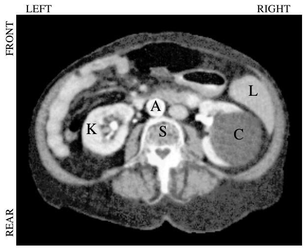

**图 25-13　计算机断层成像图像。** 这是在肚脐水平的人体腹部 CT 切片。可以看到许多器官，比如 (L) 肝脏、(K) 肾脏、(A) 主动脉、(S) 脊柱，以及覆盖在右肾上的 (C) 囊肿。CT 显示内部解剖结构的能力远胜于常规医用 X 光片。
（LEFT = 左，RIGHT = 右，FRONT = 前，REAR = 后。原书图注排在图左侧，裁图时已去掉，译文见上。）

图 25-14 给出了一种穿过头部中心采集 CT 切片的简单几何结构。一束窄的笔形 X 射线从 X 射线源射向 X 射线探测器。这意味着探测器上的测量值与沿射束路径上任何位置的物质总量有关。骨骼和牙齿之类的物质挡住更多的 X 射线，因此信号比软组织和脂肪低。如图所示，射线源和探测器组件平移扫描，就采集到这个角度上的一个视图（view，CT 行话）。图中只画了采集一个视图，而一次完整的 CT 扫描需要 300 到 1000 个视图，每次旋转约 0.3° 到 1.0°。这是通过把 X 射线源和探测器装在一个环绕病人的旋转机架上实现的。CT 数据采集的一个关键特点是：X 射线只穿过被检查的身体切片。这不像经典断层成像，X 射线会穿过你在最终图像中想要抑制的结构。计算机断层成像根本不让无关位置的信息进入采集的数据。

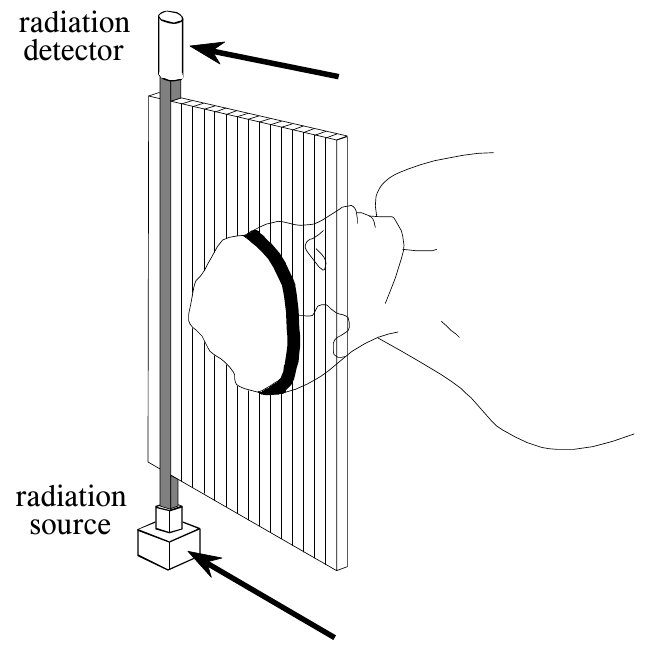

**图 25-14　CT 数据采集。** 简单的 CT 系统让一束窄 X 射线从射线源穿过身体射到探测器。然后平移射线源和探测器，得到一个完整的视图。其余视图的获取方法是：把射线源和探测器旋转约 1°，重复平移过程。
（radiation detector = 辐射探测器，radiation source = 辐射源。原书图注排在图左侧，裁图时已去掉，译文见上。）

在图像重建之前，通常需要几步预处理。例如，必须对每个 X 射线测量值取对数。这是因为 X 射线穿过物质时强度按指数衰减，取对数后得到的信号与被测物质的特性成线性关系。其他预处理步骤用来补偿多色（多于一种能量的）X 射线的使用，以及多元探测器（而不是图 25-14 中的单元探测器）的使用。这些虽然是整个技术中的关键步骤，但与重建算法无关，这里不再讨论。

图 25-15 说明了测得的视图与对应图像之间的关系。CT 系统采集的每个样本，等于沿指向该样本的射线上的图像值之和。例如，视图 1 是把每一行的所有像素加起来得到的；同样，视图 3 是把每一列的所有像素加起来得到的。其他视图（比如视图 2）是沿某个角度的射线把像素加起来。

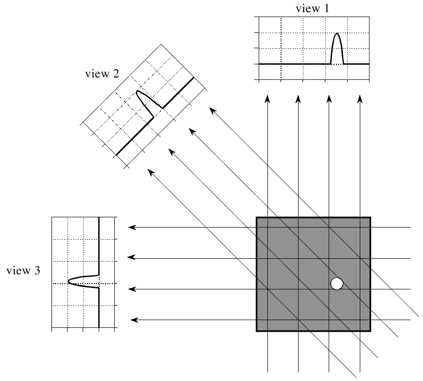

**图 25-15　CT 视图。** 计算机断层成像先采集一组视图，再重建出对应的图像。视图中的每个样本，等于沿指向该样本的射线上的图像值之和。本例中，图像是一个周围全为零的小圆柱体。这里只画了三个视图，而典型的 CT 扫描要用数百个角度略有不同的视图。
（view 1/2/3 = 视图 1/2/3。）

根据一组视图计算切片图像，主要有四种方法，统称 CT 重建算法(CT reconstruction algorithms)。第一种方法完全不实用，但有助于更好地理解问题。它基于求解大量联立线性方程：每个测量值都能列出一个方程，也就是说，某个视图中某个样本，等于图像中某一组像素之和。要解出 $N^2$ 个未知数（即图像的像素值），必须有 $N^2$ 个独立方程，因此需要 $N^2$ 个测量值。大多数 CT 扫描仪采集的样本比这个分析严格要求的多约 50%。例如，要重建一幅 512×512 的图像，系统可能采集 700 个视图，每个视图 600 个样本。这样让问题超定(overdetermined)，最终图像的噪声和伪影就会减少。第一种 CT 重建方法的问题是计算时间：求解几十万个联立线性方程是一项令人生畏的任务。

第二种 CT 重建方法用迭代技术，一小步一小步地算出最终图像。这种方法有几个变体：代数重建技术（Algebraic Reconstruction Technique, ART）、联合迭代重建技术（Simultaneous Iterative Reconstruction Technique, SIRT）和迭代最小二乘技术（Iterative Least Squares Technique, ILST）。它们的区别在于逐次修正的方式：分别是逐条射线、逐个像素，以及同时修正整个数据集。我们以 ART 为例来看看这类技术。

ART 算法开始时，把图像数组中的所有像素设为某个任意值。然后用迭代过程逐步修改图像数组，使它与各个视图相符。一个迭代周期要遍历每个测量数据点。对每个测量值，都问这样一个问题：怎样修改数组中的像素值，才能使它们与这个测量值一致？换句话说，把测得的样本与指向该样本的射线上的图像像素之和比较。如果射线和比测得的样本小，就把射线上的所有像素都调大；同样，如果射线和比测得的样本大，就把射线上的所有像素都调小。第一个完整迭代周期结束后，射线和与测量值之间仍会有误差。这是因为针对任何一个测量值所做的修改，都会打乱之前所做的所有修正。其思路是：随着反复迭代，误差越来越小，直到图像收敛到正确的解。

迭代技术一般很慢，但在没有更好算法时很有用。事实上，1972 年推出的第一台商用医学 CT 扫描仪 EMI Mark I 用的就是 ART。下一章讲神经网络时会再谈到迭代技术。第三种和第四种方法的发展，几乎已经在商用 CT 产品中完全取代了迭代技术。

最后两种重建算法基于对这个问题的正式数学解，是 DSP 的精彩范例。第三种方法叫滤波反投影(filtered backprojection)。它是对一种更老的技术——反投影(backprojection)，或称简单反投影(simple backprojection)——的改进。图 25-16 表明，简单反投影是一种符合常识但很不精巧的方法。反投影单个样本，就是把指向该样本的射线上的所有图像像素都设为同一个值。用不那么专业的话说，反投影就是把每个视图沿它当初被采集的方向"抹"回图像里。最终的反投影图像取为所有反投影视图之和。

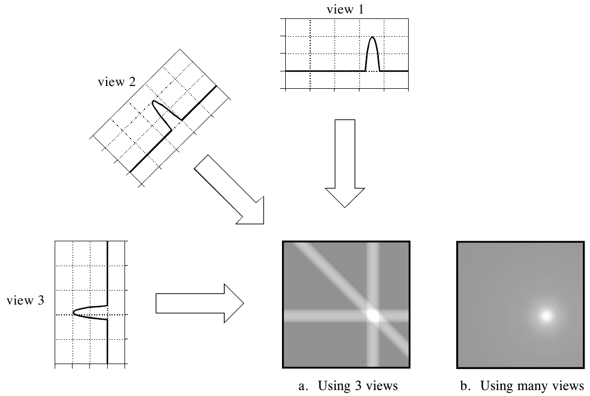

**图 25-16　反投影。** 反投影把每个视图沿它当初被采集的路径抹回去，以此重建图像。得到的图像是正确图像的一个模糊版本。
（view 1/2/3 = 视图 1/2/3；a. Using 3 views = 用 3 个视图；b. Using many views = 用许多视图。）

反投影虽然概念简单，却不能正确解决问题。如 (b) 所示，反投影图像非常模糊。真实图像中的一个点，被重建成一个从中心向外强度递减的圆形区域。用更正式的话说，反投影的点扩散函数是圆对称的，并随半径的倒数递减。

滤波反投影是纠正简单反投影中模糊的一种技术。如图 25-17 所示，每个视图在反投影之前先经过滤波，以抵消起模糊作用的 PSF。也就是说，每个一维视图都与一个一维滤波器核卷积，得到一组滤波后的视图。再把这些滤波后的视图反投影，就得到重建图像，它非常接近"正确"图像。事实上，在视图个数无穷、每个视图的点数也无穷时，滤波反投影得到的图像与"正确"图像完全相同。

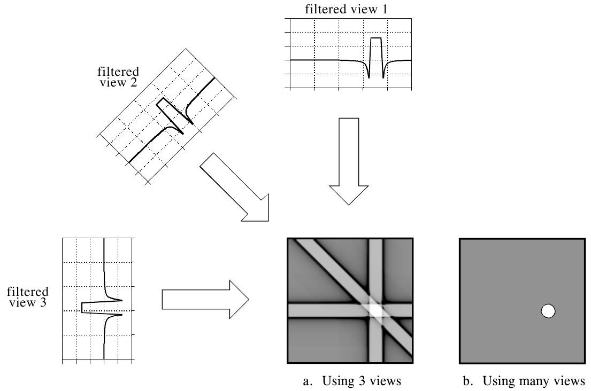

**图 25-17　滤波反投影。** 滤波反投影在反投影之前先对每个视图滤波，以此重建图像。这消除了简单反投影中的模糊，得到在数学上精确的图像重建。滤波反投影是计算机断层成像系统中最常用的算法。
（filtered view 1/2/3 = 滤波后的视图 1/2/3；a. Using 3 views = 用 3 个视图；b. Using many views = 用许多视图。）

这种技术所用的滤波器核稍后再讨论。先注意滤波器怎样改变了剖面。本例中的图像是黑背景上的一个均匀白圆（一个圆柱体）。采集到的每个视图都是平坦的背景加上一个代表白圆的圆弧形区域。滤波在两个重要方面改变了视图。第一，脉冲的顶部被削平，使最终的反投影在圆内产生均匀的信号电平。第二，脉冲两侧引入了负尖峰。反投影时，这些负值区域抵消了模糊。

第四种方法叫傅里叶重建(Fourier reconstruction)。在空间域中，CT 重建涉及二维图像与它的一组一维视图之间的关系。对图像做二维傅里叶变换、对每个视图做一维傅里叶变换，就可以在频域中考察这个问题。事实证明，图像与其视图之间的关系在频域中比在空间域中简单得多。对这个问题的频域分析是 CT 技术中的一个里程碑，叫傅里叶切片定理(Fourier slice theorem)。

图 25-18 展示了这个问题在空间域和频域中的样子。在空间域中，每个视图是沿某个角度的射线对图像积分得到的。在频域中，图中用一个二维网格表示图像频谱，每个视图（一个一维信号）的频谱用叠加在网格上的一条黑线表示。从这些线在网格上的位置可以看出，傅里叶切片定理说的是：一个视图的频谱，等于沿一条穿过图像频谱的直线（切片）上的值。例如，视图 1 的频谱与图像频谱的中心列相同，视图 3 的频谱与图像频谱的中心行相同。注意，每个视图的频谱在网格上所处的角度，与当初采集该视图的角度相同。所有这些频谱都包含负频率，并以零频率居中显示。

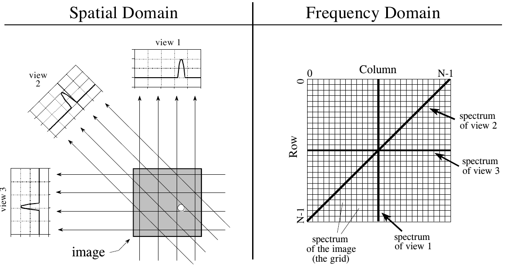

**图 25-18　傅里叶切片定理。** 傅里叶切片定理描述了图像与其视图在频域中的关系。在空间域中，每个视图是沿某个角度的射线对图像积分得到的。在频域中，每个视图的频谱是二维图像频谱的一个一维"切片"。
（Spatial Domain = 空间域，Frequency Domain = 频域；view 1/2/3 = 视图 1/2/3，image = 图像；Row = 行，Column = 列；spectrum of view 1/2/3 = 视图 1/2/3 的频谱；spectrum of the image (the grid) = 图像的频谱（网格）。）

CT 图像的傅里叶重建需要三步。第一，对每个视图做一维 FFT。第二，按傅里叶切片定理，用这些视图频谱算出图像的二维频谱。由于视图频谱是放射状排列的，而正确的图像频谱是矩形排列的，需要一个插值程序来完成转换。第三，对图像频谱做逆 FFT，得到重建图像。

这种"放射状到矩形"的转换，也是理解滤波反投影的关键。放射状排列的是反投影图像的频谱，矩形网格是正确图像的频谱。如果把放射状频谱的一小块区域与矩形网格的对应区域比较，会发现样本值完全相同，但样本密度不同。正确的频谱处处均匀分布，如矩形网格的均匀间距所示。相比之下，反投影频谱由于是放射状排列的，靠近中心处的样本密度更高。换句话说，车轮的辐条在轮毂附近挨得更近。这个问题不影响傅里叶重建，因为插值依据的是最近邻点的值，而不是它们的密度。

滤波反投影中的滤波器正是用来抵消这种不均匀的样本密度。具体地说，滤波器的频率响应必须是样本密度的倒数。由于反投影频谱的密度为 1/f，合适的滤波器的频率响应就是 $H[f] = f$。这个频率响应如图 25-19a 所示。对它做逆傅里叶变换就得到滤波器核，如 (b) 所示。数学上，滤波器核由下式给出：

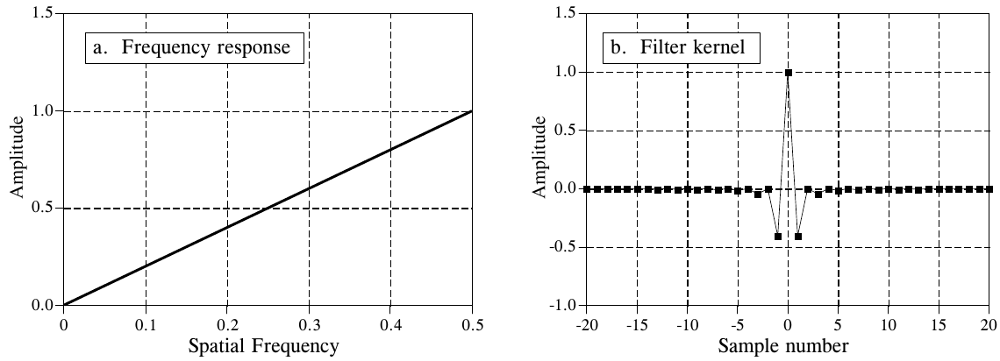

**图 25-19　反投影滤波器。** (a) 是反投影滤波器的频率响应，(b) 是对应的滤波器核。公式 25-2 给出了滤波器核的值。
（a. Frequency response = 频率响应；b. Filter kernel = 滤波器核。Amplitude = 幅度，Spatial Frequency = 空间频率，Sample number = 采样序号。）

**公式 25-2**　滤波反投影的滤波器核。图 25-19b 是这个核的图形。

$$
h[0] = 1,\qquad
h[k] = 0 \quad (k \text{ 为偶数}),\qquad
h[k] = \frac{-4/\pi^2}{k^2} \quad (k \text{ 为奇数})
$$

> **译注：** 原书公式 25-2 奇数项印成 $\dfrac{4/\pi^2}{k^2}$，漏了负号。图 25-19b 中 k = ±1 处的值约为 −0.4（$-4/\pi^2 \approx -0.405$），正文也说滤波后脉冲两侧出现负尖峰，所以应为负值，上式已改正。另外，按图 25-19a 的 $H[f] = |f|$（f 从 −0.5 到 0.5）直接做逆 DFT，译者数值计算得到的是 $h[0] = 0.25$、奇数项 $-1/(\pi^2 k^2)$，恰好是公式 25-2 的四分之一。也就是说，公式 25-2 对应的频率响应是 $4|f|$，整体差一个常数倍，不影响滤波器的形状和重建结果的相对亮度。

在结束计算机断层成像这个话题之前，应该提一下医学领域还有几种类似的成像技术，它们都大量使用 DSP。正电子发射断层成像（Positron emission tomography, PET）是给病人注射一种会发射正电子的弱放射性化合物。正电子发射后立即与一个电子湮灭，产生两条沿完全相反方向射出体外的伽马射线。放置在病人周围的辐射探测器寻找这些背对背的伽马射线，从而确定伽马射线所走的那条直线的位置。由于产生伽马射线的点一定在这条线上的某处，就可以用类似计算机断层成像的重建算法。得到的图像看起来和 CT 类似，只是亮度与每个位置上放射性物质的多少有关。PET 的一个独特优势是，放射性化合物可以附着在身体以某种方式利用的各种物质上，比如葡萄糖。重建出的图像就与这种生物物质的浓度有关。这使得对身体的生理功能而不仅仅是解剖结构成像成为可能。例如，可以生成图像，显示人脑的哪些部位参与了各种思维活动。

计算机断层成像更直接的竞争者是磁共振成像（magnetic resonance imaging, MRI），现在大多数大医院都有。这种技术最初以核磁共振（nuclear magnetic resonance, NMR）的名字发展起来。改名是出于公共关系的考虑：当地政府抗议在自己的社区里使用任何"核"的东西。要让公众明白"核"只是指所有原子都有原子核这一事实，往往是不可能的任务。做 MRI 扫描时，病人被放在一个强磁体的中心。无线电波与磁场共同作用，使体内选定的原子核发生共振，从而发出次级无线电波。这些次级无线电波被数字化，构成 MRI 重建算法所用的数据集。结果是一组看起来和计算机断层成像非常相似的图像。MRI 的优点很多：软组织分辨能力好、切片选择灵活，而且不使用可能有危险的 X 射线辐射。缺点是 MRI 比 CT 贵，而且不擅长对骨骼和其他硬组织成像。在未来很多年里，CT 和 MRI 都将是医学成像的主力。
