# 《The Scientist and Engineer's Guide to Digital Signal Processing》第 26 章中译

> 原书：上一级目录 `Documents/数学基础/` 下的 `The Scientist and Engineer Guide to Digital Signal Processing.pdf`，对应 PDF 第 462～491 页（原书第 451～480 页）。
> 上一章：[25-DSP指南-第25章中译.md](25-DSP指南-第25章中译.md)。专业名词第一次出现时在括号里附上英文。
> 插图从原书页面裁出，放在 `assets/ch26/`，图里的英文标注在每张图下方给出对照。原书 PDF 的符号字体抽取时会乱码（Σ 显示成 E，Δ 显示成 )，∞ 显示成 4），公式按原书版面重新用 LaTeX 写出。BASIC 程序的 C 版本在 `c/` 目录。

---

# 第 26 章　神经网络（及其他！）

传统的 DSP 建立在算法(algorithm)之上，通过一步步的过程把数据从一种形式变成另一种形式。这些技术大多还需要参数(parameter)才能运作。例如：递归滤波器要用递归系数；特征检测可以用相关加阈值来实现；图像显示取决于亮度和对比度设置；等等。算法描述要做什么，而参数提供评判数据的基准。参数选得恰当，往往比算法本身更重要。神经网络(neural network)把这个思想推到了极致：算法非常简单，但参数很多，而且都经过高度优化。这与科学和工程的传统支柱——先做数学推理和理论分析、再做实验——是一次革命性的背离。神经网络用试错、讲求实效的解法以及"这个比那个好用"的方法论取代了这些解题策略。本章讨论神经网络和较传统的 DSP 算法中有关参数选择的各种问题。

## 目标检测

科学家和工程师常常需要知道某种物体或状况是否存在。例如，地球物理学家勘探石油，医生检查病人有没有患病，天文学家在宇宙中寻找地外智慧，等等。这类问题通常要把采集到的数据和一个阈值(threshold)作比较。如果超过阈值，就认为目标(target，即要找的物体或状况)存在。

例如，假设你发明了一种检测人体癌症的装置。把它在病人身上扫一遍，屏幕上就会跳出一个 0 到 30 之间的数。数小表示受检者健康，数大表示存在癌组织。你发现这个装置效果相当好，但并不完美，偶尔会出错。问题是：怎样使用这个系统，才能让受检的病人受益？

图 26-1 给出了分析这种情形的系统方法。假设在两组人身上测试这个装置：几百名已知健康的志愿者（非目标，nontarget），和几百名已知患有癌症的志愿者（目标，target）。图 (a) 和 (b) 用直方图展示了测试结果。健康受检者给出的数通常比癌症患者低（这是好事），但两个分布之间有一些重叠（这是坏事）。

第 2 章讲过，直方图可以用来估计概率分布函数（probability distribution function，pdf），如 (c) 所示。例如，设想对一个随机挑选的健康受检者使用这个装置。从 (c) 可知，测试结果为 3 的可能性约为 8%，为 18 的可能性约为 1%，等等。（这个例子没有说明输出是实数（需要用 pdf）还是整数（需要用 pmf）。这里不必在意，它并不重要。）

现在想想，把这个装置用在健康状况未知的病人身上会怎样。例如，一个我们从没见过的人测得 15，能得出什么结论？他有没有癌症？我们知道，健康人测出 15 的概率是 2.1%；同样，癌症患者测出 15 的概率是 0.7%。如果没有其他信息，我们会得出结论：这个人没患癌症的可能性是患癌症的三倍。也就是说，测试结果 15 意味着受检者属于目标组的概率是 25%。这种方法可以推广，得到 (d) 中的曲线，即只根据装置给出的数来判断受检者患癌症的概率［用数学式表示为 $\text{pdf}_t / (\text{pdf}_t + \text{pdf}_{nt})$］。

如果分析到此为止，我们就犯了目标检测中最常见（也最严重）的错误之一。通常还必须考虑另一个信息来源，(d) 中的曲线才有意义：这就是待测人群中目标与非目标的相对数量。例如，我们可能发现，一千人中只有一人患有我们要检测的这种癌症。要把这一点纳入分析，就把 (c) 中非目标 pdf 的幅度调整到曲线下面积为 0.999，同样把目标 pdf 的幅度调整到曲线下面积为 0.001。然后像前面一样算出 (d)，得到病人患癌症的概率。

忽略这个信息是严重的错误，因为它极大地影响对测试结果的解读。换句话说，加入患病率(prevalence)信息后，(d) 中的曲线会发生剧烈变化。例如，如果人群中患癌症的比例是 0.001，那么测试结果 15 对应的患癌概率只有 0.025%。这与只依赖机器输出所得的 25% 大不相同。

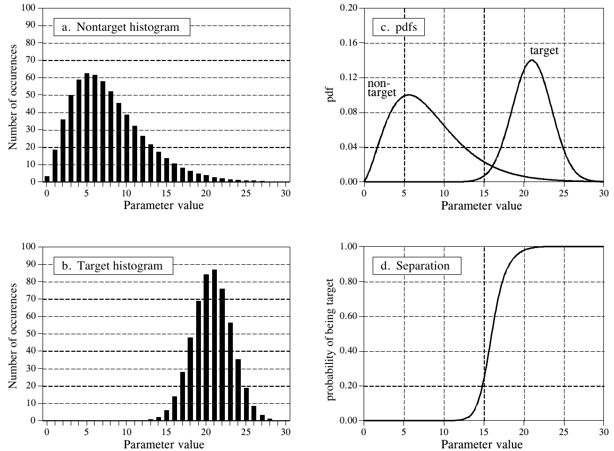

**图 26-1　目标检测的概率。** (a) 和 (b) 是目标组和非目标组关于某个参数值的直方图。由这些直方图可以估计出两组的概率分布函数，如 (c) 所示。只用这些信息就能算出 (d) 中的曲线，它给出在参数取某个具体值时，找到的是目标的概率。
（a. Nontarget histogram = 非目标直方图；b. Target histogram = 目标直方图；c. pdfs = 概率分布函数，non-target = 非目标，target = 目标；d. Separation = 区分。Number of occurences = 出现次数（原书 occurrences 误拼为 occurences），Parameter value = 参数值，probability of being target = 是目标的概率。原书图注 "Figures (a) and (b) shows" 应为 show。）

这种把输出值转换成概率的方法有助于理解问题，但它并不是实现目标检测的主要方式。大多数应用需要对目标是否存在作出"是/否"的判定，因为"是"会引出一种行动，"否"会引出另一种。做法是把测试的输出值与一个阈值比较。输出高于阈值，就说测试是阳性(positive)，表示目标存在；输出低于阈值，就说测试是阴性(negative)，表示目标不存在。在我们的癌症例子中，测试结果阴性，病人就会被告知自己健康并送回家；测试结果阳性，就要做进一步检查，比如用活检针取一块组织样本。

由于目标分布和非目标分布相互重叠，有些测试结果会是错的。也就是说，一些被送回家的病人其实患有癌症，一些被送去做进一步检查的病人其实是健康的。用目标检测的行话说，正确的分类叫做真(true)，错误的分类叫做假(false)。例如，病人患有癌症、测试也正确地检测出来，就叫真阳性(true-positive)。同样，病人没有癌症、测试也表明没有癌症，就叫真阴性(true-negative)。病人没有癌症、测试却错误地显示有，就是假阳性(false-positive)。这会造成不必要的担忧，以及额外检查带来的痛苦和花费。更糟的情形是假阴性(false-negative)：癌症存在，测试却表明病人健康。我们都知道，未经治疗的癌症会引发许多健康问题，包括过早死亡。

这两类错误给人带来的痛苦，使阈值的选择成为一种微妙的平衡。为了减少假阴性，能容忍多少假阳性？图 26-2 给出了评估这个问题的一种图形方法：ROC 曲线（receiver operating characteristic，接收者操作特性）。ROC 曲线在不同的阈值下，把被报告为阳性的目标信号百分比（越高越好），对被错误报告为阳性的非目标信号百分比（越低越好）作图。换句话说，ROC 曲线上的每个点代表真阳性和假阳性表现之间的一种可能的折中。

图 (a) 到 (d) 是我们癌症检测例子中阈值的四种设置。例如，看阈值设在 17 的 (b)。记住，输出值大于阈值的每个测试都报告为阳性。非目标分布约有 13% 的面积大于阈值（即在阈值右边）。在所有没有癌症的病人中，87% 会被报告为阴性（即真阴性），13% 会被报告为阳性（即假阳性）。相比之下，目标分布约有 80% 的面积大于阈值。这意味着 80% 的癌症患者会得到阳性结果（即真阳性），其余 20% 会被错误地报告为阴性（即假阴性）。如 (b) 中的 ROC 曲线所示，这个阈值对应曲线上的点：非目标阳性率 = 13%，目标阳性率 = 80%。

检测过程越有效，ROC 曲线就越向图的左上角弯曲。纯粹瞎猜得到的是一条 45° 的对角直线。如 (a) 所示，把阈值设得较低，几乎所有目标信号都能被检测到，代价是大量误报（假阳性）。如 (d) 所示，把阈值设得较高，情况正好相反：误报很少，但漏掉许多目标。

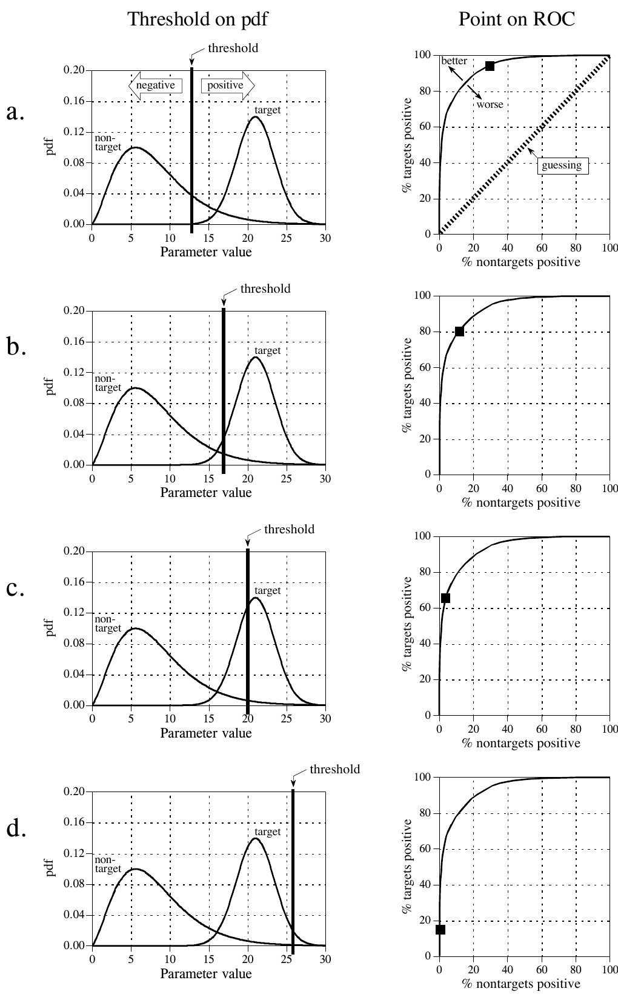

**图 26-2　ROC 曲线与 pdf 的关系。**
（左栏 Threshold on pdf = pdf 上的阈值，右栏 Point on ROC = ROC 上的点；a～d 是四种阈值设置。threshold = 阈值，negative = 阴性，positive = 阳性，non-target = 非目标，target = 目标，pdf = 概率分布函数，Parameter value = 参数值；% targets positive = 目标阳性百分比，% nontargets positive = 非目标阳性百分比，better = 更好，worse = 更差，guessing = 瞎猜。）

这些分析技术有助于理解阈值选择的后果，但最终决定取决于人能接受什么。假设你最初把癌症检测装置的阈值设在某个你觉得合适的值。用这个系统筛查过许多病人之后，你和十来个遭遇过假阳性的病人谈了谈。听说你的系统如何不必要地打乱了这些人的生活，你深受触动，于是提高了阈值。后来你遇到了一件让你更难受的事：你和一位身患绝症的病人交谈，他的癌症正是你的系统没能检测出来的。这段痛苦的经历让你大幅降低了阈值。随着时间推移，这些事情一再重复，阈值逐渐移向一个平衡值。也就是说，假阳性率乘以一个重要性系数（推动降低阈值），与假阴性率乘以另一个重要性系数（推动提高阈值）相互平衡。

这种分析可以推广到给出不止一个输出的装置。例如，假设某个癌症检测系统先给受检者拍一张 X 光片，再用自动图像分析算法识别肿瘤。算法找出可疑区域，然后测量一些关键特征来辅助评估。例如，假设我们测量可疑区域的直径（参数 1）和它在图像中的亮度（参数 2）。再假设我们的研究表明，肿瘤一般比正常组织更大、更亮。作为初步尝试，我们可以对每个参数都做一遍前面介绍的 ROC 分析，为每个参数找到一个可接受的阈值。然后，只有同时满足两个条件——参数 1 大于某个阈值、并且参数 2 大于另一个阈值——才把测试判为阳性。

这种先分别对各参数取阈值、再套用逻辑函数（AND、OR 等）的技术非常常见。然而它效率很低，还有好得多的方法。图 26-3 说明了原因。图中每个三角形代表一个目标（一位癌症患者），画在它两个参数值所对应的位置上。同样，每个方块代表一个非目标（一位没有癌症的病人）。如各坐标轴旁边的 pdf 图所示，两个参数的目标分布和非目标分布都有很大的重叠。换句话说，每个参数单独来看，都是很差的癌症预测指标。用简单的逻辑函数把两个参数组合起来，也只能带来一点点改进。特别有意思的是，这两个参数其实包含了把目标和非目标完全分开的信息：只要像图中那样，在两组之间画一条斜线就行了。

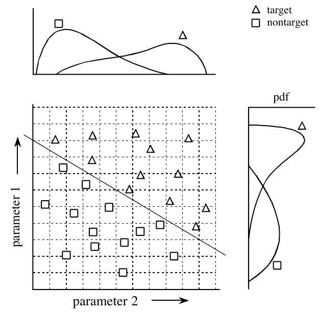

**图 26-3　二参数空间的例子。** 目标（△）和非目标（□）两组在二维中完全分开，但在每个单独的参数上都有重叠。这种重叠由沿各参数轴画出的一维 pdf 表示。
（target = 目标，nontarget = 非目标，parameter 1 = 参数 1，parameter 2 = 参数 2，pdf = 概率分布函数。）

用这一领域的行话说，这种坐标系叫做参数空间(parameter space)。例如，本例中的二维平面可以叫做"直径-亮度空间"。其思想是：目标会占据参数空间的一个区域，非目标会占据另一个区域。两个区域之间的分界可能简单到一条直线，也可能复杂到边界不规则的封闭区域。图 26-4 展示了更复杂一级的情况：用 x、y、z 轴表示的三参数空间。例如，这可能对应一个测量直径、亮度和某个第三参数（比如边缘锐度）的癌症检测系统。和二维情形一样，重要的思想是：目标组和非目标组的成员（但愿）会占据空间中不同的区域，从而可以把两者分开。在三维中，区域由平面和曲面分开。超空间(hyperspace，意为超出、高于或越过普通空间)一词常用来描述三维以上的参数空间。在数学上，超空间与一维、二维、三维空间没有什么不同；但它们有一个实际问题：在我们这个三维宇宙中无法用图形显示出来。

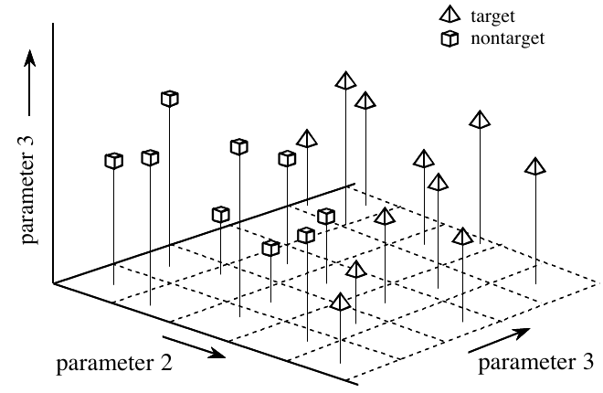

**图 26-4　三参数空间的例子。** 正如二参数空间构成一个平面，三参数空间可以用常规的 x、y、z 轴图形表示。把三参数空间划分成区域，需要一个分隔平面或曲面。
（target = 目标，nontarget = 非目标，parameter 2 = 参数 2，parameter 3 = 参数 3。原书图中竖轴和右侧斜轴都标成了 parameter 3，竖轴应为 parameter 1。）

对单参数问题选定的阈值，（通常）无所谓对错。这是因为每个阈值都对应一种独特的假阳性与假阴性组合，也就是 ROC 曲线上的某个点。这是用一个目标换另一个目标，没有绝对正确的答案。另一方面，两个或更多参数的参数空间，区域的划分肯定会有错误的情况。例如，设想图 26-3 中的数据点增多，暴露出目标组和非目标组之间有少量重叠。这时可以平移两组之间的阈值线，以假阳性数量换取假阴性数量，也就是把斜线向右上或左下平移。但如果把这条线旋转，就错了，因为那会使两类错误都增加。

正如这些例子所表明的，常规的目标检测方法（有时叫模式识别，pattern recognition）分两步。第一步叫特征提取(feature extraction)，用算法把原始数据压缩成几个参数，比如直径、亮度、边缘锐度等。这些参数常被称为特征(feature)或分类量(classifier)。需要特征提取来减少数据量。例如，一张医用 X 光片可能有一百多万个像素。特征提取的目的，是把信息提炼成更集中、更便于处理的形式。这类算法的开发与其说是科学，不如说是艺术。要看着一个问题说出"这几个分类量最能抓住信息"，需要大量的经验和技巧。试错在其中起着重要作用。

第二步是对分类量进行评估，判断目标是否存在。换句话说，要用某种方法把参数空间划分成对应目标的区域和对应非目标的区域。对一维和二维参数空间，这相当简单：把已知数据点画在图上（如图 26-3），凭眼睛把区域分开。然后把这个划分写进计算机程序，写成一个方程或其他区分区域的方式。原则上，同样的技术也能用于三维参数空间。问题是，三维图形对人来说很难理解和想象（如图 26-4）。注意：别在超空间里这么干，你的脑袋会爆炸的！

总之，我们需要一台机器，能根据目标信号和非目标信号的例子，完成多参数空间的划分。这种理想的目标检测系统，非常接近本章的主题：神经网络。

## 神经网络的结构

人类和其他动物用神经网络处理信息。它由数以万亿计的神经元（神经细胞）组成，神经元之间交换叫做动作电位(action potential)的短暂电脉冲。模仿这些生物结构的计算机算法，正式名称叫人工神经网络(artificial neural network)，以区别于动物体内那些软乎乎的东西。不过大多数科学家和工程师没这么讲究，用"神经网络"一词同时指生物的和非生物的系统。

推动神经网络研究的有两个愿望：更好地理解人脑，以及开发能处理抽象和定义不清的问题的计算机。例如，常规计算机很难听懂语音、认出人脸。相比之下，人类在这些任务上表现得极好。

人们尝试过许多不同的神经网络结构，有些模仿生物学家在显微镜下看到的东西，有些基于对问题更数学化的分析。最常用的结构如图 26-5 所示。这个神经网络由三层组成，分别叫输入层(input layer)、隐藏层(hidden layer)和输出层(output layer)。每层由一个或多个节点(node)组成，在图中用小圆圈表示。节点之间的连线表示信息从一个节点流向下一个节点。在这种特定类型的神经网络中，信息只从输入流向输出（即从左到右）。其他类型的神经网络有更复杂的连接，比如反馈路径。

输入层的节点是被动的(passive)，意思是它们不修改数据。它们在输入端接收一个值，再把这个值复制到多个输出端。相比之下，隐藏层和输出层的节点是主动的(active)，意思是它们按图 26-6 所示的方式修改数据。变量 X1₁、X1₂ ⋯ X1₁₅ 存放待评估的数据（见图 26-5）。例如，它们可以是图像的像素值、音频信号的采样、连续若干天的股价等。它们也可以是某个其他算法的输出，比如我们癌症检测例子中的分类量：直径、亮度、边缘锐度等。

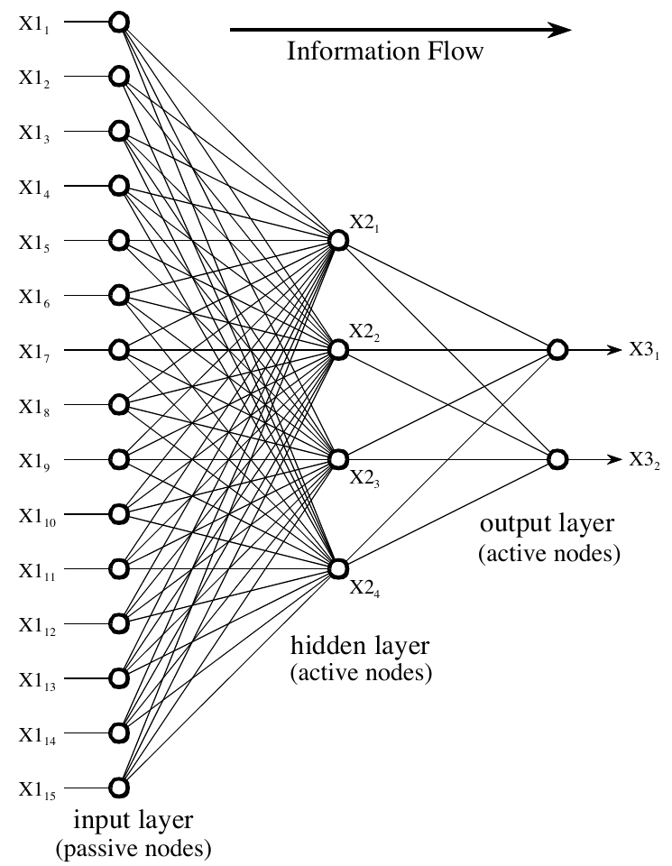

**图 26-5　神经网络的结构。** 这是神经网络最常见的结构：三层，全互连。输入层节点是被动的，只把单个输入的值转发到多个输出。相比之下，隐藏层和输出层的节点是主动的，按图 26-6 修改信号。这个神经网络的作用由隐藏层和输出层节点所用的权重决定。
（Information Flow = 信息流向，input layer (passive nodes) = 输入层（被动节点），hidden layer (active nodes) = 隐藏层（主动节点），output layer (active nodes) = 输出层（主动节点）。）

输入层的每个值都被复制后送到所有隐藏节点。这叫做全互连(fully interconnected)结构。如图 26-6 所示，进入隐藏节点的值要乘以权重(weight)，即存放在程序里的一组预先确定的数。加权后的输入再相加，得到一个数，图中用符号 Σ 表示。这个数在离开节点之前，要通过一个叫 sigmoid 的非线性数学函数。这是一条"S"形曲线，用来限制节点的输出。也就是说，sigmoid 的输入可以在 −∞ 到 +∞ 之间，而输出只能在 0 到 1 之间。

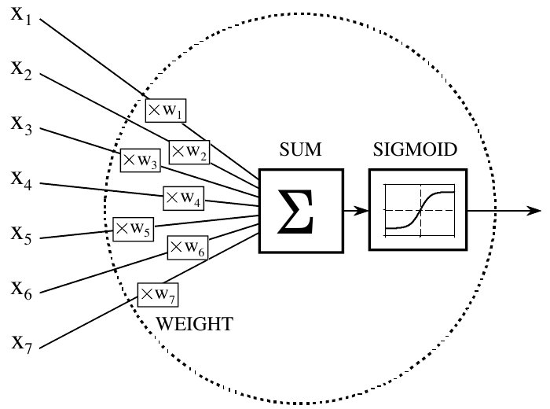

**图 26-6　神经网络的主动节点。** 这是隐藏层和输出层中主动节点的流程图。每个输入乘以一个权重（即 w_N 的值），然后求和。得到的单个值通过一个叫 sigmoid 的"S"形非线性函数。sigmoid 函数在图 26-7 中有更详细的显示。
（WEIGHT = 权重，SUM = 求和，SIGMOID = sigmoid 函数。）

隐藏层的输出在流程图（图 26-5）中用变量 X2₁、X2₂、X2₃ 和 X2₄ 表示。和前面一样，这些值各自被复制，送到下一层。输出层的主动节点把数据组合并修改，产生这个网络的两个输出值 X3₁ 和 X3₂。

神经网络可以有任意多层，每层可以有任意多个节点。大多数应用使用三层结构，输入节点最多几百个。隐藏层的大小通常约为输入层的 10%。在目标检测中，输出层只需一个节点。对这个节点的输出取阈值，就能给出输入数据中目标存在或不存在的阳性或阴性指示。

表 26-1 是实现图 26-5 流程图的程序。关键在于这种结构非常简单、非常通用。同一个流程图可以用于许多问题，不管它们各有什么特点。神经网络能对数据做有用的处理，全在于权重选得恰当。这与常规信息处理用一步步的过程来描述解法截然不同。

举个例子，设想一个识别声呐信号中物体的神经网络。假设信号的 1000 个采样存放在计算机里。计算机怎样判断这些数据代表的是潜艇、鲸鱼、海底山脉，还是什么都没有？常规 DSP 会用数学和算法来解决这个问题，比如相关和频谱分析。用神经网络的话，只需把这 1000 个采样送进输入层，输出层就会跳出数值来。只要选对权重，输出可以配置成报告各种信息。例如，可以有这样几个输出：潜艇（是/否）、鲸鱼（是/否）、海底山脉（是/否）等。换一组权重，输出可能把物体分类为：金属或非金属、生物或非生物、敌方或友方，等等。没有算法，没有规则，没有步骤；只有由所选权重的值决定的输入与输出之间的关系。

**表 26-1**（注释已译成中文）

```basic
100 'NEURAL NETWORK (FOR THE FLOW DIAGRAM IN FIG. 26-5)
110 '
120 DIM X1[15]                   '存放输入值
130 DIM X2[4]                    '存放隐藏层输出的值
140 DIM X3[2]                    '存放输出层输出的值
150 DIM WH[4,15]                 '存放隐藏层权重
160 DIM WO[2,4]                  '存放输出层权重
170 '
180 GOSUB XXXX                   '虚构的子程序，把输入数据载入 X1[ ]
190 GOSUB XXXX                   '虚构的子程序，载入权重 WH[ , ] 和 W0[ , ]
200 '
210 '                            '求隐藏节点的值 X2[ ]
220 FOR J% = 1 TO 4              '遍历隐藏层每个节点
230   ACC = 0                    '累加器变量 ACC 清零
240   FOR I% = 1 TO 15           '对每个输入节点加权求和
250     ACC = ACC + X1[I%] * WH[J%,I%]
260   NEXT I%
270   X2[J%] = 1 / (1 + EXP(-ACC) )    '求和结果送进 sigmoid
280 NEXT J%
290 '
300 '                            '求输出节点的值 X3[ ]
310 FOR J% = 1 TO 2              '遍历输出层每个节点
320   ACC = 0                    '累加器变量 ACC 清零
330   FOR I% = 1 TO 4            '对每个隐藏节点加权求和
340     ACC = ACC + X2[I%] * WO[J%,I%]
350   NEXT I%
360   X3[J%] = 1 / (1 + EXP(-ACC) )    '求和结果送进 sigmoid
370 NEXT J%
380 '
390 END
```

> **译注：** 第 190 行注释里的 `W0[ , ]`（数字 0）是笔误，应为第 160 行定义的 `WO[ , ]`（字母 O）。

**C 实现**（完整可编译版本见 `c/table26-1_nn_forward.c`，其中用三组可以手算核对的权重做了测试）：

```c
/* 第 210～370 行：输入 x1 经过隐藏层得到 x2，再经过输出层得到 x3 */
static void forward(const double x1[NI], double wh[NH][NI], double wo[NO][NH],
                    double x2[NH], double x3[NO])
{
    for (int j = 0; j < NH; j++) {          /* 220：遍历每个隐藏节点 */
        double acc = 0.0;                   /* 230：累加器清零 */
        for (int i = 0; i < NI; i++)        /* 240：把每个输入节点加权求和 */
            acc += x1[i] * wh[j][i];        /* 250 */
        x2[j] = sigmoid(acc);               /* 270：求和结果送进 sigmoid */
    }
    for (int j = 0; j < NO; j++) {          /* 310：遍历每个输出节点 */
        double acc = 0.0;                   /* 320 */
        for (int i = 0; i < NH; i++)        /* 330：把每个隐藏节点加权求和 */
            acc += x2[i] * wo[j][i];        /* 340 */
        x3[j] = sigmoid(acc);               /* 360 */
    }
}
```

运行结果：权重全为 0 时两个输出都是 0.500000；只让输出节点 1 的四个权重为 1 时，输出 1 = 0.880797，正好等于 s(4×0.5) = s(2)；随机权重下与另写的一遍计算逐位相同。

图 26-7a 更仔细地展示了 sigmoid 函数，它的数学描述是：

**公式 26-1**　sigmoid 函数。在神经网络中把它当作平滑的阈值。其图像见图 26-7a。

$$s(x) = \frac{1}{1 + e^{-x}}$$

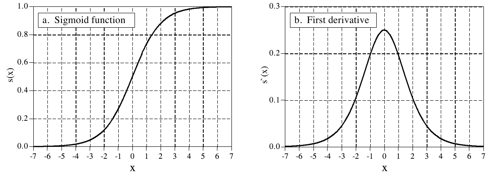

**图 26-7　sigmoid 函数及其导数。** 这两条曲线由公式 26-1 和 26-2 生成。
（a. Sigmoid function = sigmoid 函数；b. First derivative = 一阶导数。）

sigmoid 的确切形状并不重要，重要的只是它是一个平滑的阈值。作为对比，简单阈值在 x > 0 时输出一，在 x < 0 时输出零。sigmoid 完成同样的基本阈值功能，但它还是可微的，如图 26-7b 所示。虽然流程图（图 26-5）中不用导数，但它是求出合适权重的关键。这一点稍后再谈。sigmoid 的一个好处是，计算它的导数有捷径：

**公式 26-2**　sigmoid 函数的一阶导数。它可以用 sigmoid 函数本身的值算出。

$$s'(x) = s(x)\,\big[1 - s(x)\big]$$

> **译注：** 原书正文这里写"流程图（图 25-5）"，应为图 26-5。

例如，若 x = 0，则 s(x) = 0.5（由公式 26-1），一阶导数为 s′(x) = 0.5(1 − 0.5) = 0.25。这不是什么关键概念，只是让代数运算更简短的一个技巧。

如果 sigmoid 能左右移动，让它以 x = 0 以外的某个值为中心，神经网络不就更灵活了吗？答案是肯定的，大多数神经网络都允许这样做。实现起来很简单：在输入层增加一个节点，它的输入恒为一。这个值乘以隐藏层的权重后，就为每个 sigmoid 提供了一个偏置（bias，即直流偏移）。增加的这个节点叫偏置节点(bias node)。除了输入恒定之外，它和其他节点一视同仁。

神经网络能不用 sigmoid 或类似的非线性吗？要回答这个问题，看看图 26-5 的三层网络。如果没有 sigmoid，三层就会塌缩成两层。换句话说，隐藏层和输出层的求和与权重可以合并成一层，结果只是一个两层网络。

## 它为什么管用？

让神经网络完成某项任务所需的权重，由学习算法(learning algorithm)结合"系统应该怎样运作"的例子求出。例如，在声呐问题中，例子会是一个由几百段（或更多）1000 点信号片段组成的数据库。有些片段对应潜艇，有些对应鲸鱼，有些对应随机噪声，等等。学习算法用这些例子算出一组适合当前任务的权重。神经网络领域广泛用"学习"一词来描述这个过程；不过更确切的说法也许是：根据例子的统计特性确定一组优化的权重。不管这个方法叫什么，得到的权重人几乎无法理解。在极少数情况下也许能看出某些规律，但它们一般看起来就像随机数。可以观察到使用这些权重的神经网络具有正确的输入/输出关系，但为什么偏偏是这些权重管用，却相当令人费解。神经网络的这种神秘特质，让许多科学家和工程师对它敬而远之。还记得那些电脑叛变、占领地球的科幻电影吗？

尽管如此，常常能听到神经网络的拥护者说"神经网络已经被很好地理解了"之类的话。为了检验这个说法，我们先说明可以用传统 DSP 方法来挑选神经网络的权重；然后说明学习算法给出的解比传统技术更好。这虽然解释不了某组特定的权重为什么管用，但确实能让人对这种方法有信心。

从最深刻的角度看，神经网络是一种给参数空间中各个区域贴标签的方法。例如，考虑有 1000 个输入、1 个输出的声呐系统神经网络。选对权重的话，如果输入信号是潜艇的回波，输出就接近一；如果输入只是噪声，输出就接近零。这构成了一个 1000 维的参数超空间。神经网络是给这个超空间中每个位置赋一个值的方法。也就是说，1000 个输入值确定超空间中的一个位置，而神经网络的输出给出该位置的值。查找表(look-up table)可以完美地完成这个任务，为每个可能的输入地址存一个输出值。区别在于，神经网络是计算出每个位置（地址）的值，而不是去存储每个值——那是不可能完成的庞大任务。事实上，评价神经网络结构时，常看它在给定权重数量下能把超空间划分得多好。

这种思路也为隐藏层需要多少节点提供了线索。N 维参数空间需要 N 个数来指定一个位置。在超空间中标识一个区域需要 2N 个值（即沿每根轴的最小值和最大值，确定一个超空间中的长方体）。例如，按这种简单的算法，一个有 1000 个输入的神经网络需要 2000 个权重，才能把超空间的一个区域与其他区域区分开。在全互连网络中，这需要两个隐藏节点。所需区域的数目取决于具体问题，但可以预期它远小于参数空间的维数。虽然这只是一个粗略的近似，但它大致解释了为什么大多数神经网络的隐藏层只需输入层大小的 2% 到 30%。

理解神经网络的另一种完全不同的方式，是用 DSP 中相关(correlation)的概念。第 7 章讲过，相关是检测信号中是否含有某个已知模式的最优方法。做法是把信号与要找的模式相乘，再把乘积相加。和越大，信号就越像这个模式。现在看看图 26-5，把每个隐藏节点看作在输入数据中寻找一个特定的模式。也就是说，每个隐藏节点都把输入数据与该节点对应的那组权重做相关。如果模式存在，送进 sigmoid 的和就大，否则就小。

从这个角度看，sigmoid 的作用很有意思。回头看图 26-1d，注意分隔两个钟形分布的概率曲线很像一个 sigmoid。如果我们手工设计神经网络，可以让每个隐藏节点的输出等于某个特定模式出现在输入数据中的概率。输出层重复这个操作，使整个三层结构成为"相关的相关"，一个寻找"模式的模式"的网络。

常规 DSP 建立在两种技术之上：卷积和傅里叶分析。令人安心的是，神经网络能完成这两种运算，还能做得更多。设想把一个 N 点信号滤波，得到另一个 N 点信号。按卷积的输出端视角，输出信号的每个采样都是输入采样的加权和。现在设想一个每层有 N 个节点的两层神经网络。每个输出层节点产生的值，同样是输入值的加权和。如果每个输出节点都使用与其他输出节点相同的权重，这个网络就实现了线性卷积。同样，DFT 也可以用每层 N 个节点的两层神经网络来计算。每个输出层节点求出一个频率分量的幅度。做法是让每个输出层节点的权重等于要找的那个正弦波。这样得到的网络把输入信号与每个基函数正弦波做相关，从而算出 DFT。当然，两层神经网络远不如标准的三层结构强大。这意味着神经网络既能做线性处理，也能做非线性处理。

假设用这些常规 DSP 策略之一来设计神经网络的权重，能说这个网络是最优的吗？传统 DSP 算法通常建立在对输入信号特性的假设之上。例如，维纳滤波(Wiener filtering)在信号和噪声频谱都已知的假设下，能使信噪比最大；相关在噪声为白噪声的假设下，是检测目标的最优方法；反卷积在反卷积核是原卷积核之逆的假设下，能抵消不需要的卷积；等等。问题在于，科学家和工程师很少能完全了解将要遇到的输入信号。底层的数学也许很优美，但整体性能受限于对数据的了解程度。

例如，设想用实际的输入信号测试一个传统 DSP 算法。接着把算法稍作改动，比如把某个参数增大百分之一，再测一次。如果第二次的测试结果比第一次好，原来的算法对手头的任务就不是最优的。几乎所有常规 DSP 算法，都可以通过对其参数和步骤的小改动进行试错评估而得到显著改进。这正是神经网络的策略。

## 训练神经网络

神经网络的设计最好用一个例子来说明。图 26-8 是我们要攻克的问题：识别文字图像中的单个字母。这个模式识别任务受到过很多关注。它容易到许多方法都能取得部分成功，又难到没有完美的解法。许多成功的商业产品都基于这个问题，比如为邮件分拣识别信封上的地址、把文件录入文字处理软件等。

开发神经网络的第一步，是建立一个例子数据库。对文字识别问题，做法是在一张纸上把 26 个大写字母 A、B、C、D ⋯ Y、Z 打印 50 遍。接着用个人计算机可用的众多扫描设备之一，把这 1300 个字母转换成数字图像。再把这张大的数字图像分割成 10×10 像素的小图，每张小图含一个字母。这些信息存成一个 1.3 MB 的数据库：1300 张图，每张 100 个像素，每个像素 8 位。我们用数据库中的前 260 张图来训练神经网络（即确定权重），其余的用来测试它的性能。数据库还必须有办法标识每张图里是哪个字母。例如，可以给每张 10×10 的图多加一个字节，存放字母的 ASCII 码。另一种方案是，用每张 10×10 图在数据库中的位置表示它是哪个字母。例如，第 0 到 49 张图可能都是"A"，第 50 到 99 张图可能都是"B"，等等。

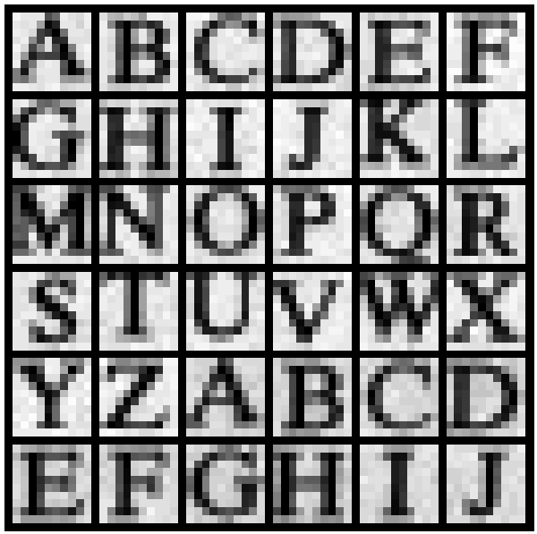

**图 26-8　文字图像的例子。** 识别文字图像中的字母是经典的模式识别问题之一。本例中，每个字母装在一张 10×10 像素的图里，每个像素有 256 个灰度级。用来训练和测试示例神经网络的数据库由 50 套 26 个大写字母组成，共 1300 张图。这里显示的是数据库的一部分。

在这个演示中，神经网络要完成一个随意定的任务：判断哪些 10×10 的图里是元音字母，即 A、E、I、O 或 U。这也许没有什么实际用途，但它确实能说明神经网络学习非常抽象的模式识别问题的能力。训练集里每个字母包含十个例子，网络（但愿）就能学到区分目标图像与非目标图像的关键特征。

本例使用的神经网络是传统的三层全互连结构，如图 26-5 和 26-6 所示。输入层有 101 个节点（100 个像素值加一个偏置节点），隐藏层有 10 个节点，输出层有 1 个节点。把一张 100 像素的图加到网络输入端时，我们希望：有元音时输出接近一，没有元音时输出接近零。不必担心输入信号是作为二维数组（10×10）采集的，而神经网络的输入是一维数组。像素值之间怎样相互关联，那是你的理解；神经网络会找到它自己的关系。

表 26-2 是计算神经网络权重的主程序，表 26-3 是主程序调用的三个子程序。数组元素 X1[1] 到 X1[100] 存放输入层的值。此外，X1[101] 恒为 1，作为偏置节点的输入。隐藏节点的输出值存放在数组元素 X2[1] 到 X2[10] 中。变量 X3 存放网络的输出值。隐藏层的权重存放在数组 WH[ , ] 中，第一个下标标识隐藏节点（1 到 10），第二个下标是输入层节点（1 到 101）。输出层的权重存放在 WO[1] 到 WO[10] 中。这样，总共有 1020 个权重值决定网络怎样运作。

**表 26-2**（注释已译成中文）

```basic
100 'NEURAL NETWORK TRAINING (Determination of weights)
110 '
120                                  '初始化
130 MU = .000005                     '迭代步长
140 DIM X1[101]                      '存放输入层信号 + 偏置项
150 DIM X2[10]                       '存放隐藏层信号
160 DIM WH[10,101]                   '存放隐藏层权重
170 DIM WO[10]                       '存放输出层权重
180 '
190 FOR H% = 1 TO 10                 '把权重设为随机值
200   WO[H%] = (RND-0.5)             '输出层权重：-0.5 到 0.5
210   FOR I% = 1 TO 101              '隐藏层权重：-0.0005 到 0.0005
220     WH[H%,I%] = (RND-0.5)/1000
230   NEXT I%
240 NEXT H%
250 '
260 '                                '迭代循环
270 FOR ITER% = 1 TO 800             '循环 800 次迭代
280 '
290   ESUM = 0                       '误差累加器 ESUM 清零
300 '
310   FOR LETTER% = 1 TO 260         '遍历训练集中的每个字母
320     GOSUB 1000                   '把训练集载入 X1[ ]
330     GOSUB 2000                   '求这个字母的误差 ELET
340     ESUM = ESUM + ELET^2         '累加本次迭代的误差
350     GOSUB 3000                   '求新的权重
360   NEXT LETTER%
370 '
380   PRINT ITER% ESUM               '把进度打印到屏幕
390 '
400 NEXT ITER%
410 '
420 GOSUB XXXX                       '虚构的子程序，保存权重
430 END
```

程序的第一个动作，是用随机数发生器把每个权重设为任意的初始值。如第 190 到 240 行所示，隐藏层权重的初值在 −0.0005 到 0.0005 之间，输出层权重在 −0.5 到 0.5 之间。选这样的范围，是为了让它们与最终权重处于同一数量级。依据是：(1) 输入信号的取值范围；(2) 每个节点求和的输入个数；(3) sigmoid 起作用的取值范围——输入约为 −5 < x < 5，输出为 0 到 1。例如，101 个典型值为 100 的输入，乘以典型值 0.0002 的权重，乘积之和约为 2，正处在 sigmoid 输入的有效范围内。

如果用这些随机权重评估神经网络的性能，我们预期它和瞎猜一样。学习算法通过把每个权重朝正确方向逐步调整来提高网络的性能。这叫迭代过程(iterative procedure)，在程序中由第 270～400 行的 FOR-NEXT 循环控制。每次迭代都让权重在区分目标与非目标例子方面稍微更有效一点。迭代循环通常一直进行到不再有进一步的改进为止。在典型的神经网络中，这可能需要十次到一万次迭代，几百次是常见的。本例做 800 次迭代。

要让这种迭代策略奏效，必须有一个单一的参数来描述系统当前的表现有多好。程序中的变量 ESUM（error sum，误差和）就起这个作用。迭代循环内的第一个动作是把 ESUM 设为零（第 290 行），以便用作累加器。每次迭代结束时，把 ESUM 的值打印到屏幕上（第 380 行），让操作者确认进展正常。随着神经网络被训练得能识别目标，ESUM 的值会从高处开始逐渐下降。图 26-9 是 ESUM 随迭代进行而下降的例子。

每次迭代都要评估训练集中全部 260 张图，这由第 310～360 行的 FOR-NEXT 循环控制。子程序 1000 用于从例子数据库中取出图像。由于这不是这里特别关心的内容，我们只说明传入和传出这个子程序的参数。进入子程序 1000 时，参数 LETTER% 在 1 到 260 之间。返回时，输入节点的值 X1[1] 到 X1[100] 存放的是数据库中与 LETTER% 对应的那张图的像素值。偏置节点的值 X1[101] 总是返回常数一。子程序 1000 还返回另一个参数 CORRECT，它存放网络对这个字母的期望输出值。也就是说，如果图中的字母是元音，CORRECT 返回一；如果不是元音，CORRECT 返回零。

把正在处理的图像载入 X1[1] 到 X1[100] 之后，子程序 2000 把数据送过当前的神经网络，得到输出节点的值 X3。换句话说，子程序 2000 和表 26-1 的程序相同，只是每层的节点数不同。这个子程序还计算当前网络把这个字母识别为目标或非目标识别得有多好。第 2210 行把变量 ELET（error-letter，字母误差）算成实际产生的输出值 X3 与期望值 CORRECT 之差。这使 ELET 成为 −1 到 1 之间的值。全部 260 个 ELET 值（在第 340 行）合起来构成 ESUM，即网络在整个训练集上的总平方误差。

第 2220 行展示了计算误差时常用的一个选项：给目标和非目标的误差赋予不同的重要性。例如，回想本章前面的癌症例子，以及假阳性错误与假阴性错误各自的后果。在本例中，我们随意规定：检测目标的误差比检测非目标的误差严重五倍。实际上，这是告诉网络在目标上做得更好，即使这会损害非目标上的表现。

**表 26-3**（注释已译成中文）

```basic
1000 'SUBROUTINE TO LOAD X1[ ] WITH IMAGES FROM THE DATABASE
1010 '进入时的变量：LETTER%
1020 '退出时的变量：X1[1] 到 X1[100]，X1[101] = 1，CORRECT
1030 '
1040 '变量 LETTER%（1 到 260）指明数据库中哪张图要返回到 X1[1]～X1[100]。
1050 '偏置节点 X1[101] 恒为一。如果返回的图是元音，变量
1060 'CORRECT 为一，否则为零。
1070 '（这个子程序的细节不重要，这里不列出。）
1900 RETURN


2000 'SUBROUTINE TO CALCULATE THE ERROR WITH THE CURRENT WEIGHTS
2010 '进入时的变量：X1[ ]，X2[ ]，WI[ , ]，WH[ ]，CORRECT
2020 '退出时的变量：ELET
2030 '
2040 '                                   '求隐藏节点的值 X2[ ]
2050 FOR H% = 1 TO 10                    '遍历每个隐藏节点
2060   ACC = 0                           '累加器清零
2070   FOR I% = 1 TO 101                 '对每个输入节点加权求和
2080     ACC = ACC + X1[I%] * WH[H%,I%]
2090   NEXT I%
2100   X2[H%] = 1 / (1 + EXP(-ACC) )     '求和结果送进 sigmoid
2110 NEXT H%
2120 '
2130 '                                   '求输出值 X3
2140 ACC = 0                             '累加器清零
2150 FOR H% = 1 TO 10                    '对每个隐藏节点加权求和
2160   ACC = ACC + X2[H%] * WO[H%]
2170 NEXT H%
2180 X3 = 1 / (1 + EXP(-ACC) )           '求和结果送进 sigmoid
2190 '
2200 '                                   '求这个字母的误差 ELET
2210 ELET = (CORRECT - X3)               '求误差
2220 IF CORRECT = 1 THEN ELET = ELET*5   '给目标额外的权重
2230 '
2240 RETURN


3000 'SUBROUTINE TO FIND NEW WEIGHTS
3010 '进入时的变量：X1[ ]，X2[ ]，X3，WI[ , ]，WH[ ]，ELET，MU
3020 '退出时的变量：WI[ , ]，WH[ ]
3030 '
3040 '                                   '求输入节点的新权重
3050 FOR H% = 1 TO 10
3060   FOR I% = 1 TO 101
3070     SLOPEO = X3 * (1 - X3)
3080     SLOPEH = X2(H%) * (1 - X2[H%])
3090     DX3DW = X1[I%] * SLOPEH * WO[H%] * SLOPEO
3100     WH[H%,I%] = WH[H%,I%] + DX3DW * ELET * MU
3110   NEXT I%
3120 NEXT H%
3130 '
3140 '                                   '求隐藏节点的新权重
3150 FOR H% = 1 TO 10
3160   SLOPEO = X3 * (1 - X3)
3170   DX3DW = X2[H%] * SLOPEO
3180   WO[H%] = WO[H%] + DX3DW * ELET * MU
3190 NEXT H%
3200 '
3210 RETURN
```

> **译注：** 第 2010、3010、3020 行注释中的变量名 `WI[ , ]`、`WH[ ]` 与程序不符，程序里实际用的是隐藏层权重 `WH[ , ]` 和输出层权重 `WO[ ]`。第 3040 行注释"求输入节点的新权重"实际更新的是隐藏层权重 WH，第 3140 行注释"求隐藏节点的新权重"实际更新的是输出层权重 WO（正文的说法是对的）。第 3080 行 `X2(H%)` 用了圆括号，与同行的 `X2[H%]` 不一致，属于排版问题。

**C 实现**（完整可编译版本见 `c/table26-2_nn_training.c`，表 26-2 的主程序和表 26-3 的三个子程序都在里面）。原书的扫描字母数据库没有随书提供，C 版用合成数据代替：给 26 个"字母"各随机生成一个 10×10 的黑白原型，每张样本再随机平移 0～1 个像素、加标准差 25 的高斯噪声。排列方式和原书一样：第 n 张图是第 n%26 个字母，前 260 张训练，后 1040 张测试。核心的权重更新子程序：

```c
/* 子程序 3000：按最速下降法更新全部权重（公式 26-3～26-5） */
static void new_weights(void)
{
    for (int h = 0; h < NHID; h++)          /* 3050～3120：隐藏层权重 */
        for (int i = 0; i < NIN; i++) {
            double slopeo = x3 * (1.0 - x3);            /* 3070：输出 sigmoid 的斜率（公式 26-2） */
            double slopeh = x2[h] * (1.0 - x2[h]);      /* 3080：隐藏 sigmoid 的斜率 */
            double dx3dw = x1[i] * slopeh * wo[h] * slopeo;   /* 3090：公式 26-4 */
            wh[h][i] += dx3dw * elet * MU;              /* 3100：公式 26-5 */
        }
    for (int h = 0; h < NHID; h++) {        /* 3150～3190：输出层权重 */
        double slopeo = x3 * (1.0 - x3);    /* 3160 */
        double dx3dw = x2[h] * slopeo;      /* 3170：公式 26-3 */
        wo[h] += dx3dw * elet * MU;         /* 3180：公式 26-5 */
    }
}
```

运行结果（MU、初值范围、800 次迭代、目标误差 ×5 都与原书相同；三个随机种子相当于三次试验，种子同时决定合成数据和初始权重）：

| 试验（种子） | 第 1 次迭代 ESUM | 第 800 次迭代 ESUM | 训练集：元音检出 / 非元音误报 | 测试集：元音检出 / 非元音误报 |
|---|---|---|---|---|
| 1 | 324.3 | 107.7 | 98.0% / 3.8% | 62.0% / 19.9% |
| 2 | 339.9 | 100.6 | 94.0% / 1.9% | 58.0% / 8.0% |
| 3 | 320.5 | 83.6 | 100.0% / 3.8% | 62.5% / 14.4% |

（阈值取 0.5。）ESUM 从 320 左右开始，前一两百次迭代下降很快，之后缓慢下降，和图 26-9 的形状与数量级都一致；不同的初值收敛到不同的最终误差。训练集上表现远好于测试集，正是后文说的"见过答案"的现象。合成"字母"不是真字母，所以测试集的具体百分比不能和原书比较。

子程序 3000 是神经网络策略的核心，即每次迭代中改变权重的算法。我们用一个比喻来解释其中的数学。设想一名伞兵被空投到敌后的困境。他跳伞落在陌生的地方，却发现四周漆黑一片，看不到几英尺以外。他接到的命令是前往最近的山谷谷底，开始执行剩下的任务。问题是，只能看到几英尺远，他怎么走到谷底？换个说法，他需要一个算法来调整自己在地面上的 x、y 位置，使海拔最低。这类似于调整神经网络权重、使网络误差 ESUM 最小的问题。

我们来看解决这个问题的两种算法：进化(evolution)和最速下降(steepest descent)。在进化法中，伞兵朝某个随机方向纵身一跳。如果新的海拔比之前高，他骂一声，回到出发点再试。如果新的海拔更低，他感到些许成功，就从新位置重复这个过程。最终他会到达谷底，不过走的是一条非常低效、杂乱无章的路线。这种方法叫进化，因为它和大自然在生物进化中采用的是同一类算法。一个物种的每一新代都与上一代有随机的差异。如果这些差异对物种有利，就更可能被保留下来、传给下一代。这是因为改进让动物能得到更多食物、躲过天敌、繁衍更多后代等。如果新性状有害，处于劣势的动物就会成为某个捕食者的午餐，这种变异也就被淘汰了。在这个意义上，每一新代都是进化优化过程的一次迭代。

用进化作训练算法时，神经网络的每个权重都加上随机数发生器给出的一个值，稍作改变。如果修改后的权重构成了更好的网络（即 ESUM 更低），就保留这些改变，否则丢弃。这样做行得通，但收敛(converge)非常慢。"收敛"是一个行话，描述朝着最优解（谷底）不断改进的过程。说得简单点，程序要花几天而不是几分钟或几小时才能得到解。

幸运的是，最速下降算法快得多。这正是伞兵自然而然的反应：判断哪个方向是下坡，然后朝那个方向走。可以这样想：伞兵向北迈一步，记下海拔的变化；回到原位后，再向东迈一步，也记下海拔的变化。用这两个值，他就能确定哪个方向是下坡。假设他向北迈一步下降 10 厘米，向东迈一步下降 20 厘米。要沿最陡的方向直接下坡，他需要沿每根轴移动与该轴坡度成正比的距离。在这个例子中，他可以向北走 10 步、向东走 20 步。这使他沿坡最陡的方向下降了 $\sqrt{10^2 + 20^2} = 22.4$ 步的距离。或者，他也可以沿对角线直线走 22.4 步到达新位置。关键在于：沿每根轴移动与该轴坡度成正比的距离，就实现了最速下降。

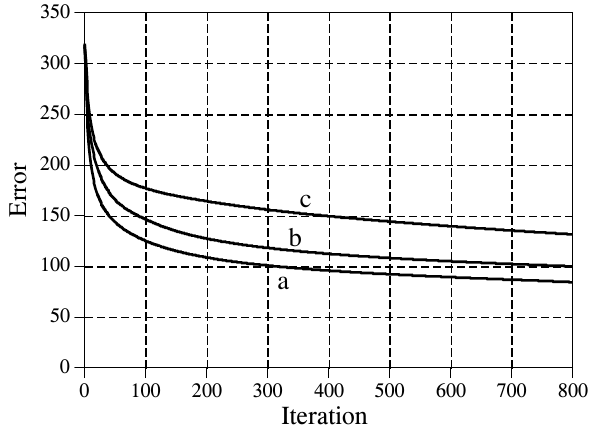

**图 26-9　神经网络的收敛。** 这张图显示随着迭代的进行，神经网络的误差（ESUM 的值）怎样下降。图中是三次独立的试验，每次的初始权重都不同。
（Error = 误差，Iteration = 迭代次数；a、b、c 是三次试验。）

子程序 3000 对网络权重实现了同样的最速下降算法。进入子程序 3000 之前，已经把一张例子图像加到输入层，并把信息传播到了输出。这意味着 X1[ ]、X2[ ] 和 X3 的值都已确定，当前的权重值 WH[ , ] 和 WO[ ] 也已确定。此外，我们还知道网络对这张图产生的误差 ELET。隐藏层权重在第 3050 到 3120 行更新，输出层权重在第 3150 到 3190 行修改。做法是算出每个权重的斜率，然后把每个权重改变一个与该斜率成正比的量。在伞兵的情形中，沿某根轴的斜率是这样求的：沿这根轴移动一小段距离（比如 Δx），测量海拔的变化（比如 ΔE），再把两者相除（ΔE/Δx）。神经网络权重的斜率也可以用同样的方法求：给权重加一个小增量（Δw），求出输出信号相应的变化（ΔX3），再把两者相除（ΔX3/Δw）。本章后面会看到一个用这种方法求斜率的例子。不过在当前这个例子中，我们用一种更高效的方法。

前面说过，非线性（sigmoid）需要是可微的。这里就要用到这个性质。如果我们知道非线性上每一点的斜率，就能直接写出每个权重的斜率（ΔX3/Δw）的方程，而不必真去扰动它。考虑一个特定的权重，比如 WO[1]，它对应输出节点的第一个输入。看看图 26-5 和 26-6 中的结构，问一问：如果只把这个权重（w）稍微改变一点、其余一切保持不变，输出（X3）会受什么影响？答案是：

**公式 26-3**　输出层权重的斜率。这个公式是针对权重 WO[1] 写的。

$$\frac{\Delta X3}{\Delta w} = X2[1]\;\text{SLOPE}_O$$

其中 SLOPE_O 是输出层 sigmoid 在当前工作点处的一阶导数。换句话说，SLOPE_O 描述 sigmoid 的输入变化时它的输出变化多少。由公式 26-2，SLOPE_O 可以由 sigmoid 当前的输出值 X3 算出。这个计算在第 3160 行。第 3170 行通过公式 26-3 算出这个权重的斜率，存放在变量 DX3DW（即 ΔX3/Δw）中。

用类似的分析，隐藏层某个权重（比如 WH[1,1]）的斜率可以这样求：

**公式 26-4**　隐藏层权重的斜率。这个公式是针对权重 WH[1,1] 写的。

$$\frac{\Delta X3}{\Delta w} = X1[1]\;\text{SLOPE}_{H1}\;WO[1]\;\text{SLOPE}_O$$

SLOPE_H1 是隐藏层 sigmoid 在当前工作点处的一阶导数。其他值 X1[1] 和 WO[1]，对于这个权重的变化在传向输出途中来说，只是常数。第 3070 和 3080 行用公式 26-2 算出两个 sigmoid 的斜率。第 3090 行通过公式 26-4 算出隐藏层权重的斜率 DX3DW。

既然知道了每个权重的斜率，就可以看看下一次迭代中每个权重怎样改变。每个权重的新值，等于当前权重加上一个与斜率成正比的量：

**公式 26-5**　更新权重。每个权重都加上一个与该权重的斜率成正比的量。

$$w_{\text{new}} = w_{\text{old}} + \frac{\Delta X3}{\Delta w}\;\text{ELET}\;\text{MU}$$

这个计算对隐藏层在第 3100 行进行，对输出层在第 3180 行进行。比例常数由两个因子组成：ELET（网络对这个特定输入的误差）和 MU（在程序开头设定的常数）。要理解为什么这个计算中需要 ELET，设想加到输入端的一张图在输出信号中产生的误差很小，而另一张图产生的输出误差很大。调整权重时，我们希望对第二张图把网络推得更多。某个东西运转得不好，我们就想改变它；运转得好，就想别去动它。按当前误差 ELET 成比例地改变每个权重，就做到了这一点。

要理解 MU 怎样影响系统，回想伞兵的例子。确定下坡方向后，他必须决定走多远再重新评估地形的坡度。把这段距离定得短，比如一米，他就能精确地沿着地形的起伏走，始终朝最优的方向移动。问题是他把大部分时间都花在评估坡度上，而不是真正往山下走。相比之下，他也可以把距离定得很长，比如 1000 米。这让伞兵能在地形上快速移动，但他可能会冲过下坡的路线。距离太长，他就会在乡间到处乱跳，却没有取得想要的进展。

在神经网络中，MU 控制每次迭代中权重改变多少。它的取值取决于具体问题，可以低到 10⁻⁶，也可以高到 0.1。从伞兵的比喻可以预料：值太小会使网络收敛太慢；值太大会使收敛不稳定，在最终解附近出现混沌振荡。遗憾的是，神经网络对不同 MU 值的反应可能很难理解或预测。因此在训练过程中监视网络误差（即 ESUM）至关重要，比如在每次迭代结束时把它打印到屏幕上。如果系统收敛得不正常，就停下程序，换一个 MU 值再试。

## 评估结果

那么，效果如何呢？元音识别的训练程序用不同的随机初始权重运行了三次。在 100 MHz 奔腾个人计算机上，完成 800 次迭代大约需要一小时。图 26-9 显示了这段时间里网络误差 ESUM 的变化。误差逐渐下降，说明网络在学习这个任务，几百次迭代后权重就接近最优值了。每次试验对这个问题都得出不同的解，最终性能也不同。这就像伞兵从不同的位置出发，最终到达不同山谷的谷底。正如有些山谷比别的更深，有些神经网络的解也比别的更好。这意味着学习算法应该运行好几次，取其中最好的作为最终解。

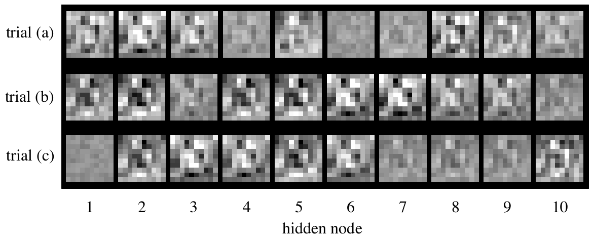

**图 26-10　神经网络权重的例子。** 图中把三个解的隐藏层权重显示成图像。在人眼看来，这三个解都像是随机的。
（trial (a)/(b)/(c) = 试验 (a)/(b)/(c)，hidden node = 隐藏节点。）

图 26-10 把三个解的隐藏层权重显示成图像。这意味着神经网络采取的第一个动作，就是把这些图像与输入信号做相关（相乘再求和）。它们看起来就像随机噪声！可以证明这些权重值是管用的，但它们为什么管用却有点神秘。这里还有一件值得思考的事。人脑由大约 100 万亿个神经元组成，每个神经元平均有 10,000 个连接。如果连本例中这个简单的神经网络我们都理解不了，又怎么去研究一个至少复杂 100,000,000,000,000 倍的东西呢？这是 21 世纪的研究课题。

图 26-11a 是神经网络对训练集中 260 个字母的输出直方图。记住，选择权重是为了让元音图像的输出接近一，其他图像的输出接近零。两个分布完全分开，没有重叠。还要注意，元音分布比非元音分布更窄。这是因为我们规定目标误差比非目标误差重要五倍（见第 2220 行）。

相比之下，图 26-11b 是数据库中第 261 到 1300 张图的直方图。目标分布和非目标分布虽然相当清晰，但没有完全分开。为什么神经网络在前 260 个字母上的表现比在后 1040 个上好？因为图 (a) 是在作弊！如果你已经看过答案，考试当然容易。换句话说，神经网络认出的是训练集中的特定图像，而不是区分元音和非元音的一般模式。

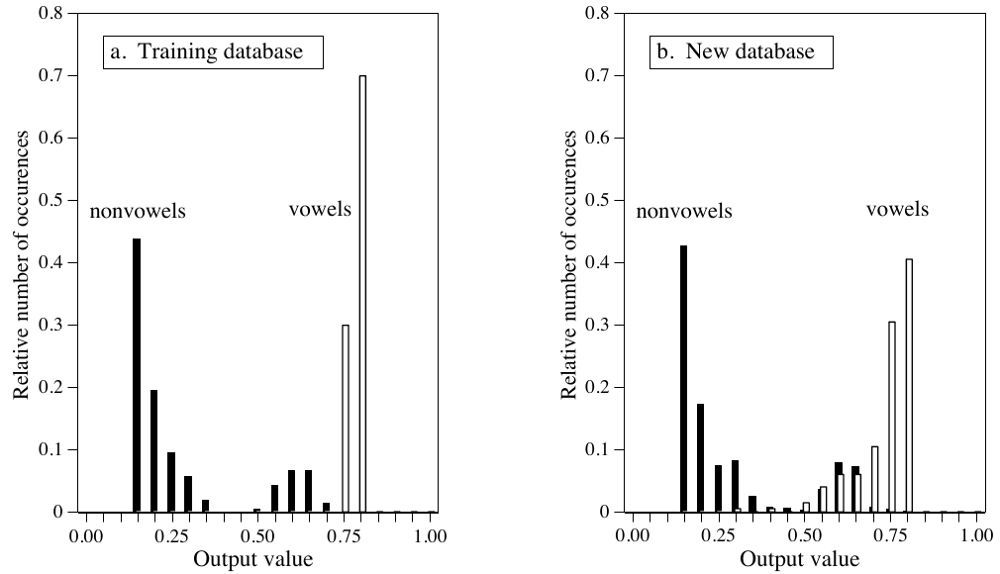

**图 26-11　神经网络的性能。** 这些是神经网络输出值的直方图，(a) 是训练数据，(b) 是其余的图像。神经网络在训练数据上表现更好，因为它已经看过考试的答案。
（a. Training database = 训练数据库；b. New database = 新数据库。nonvowels = 非元音，vowels = 元音；Relative number of occurences = 相对出现次数，Output value = 输出值。）

图 26-12 用 ROC 曲线展示了三个解的性能。试验 (b) 得到的网络明显比另外两个好。这纯属偶然，取决于所用的初始权重。在某个阈值设置下，试验"b"设计出的神经网络能检测出 25 个目标中的 24 个（即 96% 的元音图像），误报率只有每 25 个非目标 1 个（即 4% 的非元音图像）。考虑到这个问题的抽象性和所用解法的高度通用性，这个结果相当不错。

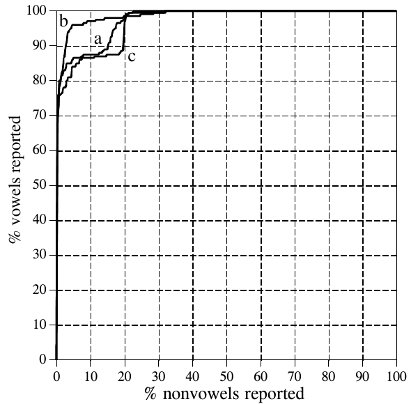

**图 26-12　神经网络例子的 ROC 分析。** 这些曲线比较了三个用来检测元音图像的神经网络。试验 (b) 是最好的解，它的曲线更靠近图的左上角。这个网络能正确检测 25 个目标中的 24 个，同时每 25 个非目标只产生 1 次误报。也就是说，ROC 曲线上有一点位于 x = 4%、y = 96% 处。
（% vowels reported = 被报告的元音百分比，% nonvowels reported = 被报告的非元音百分比；a、b、c 是三次试验。）

关于神经网络，最后再说几句。让神经网络在训练中收敛可能很棘手。如果网络误差（ESUM）不是稳步下降，就必须终止程序，修改后重新开始。可能要试好几次才能成功。有三样东西可以改变以影响收敛：(1) MU；(2) 随机初始权重的大小；(3) 隐藏节点的数目（按应该改动的先后顺序）。

神经网络开发中最关键的一项，是训练例子的有效性。例如，在开发新的商业产品时，能拿到的测试数据只有来自原型、仿真、有根据的猜测等。如果用这些初步信息训练神经网络，它在最终应用中可能无法正常工作。训练数据库与最终数据之间的任何差异，都会降低神经网络的性能（神经网络的墨菲定律）。在这个问题上别想去猜神经网络会怎样，你猜不到的！

## 递归滤波器设计

第 19 章和第 20 章讲了怎样设计具有标准频率响应的递归滤波器：高通、低通、带通等。如果你需要某种定制的东西怎么办？答案是像设计神经网络那样设计递归滤波器：从一组通用的递归系数出发，用迭代把它们慢慢塑造成你想要的样子。这项技术之所以重要，有两个原因。第一，它让人不必费劲去处理 z 变换的数学，就能设计定制的递归滤波器。第二，它表明常规 DSP 的思想和神经网络的思想可以结合起来，形成出色的算法。

这个方法的主程序见表 26-4，两个子程序见表 26-5。数组 T[ ] 存放期望的频率响应，即我们手工设计的某种曲线。由于这个程序以 FFT 为基础，信号长度必须是 2 的幂。按现在的写法，程序使用的 FFT 长度为 256，由第 130 行的变量 N% 定义。这意味着 T[0] 到 T[128] 对应采样率的 0 到 0.5 之间的频率。这个数组里只有幅度；这种设计不控制相位，相位是什么就是什么。

递归系数在第 270～310 行设为初值，通常选为恒等系统(identity system)。这里不要用随机数，否则初始滤波器会不稳定。递归系数存放在数组 A[ ] 和 B[ ] 中。变量 NP% 设定所设计滤波器的极点(pole)数。例如，若 NP% 为 5，则"a"系数从 A[0] 到 A[5]，"b"系数从 B[1] 到 B[5]。

前面提到过，迭代过程需要一个单一的值来描述当前系统运转得有多好。这个值由变量 ER（error，误差）提供，在子程序 3000 中计算。第 3040 到 3080 行在数组 IMX[ ] 中放一个冲激。接着第 3100～3150 行把这个冲激作为输入信号，送进由 A[ ] 和 B[ ] 当前值定义的递归滤波器。因此这个滤波器的输出就是当前系统的冲激响应，存放在数组 REX[ ] 中。然后如第 3170 行所示，对冲激响应做 FFT，求出系统的频率响应。子程序 1000 是第 12 章表 12-4 中列出的 FFT 程序。这个 FFT 子程序以直角坐标形式返回频率响应，覆盖数组 REX[ ] 和 IMX[ ]。

**表 26-4**（注释已译成中文）

```basic
100 'ITERATIVE DESIGN OF RECURSIVE FILTER
110 '
120                                 '初始化
130 N% = 256                        'FFT 的点数
140 NP% = 8                         '滤波器的极点数
150 DELTA = .00001                  '扰动增量
160 MU = .2                         '迭代步长
170 DIM REX[255]                    'FFT 过程中信号的实部
180 DIM IMX[255]                    'FFT 过程中信号的虚部
190 DIM T[128]                      '期望的频率响应（只有幅度）
200 DIM A[8]                        '"a" 递归系数
210 DIM B[8]                        '"b" 递归系数
220 DIM SA[8]                       '"a" 系数的斜率
230 DIM SB[8]                       '"b" 系数的斜率
240 '
250 GOSUB XXXX                      '虚构的子程序，载入 T[ ]
260 '
270 FOR P% = 0 TO NP%               '把系数初始化为恒等系统
280   A[P%] = 0
290   B[P%] = 0
300 NEXT P%
310 A[0] = 1
320 '
330 '                               '迭代循环
340 FOR ITER% = 1 TO 100            '按所需次数循环迭代
350   GOSUB 2000                    '计算新的系数
360   PRINT ITER% ENEW MU           '把当前状态打印到屏幕
370   IF ENEW > EOLD THEN MU = MU/2 '调整 MU 的值
380 NEXT ITER%
390 '
400 '
410 FOR P% = 0 TO NP%               '打印出系数
420   PRINT A[P%] B[P%]
430 NEXT P%
440 '
450 END
```

接着第 3200～3250 行计算 ER，即当前频率响应的幅度与期望频率响应之间的均方误差。要特别注意这个误差是怎样求的。程序的迭代动作优化的就是这个误差，所以它的定义方式非常重要。FOR-NEXT 循环遍历频率响应中的每个频率。对每个频率，第 3220 行由直角坐标数据算出当前频率响应的幅度。第 3230 行用当前幅度 MAG 减去期望幅度 T[ ]，求出这个频率上的误差。这个误差再平方，加到累加器变量 ER 上。遍历完所有频率后，第 3250 行完成计算，使 ER 成为整个频率响应的均方误差。

> **译注：** 第 3250 行在平均之后还开了平方根，所以 ER 严格说是均方根误差(root mean square error)，而不是正文说的均方误差。两者单调对应，对优化方向没有影响。

第 340 到 380 行控制程序的迭代循环。递归系数的修改在子程序 2000 中进行。这个子程序的第一个动作是求出 ER 的当前值，存放到另一个变量 EOLD 中（第 2040 和 2050 行）。子程序更新系数之后，再次求出 ER 的值，赋给变量 ENEW（第 2270 和 2280 行）。

变量 MU 控制迭代步长，就和前面的神经网络程序一样。这个程序用了一个进阶的功能：自动调整 MU 的值。这就是设两个变量 EOLD 和 ENEW 的原因。程序开始时，MU 设为相对较大的值 0.2（第 160 行）。这让收敛能快速进行，但会限制滤波器接近最优解的程度。随着迭代的进行，会到达一些不再有进展的点，其标志是 ENEW 比 EOLD 高。每出现一次这种情况，第 370 行就减小 MU 的值。

子程序 2000 按最速下降法更新递归系数：算出每个系数的斜率，然后把系数改变一个与其斜率成正比的量。第 2080～2130 行算出"a"系数的斜率，存放在数组 SA[ ] 中。同样，第 2150～2200 行算出"b"系数的斜率，存放在数组 SB[ ] 中。然后第 2220～2250 行把每个递归系数修改一个与这些斜率成正比的量。在这个程序中，比例常数就是步长 MU。比例常数里不需要误差项，因为只有一个要匹配的例子：期望的频率响应。

最后一个问题是程序怎样计算递归系数的斜率。在神经网络的例子中，我们推导出了斜率的方程。这里不能用这个办法，因为那需要对 DFT 求导。取而代之的是一种蛮力方法：真的把递归系数改变一个小增量，然后直接计算 ER 的新值。斜率就等于 ER 的变化量除以增量的大小。具体来说，ER 的当前值在第 2040～2050 行求出，存放在变量 EOLD 中。第 2080～2130 行的循环遍历每个"a"系数。循环内的第一个动作，是给正在处理的递归系数加上一个小增量 DELTA（第 2090 行）。第 2100 行调用子程序 3000，求出系数修改后的 ER 值。然后第 2110 行把这个系数的斜率算成 (ER − EOLD)/DELTA。第 2120 行再减去 DELTA，把修改过的系数恢复原值。

**表 26-5**（注释已译成中文）

```basic
2000 'SUBROUTINE TO CALCULATE THE NEW RECURSION COEFFICIENTS
2010 '进入时的变量：A[ ]，B[ ]，DELTA，MU
2020 '退出时的变量：A[ ]，B[ ]，EOLD，ENEW
2030 '
2040 GOSUB 3000                      '求当前误差
2050 EOLD = ER                       '把当前误差存进变量 EOLD
2060 '
2070                                 '求误差斜率
2080 FOR P% = 0 TO NP%               '遍历每个 "a" 系数
2090   A[P%] = A[P%] + DELTA         '给系数加一个小增量
2100   GOSUB 3000                    '求改变后的误差
2110   SA[P%] = (ER-EOLD)/DELTA      '算出误差斜率，存进 SA[ ]
2120   A[P%] = A[P%] - DELTA         '把系数恢复原值
2130 NEXT P%
2140 '
2150 FOR P% = 1 TO NP%               '对每个 "b" 系数重复这个过程
2160   B[P%] = B[P%] + DELTA
2170   GOSUB 3000
2180   SB[P%] = (ER-EOLD)/DELTA      '算出误差斜率，存进 SB[ ]
2190   B[P%] = B[P%] - DELTA
2200 NEXT P%
2210 '                               '计算新的系数
2220 FOR P% = 0 TO NP%               '遍历每个系数
2230   A[P%] = A[P%] - SA[P%] * MU   '调整系数，向"下坡"移动
2240   B[P%] = B[P%] - SB[P%] * MU
2250 NEXT P%
2260 '
2270 GOSUB 3000                      '求新的误差
2280 ENEW = ER                       '把新误差存进变量 ENEW
2290 '
2300 RETURN


3000 'SUBROUTINE TO CALCULATE THE FREQUENCY DOMAIN ERROR
3010 '进入时的变量：A[ ]，B[ ]，T[ ]
3020 '退出时的变量：ER
3030 '
3040 FOR I% = 0 TO N%-1              '在 IMX[ ] 中载入平移过的冲激
3050   REX[I%] = 0
3060   IMX[I%] = 0
3070 NEXT I%
3080 IMX[12] = 1
3090 '                               '计算冲激响应
3100 FOR I% = 12 TO N%-1
3110   FOR J% = 0 TO NP%
3120     REX[I%] = REX[I%] + A[J%] * IMX[I%-J%] + B[J%] * REX[I%-J%]
3130   NEXT J%
3140 NEXT I%
3150 IMX[12] = 0
3160 '                               '计算 FFT
3170 GOSUB 1000                      '表 12-4，使用 REX[ ]、IMX[ ]、N%
3180 '
3190                                 '求频域误差
3200 ER = 0                          'ER 清零，用作累加器
3210 FOR I% = 0 TO N%/2              '遍历每个正频率
3220   MAG = SQR(REX[I%]^2 + IMX[I%]^2)    '直角坐标 --> 极坐标转换
3230   ER = ER + ( MAG - T[I%] )^2   '计算并累加误差的平方
3240 NEXT I%
3250 ER = SQR( ER/(N%/2+1) )         '完成误差 ER 的计算
3260 '
3270 RETURN
```

> **译注：** 第 3080 行把冲激放在 IMX[12] 而不是 IMX[0]，是为了让第 3120 行的 `IMX[I%-J%]`、`REX[I%-J%]` 在 J% 最大取到 NP% = 8 时下标也不会为负（12 足够容纳最多 12 个极点）。冲激响应因此整体平移了 12 个采样，这只改变频率响应的相位，不影响用来算误差的幅度。

**C 实现**（完整可编译版本见 `c/table26-4_iterative_recursive_filter.c`，主程序和两个子程序都在里面，并附了一份表 12-4 的 FFT）。原书第 250 行用虚构子程序载入 T[ ]，这里按图 26-13a 的设定用截止频率 0.31 的理想低通、8 个极点。求误差斜率并更新系数的子程序：

```c
/* 子程序 2000：求新的递归系数 */
static void new_coefficients(void)
{
    calc_error();                           /* 2040：当前误差 */
    eold = er;                              /* 2050 */
    for (int p = 0; p <= NP; p++) {         /* 2080～2130：每个 a 系数的斜率 */
        a[p] += DELTA;                      /* 2090：加一个小增量 */
        calc_error();                       /* 2100 */
        sa[p] = (er - eold) / DELTA;        /* 2110：误差斜率 */
        a[p] -= DELTA;                      /* 2120：恢复原值 */
    }
    for (int p = 1; p <= NP; p++) {         /* 2150～2200：每个 b 系数的斜率 */
        b[p] += DELTA;
        calc_error();
        sb[p] = (er - eold) / DELTA;
        b[p] -= DELTA;
    }
    for (int p = 0; p <= NP; p++) {         /* 2220～2250：沿下坡方向调整系数 */
        a[p] -= sa[p] * MU;
        b[p] -= sb[p] * MU;                 /* b[0] 的斜率恒为 0，不受影响 */
    }
    calc_error();                           /* 2270：新的误差 */
    enew = er;                              /* 2280 */
}
```

运行结果：从恒等系统出发，初始误差 ER = 0.616；按原书的 100 次迭代，ER 降到 0.081（期间 MU 自动从 0.2 减半到 0.1），通带（0～0.28）平均幅度 0.995、阻带（0.34～0.5）平均幅度 0.046。继续迭代到 2000 次，ER 降到 0.058，MU 减到 0.00625，阻带平均幅度 0.038。在这台机器上 2000 次迭代只需约 0.1 秒（原书在 100 MHz 奔腾上要几分钟）。

图 26-13 是用这个程序设计出的几个滤波器的例子。虚线是期望的频率响应，实线是所设计滤波器的频率响应。在 100 MHz 奔腾上，每个滤波器都需要几分钟才能收敛。图 (a) 是一个 8 极点低通滤波器，误差在整个频谱上权重相同（就是程序现在的写法）。图 (b) 是同一个滤波器，只是计算 ER 时把阻带的误差乘以 8。这迫使滤波器的阻带纹波更小，代价是通带纹波更大。

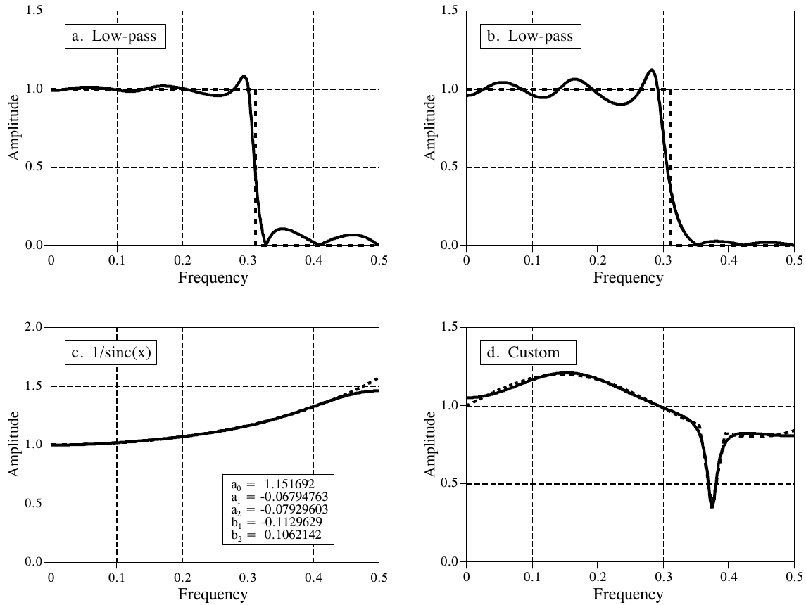

**图 26-13　递归滤波器的迭代设计。** 图 (a) 是一个 8 极点低通滤波器，误差在 0 到 0.5 之间均匀分配。在 (b) 中，误差经过加权，以通带误差为代价，迫使阻带表现更好。图 (c) 是一个用于数模转换中 1/sinc(x) 校正的 2 极点滤波器。(d) 中的频率响应完全是定制的。在每张图中，期望的频率响应用虚线表示，实际的频率响应用实线表示。
（a. Low-pass = 低通；b. Low-pass = 低通；c. 1/sinc(x)；d. Custom = 定制。Amplitude = 幅度，Frequency = 频率。(c) 中的方框列出了设计出的系数：a₀ = 1.151692，a₁ = −0.06794763，a₂ = −0.07929603，b₁ = −0.1129629，b₂ = 0.1062142。）

图 (c) 是一个实现 1/sinc(x) 的 2 极点滤波器。第 3 章讲过，它可以用来抵消数模转换中零阶保持(zeroth-order hold)的影响（见图 3-6）。这个滤波器的误差只在 0 到 0.45 之间求和，从而在这个范围内匹配得更好，代价是 0.45 到 0.5 之间匹配得更差。最后，(d) 是一个非常不规则的 6 极点频率响应，其中包含一个尖锐的凹陷。为了让它收敛，递归系数的初值设成了一个陷波滤波器(notch filter)的系数。
