# 《The Scientist and Engineer's Guide to Digital Signal Processing》第 27 章中译

> 原书：上一级目录 `Documents/数学基础/` 下的 `The Scientist and Engineer Guide to Digital Signal Processing.pdf`，对应 PDF 第 492～513 页（原书第 481～502 页）。
> 上一章：[26-DSP指南-第26章中译.md](26-DSP指南-第26章中译.md)。专业名词第一次出现时在括号里附上英文。
> 插图从原书页面裁出，放在 `assets/ch27/`，图里的英文标注在每张图下方给出对照。表 27-1～27-3 是数据表，直接译成了 Markdown 表格。本章没有 BASIC 程序。原书 PDF 的符号字体抽取时会乱码（Δ 显示成 )，+ 显示成 %，= 显示成 '，π 显示成 B），公式按原书版面重新用 LaTeX 写出。

---

# 第 27 章　数据压缩

传输和存储数据都要花钱。要处理的信息越多，花费就越大。尽管如此，大多数数字数据并不是以最紧凑的形式存储的，而是以最方便使用的方式存储，比如：文字处理软件生成的 ASCII 文本、计算机可以直接执行的二进制代码、数据采集系统采到的一个个采样，等等。通常，这些方便使用的编码方式产生的数据文件，大约是表示同样信息实际所需大小的两倍。数据压缩(data compression)是为解决这一问题而开发的各种算法和程序的统称。压缩程序把数据从方便使用的格式转换成为紧凑性而优化的格式；相应地，解压程序把信息恢复成原来的形式。本章介绍五种数据压缩技术。前三种是简单的编码技术，分别叫游程编码(run-length encoding)、霍夫曼编码(Huffman encoding)和差分编码(delta encoding)。后两种是已成为工业标准的复杂流程：LZW 和 JPEG。

## 数据压缩的策略

表 27-1 给出了对数据压缩算法分类的两种方式。在 (a) 中，方法被分为无损(lossless)和有损(lossy)两类。无损技术意味着恢复出的数据文件与原文件完全相同。这对许多类型的数据是绝对必要的，例如：可执行代码、文字处理文件、表格数字等。这类信息哪怕错放一位都承受不起。相比之下，表示图像和其他采集信号的数据文件，在存储或传输时不必保持完美无缺。所有真实世界的测量本身都含有一定量的噪声。如果对这些信号所做的改变类似于少量额外的噪声，就不会造成损害。允许这种质量下降的压缩技术叫做有损压缩。这个区分很重要，因为有损技术的压缩效果远好于无损方法。压缩比(compression ratio)越高，给数据加入的噪声就越多。

**表 27-1　压缩方法的分类。** 数据压缩方法可以用两种方式划分。在 (a) 中，技术被分为无损和有损两类：无损方法把压缩数据恢复成与原始数据完全相同的形式，有损方法只能得到一个近似。在 (b) 中，方法按照从原文件中取出、以及写入压缩文件的数据组(group)大小是固定还是可变来分类。

**a. 无损还是有损**

| 无损(Lossless) | 有损(Lossy) |
|---|---|
| 游程编码(run-length) | CS&Q |
| 霍夫曼编码(Huffman) | JPEG |
| 差分编码(delta) | MPEG |
| LZW | |

**b. 数据组大小固定还是可变**

| 方法(Method) | 输入组大小(input) | 输出组大小(output) |
|---|---|---|
| CS&Q | 固定(fixed) | 固定 |
| 霍夫曼编码 | 固定 | 可变(variable) |
| 算术编码(Arithmetic) | 可变 | 可变 |
| 游程编码、LZW | 可变 | 固定 |

在万维网上传输的图像，是说明数据压缩为什么重要的绝佳例子。假设我们要通过计算机的 33.6 kbps 调制解调器下载一张数字化的彩色照片。如果图像没有压缩（比如 TIFF 文件），它大约有 600 kB 的数据。如果用无损技术压缩过（比如 GIF 格式所用的那种），大约是这个大小的一半，即 300 kB。如果用的是有损压缩（JPEG 文件），大约是 50 kB。关键在于，这三个等价文件的下载时间分别是 142 秒、71 秒和 12 秒。差别太大了！JPEG 是数字照片的最佳选择，而 GIF 用于绘制的图像，比如有大片单一颜色的公司标志。

对数据压缩方法的第二种分类方式见表 27-1b。大多数数据压缩程序的工作方式是：从原文件中取出一组数据，以某种方式压缩，再把压缩后的这组数据写入输出文件。例如，表中有一种技术叫 CS&Q，是更粗的采样和/或量化(coarser sampling and/or quantization)的缩写。假设我们要压缩一个数字化波形，比如数字化到 12 位的音频信号。我们可以从原文件中读出两个相邻的采样（24 位），把其中一个采样整个丢掉，把另一个采样的最低 4 位丢掉，然后把剩下的 8 位写入输出文件。输入 24 位、输出 8 位，我们就用一个有损算法实现了 3:1 的压缩比。这种做法本身相当粗糙，但和一种叫变换压缩(transform compression)的技术配合使用时非常有效。后面会讲到，这正是 JPEG 的基础。

表 27-1b 显示 CS&Q 是一种"固定输入、固定输出"的方案。也就是说，从输入文件读入固定数量的位，向输出文件写出更少的固定数量的位。其他压缩方法允许读入或写出可变数量的位。在学习下面每种压缩方法时，可以回头对照这张表，理解它在这个分类体系中的位置。为什么 JPEG 和 MPEG 没有列在这张表里？它们是组合了许多其他技术的复合算法，太复杂了，没法归入这些简单的类别。

## 游程编码

数据文件里经常有同一个字符连续重复很多次的情况。例如，文本文件用多个空格来分隔句子、缩进段落、排版表格和图表等。数字化信号中也可能出现连续相同的值，表示信号没有变化。比如，一张夜空的图像会有长串代表黑色背景的字符；同样，数字化的音乐在两首歌之间可能有一长串零。游程编码(run-length encoding)是压缩这类文件的一种简单方法。

图 27-1 演示了对一个经常出现连续零的数据序列做游程编码。输入数据中每遇到一个零，就向输出文件写入两个值。第一个值是零，作为标志，表示游程压缩开始了；第二个值是这一串零的个数。如果平均游程长度大于二，就能实现压缩。反过来，如果数据中有很多单独的零，编码后的文件反而会比原文件大。

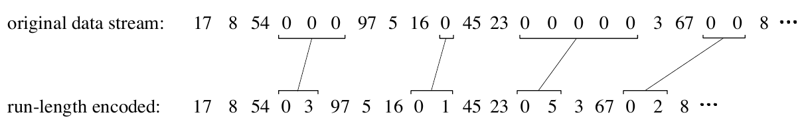

**图 27-1　游程编码的例子。** 每一串零在压缩文件中都被替换成两个字符：一个零，表示正在压缩；后面跟着这一串零的个数。
（original data stream = 原始数据流，run-length encoded = 游程编码后。）

人们发明过许多不同的游程方案。例如，输入数据可以按单个字节处理，也可以按表示更复杂内容（比如浮点数）的字节组来处理。游程编码可以只用于其中一个字符（比如上面的零），也可以用于几个字符，或者所有字符。

一个通用游程方案的好例子是 PackBits，它是为 Macintosh 用户设计的。输入文件中的每个字节（8 位）在压缩文件中被替换成 9 位。增加的第 9 位被解释为数的符号。也就是说，从输入文件读到的每个字符在 0 到 255 之间，而写入编码文件的每个字符在 −255 到 255 之间。要理解它的用法，看这个输入文件：1, 2, 3, 4, 2, 2, 2, 2, 4；PackBits 算法生成的压缩文件是：1, 2, 3, 4, 2, −3, 4。压缩程序只是把输入文件中的每个数照搬到压缩文件里，只有连串的 2, 2, 2, 2 例外。它在压缩文件中用两个数 2, −3 表示。第一个数（"2"）说明这一串由什么字符组成；第二个数（"−3"）说明这一串有几个字符，取绝对值再加一即得。例如，4, −2 表示 4, 4, 4；21, −4 表示 21, 21, 21, 21, 21；依此类推。

PackBits 有一个不便之处：9 位必须重新排列成计算机存储和传输所用的标准 8 位字节。当输入限定为 ASCII 文本时，可以对这个方案做一个有用的修改。如表 27-2 所示，每个 ASCII 字符通常存成一个完整字节（8 位），但实际上只用其中 7 位来标识字符。换句话说，127 到 255 这些值没有任何标准化的含义，不需要存储或传输。这样就可以用第 8 位来表示是否正在进行游程编码。

**表 27-2　ASCII 码。** 这是一个由来已久的标准，让字母和数字可以用数字形式表示。每个可打印字符被分配一个 32 到 127 之间的数，而 0 到 31 用于各种控制动作。虽然只定义了 128 个码，ASCII 字符通常存成一个完整字节（8 位）。未定义的值（128 到 255）常被用来表示希腊字母、数学符号和各种几何图案，但这并没有标准化。许多控制字符（0 到 31）源自更早的通信网络，并不适用于计算机技术。

| 码 | 含义 | 码 | 字符 | 码 | 字符 | 码 | 字符 |
|---|---|---|---|---|---|---|---|
| 0 | 空字符(null) | 32 | 空格(space) | 64 | @ | 96 | \` |
| 1 | 标题开始(start heading) | 33 | ! | 65 | A | 97 | a |
| 2 | 正文开始(start of text) | 34 | " | 66 | B | 98 | b |
| 3 | 正文结束(end of text) | 35 | # | 67 | C | 99 | c |
| 4 | 传输结束(end of xmit) | 36 | $ | 68 | D | 100 | d |
| 5 | 询问(enquiry) | 37 | % | 69 | E | 101 | e |
| 6 | 确认(acknowledge) | 38 | & | 70 | F | 102 | f |
| 7 | 响铃(bell, beep) | 39 | ' | 71 | G | 103 | g |
| 8 | 退格(backspace) | 40 | ( | 72 | H | 104 | h |
| 9 | 水平制表(horz. tab) | 41 | ) | 73 | I | 105 | i |
| 10 | 换行(line feed) | 42 | * | 74 | J | 106 | j |
| 11 | 垂直制表、归位(vert. tab, home) | 43 | + | 75 | K | 107 | k |
| 12 | 换页、清屏(form feed, cls) | 44 | , | 76 | L | 108 | l |
| 13 | 回车(carriage return) | 45 | - | 77 | M | 109 | m |
| 14 | 移出(shift out) | 46 | . | 78 | N | 110 | n |
| 15 | 移入(shift in) | 47 | / | 79 | O | 111 | o |
| 16 | 数据链路转义(data line esc) | 48 | 0 | 80 | P | 112 | p |
| 17 | 设备控制 1(device control 1) | 49 | 1 | 81 | Q | 113 | q |
| 18 | 设备控制 2 | 50 | 2 | 82 | R | 114 | r |
| 19 | 设备控制 3 | 51 | 3 | 83 | S | 115 | s |
| 20 | 设备控制 4 | 52 | 4 | 84 | T | 116 | t |
| 21 | 否认(negative ack.) | 53 | 5 | 85 | U | 117 | u |
| 22 | 同步空闲(synch. idle) | 54 | 6 | 86 | V | 118 | v |
| 23 | 传输块结束(end xmit block) | 55 | 7 | 87 | W | 119 | w |
| 24 | 取消(cancel) | 56 | 8 | 88 | X | 120 | x |
| 25 | 介质结束(end of medium) | 57 | 9 | 89 | Y | 121 | y |
| 26 | 替换(substitute) | 58 | : | 90 | Z | 122 | z |
| 27 | 转义(escape) | 59 | ; | 91 | [ | 123 | { |
| 28 | 文件分隔符(file separator) | 60 | < | 92 | \\ | 124 | \| |
| 29 | 组分隔符(group separator) | 61 | = | 93 | ] | 125 | } |
| 30 | 记录分隔符(record separator) | 62 | > | 94 | ^ | 126 | ~ |
| 31 | 单元分隔符(unit separator) | 63 | ? | 95 | _ | 127 | 删除(del) |

> **译注：** 原书表中 117 对应的字符印成了 "r"，应为 "u"，上表已改正。

## 霍夫曼编码

这种方法以 D.A. Huffman 的名字命名，他在 1950 年代提出了这一方法。图 27-2 是一个大型 ASCII 文件中字节值的直方图。这个文件 96% 以上只由 31 个字符组成：小写字母、空格、逗号、句号和回车。利用这一观察，可以为这个文件设计一个合适的压缩方案。首先，给这 31 个常用字符每个分配一个 5 位二进制码：00000 = "a"，00001 = "b"，00010 = "c"，等等。这样，文件中 96% 的内容大小缩减为原来的 5/8。最后一个 5 位码 11111 作为标志，表示正在传输的字符不是这 31 个常用字符之一；文件中接下来的 8 位按标准 ASCII 编码说明这是什么字符。这样，输入文件中 4% 的字符需要 5 + 8 = 13 位。其思路是：给常用字符分配较少的位，给罕用字符分配较多的位。在这个例子中，每个原始字符平均所需的位数是：$0.96 \times 5 + 0.04 \times 13 = 5.32$。换句话说，总压缩比为 8 位 / 5.32 位，约 1.5:1。

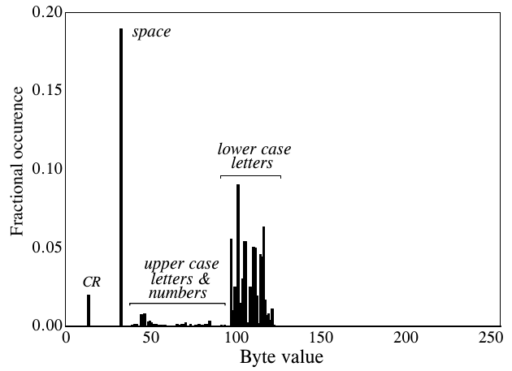

**图 27-2　文本的直方图。** 这是本书某一章 ASCII 值的直方图。最常见的字符是小写字母、空格和回车。
（Fractional occurence = 出现频率（原书拼作 occurence，应为 occurrence），Byte value = 字节值；space = 空格，CR = 回车，lower case letters = 小写字母，upper case letters & numbers = 大写字母和数字。）

霍夫曼编码把这个思路推向极致。最常出现的字符，比如空格和句号，可能只分配一两位；不常用的字符，比如 !、@、#、$ 和 %，可能需要十几位甚至更多。用数学语言说，当每个字符所用的位数与该字符出现概率的对数成正比时，达到最优。

霍夫曼编码有一个巧妙之处，在于这些变长码怎样紧密排列在一起。设想你收到一串由 1 和 0 组成的串行数据流。如果每个字符用 8 位表示，只要每 8 位切一段，就能把字符一个个直接分开。现在考虑一个霍夫曼编码的数据流，每个字符的位数各不相同，怎样把字符一个个分开？答案在于恰当地选择霍夫曼码，使之能够被正确分开。用一个例子来说明它是怎样工作的。

图 27-3 是一个简化的霍夫曼编码方案。字符 A 到 G 以图中所示的概率出现在原始数据流中。由于字符 A 最常见，我们用一位来表示它，即码 1。次常见的字符 B 分到两位，即码 01。依此类推，直到最不常见的字符 G，分到六位：000011。如图所示，这些变长码被重新整理成 8 位一组，这是计算机使用的标准。

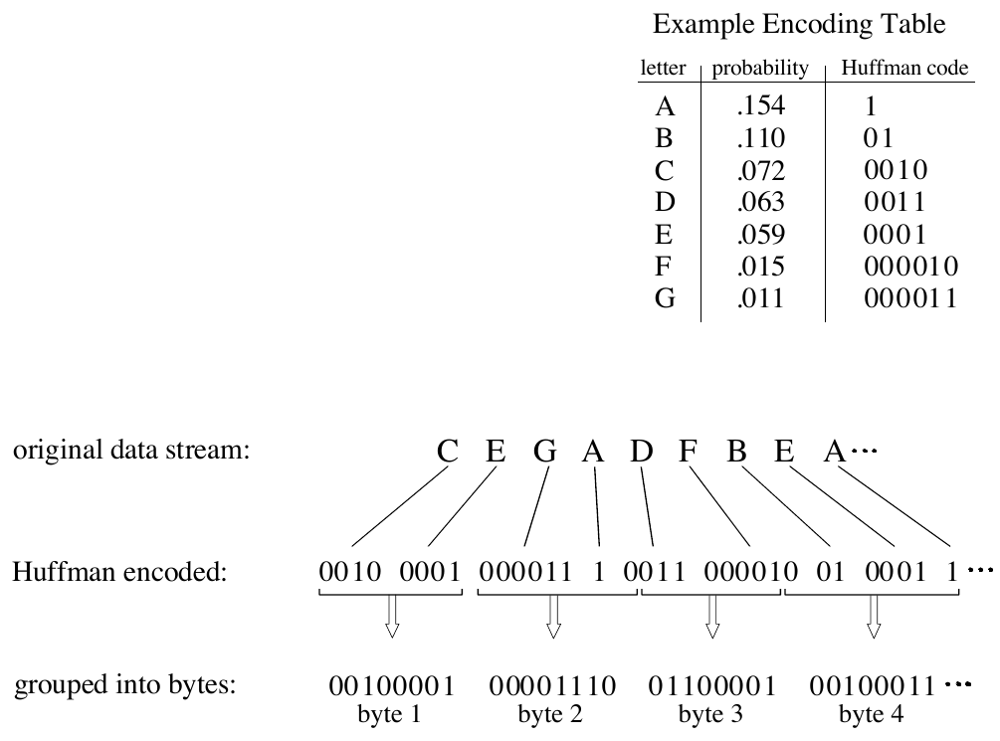

**图 27-3　霍夫曼编码。** 编码表根据出现概率，给本例中用到的七个字母各分配一个变长二进制码。由这 7 个字符组成的原始数据流，经这张表转换成霍夫曼编码数据。由于各个霍夫曼码长度不同，二进制数据需要重新分组成标准的 8 位字节，以便存储和传输。
（Example Encoding Table = 编码表示例，letter = 字母，probability = 概率，Huffman code = 霍夫曼码；original data stream = 原始数据流，Huffman encoded = 霍夫曼编码后，grouped into bytes = 分组成字节，byte 1～4 = 第 1～4 字节。）

> **译注：** 把图中码流 0010 0001 000011 1 0011 000010 01 0001 1 首尾相接再每 8 位切一刀，得到的正是图中 4 个字节 00100001、00001110、01100001、00100011，已逐位核对无误。

解压时，所有 8 位组首尾相接，形成一长串 1 和 0。仔细看图 27-3 的编码表，注意每个码都由两部分组成：一个 1 之前的若干个 0，以及 1 之后一段可有可无的二进制码。这使得二进制数据流可以被切分成一个个码，而无需在码之间加分隔符或其他标记。解压程序逐位查看这串 1 和 0，直到构成一个有效的码，然后从头开始寻找下一个字符。码的构造方式保证了切分时不存在歧义。

霍夫曼方法的一个更复杂的版本叫算术编码(arithmetic encoding)。在这种方案中，字符序列根据其出现概率由单个码来表示。它的优点是压缩效果更好，大约高 5～10%。先做游程编码、再做霍夫曼编码或算术编码，也是一种常见策略。可想而知，这类算法非常复杂，通常留给数据压缩专家去做。

要实现霍夫曼编码或算术编码，压缩和解压算法必须就表示每个字符（或字符组）的二进制码达成一致。这可以用两种方式之一来处理。最简单的是使用一张预先定义好、始终不变的编码表，不管压缩的是什么信息。更复杂的方案使用为特定数据优化的编码，这就要求把编码表放进压缩文件中，供解压程序使用。两种方法都很常见。

## 差分编码

在科学、工程和数学中，希腊字母 delta（Δ）用来表示一个变量的变化。差分编码(delta encoding)这个术语指的是若干种技术，它们存储的是相邻采样（或字符）之间的差，而不是直接存储采样本身。图 27-4 是一个例子。差分编码文件中的第一个值与原始数据中的第一个值相同；编码文件中之后的所有值，都等于输入文件中对应值与前一个值之差（delta）。

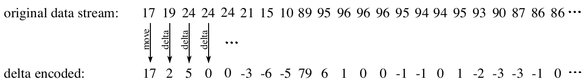

**图 27-4　差分编码的例子。** 编码文件中的第一个值与原文件中的第一个值相同。此后，编码文件中的每个采样都是原文件中当前采样与上一个采样之差。
（original data stream = 原始数据流，delta encoded = 差分编码后；箭头上的 move = 照搬，delta = 求差。）

当原始数据中的值是平滑的，也就是相邻值之间通常只有很小的变化时，差分编码可以用于数据压缩。ASCII 文本和可执行代码不是这样；但当文件表示的是信号时，这种情况非常普遍。例如，图 27-5a 是一段数字化到 8 位的音频信号，每个采样在 −127 到 127 之间。图 27-5b 是这个信号的差分编码版本。关键特点是：差分编码后的信号幅度比原信号小。换句话说，差分编码提高了每个采样值接近零的概率，降低了它远离零的概率。这种不均匀的概率分布，正是霍夫曼编码发挥作用所需要的。如果原信号不变化，或者按一条直线变化，差分编码会产生一串串相同的值，这正是游程编码所需要的。相应地，先做差分编码、再做霍夫曼编码和/或游程编码，是压缩信号的一种常见策略。

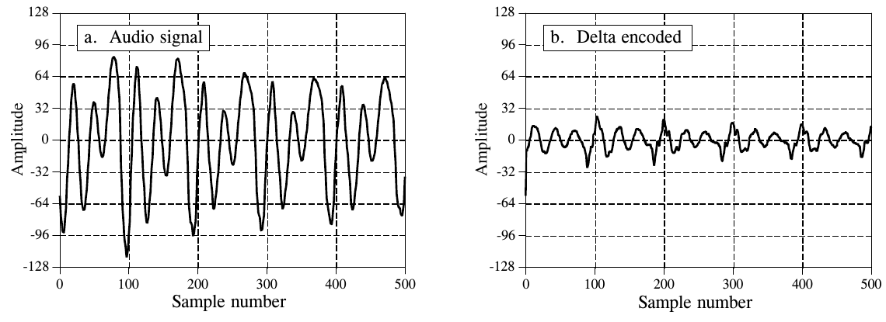

**图 27-5　差分编码的例子。** (a) 是数字化到 8 位的音频信号；(b) 是这个信号的差分编码版本。如果被编码的信号从一个采样到下一个采样变化缓慢，差分编码对数据压缩就很有用。
（a. Audio signal = 音频信号；b. Delta encoded = 差分编码后。Amplitude = 幅度，Sample number = 采样序号。）

差分编码的思路可以扩展成一种更复杂的技术，叫线性预测编码(Linear Predictive Coding, LPC)。要理解 LPC，设想输入信号的前 99 个采样已经编码完，我们正要处理第 100 个采样。这时我们问自己：根据前 99 个采样，第 100 个采样最可能是什么值？在差分编码中，答案是第 100 个采样最可能的值与前一个值（第 99 个采样）相同。这个期望值被用作编码第 100 个采样的参考，也就是说，把采样与期望值之差放进编码文件。LPC 在此基础上更进一步，对最可能的值做出更好的猜测，做法是查看最近的若干个采样，而不只是最后一个。LPC 所用的算法类似于递归滤波器，会用到 z 变换和其他高深的数学技术。

## LZW 压缩

LZW 压缩以它的发明者 A. Lempel 和 J. Ziv 命名，后来由 Terry A. Welch 做了改进。由于简单通用，它是通用数据压缩的首选技术。通常，可以期望 LZW 把文本、可执行代码和类似的数据文件压缩到原大小的一半左右。面对冗余度极高的数据文件，比如表格数字、计算机源代码和采集到的信号，LZW 的表现也很好，这些情况下 5:1 的压缩比很常见。好几种号称能"让你的硬盘容量翻倍"的个人电脑工具，都是以 LZW 为基础的。

GIF 图像文件总是使用 LZW 压缩，TIFF 和 PostScript 也把它作为一个可选项。LZW 压缩受美国专利 4,558,302 号保护，该专利于 1985 年 12 月 10 日授予 Sperry 公司（现为 Unisys 公司）。商业授权事宜请联系：Welch Licensing Department, Law Department, M/SC2SW1, Unisys Corporation, Blue Bell, Pennsylvania, 19424-0001。

> **译注：** 这是原书写作时（1990 年代）的情况。LZW 的美国专利已于 2003 年到期，其他国家的相应专利也在 2004 年前后陆续到期。

LZW 压缩使用一张码表(code table)，如图 27-6 所示。常见的选择是让表中有 4096 个条目。这时，LZW 编码后的数据完全由 12 位的码组成，每个码指向码表中的一个条目。解压的方法是：从压缩文件中取出每个码，通过码表查出它代表哪个或哪些字符。码表中的 0～255 号码始终用来表示输入文件中的单个字节。例如，如果只用前 256 个码，原文件中的每个字节都会在 LZW 编码文件中变成 12 位，文件反而大了 50%。解压时，每个 12 位码再通过码表还原成单个字节。当然，这种情况没什么用处。

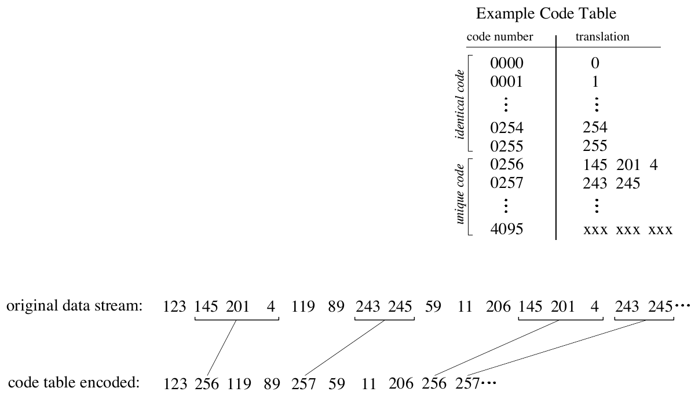

**图 27-6　码表压缩的例子。** 这是流行的 LZW 压缩方法的基础。编码的做法是：找出原文件中那些已经存在于码表中的字节序列，用代表该序列的 12 位码代替序列放进压缩文件。表中前 256 个条目对应单字节值 0 到 255，其余条目对应字节序列。LZW 算法是根据被压缩的具体数据生成码表的一种高效方法。（本图中的码表是一个简化的例子，并不是 LZW 算法实际生成的。）
（Example Code Table = 码表示例，code number = 码号，translation = 对应内容；identical code = 与字节值相同的码，unique code = 专用码；original data stream = 原始数据流，code table encoded = 码表编码后。）

LZW 方法通过用 256 到 4095 号码表示字节序列来实现压缩。例如，523 号码可能代表三个字节组成的序列：231 124 234。压缩算法每在输入文件中遇到一次这个序列，就把 523 号码放进编码文件。解压时，523 号码通过码表还原成真正的 3 字节序列。分配给单个码的序列越长、这个序列重复得越频繁，压缩率就越高。

这个方法虽然简单，但有两个主要障碍需要克服：(1) 怎样确定哪些序列应该放进码表；(2) 怎样把压缩程序用的码表同样提供给解压程序。LZW 算法精妙地解决了这两个问题。

LZW 程序开始编码一个文件时，码表中只有前 256 个条目，其余部分是空的。这意味着进入压缩文件的头几个码，只是输入文件中被转换成 12 位的单个字节。随着编码进行，LZW 算法识别出数据中重复出现的序列，并把它们加入码表。一个序列第二次出现时，压缩才开始。关键在于：输入文件中的一个序列，要等它已经以单个字符（0～255 号码）的形式放进压缩文件之后，才会被加入码表。这一点很重要，因为它使解压程序能直接从压缩数据中重建码表，而不必单独传输码表。

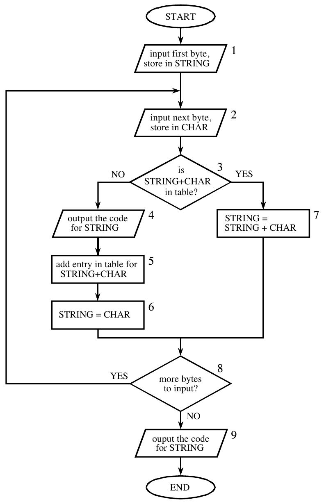

**图 27-7　LZW 压缩流程图。** 变量 CHAR 是单个字节；变量 STRING 是可变长度的字节序列。数据以单个字节的形式从输入文件读入（框 1 和 2），以 12 位码的形式写入压缩文件（框 4）。表 27-3 是这个算法的一个例子。
（START = 开始，END = 结束；1. input first byte, store in STRING = 读入第一个字节，存入 STRING；2. input next byte, store in CHAR = 读入下一个字节，存入 CHAR；3. is STRING+CHAR in table? = STRING+CHAR 在表中吗？；4. output the code for STRING = 输出 STRING 的码；5. add entry in table for STRING+CHAR = 在表中为 STRING+CHAR 新增条目；6. STRING = CHAR；7. STRING = STRING + CHAR；8. more bytes to input? = 还有字节要读吗？；9. output the code for STRING = 输出 STRING 的码（原书误拼为 ouput）。YES = 是，NO = 否。）

图 27-7 是 LZW 压缩的流程图。表 27-3 逐步给出了一个示例输入文件的处理细节，这个文件由 45 个字节组成，是 ASCII 文本串：the/rain/in/Spain/falls/mainly/on/the/plain。当我们说 LZW 算法从输入文件读入字符 "a" 时，意思是它读入值 01100001（用 8 位表示的 97），97 是 "a" 的 ASCII 码。当我们说它向编码文件写入字符 "a" 时，意思是它写入 000001100001（用 12 位表示的 97）。

> **译注：** 正文说输入是 45 个字节，但表 27-3 实际处理的是 the/rain/in/Spain/falls/mainly/on/the/plain/（末尾多一个 /），共 44 个字节；表中第 45 行是"文件结束"，不对应输入字节。我用 Python 照图 27-7 的流程实现了一遍，生成的码表条目 256～288 与表 27-3 逐条一致，共输出 34 个码。顺便一提，34 个 12 位码共 408 位，比原文 44 × 8 = 352 位还多：这么短的文本里重复太少，LZW 的码表还来不及发挥作用。

**表 27-3　LZW 示例。** 本表展示短语 the/rain/in/Spain/falls/mainly/on/the/plain/ 的压缩过程。

| 行 | CHAR | STRING + CHAR | 在表中？ | 输出 | 加入表中 | 新 STRING | 说明 |
|---|---|---|---|---|---|---|---|
| 1 | t | t | | | | t | 第一个字符，不做任何事 |
| 2 | h | th | 否 | t | 256 = th | h | |
| 3 | e | he | 否 | h | 257 = he | e | |
| 4 | / | e/ | 否 | e | 258 = e/ | / | |
| 5 | r | /r | 否 | / | 259 = /r | r | |
| 6 | a | ra | 否 | r | 260 = ra | a | |
| 7 | i | ai | 否 | a | 261 = ai | i | |
| 8 | n | in | 否 | i | 262 = in | n | |
| 9 | / | n/ | 否 | n | 263 = n/ | / | |
| 10 | i | /i | 否 | / | 264 = /i | i | |
| 11 | n | in | 是 (262) | | | in | 找到第一个匹配 |
| 12 | / | in/ | 否 | 262 | 265 = in/ | / | |
| 13 | S | /S | 否 | / | 266 = /S | S | |
| 14 | p | Sp | 否 | S | 267 = Sp | p | |
| 15 | a | pa | 否 | p | 268 = pa | a | |
| 16 | i | ai | 是 (261) | | | ai | 匹配 ai，ain 还不在表中 |
| 17 | n | ain | 否 | 261 | 269 = ain | n | ain 加入表中 |
| 18 | / | n/ | 是 (263) | | | n/ | |
| 19 | f | n/f | 否 | 263 | 270 = n/f | f | |
| 20 | a | fa | 否 | f | 271 = fa | a | |
| 21 | l | al | 否 | a | 272 = al | l | |
| 22 | l | ll | 否 | l | 273 = ll | l | |
| 23 | s | ls | 否 | l | 274 = ls | s | |
| 24 | / | s/ | 否 | s | 275 = s/ | / | |
| 25 | m | /m | 否 | / | 276 = /m | m | |
| 26 | a | ma | 否 | m | 277 = ma | a | |
| 27 | i | ai | 是 (261) | | | ai | 匹配 ai |
| 28 | n | ain | 是 (269) | | | ain | 匹配更长的串 ain |
| 29 | l | ainl | 否 | 269 | 278 = ainl | l | |
| 30 | y | ly | 否 | l | 279 = ly | y | |
| 31 | / | y/ | 否 | y | 280 = y/ | / | |
| 32 | o | /o | 否 | / | 281 = /o | o | |
| 33 | n | on | 否 | o | 282 = on | n | |
| 34 | / | n/ | 是 (263) | | | n/ | |
| 35 | t | n/t | 否 | 263 | 283 = n/t | t | |
| 36 | h | th | 是 (256) | | | th | 匹配 th，the 还不在表中 |
| 37 | e | the | 否 | 256 | 284 = the | e | the 加入表中 |
| 38 | / | e/ | 是 (258) | | | e/ | |
| 39 | p | e/p | 否 | 258 | 285 = e/p | p | |
| 40 | l | pl | 否 | p | 286 = pl | l | |
| 41 | a | la | 否 | l | 287 = la | a | |
| 42 | i | ai | 是 (261) | | | ai | 匹配 ai |
| 43 | n | ain | 是 (269) | | | ain | 匹配更长的串 ain |
| 44 | / | ain/ | 否 | 269 | 288 = ain/ | / | |
| 45 | EOF | / | | / | | | 文件结束，输出 STRING |

> **译注：** 原表第 38 行"在表中？"一栏只印了 "yes"，漏了码号，应为 258（第 4 行加入的 e/），上表已补上。

压缩算法使用两个变量：CHAR 和 STRING。变量 CHAR 存放单个字符，即一个 0 到 255 之间的单字节值。变量 STRING 是一个可变长度的串，即由一个或多个字符组成的一组字符，每个字符是一个字节。在图 27-7 的框 1 中，程序先从输入文件取出第一个字节，放进变量 STRING。表 27-3 第 1 行展示了这个动作。接下来，算法对输入文件中每个后续字节循环一次，这个循环在流程图中由框 8 控制。每从输入文件读入一个字节（框 2），就把它存入变量 CHAR。然后在数据表中查找，确定两个变量的拼接 STRING+CHAR 是否已经分配了码（框 3）。

如果在码表中没有找到匹配，就执行三个动作，如框 4、5、6 所示。框 4 把与变量 STRING 内容对应的 12 位码写入压缩文件；框 5 在表中为 STRING+CHAR 的拼接创建一个新码；框 6 让变量 STRING 取变量 CHAR 的值。表 27-3 第 2 到第 10 行是这些动作的例子，对应示例文件的前 10 个字节。

如果在码表中找到了匹配（框 3），就把 STRING+CHAR 的拼接存入变量 STRING，不做其他任何事（框 7）。也就是说，如果在表中找到了匹配的序列，在确定表中是否还有更长的匹配序列之前，不应采取任何动作。第 11 行就是这样一个例子：序列 STRING+CHAR = in 被识别为在表中已经有码。在第 12 行，输入文件的下一个字符 / 被加到序列上，在码表中查找 in/。由于这个更长的序列不在表中，程序把它加入表中，输出表中那个较短序列的码（262 号码），然后从字符 / 开始重新查找序列。这个流程一直继续，直到输入文件中没有更多字符。最后，程序把与 STRING 当前值对应的码写入压缩文件，收尾（如图 27-7 的框 9 和表 27-3 的第 45 行所示）。

LZW 解压算法的流程图见图 27-8。从压缩文件中读入每个码，与码表比对，得到它代表的内容。每这样处理一个码，就更新一次码表，使它始终与压缩时用的码表一致。不过，解压程序有一个小麻烦：某些数据组合会使解压算法收到一个在它的码表中还不存在的码。这种意外情况由框 4、5、6 处理。

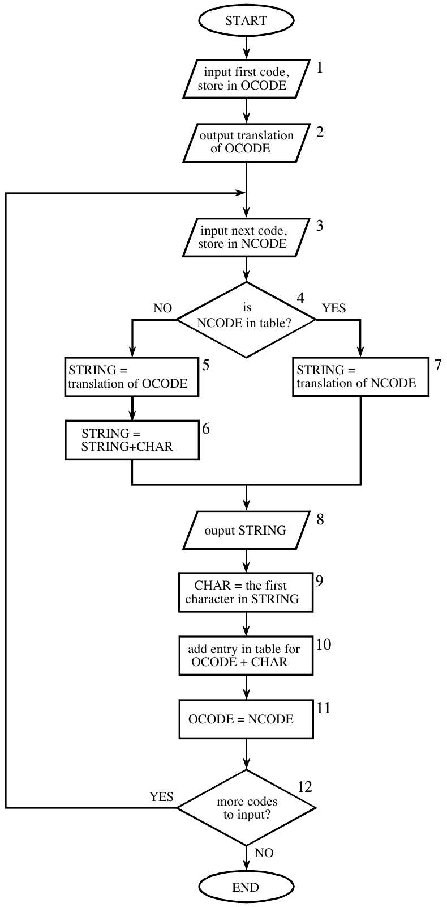

**图 27-8　LZW 解压流程图。** 变量 OCODE 和 NCODE（旧码(oldcode)和新码(newcode)）存放来自压缩文件的 12 位码，CHAR 存放单个字节，STRING 存放一串字节。
（START = 开始，END = 结束；1. input first code, store in OCODE = 读入第一个码，存入 OCODE；2. output translation of OCODE = 输出 OCODE 对应的内容；3. input next code, store in NCODE = 读入下一个码，存入 NCODE；4. is NCODE in table? = NCODE 在表中吗？；5. STRING = translation of OCODE = STRING 取 OCODE 对应的内容；6. STRING = STRING+CHAR；7. STRING = translation of NCODE = STRING 取 NCODE 对应的内容；8. output STRING = 输出 STRING（原书误拼为 ouput）；9. CHAR = the first character in STRING = CHAR 取 STRING 的第一个字符；10. add entry in table for OCODE + CHAR = 在表中为 OCODE + CHAR 新增条目；11. OCODE = NCODE；12. more codes to input? = 还有码要读吗？YES = 是，NO = 否。）

最简单的 LZW 程序只需要几十行代码。真正的难点在于高效地管理码表。蛮力做法需要大量内存，程序执行也慢。商业 LZW 程序用了几个技巧来提高性能。例如，内存问题的根源在于，事先不知道每个码对应的字符串有多长。大多数 LZW 程序利用码表的冗余性来解决这个问题。例如，看表 27-3 的第 29 行，那里 278 号码被定义为 ainl。与其存储这四个字节，不如把 278 号码存成"269 号码 + l"，而 269 号码在第 17 行已被定义为 ain。同样，269 号码可以存成"261 号码 + n"，而 261 号码在第 7 行已被定义为 ai。这个规律总是成立：每个码都可以表示成一个之前的码加一个新字符。

压缩算法的执行时间，受限于在码表中查找是否存在匹配。打个比方，设想你想知道一个朋友的名字是否在电话簿里。麻烦在于，你手头唯一的电话簿是按电话号码排列的，而不是按字母顺序。这就要求你一页一页地翻找你要的名字。在全部 4096 个码中查找与某个特定字符串匹配的码，正是同样低效的情形。解决办法是：组织码表，让你要找的东西本身告诉你去哪里找（就像部分按字母排序的电话簿）。换句话说，不要把 4096 个码分配到连续的内存位置上，而是根据将要存放的序列把内存划分成若干区域。例如，假设我们想知道序列"329 号码 + x"是否在码表中，码表应该组织成由"x"指示从哪里开始找。这类码表管理方案有很多，可能变得相当复杂。

这就引出了关于 LZW 及类似压缩方案的最后一点：这是一个竞争非常激烈的领域。数据压缩的基础虽然比较简单，作为商业产品出售的那类程序却极其精巧。公司靠卖给你做压缩的程序赚钱，并通过专利之类的手段严密保护自己的商业秘密。别指望花几个小时就能做到这些程序的性能水平。

## JPEG（变换压缩）

人们开发了许多有损压缩方法，但其中最有价值的是一族叫变换压缩(transform compression)的技术。变换压缩最好的例子，体现在流行的 JPEG 图像编码标准中。JPEG 这个名字来自它的发起组织：联合图像专家组(Joint Photographers Experts Group)。我们通过介绍 JPEG 的工作方式来说明有损压缩是怎样起作用的。

> **译注：** 该组织的正式名称是 Joint Photographic Experts Group，原书写成了 Photographers。

我们已经讨论过一种简单的有损数据压缩方法：更粗的采样和/或量化（表 27-1 中的 CS&Q）。它的做法是减少每个采样的位数，或者干脆丢掉一部分采样。这两种做法都有预期的效果：数据文件变小了，代价是信号质量下降。可想而知，这些简单方法效果并不好。

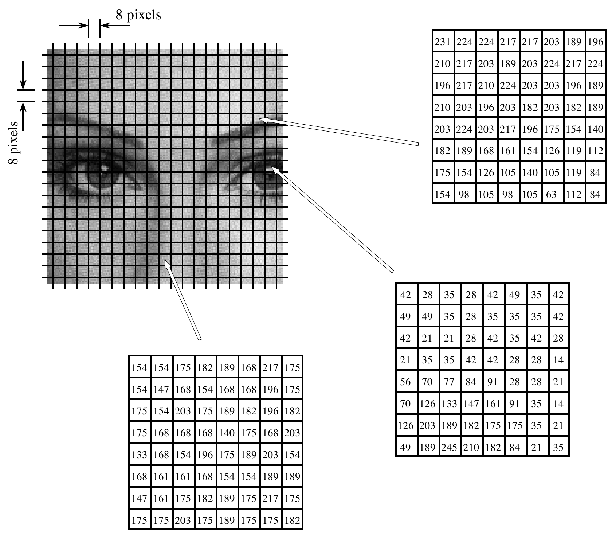

**图 27-9　JPEG 的图像分块。** JPEG 变换压缩先把图像分成 8×8 的块，每块含 64 个像素。图中把其中三个 8×8 块放大显示，给出了各个像素的值，每个值是 0 到 255 之间的单字节值。
（8 pixels = 8 个像素。三个放大的块依次取自眉毛、眼睛和鼻子，即图 27-11 中的 a、b、c。）

变换压缩基于一个简单的前提：信号经过傅里叶（或其他）变换后，得到的各个数据值在承载信息方面不再同等重要。具体地说，信号的低频成分比高频成分更重要。从高频成分中去掉 50% 的位，可能只去掉了比如 5% 的编码信息。

如图 27-9 所示，JPEG 压缩先把图像分成 8×8 的像素块。完整的 JPEG 算法可以接受很宽范围的每像素位数，包括使用彩色信息。本例中，每个像素是一个字节，即 0 到 255 之间的灰度值。这些 8×8 像素块在压缩时是相互独立处理的。也就是说，每块起初用 64 个字节表示；经过变换并去掉一些数据后，每块用比如 2 到 20 个字节表示。解压时，对这 2 到 20 个字节做逆变换，得到原 8×8 块的一个近似。再把这些近似块拼在一起，形成解压后的图像。为什么用 8×8 的像素块，而不用比如 16×16？8×8 的分块是按照制定标准时集成电路技术所能处理的最大尺寸确定的。无论如何，8×8 的尺寸效果很好，将来可能改，也可能不改。

人们研究过许多不同的变换用于数据压缩，其中一些就是专门为此发明的。例如，卡南-洛伊夫变换(Karhunen-Loeve transform)能提供最好的压缩比，但难以实现。傅里叶变换容易使用，但压缩效果不够好。经过一番竞争，胜出的是傅里叶变换的一个亲戚：离散余弦变换(Discrete Cosine Transform, DCT)。

正如傅里叶变换用正弦波和余弦波来表示信号，DCT 只用余弦波。DCT 有几个版本，在数学上略有差别。以其中一个版本为例，设想一个 129 点的信号，从第 0 个采样到第 128 个采样。现在把它变成一个 256 点的信号：复制第 1 到第 127 个采样，把它们作为第 255 到第 130 个采样加上去，即：0, 1, 2, ⋯, 127, 128, 127, ⋯, 2, 1。对这个 256 点的信号做傅里叶变换，得到一个 129 点的频谱，分布在 0 到 128 之间。由于时域信号被强制成对称的，频谱的虚部全为零。换句话说，我们从一个 129 点的时域信号出发，得到一个 129 点的频谱，每个点是一个余弦波的幅度。瞧，这就是 DCT！

> **译注：** 复制的第 1～127 个采样共 127 个，放在新信号里应占第 255 到第 129 个位置，原书写成 "255 to 130" 少算了一个。按书中给出的序列 0, 1, ⋯, 127, 128, 127, ⋯, 1，第 129 个采样就是 127。

对一个 8×8 块做 DCT，得到一个 8×8 的频谱。换句话说，64 个数变成了另外 64 个数。所有这些值都是实数，这里没有复数运算。和傅里叶分析一样，频谱中的每个值是一个基函数(basis function)的幅度。图 27-10 按照幅度在频谱中所处的位置，画出了 8×8 DCT 所用的 64 个基函数中的 6 个。8×8 DCT 的基函数为：

**公式 27-1**　DCT 基函数。变量 x 和 y 是空间域的下标，u 和 v 是频谱的下标。这是 8×8 DCT 的公式，所有下标都从 0 到 7。

$$b[x, y] = \cos\!\left[\frac{(2x+1)u\pi}{16}\right] \cos\!\left[\frac{(2y+1)v\pi}{16}\right]$$

低频位于频谱的左上角，高频位于右下角。直流分量在 [0,0]，即最左上角的值。[0,1] 的基函数在一个方向上是半个周期的余弦波，在另一个方向上是常数。[1,0] 的基函数与之类似，只是旋转了 90°。

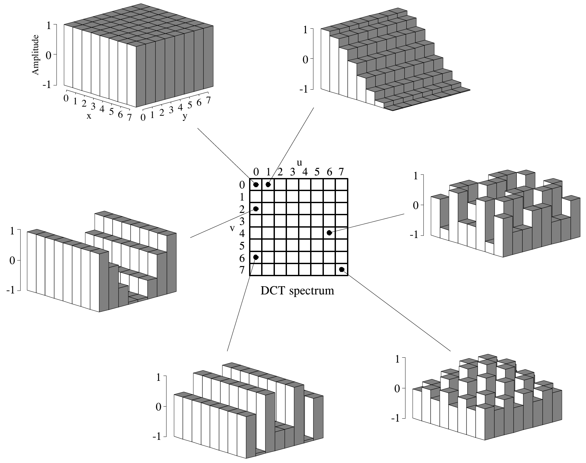

**图 27-10　DCT 的基函数。** DCT 频谱是一个 8×8 的数组，数组中每个元素是 64 个基函数之一的幅度。图中画出了其中 6 个基函数，并标明了对应幅度在频谱中的位置。
（DCT spectrum = DCT 频谱；Amplitude = 幅度；x、y 为空间下标，u、v 为频谱下标。）

DCT 通过把 8×8 像素块与每个基函数做相关来计算频谱。也就是说，每个频谱值的求法是：把相应的基函数与 8×8 像素块逐点相乘，再把乘积加起来。然后还需要两步调整才能完成 DCT 计算（和傅里叶变换一样）。第一，把第 0 行和第 0 列中的 15 个频谱值除以二。第二，把频谱中全部 64 个值除以 16。逆 DCT 的计算方法是：把频谱中每个幅度赋给相应的基函数，再相加，重建空间域。不需要额外步骤。这些和傅里叶分析中的概念完全相同，只是基函数不同。

> **译注：** "第 0 行和第 0 列中的 15 个值除以二"里，左上角的 [0,0] 同时属于第 0 行和第 0 列，要除两次（即除以 4）。按这个规则，我用 Python 对图 27-11a 的眉毛块做了 DCT 并取整，前三行结果与图 27-11d 逐个数字一致（左上角为 174，等于 64 个像素的平均值 174.1）。

图 27-11 演示了对图 27-9 中三个 8×8 块的 JPEG 编码。左栏的 a、b、c 是原始像素值；中栏的 d、e、f 是这些块的 DCT 频谱；右栏的 g、h、i 展示了减少频谱中每个分量所用位数的效果。例如，(g) 的做法是：把 (d) 中的每个采样截断到十位，做逆 DCT，然后从原图中减去重建的图像。同样，(h) 和 (i) 是把频谱中每个采样分别截断到八位和五位得到的。正如预期，用来表示数据的位数越少，重建误差越大。作为这种位截断的例子，中栏的频谱用每个频谱值 8 位表示：直流分量的范围是 0 到 255，其他值的范围是 −127 到 127。

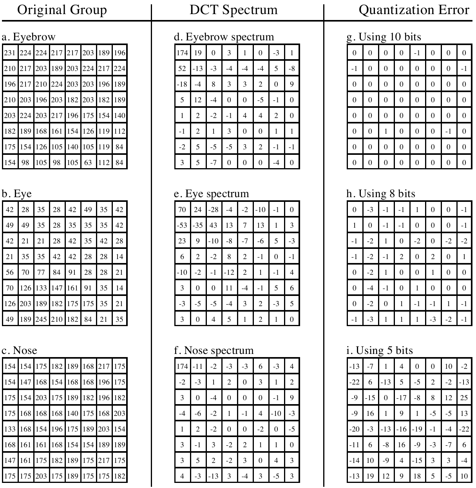

**图 27-11　JPEG 编码的例子。** 左栏是三个 8×8 像素块，就是图 27-9 中的那三个。中栏是这三个块的 DCT 频谱。第三栏是用有限位数表示频谱时，解压后像素值的误差。
（Original Group = 原始块，DCT Spectrum = DCT 频谱，Quantization Error = 量化误差；a. Eyebrow = 眉毛，b. Eye = 眼睛，c. Nose = 鼻子；d～f. … spectrum = …的频谱；g. Using 10 bits = 用 10 位，h. Using 8 bits = 用 8 位，i. Using 5 bits = 用 5 位。）

压缩频域的第二种方法，是丢掉 64 个频谱值中的一部分。从图 27-11 的频谱可以看出，信号几乎全部集中在低频成分中。这意味着可以去掉最高频的那些成分，而信号只会稍有劣化。图 27-12 是删掉不同数量的高频成分时所产生的图像失真的例子。本例所用的 8×8 块是图 27-10 中的眼睛图像。(d) 是用全部 64 个频谱值得到的正确重建，其余各图是只用标明数量的最低频系数得到的重建。如 (c) 所示，即使去掉四分之三的最高频成分，重建的误差也很小。更妙的是，确实出现的那点误差看起来非常像随机噪声。

> **译注：** 这里的"图 27-10 中的眼睛图像"应为图 27-9（图 27-12 的图注也写的是图 27-9）；图 27-10 画的是 DCT 基函数，没有眼睛。

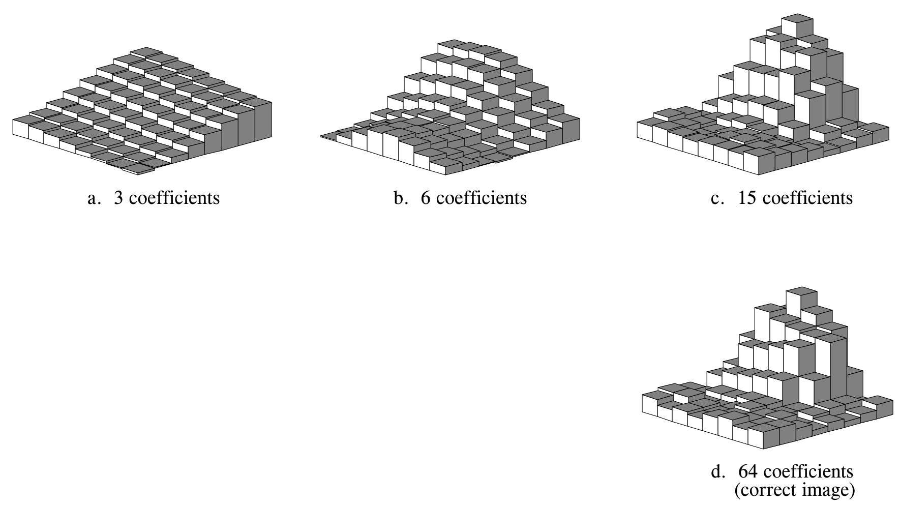

**图 27-12　JPEG 重建的例子。** 本例所用的 8×8 像素块是图 27-9 中的眼睛。如图所示，只需要 64 个值中不到 1/4，就能很好地逼近正确图像。
（a. 3 coefficients = 3 个系数；b. 6 coefficients = 6 个系数；c. 15 coefficients = 15 个系数；d. 64 coefficients (correct image) = 64 个系数（正确图像）。）

JPEG 是把几种数据压缩方案组合起来以获得更好效果的一个好例子。整个 JPEG 流程可以概括为以下几步。第一，把图像分成 8×8 的块。第二，对每块做 DCT。第三，用上述方法压缩每个 8×8 频谱：减少位数，并去掉一部分分量。这一步由一张量化表(quantization table)控制，一步完成。图 27-13 给出了两张量化表的例子。频谱中的每个值除以量化表中对应的值，结果四舍五入到最接近的整数。例如，量化表左上角的值是一，因此直流值保持不变。相比之下，(a) 右下角的条目是 16，意味着原来 −127 到 127 的范围被缩小到只有 −7 到 7。换句话说，这个值的精度从八位降到了四位。更极端的情况是 (b) 右下角的条目为 256，这个频谱值被完全消除了。

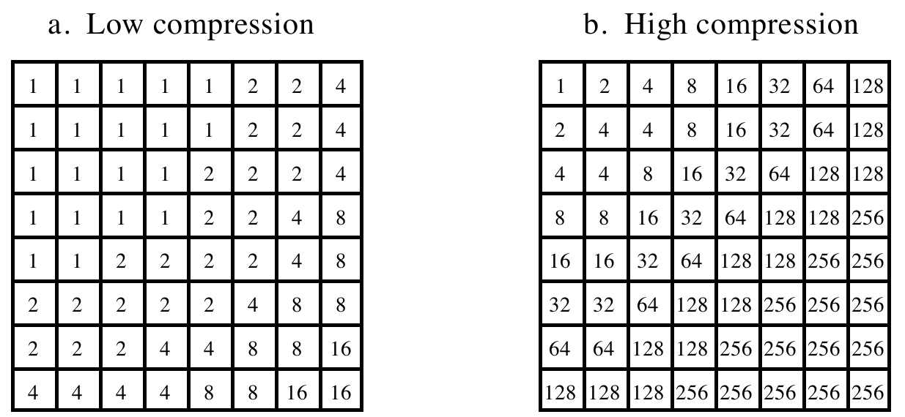

**图 27-13　JPEG 量化表。** 这是压缩时可能用到的两张量化表示例。DCT 频谱中的每个值除以量化表中对应的值，结果四舍五入到最接近的整数。
（a. Low compression = 低压缩率；b. High compression = 高压缩率。）

JPEG 编码的第四步，是把修改后的频谱从 8×8 数组转换成一个线性序列。这一步使用图 27-14 所示的蛇形(serpentine)扫描顺序，把所有高频成分集中放到线性序列的末尾。这样一来，被去掉的分量留下的零就聚成了长串。第五步用游程编码压缩这些成串的零。第六步，用霍夫曼编码或算术编码对序列编码，形成最终的压缩文件。

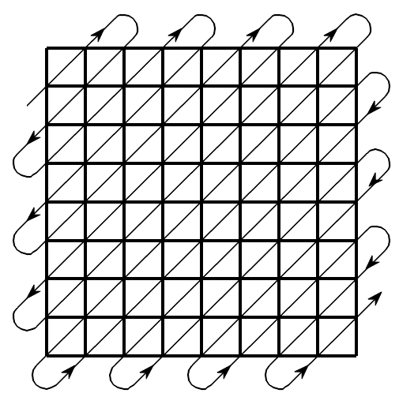

**图 27-14　JPEG 的串行化转换。** 用蛇形顺序把 8×8 的 DCT 频谱转换成 64 个值的线性序列。这样所有高频成分都被放在一起，其中大量的零可以用游程编码高效地压缩。

压缩量以及由此造成的图像质量损失，可以在运行 JPEG 压缩程序时选择。图 27-15 展示了高压缩比造成的那类图像失真。在图中所示的 45:1 压缩比下，每个 8×8 块只用大约 12 位表示。仔细观察这张图可以看出，六个最低频的基函数在一定程度上得到了表示。

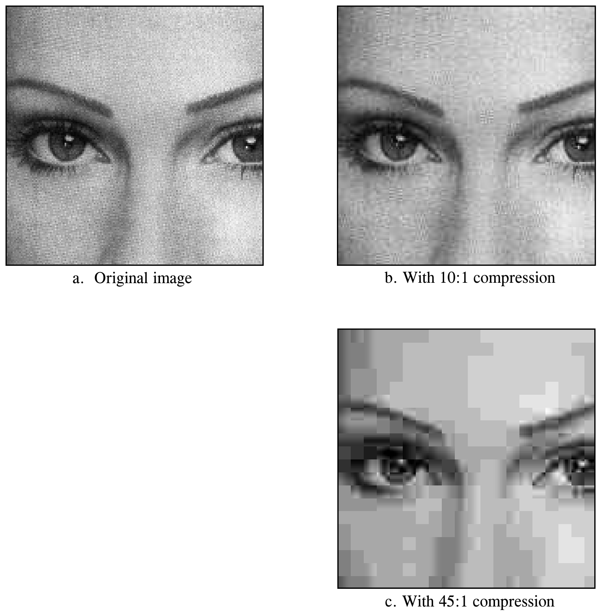

**图 27-15　JPEG 失真的例子。** (a) 是原始图像，(b) 和 (c) 分别是用 10:1 和 45:1 压缩比恢复的图像。(c) 所用的高压缩比使每个 8×8 像素块只用不到 12 位表示。
（a. Original image = 原始图像；b. With 10:1 compression = 10:1 压缩；c. With 45:1 compression = 45:1 压缩。）

为什么在图像压缩上 DCT 比傅里叶变换更好？主要原因是 DCT 有半个周期的基函数，即 S[0,1] 和 S[1,0]。如图 27-10 所示，它们从数组的一侧平缓地倾斜到另一侧。相比之下，傅里叶变换中最低的频率要形成一个完整的周期。图像中几乎总有亮度在一片区域内逐渐变化的地方。使用与这种基本模式相匹配的基函数，可以得到更好的压缩效果。

## MPEG

MPEG 是一个用于数字视频序列的压缩标准，比如用在计算机视频和数字电视网络中。此外，MPEG 还提供对视频所配音轨的压缩。这个名字来自它的发起组织：运动图像专家组(Moving Pictures Experts Group)。如果你觉得 JPEG 复杂，那 MPEG 简直是噩梦！MPEG 是拿钱买来用的东西，别想着自己去写。这项技术的未来，是把压缩和解压算法直接做进集成电路。MPEG 的潜力巨大。想象一下：一根接到你家的光纤里承载着成千上万个视频频道。这是 21 世纪的一项关键技术。

除了降低数据率，MPEG 还有几个重要特性。影片可以正向或反向播放，可以按正常速度或快速播放。编码后的信息是随机访问的，也就是说，序列中任何一帧都可以方便地作为静止图像显示出来。与此相应，影片是可编辑的，意思是影片中的短片段可以只参照自身来编码，而不必参照整个序列。MPEG 被设计成能抵抗差错，你最不希望看到的就是一个比特的错误打断了整部影片。

MPEG 使用的方法可以分成两种压缩：帧内(within-the-frame)压缩和帧间(between-frame)压缩。帧内压缩是指把构成视频序列的各个帧当作普通的静止图像来编码。这种压缩使用 JPEG 标准，只有少量改动。在 MPEG 术语中，以这种方式编码的帧叫做帧内编码图像(intra-coded picture)，或 I 帧(I-picture)。

视频序列中的大多数像素从一帧到下一帧变化很小。除非摄像机在移动，图像的大部分是在几十帧内保持不变的背景。MPEG 利用这一点，用一种复杂形式的差分编码来压缩帧与帧之间的冗余信息。把其中一帧压缩成 I 帧之后，MPEG 把后续各帧编码成预测编码图像(predictive-coded picture)，即 P 帧(P-picture)。也就是说，P 帧中只包含自 I 帧以来发生了变化的像素。

这两种压缩方案构成了 MPEG 的主干，但实际实现远比这里描述的复杂得多。例如，P 帧可以参照一个经过平移的 I 帧，以反映图像序列中物体的运动。还有双向预测编码图像(bidirectional predictive-coded picture)，即 B 帧(B-picture)，它们同时参照之前和之后的 I 帧。这用来处理图像中在许多帧内逐渐变化的区域。各帧在压缩数据中还可以不按顺序存放，以便于 I、P、B 帧的正确排序。再加上彩色和声音，这一切就更复杂了。

MPEG 的主要失真发生在图像的大片区域快速变化时。实际上，为了跟上快速变化的场景，需要一阵突发的大量信息。如果数据率是固定的，观众从一个场景切换到下一个场景时会看到"块状"图案。在同时传输多个视频频道的网络中，比如有线电视，这种情况可以减轻：一个视频频道中快速变化场景所需的突发信息，与其他频道中相对静止的场景所需的少量信息平均掉了。
