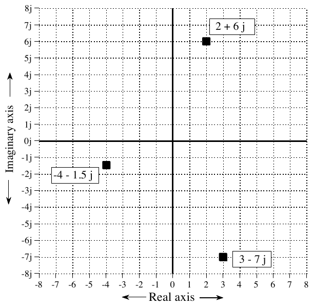
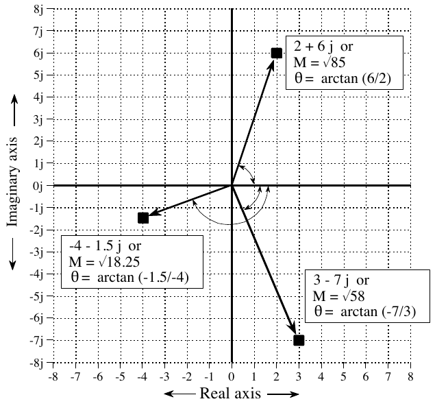
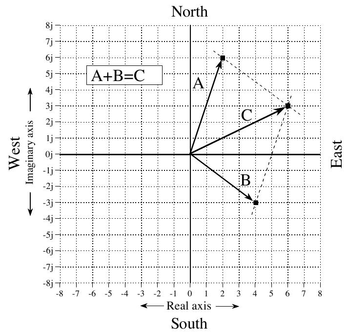
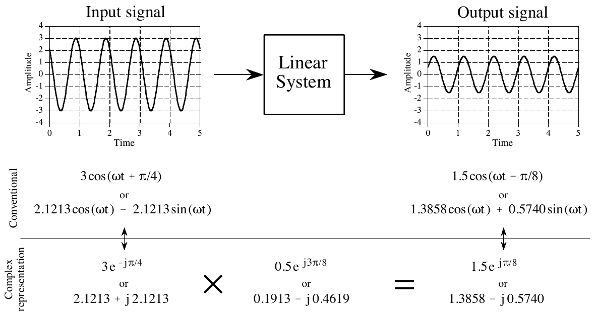
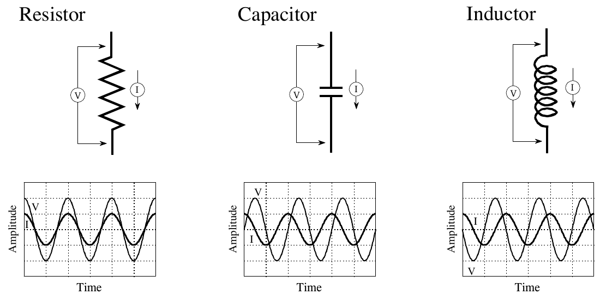
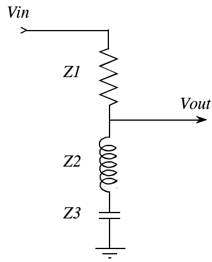
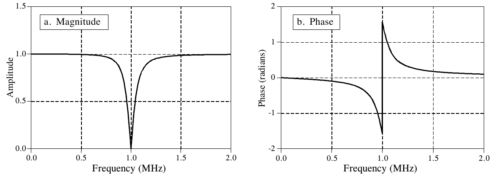

# 《The Scientist and Engineer's Guide to Digital Signal Processing》第 30 章中译

> 原书：上一级目录 `Documents/数学基础/` 下的 `The Scientist and Engineer Guide to Digital Signal Processing.pdf`，对应 PDF 第 562～577 页（原书第 551～566 页）。
> 上一章：[29-DSP指南-第29章中译.md](29-DSP指南-第29章中译.md)。专业名词第一次出现时在括号里附上英文。
> 插图从原书页面裁出，放在 `assets/ch30/`，图里的英文标注在每张图下方给出对照。原书 PDF 的符号字体抽取时会乱码（√ 显示成 %、θ 显示成 2、ω 显示成 T、φ 显示成 N、π 显示成 B、共轭星号显示成 t），公式按原书版面重新用 LaTeX 写出。本章没有 BASIC 程序。

---

# 第 30 章　复数

复数(complex numbers)是日常数学中普通数的一种扩展。它们有一个独特的性质：能把两个变量当作一个量来表示和处理。这和傅里叶分析非常契合，因为频域正是由两个信号组成的：实部和虚部。复数能缩短 DSP 中的公式，还能实现单靠实数很难甚至无法实现的技术。例如，快速傅里叶变换就是建立在复数之上的。遗憾的是，复数技术非常数学化，要有效使用它们，需要大量的学习和练习。许多科学家和工程师把复数技术看作一条分界线：线这边是把 DSP 当工具用，线那边是把 DSP 当职业做。本章介绍复数的数学，以及在科学和工程中使用复数的基本方法。接下来的三章讨论建立在复数之上的重要技术：复傅里叶变换、拉普拉斯变换和 z 变换。这些复数变换是理论 DSP 的核心。做好准备，数学来了！

## 复数系统

为了说明复数，设想一个孩子把球抛向空中。假设球竖直向上抛出，初速度为每秒 9.8 米。离开孩子的手一秒后，球到达 4.9 米高，重力加速度（9.8 米每二次方秒）已经把它的速度减到零。然后球加速落向地面，在抛出两秒后被孩子接住。根据基本的物理公式，球在任一时刻的高度是：

$$h = \frac{-g\,t^2}{2} + v\,t$$

其中 h 是离地面的高度（米），g 是重力加速度（9.8 米每二次方秒），v 是初速度（每秒 9.8 米），t 是时间（秒）。

现在假设我们想知道球什么时候经过某个高度。代入已知值并解出 t：

$$t = 1 \pm \sqrt{1 - h/4.9}$$

例如，球有两次处在 3 米高：$t = 0.38$（上升时）和 $t = 1.62$ 秒（下落时）。

只要问的问题合理，这些公式就给出合理的答案。可是如果问不合理的问题会怎样？例如：球什么时候到达 10 米高？这个问题在现实中没有答案，因为球永远到不了这个高度。然而，把 $h = 10$ 代入上式，会得到两个答案：$t = 1 + \sqrt{-1.041}$ 和 $t = 1 - \sqrt{-1.041}$。两个答案都含有负数的平方根，这在我们所知的世界里并不存在。多项式方程的这种奇特性质，最早由意大利数学家吉罗拉莫·卡尔达诺(Girolamo Cardano，1501-1576)使用。两个世纪后，伟大的德国数学家卡尔·弗里德里希·高斯(Carl Friedrich Gauss，1777-1855)创造了"复数"这个术语，为现代对这一领域的理解铺平了道路。

每个复数都是两个分量之和：实部(real part)和虚部(imaginary part)。实部是一个实数，也就是我们小时候学的普通数。虚部是一个虚数(imaginary number)，即负数的平方根。为了统一，虚部通常化成一个普通数乘以负一的平方根。例如，复数 $t = 1 + \sqrt{-1.041}$ 先化成 $t = 1 + \sqrt{1.041}\,\sqrt{-1}$，再化成最终形式 $t = 1 + 1.02\sqrt{-1}$。这个复数的实部是 1，虚部是 $1.02\sqrt{-1}$。这种记法让抽象的 $\sqrt{-1}$ 可以用一个专门的符号表示。数学家一直用 i 表示 $\sqrt{-1}$。相比之下，电气工程师用符号 j，因为 i 被用来表示电流。两种符号在 DSP 中都很常见。本书采用电气工程的惯例，用 j。

例如，下面这些都是合法的复数：$1+2j$、$1-2j$、$-1+2j$、$3.14159+2.7183j$、$(4/3)+(19/2)j$ 等等。所有普通数，比如 2、6.34 和 −1.414，都可以看作虚部为零的复数，即 $2+0j$、$6.34+0j$ 和 $-1.414+0j$。

就像实数用数轴上的位置来描述一样，复数用一个叫复平面(complex plane)的二维图上的位置来表示。如图 30-1 所示，复平面的横轴是复数的实部，纵轴是虚部。由于实数就是虚部为零的复数，实数轴和复平面的 x 轴是同一条线。

**图 30-1　复平面。** 每个复数在复平面上都有唯一的位置，如图中三个例子所示。横轴表示实部，纵轴表示虚部。
（Real axis = 实轴，Imaginary axis = 虚轴。）

在数学公式里，一个复数用单个变量表示，尽管它由两部分组成。例如，图 30-1 中的三个复数变量可以写成：

$$A = 2 + 6j \qquad B = -4 - 1.5j \qquad C = 3 - 7j$$

其中 A、B、C 是复数变量。这体现了使用复数的一个很大的优点，也体现了一个很大的缺点。优点是用一个符号表示两样东西，天生简洁。缺点是你得记住哪些变量是复数、哪些是普通数。

把复数拆成实部和虚部的数学记法，用的是运算符 Re( ) 和 Im( )。例如，对上面几个复数：

| 实部 | 虚部 |
|---|---|
| Re A = 2 | Im A = 6 |
| Re B = −4 | Im B = −1.5 |
| Re C = 3 | Im C = −7 |

注意，运算符 Im( ) 返回的值不带 j。例如，$\mathrm{Im}(3+4j)$ 等于 4，而不是 4j。

复数遵循和普通数一样的代数规则，只要把 j 当作一个常数。例如，加、减、乘、除分别是：

**公式 30-1**　复数的加法。

$$(a+bj) + (c+dj) = (a+c) + j(b+d)$$

**公式 30-2**　复数的减法。

$$(a+bj) - (c+dj) = (a-c) + j(b-d)$$

**公式 30-3**　复数的乘法。

$$(a+bj)(c+dj) = (ac-bd) + j(bc+ad)$$

**公式 30-4**　复数的除法。

$$\frac{a+bj}{c+dj} = \frac{ac+bd}{c^2+d^2} + j\,\frac{bc-ad}{c^2+d^2}$$

处理这类公式时要用到两个技巧。第一，凡是遇到 $j^2$ 项，就把它换成 −1。这由 j 的定义直接得出：$j^2 = (\sqrt{-1})^2 = -1$。第二个技巧用来消去分母中的 j。例如，公式 30-4 左边的分母是 $c+dj$。处理办法是分子分母同乘 $c-jd$，从而把分母里的虚数项全部消掉。用行话说，把复数虚部的符号反过来，叫做取共轭复数(complex conjugate)，记法是在变量右上角加一个星号。例如，若 $Z = a+bj$，则 $Z^* = a-bj$。换句话说，公式 30-4 就是把分子和分母都乘以分母的共轭复数推导出来的。

即使变量 A、B、C 是复数，下面这些性质也成立。把每个变量拆成实部和虚部，算一遍代数就能证明。

**公式 30-5**　交换律。

$$AB = BA$$

**公式 30-6**　结合律。

$$(A+B)+C = A+(B+C)$$

**公式 30-7**　分配律。

$$A(B+C) = AB + AC$$

## 极坐标表示法

除了刚才讲的直角坐标表示法(rectangular notation)，复数也可以用极坐标表示法(polar notation)表示。例如，图 30-2 用极坐标形式画出了三个复数，就是前面图 30-1 中的那三个。幅度(magnitude)是从原点出发、到复数点结束的向量的长度，相位角(phase angle)是这个向量与 x 轴正方向之间的夹角。复数可以用下面的公式在直角坐标和极坐标之间转换（注意第 8 章讨论过的极坐标的那些麻烦事）：

**公式 30-8**　直角坐标到极坐标的转换。复数变量 A 可以从直角坐标形式 Re A 与 Im A，换成极坐标形式 M 与 θ。

$$M = \sqrt{(\mathrm{Re}\,A)^2 + (\mathrm{Im}\,A)^2} \qquad \theta = \arctan\left[\frac{\mathrm{Im}\,A}{\mathrm{Re}\,A}\right]$$

**公式 30-9**　极坐标到直角坐标的转换。把复数从 M 与 θ 换成 Re A 与 Im A。

$$\mathrm{Re}\,A = M\cos(\theta) \qquad \mathrm{Im}\,A = M\sin(\theta)$$

**图 30-2　极坐标形式的复数。** 复平面上的三个示例点用极坐标表示。图 30-1 用直角坐标形式画出了同样这几个点。
（Real axis = 实轴，Imaginary axis = 虚轴；每个方框写的是"直角坐标形式 or 幅度 M = …、相位 θ = …"，or = 或。）

> **译注：** 图中 2 + 6j 的幅度标成 M = √85，应为 √(2² + 6²) = √40。另外两个点的 √18.25 和 √58 是对的。

这带来了数学上的一次巨大飞跃。（没错，这意味着你要格外留心。）用直角坐标表示的复数形如 $a+bj$。信息装在变量 a 和 b 里，但真正的复数是整个表达式 $a+bj$。在极坐标形式中，关键信息装在 M 和 θ 里，那么真正的复数的完整表达式是什么？

关键在公式 30-9，即极坐标到直角坐标的转换。从真正的复数 $a+bj$ 出发，套用公式 30-9，得到：

**公式 30-10**　直角坐标形式与极坐标形式的复数。左边是复数的直角坐标形式，右边是极坐标表示。M、θ 与 a、b 之间的换算由公式 30-8 和 30-9 给出。

$$a + jb = M\,(\cos\theta + j\sin\theta)$$

左边的表达式是复数正规的直角坐标描述，右边的表达式是正规的极坐标描述。

在继续下一步之前，先回顾一下我们是怎么走到这一步的。第一，我们给复数的直角坐标形式一个图形表示，也就是二维平面上的一个位置。第二，我们定义 M 和 θ 这两个量，使它们和我们以前对极坐标与直角坐标之间关系的认识保持一致（公式 30-8 和 30-9）。第三，我们顺着这些做法的数学推论往下走，得出复数正确的极坐标形式必须是 $M(\cos\theta + j\sin\theta)$。这个逻辑虽然直截了当，但结果很难凭"直觉"看出来。不幸的是，情况还会更糟。

复数数学中最重要的公式之一是欧拉关系(Euler's relation)，以聪明而又极为多产的瑞士数学家莱昂哈德·欧拉(Leonhard Euler，1707-1783；Euler 读作"Oiler"）命名：

**公式 30-11**　欧拉关系。这是在科学和工程中使用复数的关键公式。

$$e^{jx} = \cos x + j\sin x$$

如果你喜欢这类东西，可以把指数项展开成泰勒级数(Taylor series)来证明这个关系：

$$e^{jx} = \sum_{n=0}^{\infty}\frac{(jx)^n}{n!} = \left[\sum_{k=0}^{\infty}(-1)^k\,\frac{x^{2k}}{(2k)!}\right] + j\left[\sum_{k=0}^{\infty}(-1)^k\,\frac{x^{2k+1}}{(2k+1)!}\right]$$

右边方括号里的两项，分别是 cos(x) 和 sin(x) 的泰勒级数。别在这个证明上花太多时间，我们不会拿它做任何事。

用欧拉关系改写公式 30-10，就得到极坐标表示复数最常见的方式，即复指数(complex exponential)：

**公式 30-12**　复数的指数形式。左边的直角坐标形式等于右边的指数极坐标形式。

$$a + jb = M\,e^{j\theta}$$

这种指数形式的复数是 DSP 数学的支柱。理解它的第一步是把公式 30-8 到 30-12 背下来。使用指数极坐标形式的一大好处是复数的乘除非常简单：

**公式 30-13**　复数的乘法。

$$M_1 e^{j\theta_1}\; M_2 e^{j\theta_2} = M_1 M_2\, e^{j(\theta_1+\theta_2)}$$

**公式 30-14**　复数的除法。

$$\frac{M_1 e^{j\theta_1}}{M_2 e^{j\theta_2}} = \frac{M_1}{M_2}\, e^{j(\theta_1-\theta_2)}$$

也就是说，极坐标形式的复数相乘，就是幅度相乘、角度相加。在极坐标形式下做加减，最简单的办法是先把数换成直角坐标形式，做完运算再换回极坐标。在计算机程序里，复数通常用直角坐标形式表示；而在书写和推导公式时，通常用极坐标形式。正如 Re( ) 和 Im( ) 用来从复数中取出直角坐标分量，运算符 Mag( ) 和 Phase( ) 用来取出极坐标分量。例如，若 $A = 5e^{j\pi/7}$，则 $\mathrm{Mag}(A) = 5$，$\mathrm{Phase}(A) = \pi/7$。

## 用代换法使用复数

总结一下我们走到了哪里。常见代数方程的解中常常含有负数的平方根。这些叫做复数，代表在我们所知的世界中不可能存在的解。复数用两种形式之一表示：$a+bj$（直角坐标）或 $Me^{j\theta}$（极坐标），其中 j 是表示 $\sqrt{-1}$ 的符号。无论用哪种记法，一个复数都包含两条独立的信息：要么是 a 和 b，要么是 M 和 θ。尽管复数难以捉摸，它们遵循的数学规律和普通数的规律相似（或相同）。

以上说的是复数是什么、它们在纯数学世界中处于什么位置。接下来的任务，是讲它们在科学和工程问题中怎样派上用场。一种和日常经验毫无关联的数学，怎么可能用得上？答案是：手里拿着锤子，就把问题弄成钉子的样子。换句话说，我们把物理问题变成复数形式，处理这些复数，然后再变回物理上的答案。

用复数表示物理问题有两种方式：简单的代换法(substitution)，以及一种更优雅的方法，我们称之为数学等价(mathematical equivalence)。数学等价会在下一章复傅里叶变换中讨论。本章余下的部分专讲代换法。

代换法取两个实的物理参数，一个放进复数的实部，一个放进虚部。这样两个值就能作为一个整体，即一个复数，来处理。完成所需的数学运算后，再把复数拆成实部和虚部，它们又对应回我们关心的物理参数。

一个简单的例子就能说明它怎么用。你可能还记得基础物理里讲过，向量可以表示力、速度、加速度等。例如，设想一艘帆船，被风推向一个方向，又被洋流推向另一个方向。船受到的合力就是这两个力向量的向量和。图 30-3 画出了这个例子：两个向量 A 和 B 按平行四边形法则相加，得到 C。

**图 30-3　用复数做向量加法。** 向量 A 和 B 表示按南北和东西方向测量的力。东西方向用复数的实部代替，南北方向用复数的虚部代替。这种代换让复数数学能用于一个完全是实数的问题。
（North = 北，South = 南，East = 东，West = 西；Real axis = 实轴，Imaginary axis = 虚轴。）

我们可以这样用复数表示这个问题：把东西方向的坐标放进复数的实部，南北方向的坐标放进虚部。这样，每个向量虽然由两部分组成，却能当作一个复数来处理。例如，风力向量 A 的方向可能是向东 2 份、向北 6 份，表示成复数 $2+6j$。同样，洋流的力向量 B 的方向可能是向东 4 份、向南 3 份，表示成复数 $4-3j$。这两个向量可以用公式 30-1 相加，得到表示向量 C 的复数 $6+3j$。换回物理意义，帆船受到的合力方向是向东 6 份、向北 3 份。

> **译注：** 原文这里写成"向北 6 份、向东 3 份"，把方向说反了。$6+3j$ 的实部 6 对应东西方向，虚部 3 对应南北方向，图 30-3 中 C 也指向 (6, 3)，译文已按正确方向译出。

不用复数能解这个问题吗？当然能！复数只是提供了一种形式化的办法，来记录构成一个向量的两个分量。要记住的思想是：有些物理问题只要给其中一个分量加上 j，就能转换成复数形式；转换回物理问题，也不过是去掉 j。这就是代换法的精髓。

问题在于：我们怎么知道适用于复数数学的规则和定律，同样适用于原来的物理问题？例如，我们用公式 30-1 把帆船问题中的力向量相加。我们怎么知道复数加法给出的结果与力向量相加的结果相同？在大多数情况下，我们知道复数数学能用于某个应用，是因为别人说可以。某位杰出而受人尊敬的数学家或工程师把细节推导清楚并发表了结果。要记住的一点是：我们不能把随便什么问题代换成复数形式，就指望答案有意义。我们必须只用于那些已经证明适合复数分析的应用。

来看一个复数代换不管用的例子。设想你买苹果每箱 5 美元，买橘子每箱 10 美元，你用复数 $5+10j$ 来表示。某一周你买了 6 箱苹果和 2 箱橘子，用复数 $6+2j$ 表示。你要付的总价等于数量乘以单价，即 $(5+10j)(6+2j) = 10+70j$。也就是说，复数运算告诉你，苹果要付 10 美元，橘子要付 70 美元。问题是，这个答案完全错了！复数数学的规则并不符合这个具体物理问题的规则。

## 正弦波的复数表示

复数之所以在电子学和信号处理中占有一席之地，是因为它们能紧凑地表示和处理所有波形中最有用的一种：正弦波和余弦波。表示正弦波的传统方式是 $M\cos(\omega t + \phi)$ 或 $A\cos(\omega t) + B\sin(\omega t)$，分别是极坐标和直角坐标的写法。注意我们用 ω 表示频率，即以弧度每秒为单位的自然频率(natural frequency)。如果你觉得更习惯，可以把每个 ω 换成 2πf，让表达式以赫兹为单位。不过，大多数 DSP 数学都用较短的记法，你应该熟悉它。既然表示一个正弦波需要两个参数（A 和 B，或 M 和 φ），用复数来表示这些重要的波形就再自然不过了。用代换法，从传统的正弦波表示换成复数非常直接。直角坐标形式是：

$$\underbrace{A\cos(\omega t) + B\sin(\omega t)}_{\text{传统表示}} \;\Longleftrightarrow\; \underbrace{a + jb}_{\text{复数}}$$

其中 $A \Leftrightarrow a$，$B \Leftrightarrow -b$。用文字说，余弦波的幅度成为复数的实部，而正弦波幅度的相反数成为虚部。重要的是要明白，这不是一个等式，只是让一个复数去代表一个正弦波的一种方式。这种代换也可以用于极坐标形式：

$$\underbrace{M\cos(\omega t + \phi)}_{\text{传统表示}} \;\Longleftrightarrow\; \underbrace{M e^{j\theta}}_{\text{复数}}$$

其中 $M \Leftrightarrow M$，$\theta \Leftrightarrow -\phi$。用文字说，极坐标形式的代换保持幅度不变，但把相位角的符号反过来。

为什么要反转虚部和相位角的符号？这是为了让代换的形式与下一章讲的复傅里叶变换保持一致。本章的代换技术并不从这个符号反转中得到任何好处，但几乎总是这么做，以便和更高级的方法保持一致。

> **译注：** 这两条代换规则其实互相矛盾。由 $M\cos(\omega t+\phi) = M\cos\phi\cos(\omega t) - M\sin\phi\sin(\omega t)$ 可得 $A = M\cos\phi$、$B = -M\sin\phi$；按直角坐标规则 $b = -B = M\sin\phi$，于是 $a+jb = Me^{+j\phi}$，对应的是 $\theta = +\phi$，而不是原书说的 $\theta = -\phi$。按原书的两条规则，同一个正弦波的直角坐标形式和极坐标形式会互为共轭复数，图 30-4 正是这种情况（见该图下的译注）。只要始终只用其中一种形式计算，结论不受影响。

用复数表示正弦和余弦波，是电路分析和 DSP 中的常用技术。这是因为支配复数的许多（但不是全部）规则和定律，与支配正弦波的规则和定律相同。换句话说，我们可以用复数表示正弦和余弦波，以各种方式处理这些数，得到的答案和正弦波的实际行为相符。

不过，我们必须小心，只能使用能模仿所表示的物理问题（这里是正弦波）的数学运算。例如，假设用复数变量 A 和 B 表示两个频率相同、但幅度和相移不同的正弦波。两个复数相加，得到第三个复数。同样，两个正弦波相加，得到第三个正弦波。正如你所希望的，第三个复数就代表第三个正弦波。复数加法与物理系统相符。

现在设想把复数 A 和 B 相乘，得到另一个复数。这和两个正弦波相乘的结果相符吗？不！两个正弦波相乘得到的不是另一个正弦波。复数乘法与物理系统不符，因此不能用。

好在哪些运算有效是有明确界定的，必须满足两个条件。第一，所有正弦波必须是同一频率。例如，如果复数 $1+1j$ 和 $2+2j$ 代表同一频率的正弦波，那么两个正弦波之和就由复数 $3+3j$ 表示。但如果 $1+1j$ 和 $2+2j$ 代表不同频率的正弦波，复数表示就无能为力了。这时复数之和 $3+3j$ 毫无意义。

尽管如此，使用复数时可以把频率留作变量，只是它必须处处相同。例如，把 $2\omega + 3\omega j$ 和 $3\omega + 1j$ 相加，得到 $5\omega + (3\omega + 1)j$，这完全合法。它们代表幅度和相位随频率变化的正弦波。我们虽然不知道具体的频率是多少，但知道它处处相同，都是 ω。

第二个条件是，所表示的运算必须是线性的，如第 5 章讨论过的那样。例如，正弦波可以通过加法和减法组合，但不能通过乘法或除法组合。同样，系统可以是放大器、衰减器、高通或低通滤波器等，但不能是平方、削波(clipping)和阈值化(thresholding)这类操作。记住，就连卷积和傅里叶分析也只对线性系统有效。

## 系统的复数表示

图 30-4 是一个用复数表示正弦波通过线性系统的例子。这个例子用连续信号，离散信号的处理方式完全相同。由于输入信号是正弦波，系统又是线性的，输出也会是正弦波，而且频率与输入相同。如图所示，示例输入信号的传统表示是 $3\cos(\omega t + \pi/4)$，或等价的表达式 $2.1213\cos(\omega t) - 2.1213\sin(\omega t)$。用复数表示，就是 $3e^{-j\pi/4}$ 或 $2.1213 + j2.1213$。同样，输出的传统表示是 $1.5\cos(\omega t - \pi/8)$，或另一种形式 $1.3858\cos(\omega t) + 0.5740\sin(\omega t)$。用复数表示就是 $1.5e^{j\pi/8}$ 或 $1.3858 - j0.5740$。

**图 30-4　用复数表示的正弦波。** 复数在 DSP 和电子学中很受欢迎，因为它们是表示和处理正弦波的一种便利方式。如本例所示，正弦输入和输出信号可以表示成复数，既可以用极坐标形式，也可以用直角坐标形式。此外，线性系统对正弦波造成的改变也可以用一个复数表示。
（Input signal = 输入信号，Output signal = 输出信号，Linear System = 线性系统，Amplitude = 幅度，Time = 时间；Conventional = 传统表示，Complex representation = 复数表示，or = 或。）

> **译注：** 图中每一列的极坐标形式和直角坐标形式并不相等，而是互为共轭复数：$3e^{-j\pi/4} = 2.1213 - j2.1213$（图中写 $+j$），$0.5e^{j3\pi/8} = 0.1913 + j0.4619$（图中写 $-j$），$1.5e^{j\pi/8} = 1.3858 + j0.5740$（图中写 $-j$）。原因见上一节的译注：原书的直角坐标规则与极坐标规则差一个符号。不过，三个极坐标形式之间、三个直角坐标形式之间各自是自洽的：$3e^{-j\pi/4} \times 0.5e^{j3\pi/8} = 1.5e^{j\pi/8}$，$(2.1213+j2.1213)(0.1913-j0.4619) = 1.3858 - j0.5740$（已数值验算）。所以"输入乘以系统等于输出"这个结论无论用哪一种形式都成立。

系统的特性也可以用一个复数表示。这个复数的幅度是输出与输入幅度之比（即 $M_{out}/M_{in}$）。同样，这个复数的角度是输出与输入角度之差的相反数（即 $-[\phi_{out} - \phi_{in}]$）。在这里用的例子中，系统用复数 $0.5e^{j3\pi/8}$ 描述。换句话说，正弦波的幅度被乘以 0.5，相位角改变了 $-3\pi/8$。

表示系统的复数可以换成直角坐标形式 $0.1913 - j0.4619$，但对它的含义必须小心解读。它并不表示正弦波通过系统后幅度变为 0.1913 倍，也不表示余弦波变为 −0.4619 倍。一般来说，纯正弦波或纯余弦波进入线性系统后，会变成正弦波和余弦波的混合。

好在复数数学会自动处理这些交叉项。正弦波通过线性系统时，把表示输入信号的复数和表示系统的复数相乘，就得到表示输出的复数。三个复数中只要知道任意两个，就能求出第三个。如图 30-4 所示，计算既可以用极坐标形式，也可以用直角坐标形式。

在前面的章节中，我们讲过傅里叶变换怎样把信号分解成余弦波和正弦波。余弦波的幅度叫实部，正弦波的幅度叫虚部。我们强调过，这些幅度都是普通数，"实"和"虚"只是用来把两者区分开的名字。现在引入了复数，这两个名字从哪儿来就很明显了。例如，设想把一个 1024 点信号分解成 513 个余弦波和 513 个正弦波。用代换法，可以用 513 个复数来表示这个频谱。不过，别误以为这就是第 31 章的主题复傅里叶变换。这仍然是实傅里叶变换，只是用代换法把频谱放进了复数格式而已。

## 电路分析

这种用复数代换余弦和正弦波的方法叫相量变换(phasor transform)。它是分析由电阻、电容和电感组成的网络的主要工具。[更正式地说，电气工程师把相量变换定义为乘以复数项 $e^{j\omega t}$ 再取实部。这样整个过程就能写成一个公式，在数学推导中更便于处理。"代换"能达到同样的结果，只是没那么优雅。]

第一步是弄清每种器件的电流和电压之间的关系。对电阻来说，这由欧姆定律(Ohm's law)表示：$v = iR$，其中 i 是流过器件的瞬时电流，v 是器件两端的瞬时电压，R 是电阻。相比之下，电容和电感由微分方程支配：$i = C\,dv/dt$ 和 $v = L\,di/dt$，其中 C 是电容，L 是电感。在最一般的电路分析方法中，要按电路的连接方式把这些讨厌的微分方程组合起来，再解出关心的参数。这样做能回答关于电路的一切问题，但数学会变得一团糟。

如果把信号限制为正弦波，就能大大简化。用复数表示这些正弦波，难缠的微分方程就能直接换成简单得多的代数方程。图 30-5 说明了这是怎么做到的。我们把这三种元件（电阻、电容和电感）各自看作一个系统。系统的输入是流过器件的正弦电流，输出是器件两端的正弦电压。这意味着可以用两个复数变量分别表示系统的输入和输出：I（电流）和 V（电压）。输入与输出之间的关系也可以用一个复数表示。这个复数叫做阻抗(impedance)，用符号 Z 表示。也就是：

$$I \times Z = V$$

**图 30-5　阻抗的定义。** 用复数表示正弦电压和电流时，两者之比叫做阻抗，用复数变量 Z 表示。电阻、电容和电感的阻抗分别是 R、$-j/\omega C$ 和 $j\omega L$。
（Resistor = 电阻，Capacitor = 电容，Inductor = 电感；V = 电压，I = 电流；Amplitude = 幅度，Time = 时间。）

用文字说，表示正弦电压的复数，等于表示正弦电流的复数乘以阻抗（另一个复数）。三者知道任意两个，就能求出第三个。在极坐标形式中，阻抗的幅度是 V 与 I 的幅度之比；同样，阻抗的相位是 V 与 I 的相位差。

这个关系可以看作正弦波的欧姆定律。欧姆定律（$v = iR$）描述电阻怎样把电阻器中的瞬时电流和电压联系起来。当信号是用复数表示的正弦波时，这个关系变成 $V = IZ$，即阻抗把电流和电压联系起来。电阻是一个普通数，因为它联系的是两个普通数。阻抗是一个复数，因为它联系的是两个复数。阻抗比电阻包含更多信息，因为它同时决定幅度和相位角。

从支配它们工作的微分方程可以证明，电阻、电容和电感的阻抗分别是 R、$-j/\omega C$ 和 $j\omega L$。举个例子，设想这三种元件中的电流都是单位幅度的余弦波，如图 30-5 所示。用代换法，它表示为复数 $1+0j$。电阻两端的电压是 $V = IZ = (1+0j)R = R+0j$，也就是幅度为 R 的余弦波。电容两端的电压是 $V = IZ = (1+0j)(-j/\omega C)$，化简为 $0 - j/\omega C$，是幅度为 $1/\omega C$ 的正弦波。同样，电感两端的电压可以算出：$V = IZ = (1+0j)(j\omega L)$，化简为 $0 + j\omega L$，是幅度为 $\omega L$ 的负正弦波。

这种方法的妙处在于，分析 RLC 电路时不必求助于微分方程。电阻、电容和电感的阻抗，可以和直流电路中的电阻一样处理。这包括所有基本的组合，比如电阻串联、电阻并联、分压器等等。

例如，图 30-6 是一个叫陷波滤波器(notch filter)的 RLC 电路，用来去掉一个很窄的频带。比如，它可以消除音频或仪器信号中的 60 赫兹干扰。如果这个电路由三个电阻组成（而不是电阻、电容和电感），输入与输出信号之间的关系就由分压公式给出：$v_{out}/v_{in} = (R_2+R_3)/(R_1+R_2+R_3)$。由于电路中含有电容和电感，这个式子改写成用阻抗表示：

**图 30-6　RLC 陷波滤波器。** 这个电路从信号中去掉一个很窄的频带。用复数代换能大大简化这类电路的分析。
（Vin = 输入电压，Vout = 输出电压；Z1、Z2、Z3 分别是电阻、电感、电容的阻抗。）

$$\frac{V_{out}}{V_{in}} = \frac{Z_2 + Z_3}{Z_1 + Z_2 + Z_3}$$

其中 $V_{out}$、$V_{in}$、$Z_1$、$Z_2$、$Z_3$ 都是复数变量。代入每个元件的阻抗：

$$\frac{V_{out}}{V_{in}} = \frac{j\omega L - \dfrac{j}{\omega C}}{R + j\omega L - \dfrac{j}{\omega C}}$$

接下来，埋头做代数，把含 j 的项和不含 j 的项分开。也就是说，把式子拆成实部和虚部。这段代数可能又长又烦，但另一条路是列出并求解微分方程，那更麻烦。拆成实部和虚部后，陷波滤波器的复数表示变成：

$$\frac{V_{out}}{V_{in}} = \frac{k^2}{R^2 + k^2} + j\,\frac{Rk}{R^2 + k^2} \qquad \text{其中：} k = \omega L - 1/\omega C$$

最后，把这个关系换成极坐标形式，画在图 30-7 中：

$$\mathrm{Mag} = \frac{\omega L - 1/\omega C}{\left(R^2 + [\omega L - 1/\omega C]^2\right)^{1/2}} \qquad \mathrm{Phase} = \arctan\left[\frac{R}{\omega L - 1/\omega C}\right]$$

**图 30-7　陷波滤波器的频率响应。** 这些曲线对应的元件值是：R = 50 Ω，C = 470 pF，L = 54 µH。
（a. Magnitude = 幅度；b. Phase = 相位；Amplitude = 幅度，Phase (radians) = 相位（弧度），Frequency (MHz) = 频率（兆赫）。）

> **译注：** 按这组元件值，陷波中心频率 $f_0 = 1/(2\pi\sqrt{LC}) \approx 0.999$ MHz，与图中 1.0 MHz 处的凹口一致（已数值验算）。正文举的 60 赫兹只是用途举例，与这组元件值无关。另外，Mag 公式的分子 $\omega L - 1/\omega C$ 在谐振频率以下为负，严格说幅度应取绝对值；图 30-7a 画的就是绝对值。

从这些例子中要记住的关键点是：代换法怎样让复数能够表示真实世界的问题。下一章我们将看一种在科学和工程中使用复数的更高级的方式：数学等价。
