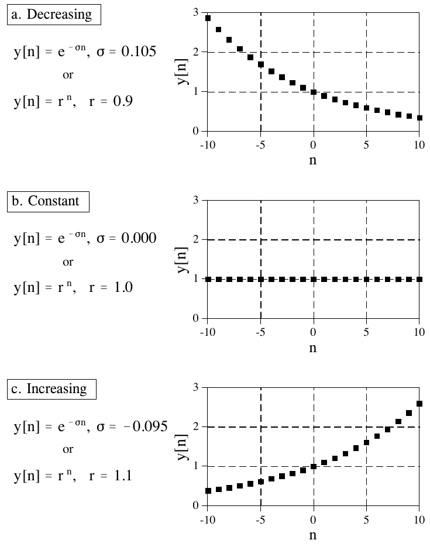
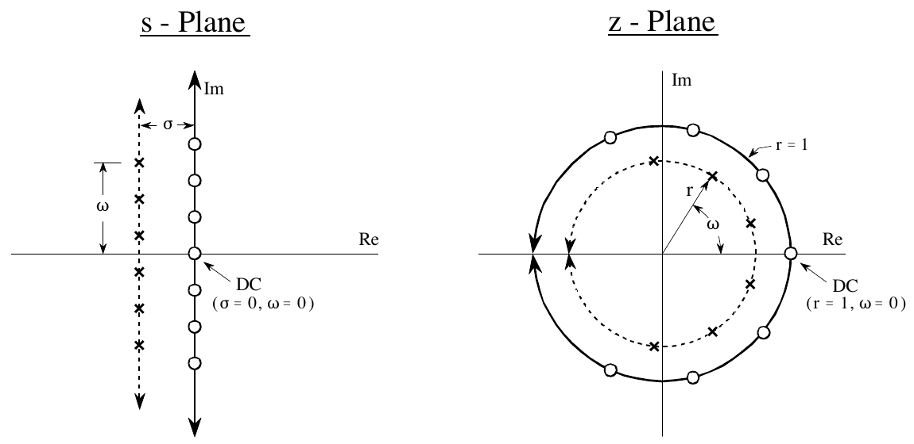
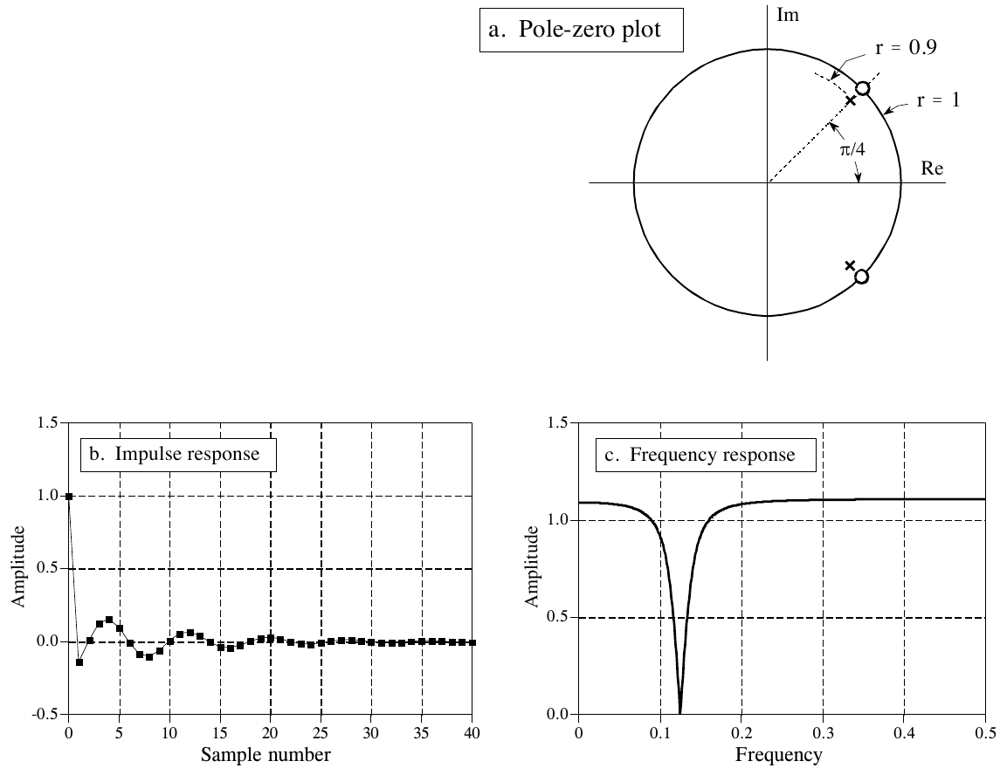
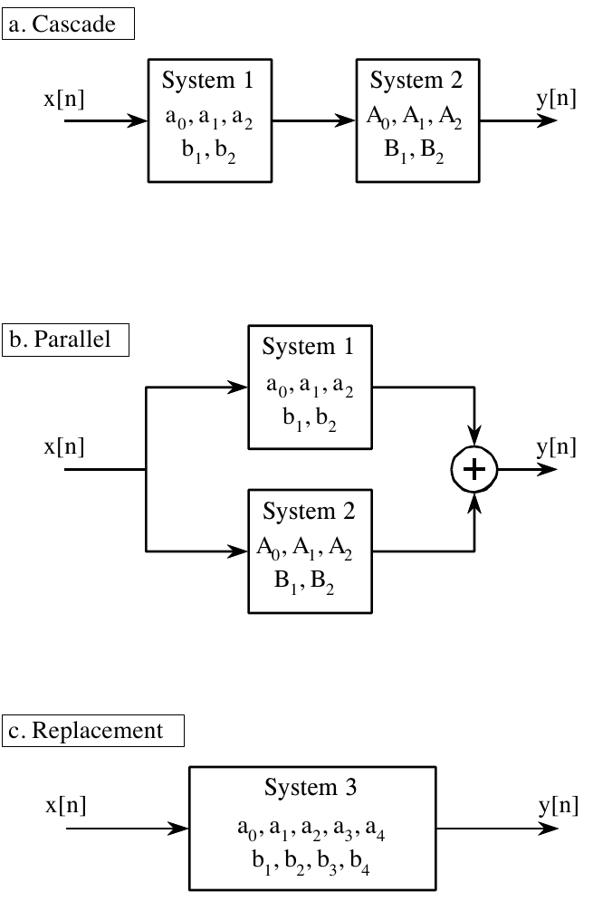
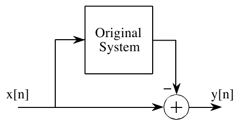
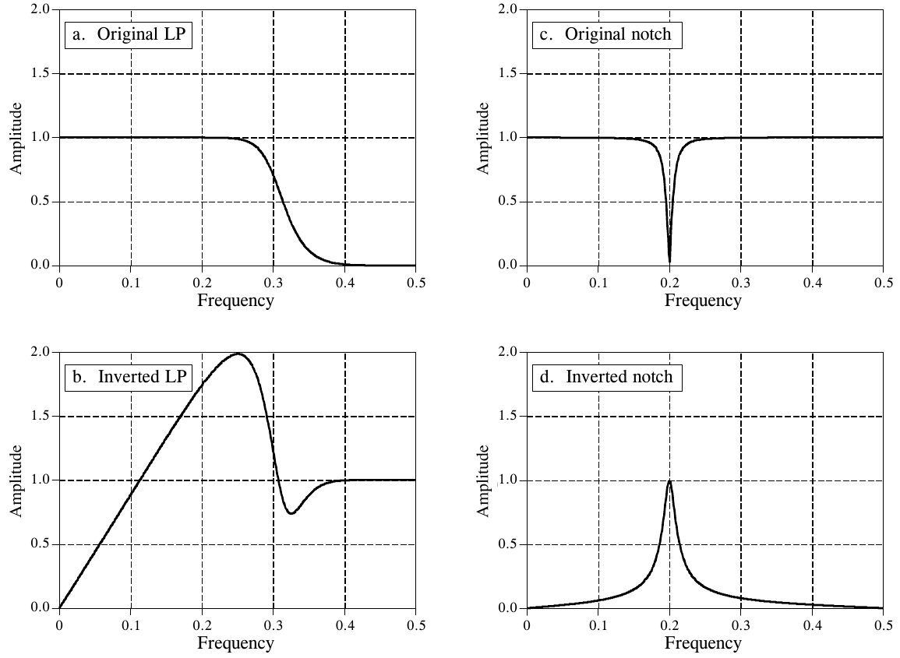
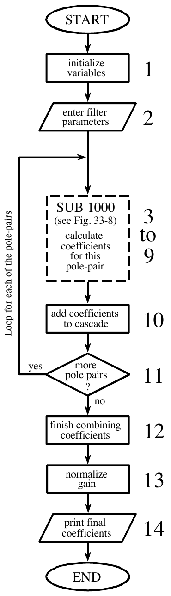
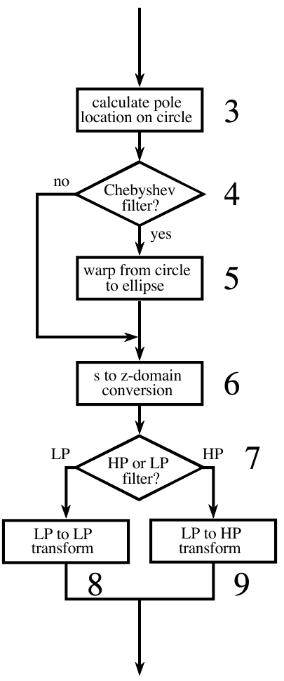

# 《The Scientist and Engineer's Guide to Digital Signal Processing》第 33 章中译

> 原书：上一级目录 `Documents/数学基础/` 下的 `The Scientist and Engineer Guide to Digital Signal Processing.pdf`，对应 PDF 第 616～641 页（原书第 605～630 页）。PDF 第 642 页起是书末的学习指南(Study Guide)和术语表(Glossary)，不属于本章。
> 上一章：[32-DSP指南-第32章中译.md](32-DSP指南-第32章中译.md)。专业名词第一次出现时在括号里附上英文。
> 插图从原书页面裁出，放在 `assets/ch33/`，图里的英文标注在每张图下方给出对照。原书 PDF 的符号字体抽取时会乱码（σ 显示成 F，ω 显示成 T，π 显示成 B，Σ 显示成 j，∞ 显示成 4，∫ 显示成 m，→ 显示成 6，ε 显示成 ,），公式都对照渲染页面重新用 LaTeX 写出。BASIC 程序的 C 版本在 `c/` 目录。

---

# 第 33 章　z 变换

模拟滤波器用拉普拉斯变换(Laplace transform)来设计；与之平行，递归数字滤波器用一种叫 z 变换(z-transform)的技术来设计。这两种变换的总体策略相同：用正弦波和指数信号去"探测"冲激响应，找出系统的极点(pole)和零点(zero)。拉普拉斯变换处理的是微分方程、s 域和 s 平面；相应地，z 变换处理的是差分方程(difference equation)、z 域(z-domain)和 z 平面(z-plane)。不过，这两种技术并不是彼此的镜像：s 平面用直角坐标排布，而 z 平面用极坐标。递归数字滤波器常常从某种经典模拟滤波器出发来设计，比如巴特沃斯(Butterworth)、切比雪夫(Chebyshev)或椭圆(elliptic)滤波器，然后经过一系列数学变换得到想要的数字滤波器。z 变换为这套数学提供了框架。第 20 章给出的切比雪夫滤波器设计程序用的就是这个方法，本章会详细讨论它。

## z 域的本质

为了强调拉普拉斯变换和 z 变换是平行的技术，我们先从拉普拉斯变换出发，演示怎样把它变成 z 变换。由上一章，拉普拉斯变换由时域信号与 s 域信号之间的关系定义：

$$X(s) = \int_{t=-\infty}^{\infty} x(t)\, e^{-st}\, dt$$

其中 x(t) 和 X(s) 分别是信号的时域表示和 s 域表示。上一章讲过，这个式子用幅度按指数变化的正弦波和余弦波来分析时域信号。把复变量 s 换成它的等价写法 $\sigma + j\omega$，就能看清这一点。用这种写法，拉普拉斯变换变成：

$$X(\sigma, \omega) = \int_{t=-\infty}^{\infty} x(t)\, e^{-\sigma t} e^{-j\omega t}\, dt$$

如果只关心实时域信号（通常如此），s 平面的上半部分和下半部分互为镜像，而 $e^{-j\omega t}$ 这一项就化为简单的余弦波和正弦波。这个式子用 σ 和 ω 两个参数标出 s 平面上的每个位置。每个位置上的值是一个复数，由实部和虚部组成。求实部时，把时域信号乘以一个频率为 ω、幅度按衰减参数 σ 指数变化的余弦波，X(σ,ω) 的实部就等于所得波形的积分。X(σ,ω) 的虚部求法类似，只是改用正弦波。如果这些听起来不太熟悉，继续读之前你需要先复习上一章。

拉普拉斯变换可以分三步变成 z 变换。第一步最显然：从连续信号换成离散信号。做法是把时间变量 t 换成采样序号 n，并把积分改成求和：

$$X(\sigma, \omega) = \sum_{n=-\infty}^{\infty} x[n]\, e^{-\sigma n} e^{-j\omega n}$$

注意 X(σ,ω) 用的是圆括号，表示它是连续的而不是离散的。虽然现在处理的是离散时域信号 x[n]，参数 σ 和 ω 仍然可以在连续的范围内取值。第二步是改写指数项。一个指数信号在数学上有两种表示方式：

$$y[n] = e^{-\sigma n} \qquad \text{或} \qquad y[n] = r^{n}$$

如图 33-1 所示，这两个式子都生成一条指数曲线。第一种写法通过参数 σ 控制信号的衰减：σ 为正时，波形随采样序号 n 增大而减小；σ 为负时，曲线逐渐增大；σ 恰好为零时，信号恒等于一。



**图 33-1　指数信号。** 指数有两种不同的数学表示形式。拉普拉斯变换用其中一种，z 变换用另一种。
（a. Decreasing = 递减：σ = 0.105，或 r = 0.9；b. Constant = 恒定：σ = 0.000，或 r = 1.0；c. Increasing = 递增：σ = −0.095，或 r = 1.1。原书图注排在图左侧，裁图时已去掉，译文见上。）

第二种写法用参数 r 控制波形的衰减：$r < 1$ 时波形减小，$r > 1$ 时增大，$r = 1$ 时信号保持恒定。这两个式子只是同一件事的两种说法，用下面的关系就能互换：

$$r^{n} = \big[e^{\ln(r)}\big]^{n} = e^{n\ln(r)} = e^{-\sigma n} \qquad \text{其中：}\ \sigma = -\ln(r)$$

把拉普拉斯变换变成 z 变换的第二步，就是改用另一种指数形式：

$$X(r, \omega) = \sum_{n=-\infty}^{\infty} x[n]\, r^{n} e^{-j\omega n}$$

这虽然是 z 变换一个完全正确的表达式，但对复数记法来说还不是最紧凑的形式。拉普拉斯变换解决这个问题的办法，是引入一个新的复变量 s，定义为 $s = \sigma + j\omega$。同样，我们为 z 变换定义一个新变量：

$$z = r e^{-j\omega}$$

这是把复变量 z 定义为两个实变量 r 和 ω 的极坐标组合。推导 z 变换的第三步，就是用 z 代替 r 和 ω。这样就得到 z 变换的标准形式：

**公式 33-1**　z 变换。z 变换定义了时域信号 x[n] 与 z 域信号 X(z) 之间的关系。

$$X(z) = \sum_{n=-\infty}^{\infty} x[n]\, z^{-n}$$

> **译注：** 原书这一段推导的符号前后不一致，照原样译出，这里按通行教材说明。通行的定义是 $z = re^{j\omega}$（指数上没有负号）。这样 $z^{-n} = r^{-n}e^{-j\omega n}$，第二步的式子相应应写成 $\sum x[n]\, r^{-n} e^{-j\omega n}$，与公式 33-1 才严格对上。本章后文说"正频率从 DC 点沿逆时针方向排在上半圆"，用的也正是 $z = e^{j\omega}$ 的约定。同理，第 615 页"把每个 z 换成 $e^{-j\omega}$"求频率响应，按通行约定应为 $e^{j\omega}$。对实系数系统来说，两种写法得到的幅度响应相同，相位差一个符号。

为什么 z 变换要用 $r^n$ 而不用 $e^{-\sigma n}$，用 z 而不用 s？第 19 章讲过，递归滤波器由一组递归系数(recursion coefficients)实现。要在 z 域分析这类系统，我们必须能把递归系数变成 z 域的传递函数(transfer function)，再变回来。下面很快就会看到，按这种方式（$r^n$ 和 z）定义 z 变换，能让这两种重要表示之间的转换最简单。事实上，这样定义 z 域，使得从一种表示转到另一种变得轻而易举。

图 33-2 展示了拉普拉斯变换的 s 平面与 z 变换的 z 平面之间的区别。s 平面上的位置由两个参数确定：σ 是沿横轴的指数衰减变量，ω 是沿纵轴的频率变量。换句话说，这两个实参数排成直角坐标系。这种几何形状来自 s（表示 s 平面上位置的复变量）的定义：$s = \sigma + j\omega$。

相比之下，z 域用的变量 r 和 ω 按极坐标排布。到原点的距离 r 是指数衰减的值；从正横轴量起的角距离 ω 是频率。这种几何形状来自 z 的定义 $z = re^{-j\omega}$。换句话说，表示 z 平面上位置的复变量，是把两个实参数以极坐标形式组合而成的。

这些差别使得 s 平面上的竖直线对应 z 平面上的圆。例如，图 33-2 的 s 平面画了一组零极点，它们都落在竖直线上；z 平面上对应的极点和零点则落在以原点为圆心的圆上。这可以从前面给出的关系 $\sigma = -\ln(r)$ 来理解。例如，s 平面的纵轴（即 $\sigma = 0$）对应 z 平面的单位圆(unit circle)（即 $r = 1$）。s 平面左半边的竖直线对应 z 平面单位圆内部的圆；同样，s 平面右半边的竖直线对应单位圆外部的圆。换句话说，s 平面的左半边和右半边，分别对应单位圆的内部和外部。例如，连续系统的极点落在 s 平面右半边时系统不稳定；同样，离散系统的极点落在 z 平面单位圆外时系统不稳定。当时域信号完全是实数时（最常见的情况），z 平面的上下两半互为镜像，和 s 域一样。



**图 33-2　s 平面与 z 平面的关系。** s 平面是直角坐标系，σ 表示沿实轴（横轴）的距离，ω 表示沿虚轴（纵轴）的距离。相比之下，z 平面是极坐标形式，r 是到原点的距离，ω 是从正横轴量起的角度。s 平面上的竖直线（比如图中示例的极点和零点所在的线）对应 z 平面上的圆。
（s-Plane = s 平面，z-Plane = z 平面，Re = 实部，Im = 虚部；DC = 直流，s 平面上在 σ = 0、ω = 0 处，z 平面上在 r = 1、ω = 0 处。○ 为零点，× 为极点。）

要特别留意频率变量 ω 在两种变换中的用法。一个连续正弦波的频率可以在 DC 到无穷大之间任取，这意味着 s 平面必须允许 ω 从负无穷取到正无穷。相比之下，离散正弦波的频率只能在 DC 到采样率的一半之间。也就是说，频率用采样率的分数表示时必须在 0 到 0.5 之间，用自然频率(natural frequency)表示（即 $\omega = 2\pi f$）时必须在 0 到 π 之间。如果把 ω 解释为以弧度表示的角度，这正好与 z 平面的几何形状相符：正频率对应 0 到 π 弧度的角度，负频率对应 0 到 −π 弧度。由于 z 平面表示频率的方式与 s 平面不同，有些作者用不同的符号来区分二者。常见的记法是用 Ω（大写 omega）表示 z 域的频率，用 ω（小写 omega）表示 s 域的频率。本书两种频率都用 ω 表示，但在其他 DSP 资料里要留意这一点。

在 s 平面上，纵轴上的值就是系统的频率响应。也就是说，在 $\sigma = 0$ 处求值的拉普拉斯变换等于傅里叶变换。类似地，z 域的频率响应位于单位圆上。把 z 变换（公式 33-1）在 $r = 1$ 处求值就能看出这一点：此时式子化为离散时间傅里叶变换（DTFT）。这样零频率（DC）就位于 z 平面横轴上值为一的点。频谱的正频率从这个 DC 位置出发按逆时针方向排列，占据上半圆；负频率从 DC 位置沿顺时针方向排列，构成下半圆。频谱的正频率和负频率在 $\omega = \pi$ 与 $\omega = -\pi$ 这个公共点相遇。这种圆形几何也对应了离散信号频谱的周期性：频率角增大到超过 π 后，遇到的值和 0 到 π 之间的完全相同。绕着圆跑，看到的风景就会一遍遍重复。

> **译注：** 原文此处写"零频率（DC）位于 **s 平面**横轴上值为一的点"，按上下文应为 z 平面，译文已改正。

## 递归系统的分析

第 19 章讲过，递归滤波器由一个差分方程描述：

**公式 33-2**　差分方程。详见第 19 章。

$$y[n] = a_0 x[n] + a_1 x[n-1] + a_2 x[n-2] + \cdots + b_1 y[n-1] + b_2 y[n-2] + b_3 y[n-3] + \cdots$$

其中 x[ ] 和 y[ ] 分别是输入和输出信号，"a"和"b"项是递归系数。这个式子一个显而易见的用途，是描述程序员怎样实现这个滤波器。同样重要的一点是，它表示了输入和输出之间一种必须始终成立的数学关系。正如连续系统受微分方程支配，递归离散系统按照这个差分方程运行。从这个关系出发，可以推出系统的关键特性：冲激响应、阶跃响应、频率响应、零极点图等。

分析的第一步，是对公式 33-2 两边取 z 变换（公式 33-1）。换句话说，我们想看看这个支配关系在 z 域里是什么样子。经过相当多的代数运算，可以把这个关系整理成 $Y[z]/X[z]$，即输出信号的 z 域表示除以输入信号的 z 域表示。和拉普拉斯变换一样，这叫做系统的传递函数，记作 H[z]。结果是：

**公式 33-3**　多项式形式的传递函数。递归系数可以直接在这个式子里认出来。

$$H[z] = \frac{a_0 + a_1 z^{-1} + a_2 z^{-2} + a_3 z^{-3} + \cdots}{1 - b_1 z^{-1} - b_2 z^{-2} - b_3 z^{-3} - \cdots}$$

这是传递函数的两种写法之一。这种形式之所以重要，是因为它直接包含递归系数。例如，假设我们知道一个数字滤波器的递归系数，比如从设计表里查到的：

| a | b |
|---|---|
| a0 = 0.389 | |
| a1 = −1.558 | b1 = 2.161 |
| a2 = 2.338 | b2 = −2.033 |
| a3 = −1.558 | b3 = 0.878 |
| a4 = 0.389 | b4 = −0.161 |

不用操心麻烦的复数代数，就可以直接写出系统的传递函数：

$$H[z] = \frac{0.389 - 1.558 z^{-1} + 2.338 z^{-2} - 1.558 z^{-3} + 0.389 z^{-4}}{1 - 2.161 z^{-1} + 2.033 z^{-2} - 0.878 z^{-3} + 0.161 z^{-4}}$$

注意"b"系数进入传递函数时前面带负号。另外，有些作者用加号写这个式子，但把所有"b"系数的符号反过来。问题就在这里：如果你拿到一组递归系数（比如来自一张表或一个滤波器设计程序），"b"系数的符号和你预期的相反的可能性是五五开。如果没发现这个差异，滤波器会严重不稳定。

公式 33-3 用 z 的负幂次表示传递函数，比如 $z^{-1}$、$z^{-2}$、$z^{-3}$ 等。代入一组实际的递归系数之后，可以把传递函数改写成更常规的、使用正幂次的形式，即 $z$、$z^2$、$z^3$、⋯。把上例的分子和分母同乘 $z^4$，得到：

$$H[z] = \frac{0.389 z^{4} - 1.558 z^{3} + 2.338 z^{2} - 1.558 z + 0.389}{z^{4} - 2.161 z^{3} + 2.033 z^{2} - 0.878 z + 0.161}$$

正幂次往往更好用，而且某些 z 域技术必须用它。那为什么不干脆用正幂次改写公式 33-3，彻底忘掉负幂次呢？不行！把分子分母同除以 z 的最高次幂（比如上例中的 $z^4$）这个技巧，只有在递归系数的个数已知时才能用。公式 33-3 是为任意个数的系数写的。重点是，正幂次和负幂次在 DSP 中都很常用，你需要知道怎样在两者之间转换。

递归系统的传递函数之所以有用，是因为它能以递归系数做不到的方式被操作。这包括：把级联和并联的各级合并成单个系统、通过指定零极点位置来设计滤波器、把模拟滤波器转换成数字滤波器等。这些操作通过在 z 域做代数运算来完成，比如乘法、加法和因式分解。操作完成后，把传递函数整理成公式 33-3 的形式，就能认出新的递归系数。

和 s 域一样，z 域的一个重要特点是传递函数可以用极点和零点来表示。这就是 z 域的第二种一般形式：

**公式 33-4**　零极点形式的传递函数。

$$H[z] = \frac{(z - z_1)(z - z_2)(z - z_3)\cdots}{(z - p_1)(z - p_2)(z - p_3)\cdots}$$

每个极点（$p_1, p_2, p_3, \cdots$）和零点（$z_1, z_2, z_3, \cdots$）都是一个复数。要从公式 33-4 转到 33-3，把各项乘开并合并同类项即可。这可能涉及海量的代数运算，但原理上很直接，也很容易写成计算机程序。从公式 33-3 转到 33-4 则困难得多，因为需要对多项式做因式分解。第 32 章讲过，如果传递函数是二阶或更低（即 z 的幂次不高于 $z^2$），可以用二次方程求根公式来分解。高于二阶的系统无法用代数方法分解，必须用数值方法。幸好这很少需要：数字滤波器的设计从零极点位置（公式 33-4）出发，最后得到递归系数（公式 33-3），而不是反过来。

和所有复数一样，零极点位置可以用极坐标或直角坐标表示。极坐标的好处是更符合 z 平面的自然结构；相比之下，做数学推导时一般更喜欢直角坐标，也就是说，$\sigma + j\omega$ 通常比 $re^{j\omega}$ 更容易操作。

作为使用这些公式的例子，我们按以下步骤设计一个陷波滤波器(notch filter)：(1) 指定零极点在 z 平面上的位置；(2) 按公式 33-4 的形式写出传递函数；(3) 把传递函数整理成公式 33-3 的形式；(4) 认出实现这个滤波器所需的递归系数。图 33-3 是我们要用的例子：一个由两个极点和两个零点构成的陷波滤波器，它们的位置是：

| 极坐标形式 | 直角坐标形式 |
|---|---|
| $z_1 = 1.00\, e^{j(\pi/4)}$ | $z_1 = 0.7071 + j\,0.7071$ |
| $z_2 = 1.00\, e^{j(-\pi/4)}$ | $z_2 = 0.7071 - j\,0.7071$ |
| $p_1 = 0.90\, e^{j(\pi/4)}$ | $p_1 = 0.6364 + j\,0.6364$ |
| $p_2 = 0.90\, e^{j(-\pi/4)}$ | $p_2 = 0.6364 - j\,0.6364$ |



**图 33-3　在 z 域设计的陷波滤波器。** 设计从在 z 平面上放置两个极点和两个零点开始，如 (a) 所示。得到的冲激响应和频率响应分别如 (b) 和 (c) 所示。陷波的锐度由极点到零点的距离控制。
（a. Pole-zero plot = 零极点图（r = 0.9 为极点所在的圆，r = 1 为单位圆，π/4 为角度）；b. Impulse response = 冲激响应；c. Frequency response = 频率响应。Amplitude = 幅度，Sample number = 采样序号，Frequency = 频率。原书图注排在左上方，裁图时已擦掉，译文见上。）

要理解为什么这是一个陷波滤波器，把这张零极点图和图 32-6（s 平面上的陷波滤波器）比较一下。唯一的区别是：从 z 平面求频率响应要沿单位圆移动，而从 s 平面求频率响应要沿纵轴移动。从零极点的极坐标形式可以看出，陷波出现在自然频率 π/4 处，对应采样率的 0.125。

由于零极点的位置已知，直接代入数值，就能按公式 33-4 的形式写出传递函数：

$$H(z) = \frac{\big[z - (0.7071 + j\,0.7071)\big]\big[z - (0.7071 - j\,0.7071)\big]}{\big[z - (0.6364 + j\,0.6364)\big]\big[z - (0.6364 - j\,0.6364)\big]}$$

要找出实现这个滤波器的递归系数，必须把传递函数整理成公式 33-3 的形式。首先把各项乘开来展开：

$$H(z) = \frac{z^2 - 0.7071z + j0.7071z - 0.7071z + 0.7071^2 - j0.7071^2 - j0.7071z + j0.7071^2 - j^2 0.7071^2}{z^2 - 0.6364z + j0.6364z - 0.6364z + 0.6364^2 - j0.6364^2 - j0.6364z + j0.6364^2 - j^2 0.6364^2}$$

接着合并同类项并化简。只要 z 平面的上半部分是下半部分的镜像（处理实冲激响应时总是如此），所有含"j"的项都会互相抵消：

$$H[z] = \frac{1.000 - 1.414z + 1.000z^2}{0.810 - 1.273z + 1.000z^2}$$

这虽然已经是一个多项式除以另一个多项式的形式，但没有按公式 33-3 的要求使用 z 的负指数。把分子分母同除以式中 z 的最高次幂（这里是 $z^2$），就能改过来：

$$H[z] = \frac{1.000 - 1.414z^{-1} + 1.000z^{-2}}{1.000 - 1.273z^{-1} + 0.810z^{-2}}$$

既然传递函数已经是公式 33-3 的形式，递归系数一眼就能读出来：

| a | b |
|---|---|
| a0 = 1.000 | |
| a1 = −1.414 | b1 = 1.273 |
| a2 = 1.000 | b2 = −0.810 |

这个例子给出了从零极点图求递归系数的一般策略。在特定情况下，可以推出把零极点位置直接和递归系数联系起来的更简单的公式。例如，含两个极点和两个零点的系统叫做双二阶(biquad)，有如下关系：

**公式 33-5**　双二阶设计公式。由极点位置 $r_p$ 与 $\omega_p$、零点位置 $r_0$ 与 $\omega_0$，给出递归系数 $a_0, a_1, a_2, b_1, b_2$。

$$\begin{aligned}
a_0 &= 1 \\
a_1 &= -2r_0\cos(\omega_0) \\
a_2 &= r_0^2 \\
b_1 &= 2r_p\cos(\omega_p) \\
b_2 &= -r_p^2
\end{aligned}$$

传递函数确定之后，怎样求频率响应？有三种方法：一种是数学方法，两种是计算（编程）方法。数学方法基于求出 z 平面上位于单位圆的那些值，做法是在 $r = 1$ 处计算传递函数 H(z)。具体地说，先把传递函数写成公式 33-3 或 33-4 的形式，再把每个 z 换成 $e^{-j\omega}$（也就是 $r = 1$ 时的 $re^{-j\omega}$）。这样就得到频率响应的数学表达式 H(ω)。问题是，得到的式子形式非常不方便，通常要做大量代数运算，才能得到能看懂的东西，比如幅度和相位。这种方法虽然能给出频率响应的精确表达式，但很难在计算机程序里自动化，比如滤波器设计软件包需要的那种自动化。

求频率响应的第二种方法，同样是在单位圆上计算 z 平面的值。不同之处在于，我们只计算频率响应的采样，而不是求整条曲线的数学解。计算机程序循环遍历，比如说，$\omega = 0$ 到 $\omega = \pi$ 之间等间隔的 1000 个频率。可以想象一只蚂蚁在 z 平面单位圆上半部分的 1000 个离散点之间移动。在每个位置上计算传递函数，就得到该处频率响应的幅度和相位。

这种方法效果很好，滤波器设计软件包里常用。它的主要局限是没有考虑舍入噪声对系统特性的影响。即使用这种方法求出的频率响应看起来完美无缺，实际实现出来的系统也可能完全不稳定！

这就引出了第三种方法：从实际用来实现滤波器的递归系数求频率响应。首先，让一个冲激通过系统，求出滤波器的冲激响应；第二步，对冲激响应做 DFT（当然是用 FFT），求出系统的频率响应。这个过程唯一要记住的关键一点是：冲激响应要取足够多的采样，使被丢掉的那些采样无关紧要。关于这一点的理论判据可以写好几本书，但实用的规则简单得多：取你认为必要的采样数；求出频率响应后，回头用两倍的采样数再做一遍。如果两次得到的频率响应足够相似，你就可以确信冲激响应的截断没有在什么地方骗了你。

## 级联与并联

复杂的递归滤波器通常分级设计，以简化 z 域里繁琐的代数。图 33-4 画出了把各级组合起来的两种常见方式：级联(cascade)的各级，以及输出相加的并联(parallel)各级。例如，一个低通级和一个高通级级联，可以构成带通滤波器；同样，低通级和高通级并联，可以构成带阻滤波器。我们把要合并的两级叫做系统 1 和系统 2，它们的递归系数分别叫 $a_0, a_1, a_2, b_1, b_2$ 和 $A_0, A_1, A_2, B_1, B_2$。我们的目标是把这两级（级联或并联）合并成单个递归滤波器，叫做系统 3，它的递归系数为 $a_0, a_1, a_2, a_3, a_4, b_1, b_2, b_3, b_4$。

前面的章节讲过，级联系统的频率响应通过相乘来合并，并联系统的频率响应通过相加来合并。z 域的传递函数也遵循同样的规则。这样就可以把问题搬到 z 域，做所需的乘法或加法，再回到最终系统的递归系数，从而把递归系统合并起来。

作为这种方法的例子，我们来推导两个双二阶级级联的代数。每一级的传递函数，用相应的递归系数按公式 33-3 写出。整个系统的传递函数 H[z]，就是两级传递函数之积：

$$H[z] = \frac{a_0 + a_1z^{-1} + a_2z^{-2}}{1 - b_1z^{-1} - b_2z^{-2}} \times \frac{A_0 + A_1z^{-1} + A_2z^{-2}}{1 - B_1z^{-1} - B_2z^{-2}}$$

把多项式乘开并合并同类项：

$$H[z] = \frac{a_0A_0 + (a_0A_1 + a_1A_0)z^{-1} + (a_0A_2 + a_1A_1 + a_2A_0)z^{-2} + (a_1A_2 + a_2A_1)z^{-3} + (a_2A_2)z^{-4}}{1 - (b_1 + B_1)z^{-1} - (b_2 + B_2 - b_1B_1)z^{-2} - (-b_1B_2 - b_2B_1)z^{-3} - (-b_2B_2)z^{-4}}$$



**图 33-4　合并级联与并联的各级。** 借助 z 域，可以把级联 (a) 或并联 (b) 的递归级合并成单个系统 (c)。
（a. Cascade = 级联；b. Parallel = 并联；c. Replacement = 替代系统。System 1/2/3 = 系统 1/2/3。原书图注排在左侧，裁图时已去掉，译文见上。）

由于这已经是公式 33-3 的形式，可以直接读出实现级联系统的递归系数（左边是合并后系统 3 的系数，右边是两级的系数）：

$$\begin{aligned}
a_0 &= a_0A_0 & & \\
a_1 &= a_0A_1 + a_1A_0 & b_1 &= b_1 + B_1 \\
a_2 &= a_0A_2 + a_1A_1 + a_2A_0 & b_2 &= b_2 + B_2 - b_1B_1 \\
a_3 &= a_1A_2 + a_2A_1 & b_3 &= -b_1B_2 - b_2B_1 \\
a_4 &= a_2A_2 & b_4 &= -b_2B_2
\end{aligned}$$

这种技术显而易见的问题是，乘开和整理多项式各项需要大量代数运算。幸好，整个算法可以写成一个很短的计算机程序，见表 33-1。级联和并联合并虽然需要不同的数学，但用的几乎是同一个程序。具体地说，两种算法只有一行代码不同，所以可以合进同一个程序。

**表 33-1**　合并级联与并联的各级。这个程序合并级联或并联各级的递归系数。被合并两级的递归系数通过数组 A1[ ]、B1[ ] 和 A2[ ]、B2[ ] 进入程序；实现整个系统的递归系数通过数组 A3[ ]、B3[ ] 离开程序。（注释已译成中文。）

```basic
100 'COMBINING RECURSION COEFFICIENTS OF CASCADE AND PARALLEL STAGES
110 '
120 '                               '初始化变量
130 DIM A1[8], B1[8]                '系统 1（其中一级）的 a、b 系数
140 DIM A2[8], B2[8]                '系统 2（其中一级）的 a、b 系数
150 DIM A3[16], B3[16]              '系统 3（合并后的系统）的 a、b 系数
160 '
170                                 '指定级联还是并联
180 INPUT "Enter 0 for cascade, 1 for parallel: ", CP%
190 '
200 GOSUB XXXX                      '虚构的子程序，载入 A1[ ]、B1[ ]、A2[ ]、B2[ ]
210 '
220 FOR I% = 0 TO 8                 '把递归系数变成传递函数
230 B2[I%] = -B2[I%]
240 B1[I%] = -B1[I%]
250 NEXT I%
260 B1[0] = 1
270 B2[0] = 1
280 '
290 FOR I% = 0 TO 16                '用卷积做多项式乘法
300 A3[I%] = 0
310 B3[I%] = 0
320 FOR J% = 0 TO 8
330 IF I%-J% < 0 OR I%-J% > 8 THEN GOTO 370
340 IF CP% = 0 THEN A3[I%] = A3[I%] + A1[J%] * A2[I%-J%]
350 IF CP% = 1 THEN A3[I%] = A3[I%] + A1[J%] * B2[I%-J%] + A2[J%] * B1[I%-J%]
360 B3[I%] = B3[I%] + B1[J%] * B2[I%-J%]
370 NEXT J%
380 NEXT I%
390 '
400 FOR I% = 0 TO 16                '把传递函数变回递归系数
410 B3[I%] = -B3[I%]
420 NEXT I%
430 B3[0] = 0
440 '                               '合并后系统的递归系数现在
450 END                             '存放在 A3[ ] 和 B3[ ] 中
```

**C 实现**（完整可编译版本见 `c/table33-1_combine_stages.c`，其中还用数值验证了本章的公式 33-5～33-8、33-11，以及图 33-6、图 33-7）：

```c
/* 表 33-1：cp = 0 级联，cp = 1 并联。输入不改动，结果写进 a3[]、b3[] */
static void combine(const double *a1, const double *b1, const double *a2, const double *b2,
                    int cp, double *a3, double *b3)
{
    double t1[N1], t2[N1];
    for (int i = 0; i < N1; i++) {          /* 220～250：把递归系数改写成传递函数的分母 */
        t1[i] = -b1[i];
        t2[i] = -b2[i];
    }
    t1[0] = 1.0;                            /* 260～270：分母常数项为 1 */
    t2[0] = 1.0;

    for (int i = 0; i < N3; i++) {          /* 290：多项式相乘就是系数卷积 */
        a3[i] = 0.0;                        /* 300 */
        b3[i] = 0.0;                        /* 310 */
        for (int j = 0; j < N1; j++) {      /* 320 */
            if (i - j < 0 || i - j > N1 - 1) continue;   /* 330：越界的项不存在 */
            if (cp == 0) a3[i] += a1[j] * a2[i - j];      /* 340：级联，分子相乘 */
            if (cp == 1) a3[i] += a1[j] * t2[i - j] + a2[j] * t1[i - j];  /* 350：并联，分子交叉相乘再相加 */
            b3[i] += t1[j] * t2[i - j];                   /* 360：两种情况分母都相乘 */
        }
    }

    for (int i = 0; i < N3; i++)            /* 400～420：把分母改回递归系数 */
        b3[i] = -b3[i];
    b3[0] = 0.0;                            /* 430 */
}
```

C 版本没有像原程序那样就地修改 B1[ ]、B2[ ]，而是复制到临时数组 t1、t2 里再取负，这样调用后输入的两组系数保持不变。实测结果（N1 = 9、N3 = 17，对应原书的 DIM 8 和 DIM 16）：
- **级联：** 把图 33-3 的陷波器和一个两极点切比雪夫低通级联，合并后的频率响应与两级频率响应之积的最大差 2.9e-15；把 2000 点随机信号逐级滤波，与用合并系数一次滤波逐点比较，最大差 1.3e-15；合并出的系数与上面第 617 页的展开式最大差 1.1e-16。
- **并联：** 合并后的频率响应与两级之和的最大差 5.5e-15，时域逐点最大差 2.2e-15。

这个程序的工作方式是：先把各级的递归系数变成公式 33-3 形式的传递函数（第 220～270 行）；按适当方式合并这些传递函数之后（第 290～380 行），再把信息变回递归系数（第 400～430 行）。

这个程序的核心，是传递函数多项式怎样表示、怎样合并。例如，被合并的第一级的分子是 $a_0 + a_1z^{-1} + a_2z^{-2} + a_3z^{-3} \cdots$。程序里表示这个多项式的方式，是把系数 $a_0, a_1, a_2, a_3 \cdots$ 存进数组 A1[0]、A1[1]、A1[2]、A1[3]⋯。同样，第二级的分子用存在 A2[0]、A2[1]、A2[2]、A2[3]⋯ 里的值表示，合并后系统的分子存在 A3[0]、A3[1]、A3[2]、A3[3]⋯ 里。思路是只通过多项式的系数来表示和操作多项式。问题是：A1[ ]、A2[ ]、A3[ ] 都代表多项式，已知前两个，怎样算出 A3[ ]？答案是：两个多项式相乘时，它们的系数做卷积。写成式子就是 $A1[\ ] * A2[\ ] = A3[\ ]$。这样就能用标准的卷积算法求级联各级的传递函数：把两个分子数组卷积，再把两个分母数组卷积。

合并并联各级的过程稍微复杂一点。代数里，分数按下式相加：

$$\frac{w}{x} + \frac{y}{z} = \frac{w\cdot z + y\cdot x}{x\cdot z}$$

由于每个传递函数都是一个分数（一个多项式除以另一个多项式），合并并联各级的方法是：分母相乘，分子做交叉乘积再相加。这意味着分母的算法和级联时相同，但分子的计算更复杂。第 340 行把级联各级的分子卷积，求出合并后传递函数的分子；第 350 行把并联组合的分子算成"两个分子分别与两个分母卷积之和"；第 360 行处理两种情况下分母的计算。

> **译注：** 原书这个分数相加式的分子印成了 $w\cdot z + y\cdot z$，第二项应为 $y\cdot x$（交叉相乘）。第 350 行程序本身是对的：A1 与 B2 卷积、A2 与 B1 卷积。

## 频谱反转

第 14 章介绍过一种叫频谱反转(spectral inversion)的 FIR 滤波器技术。它通过改变滤波器核，把频率响应上下翻转：所有通带变成阻带，反之亦然。例如，低通滤波器变成高通，带通滤波器变成带阻，等等。递归滤波器也能做类似的处理，只是效果差得多。

如图 33-5 所示，频谱反转的做法是从原信号中减去系统的输出。这个过程可以看作两级并联，其中一级恰好是恒等系统（输出与输入完全相同）。用这个思路可以证明，"b"系数保持不变，修改后的"a"系数为：



**图 33-5　频谱反转。** 这个过程等同于从原信号中减去系统的输出。
（Original System = 原系统；求和圆圈上方的 − 号表示减去原系统的输出。原书图注排在左侧，裁图时已去掉，译文见上。）

**公式 33-6**　频谱反转。按下面的公式修改"a"系数，可以把递归滤波器的频率响应上下翻转。原书中原系数用斜体，修改后的系数用正体；这里等号左边是修改后的系数，右边是原系数。"b"系数不变。这种方法的效果通常很差。

$$\begin{aligned}
a_0 &= 1 - a_0 \\
a_1 &= -a_1 - b_1 \\
a_2 &= -a_2 - b_2 \\
a_3 &= -a_3 - b_3 \\
&\ \ \vdots
\end{aligned}$$

图 33-6 展示了对两种常见频率响应做频谱反转的结果：低通滤波器 (a) 和陷波滤波器 (c)，分别得到高通滤波器 (b) 和带通滤波器 (d)。得到的频率响应怎么样？高通滤波器糟糕透顶！带通的情况好一些，但峰不如它所由来的陷波滤波器那么尖锐。与第 14 章看到的出色表现相比，这些平庸的结果尤其令人失望。为什么会有这种差别？答案在于滤波器设计中常被遗忘的一样东西：相位响应。



**图 33-6　频谱反转的例子。** (a) 是一个 6 极点低通巴特沃斯滤波器的频率响应；(b) 是用频谱反转得到的对应高通滤波器，简直一团糟！(c) 和 (d) 是一个比较成功的例子：陷波滤波器被变成了带通频率响应。
（a. Original LP = 原低通；b. Inverted LP = 反转后的低通；c. Original notch = 原陷波；d. Inverted notch = 反转后的陷波。Amplitude = 幅度，Frequency = 频率。原书图注里的 its 应为 it's，in to 应为 into。）

`c/table33-1_combine_stages.c` 重做了这两个例子（原书没给参数，按图估计）：
- **(a)→(b)：** 6 极点巴特沃斯低通、截止 0.3，反转后幅度在 0.251 处冲到 1.988，在 0.326 处回落到 0.739，0.5 处为 1.000，和图 (b) 的形状一致。
- **(c)→(d)：** 零点在单位圆上 0.2 处、极点半径 0.95 的陷波器，反转后在 0.2 处为 1.000，0.18 处已降到 0.368，0.1 处为 0.060。
- 用公式 33-6 算出的系数，与用表 33-1 把原系统"取负后和恒等系统并联"算出的系数完全相同（差为 0）。

为了说明相位是罪魁祸首，考虑一种叫希尔伯特变换器(Hilbert transformer)的系统。希尔伯特变换器不是某种具体的器件，而是任何具有如下频率响应的系统：对所有频率，幅度 = 1，相位 = 90 度。这意味着任何正弦波通过希尔伯特变换器后，幅度不受影响，但相位改变四分之一周期。希尔伯特变换器可以是模拟的也可以是离散的（即硬件或软件），在通信中常用于各种调制和解调技术。

现在，假设我们通过从原信号中减去希尔伯特变换器的输出，来对它做频谱反转。如果只看频率响应的幅度，我们会得出结论：整个系统的输出为零。也就是说，希尔伯特变换器输出的幅度与原信号的幅度完全相同，两者会相互抵消。这当然完全错了。两个正弦波只有在幅度和相位都相同时才会完全抵消。实际上，这个组合系统的频率响应幅度为 $\sqrt{2}$，相移为 −45 度。输出不但不是零（我们天真的猜测），反而比输入的幅度还大！

频谱反转在第 14 章效果很好，是因为那里用的滤波器种类特殊：零相位，即滤波器核左右对称。系统不引入相移时，从输入中减去输出的结果完全由幅度决定。递归滤波器饱受相移困扰，所以频谱反转一般只能得到不令人满意的滤波器。

## 增益调整

假设我们有一个递归滤波器，需要修改递归系数来改变输出信号的幅度。例如，为了保证滤波器在通带内增益为一，就可能需要这样做。方法非常简单：把"a"系数乘以你希望增益改变的倍数，"b"系数保持不变。

调整增益之前，我们大概想先知道它当前的值。由于增益必须在通带内的某个频率上规定，具体做法取决于滤波器的类型。低通滤波器的增益在零频率处测量，高通滤波器则用 0.5 这个允许的最高频率。推导这两个特殊频率处的增益表达式相当简单，做法如下。

首先，推导零频率处增益的公式。思路是强制每个输入采样都等于一，于是每个输出采样都等于 G，即我们要求的系统增益。先写出递归方程，即输入信号与输出信号之间的数学关系：

$$y[n] = a_0 x[n] + a_1 x[n-1] + a_2 x[n-2] + \cdots + b_1 y[n-1] + b_2 y[n-2] + b_3 y[n-3] + \cdots$$

接着，把每个输入采样代入一，每个输出采样代入 G。换句话说，强制系统工作在零频率。方程变成：

$$G = a_0 + a_1 + a_2 + a_3 + \cdots + b_1G + b_2G + b_3G + b_4G + \cdots$$

解出 G，就得到用递归系数表示的系统零频率增益：

**公式 33-7**　递归滤波器的直流增益。这个关系由递归系数给出直流增益。

$$G = \frac{a_0 + a_1 + a_2 + a_3 + \cdots}{1 - (b_1 + b_2 + b_3 + \cdots)}$$

要让滤波器在直流处增益为一，就用这个关系算出现有增益，再把所有"a"系数除以 G。

频率 0.5 处的增益求法类似：强制输入和输出信号工作在这个频率，看系统怎样响应。在频率 0.5 处，输入信号的采样在 −1 和 1 之间交替，即相继的采样为 1、−1、1、−1、1、−1、1 等。相应的输出信号也交替变号，幅度等于系统增益：G、−G、G、−G、G、−G 等。把这些信号代入递归方程：

$$G = a_0 - a_1 + a_2 - a_3 + \cdots - b_1G + b_2G - b_3G + b_4G + \cdots$$

解出 G，就得到用递归系数表示的系统在频率 0.5 处的增益：

**公式 33-8**　最高频率处的增益。这个关系根据系统的递归系数，给出递归滤波器在频率 0.5 处的增益。

$$G = \frac{a_0 - a_1 + a_2 - a_3 + a_4 \cdots}{1 - (-b_1 + b_2 - b_3 + b_4 \cdots)}$$

和前面一样，把所有"a"系数除以算出的这个 G，就能把滤波器归一化为单位增益。在计算机程序里计算公式 33-8，需要一种办法给奇数下标的系数加负号、给偶数下标的系数加正号。最常用的方法是把每个系数乘以 $(-1)^k$，其中 k 是正在处理的系数的下标。也就是说，k 依次取 0、1、2、3、4、5、6 等值时，$(-1)^k$ 依次取 1、−1、1、−1、1、−1、1 等。

C 版本实测：对图 33-3 的陷波器，公式 33-7 给出 DC 增益 1.090428，公式 33-8 给出 0.5 处增益 1.107507，都与把 z 直接代入传递函数的结果在六位小数上一致，也和图 33-3c 两端约 1.1 的高度相符（这个陷波器没有做增益归一化）。

## 切比雪夫-巴特沃斯滤波器设计

第 20 章给出的切比雪夫-巴特沃斯程序，展示了设计递归数字滤波器的一种常用方法。它从模拟滤波器在 s 平面上的零极点图出发，经过几次数学变换，转换成想要的数字滤波器。为了降低代数的复杂度，滤波器被设计成几级的级联，每一级实现一对极点。然后把各级的递归系数合并成整个滤波器的递归系数。这是一个非常精巧也非常复杂的算法，用它来结束本书再合适不过。下面看它是怎样工作的。

### 循环控制

图 33-7 给出了这个方法的程序和流程图，是从第 20 章复制过来的。初始化和参数输入之后，程序的主体是一个循环，逐个处理滤波器中的每一对极点。这个循环由流程图中的第 11 块控制，对应程序第 320 和 460 行的 FOR-NEXT 循环。例如，对于 6 极点滤波器，这个循环执行三次，循环变量 P% 依次取 1、2、3。也就是说，6 极点滤波器分三级实现，每级两个极点。

### 合并系数

每次循环中，子程序 1000（列在图 33-8 中）计算这一级的递归系数，通过五个变量 A0、A1、A2、B1、B2 返回。在流程图的第 10 步（第 360～440 行），这些系数与之前所有级的系数（存放在数组 A[ ] 和 B[ ] 中）合并。第一次循环结束时，A[ ] 和 B[ ] 存放第一级的系数；第二次循环结束时，A[ ] 和 B[ ] 存放第一级与第二级级联的系数。所有循环完成后，A[ ] 和 B[ ] 存放的就是实现整个滤波器所需的系数。

系数按前面表 33-1 介绍的方式合并，只是做了几处修改，让代码更紧凑。第一，循环过程中 A[ ] 和 B[ ] 的下标平移了两位。例如，$a_0$ 存在 A[2] 中，$a_1$ 和 $b_1$ 存在 A[3] 和 B[3] 中，依此类推。这样做是为了防止程序访问数组定义范围之外的值。这个平移在第 12 块（第 480～520 行）中去掉，使最终的递归系数无偏移地存放在 A[ ] 和 B[ ] 中。

第二，A[ ] 和 B[ ] 必须用对应恒等系统的系数初始化，而不是全零。这在第 180～240 行完成。第一次循环时，第一级的系数与这些数组里原有的信息合并；如果原来全是零，数组就会永远是零。第三，用了两个临时数组 TA[ ] 和 TB[ ]，在卷积过程中保存 A[ ] 和 B[ ] 的旧值，腾出 A[ ] 和 B[ ] 来存放新值。

程序最后，第 13 块（第 540～670 行）把滤波器调整为通带内单位增益。做法如前所述：用公式 33-7 或 33-8 算出现有增益，再把所有"a"系数除以它来归一化。中间变量 SA 和 SB 分别是"a"系数之和与"b"系数之和。

**图 33-7**　切比雪夫-巴特沃斯滤波器设计。这个程序在第 20 章以表 20-4 和表 20-5 的形式给出过。图 33-8 给出子程序 1000 的程序和流程图，它在这个主程序的第 340 行被调用。（注释已译成中文。）

```basic
100 'CHEBYSHEV FILTER- COEFFICIENT CALCULATION
110 '
120                             '初始化变量
130 DIM A[22]                   '存放"a"系数
140 DIM B[22]                   '存放"b"系数
150 DIM TA[22]                  '合并各级时内部使用
160 DIM TB[22]                  '合并各级时内部使用
170 '
180 FOR I% = 0 TO 22
190   A[I%] = 0
200   B[I%] = 0
210 NEXT I%
220 '
230 A[2] = 1
240 B[2] = 1
250 PI = 3.14159265
260                             '输入滤波器参数
270 INPUT "Enter cutoff frequency (0 to .5):       ", FC
280 INPUT "Enter 0 for LP, 1 for HP filter:        ", LH
290 INPUT "Enter percent ripple (0 to 29):         ", PR
300 INPUT "Enter number of poles (2,4,...20):      ", NP
310 '
320 FOR P% = 1 TO NP/2          '对每个零极点对循环
330 '
340   GOSUB 1000                '图 33-8 中的子程序
350 '
360   FOR I% = 0 TO 22          '把系数加进级联
370     TA[I%] = A[I%]
380     TB[I%] = B[I%]
390   NEXT I%
400 '
410   FOR I% = 2 TO 22
420     A[I%] = A0*TA[I%] + A1*TA[I%-1] + A2*TA[I%-2]
430     B[I%] =    TB[I%] - B1*TB[I%-1] - B2*TB[I%-2]
440   NEXT I%
450 '
460 NEXT P%
470 '
480 B[2] = 0                    '完成系数合并
490 FOR I% = 0 TO 20
500   A[I%] = A[I%+2]
510   B[I%] = -B[I%+2]
520 NEXT I%
530 '
540 SA = 0                      '归一化增益
550 SB = 0
560 FOR I% = 0 TO 20
570   IF LH = 0 THEN SA = SA + A[I%]
580   IF LH = 0 THEN SB = SB + B[I%]
590   IF LH = 1 THEN SA = SA + A[I%] * (-1)^I%
600   IF LH = 1 THEN SB = SB + B[I%] * (-1)^I%
610 NEXT I%
620 '
630 GAIN = SA / (1 - SB)
640 '
650 FOR I% = 0 TO 20
660   A[I%] = A[I%] / GAIN
670 NEXT I%
680 '                           '最终的递归系数
690 END                         '存放在 A[ ] 和 B[ ] 中
```



（图 33-7 右侧的流程图。START = 开始；1. initialize variables = 初始化变量；2. enter filter parameters = 输入滤波器参数；3～9. SUB 1000 (see Fig. 33-8) calculate coefficients for this pole-pair = 子程序 1000（见图 33-8），计算这一对极点的系数；10. add coefficients to cascade = 把系数加进级联；11. more pole pairs? = 还有极点对吗？（yes = 是，no = 否）；12. finish combining coefficients = 完成系数合并；13. normalize gain = 归一化增益；14. print final coefficients = 打印最终系数；END = 结束。左侧竖排文字 Loop for each of the pole-pairs = 对每一对极点循环。）

**C 实现：** 这个程序和表 20-4 完全相同，完整的 C 版本见 `c/table20-4_chebyshev_design.c`（带 FC、LH、PR、NP 四个参数运行即打印系数）。`c/table33-1_combine_stages.c` 里另有一份同样的实现 `cheb_design_compact()`，并用它验证了本章说的"下标平移两位的紧凑写法就是表 33-1 的级联合并"：
- 把每一级改用表 33-1 的 `combine()` 逐级级联，4 组参数（低通/高通、纹波 0～10%、4～10 极点）下与紧凑写法的系数最大差 6.4e-15。表 33-1 每级的数组只到下标 8，所以这项对比的极点数最多取到 10。
- 低通 FC=0.1、PR=0.5、NP=4 时打印出的 9 个系数，与第 20 章 C 程序的输出逐位一致（a0 = 2.780757E-03，b1 = 2.764031E+00 等）。

### 在 s 平面上计算极点位置

不论要设计哪种滤波器，这个程序都从 s 平面上一个截止频率 $\omega = 1$ 的巴特沃斯低通滤波器出发。上一章讲过，巴特沃斯滤波器的极点在 s 平面上沿一个圆等间隔分布。由于是低通滤波器，不用零点。圆的半径为一，对应截止频率 $\omega = 1$。流程图第 3 块（第 1080 和 1090 行）用直角坐标计算每一对极点的位置。程序变量 RP 和 IP 分别是极点位置的实部和虚部，对应 σ 和 ω，即极点对位于 $\sigma \pm j\omega$。极点位置由滤波器的极点数和正在处理的级算出，对应程序变量 NP 和 P%。

### 从圆变形为椭圆

要实现切比雪夫滤波器，必须把这个圆形的极点分布变换成椭圆形分布。椭圆的相对扁平程度决定了滤波器通带内有多少纹波。如果极点在圆上的位置是 σ 和 ω，它在椭圆上的对应位置 σ′ 和 ω′ 由下式给出：

**公式 33-9**　圆到椭圆的变换。这些公式把极点在圆上的位置变成椭圆上的对应位置。变量 NP 和 PR 分别是滤波器的极点数和通带纹波百分比。圆上的位置由 σ 和 ω 给出，椭圆上的位置由 σ′ 和 ω′ 给出。变量 ε、v 和 k 只是用来让式子短一些。

$$\sigma' = \sigma\,\sinh(v)/k \qquad\qquad \omega' = \omega\,\cosh(v)/k$$

$$\text{其中：}\quad v = \frac{\sinh^{-1}(1/\varepsilon)}{NP}, \qquad k = \cosh\!\left(\frac{1}{NP}\cosh^{-1}\frac{1}{\varepsilon}\right), \qquad \varepsilon = \left[\left(\frac{100}{100 - PR}\right)^{2} - 1\right]^{1/2}$$

这些公式用双曲正弦和双曲余弦来定义椭圆，就像普通的正弦和余弦作用于圆一样。椭圆的扁平程度由变量 PR 控制，它在数值上等于滤波器通带纹波的百分比。变量 ε、v 和 k 用来降低式子的复杂度，在程序里分别用 ES、VX 和 KX 表示。除了把圆变成椭圆，这些公式还修正极点位置，使截止频率保持为一。由于许多编程语言不支持双曲函数，程序用了下面的恒等式：

$$\sinh(x) = \frac{e^{x} - e^{-x}}{2} \qquad\qquad \cosh(x) = \frac{e^{x} + e^{-x}}{2}$$

$$\sinh^{-1}(x) = \log_e\!\big[x + (x^{2} + 1)^{1/2}\big] \qquad\qquad \cosh^{-1}(x) = \log_e\!\big[x + (x^{2} - 1)^{1/2}\big]$$

这些公式在 $PR \ge 30$ 和 $PR = 0$ 时会出现非法运算。要用这个程序计算巴特沃斯滤波器（即零纹波，PR = 0），必须绕过实现这些公式的程序行（第 1120 行）。

### 连续到离散的转换

把零极点图从 s 域转换到 z 域，最常用的方法是双线性变换(bilinear transform)。这是一种保角映射(conformal mapping)的数学技术：把一个复平面通过代数方法扭曲、变形成另一个复平面。双线性变换通过下面的替换把 H(s) 变成 H(z)：

**公式 33-10**　双线性变换。这个替换把 s 平面上的每个点映射到 z 平面上的一个对应点。

$$s \rightarrow \frac{2\,(1 - z^{-1})}{T\,(1 + z^{-1})}$$

也就是说，先写出 H(s) 的式子，再把每个 s 换成上面的表达式。大多数情况下取 $T = 2\tan(1/2) = 1.093$。这样，s 域 0 到 π 弧度/秒的频率范围，被映射到 z 域 0 到 π 弧度的频率范围。不深入细节地说，双线性变换具有从 s 平面转换到 z 平面所需的性质，比如把竖直线映射成圆。

> **译注：** 原书公式 33-10 的说明里 point 误拼为 piont。另外，"s 域 0 到 π 弧度/秒被映射到 z 域 0 到 π 弧度"这句不准确。把 $z = e^{j\Omega}$ 代入公式 33-10 可得 $\omega = \tan(\Omega/2)/\tan(1/2)$：实际被映射到 z 域 0～π 的是 s 域的整个 0～∞，而取 $T = 2\tan(1/2)$ 的作用，是让模拟频率 ω = 1（原型滤波器的截止频率）恰好落在数字频率 Ω = 1 弧度上。C 版本实测，用公式 33-11 把截止为 1 的两极点巴特沃斯原型转成数字滤波器后，在 Ω = 1 弧度处 |H| = 0.7071，正好是截止点。



**图 33-8**　图 33-7 调用的子程序。（注释已译成中文；右侧流程图的对照见代码下方。）

```basic
1000 'THIS SUBROUTINE IS CALLED FROM FIG. 33-7, LINE 340
1010 '
1020 '进入子程序的变量：   PI, FC, LH, PR, HP, P%
1030 '离开子程序的变量：   A0, A1, A2, B1, B2
1040 '内部使用的变量：     RP, IP, ES, VX, KX, T, W, M, D, K,
1050 '                     X0, X1, X2, Y1, Y2
1060 '
1070 '                                 '计算极点在单位圆上的位置
1080 RP = -COS(PI/(NP*2) + (P%-1) * PI/NP)
1090 IP =  SIN(PI/(NP*2) + (P%-1) * PI/NP)
1100 '
1110 '                                 '从圆变形为椭圆
1120 IF PR = 0 THEN GOTO 1210
1130 ES = SQR( (100 / (100-PR))^2 -1 )
1140 VX = (1/NP) * LOG( (1/ES) + SQR( (1/ES^2) + 1) )
1150 KX = (1/NP) * LOG( (1/ES) + SQR( (1/ES^2) - 1) )
1160 KX = (EXP(KX) + EXP(-KX))/2
1170 RP = RP * ( (EXP(VX) - EXP(-VX) ) /2 ) / KX
1180 IP = IP * ( (EXP(VX) + EXP(-VX) ) /2 ) / KX
1190 '
1200 '                                 's 域到 z 域的转换
1210 T  = 2 * TAN(1/2)
1220 W  = 2*PI*FC
1230 M  = RP^2 + IP^2
1240 D = 4 - 4*RP*T + M*T^2
1250 X0 = T^2/D
1260 X1 = 2*T^2/D
1270 X2 = T^2/D
1280 Y1 = (8 - 2*M*T^2)/D
1290 Y2 = (-4 - 4*RP*T - M*T^2)/D
1300 '
1310 '                                 '低通到低通，或低通到高通
1320 IF LH = 1 THEN K = -COS(W/2 + 1/2) / COS(W/2 - 1/2)
1330 IF LH = 0 THEN K =  SIN(1/2 - W/2) / SIN(1/2 + W/2)
1340 D = 1 + Y1*K - Y2*K^2
1350 A0 = (X0 - X1*K + X2*K^2)/D
1360 A1 = (-2*X0*K + X1 + X1*K^2 - 2*X2*K)/D
1370 A2 = (X0*K^2 - X1*K + X2)/D
1380 B1 = (2*K + Y1 + Y1*K^2 - 2*Y2*K)/D
1390 B2 = (-K^2 - Y1*K + Y2)/D
1400 IF LH = 1 THEN A1 = -A1
1410 IF LH = 1 THEN B1 = -B1
1420 '
1430 RETURN
```

（图 33-8 右侧流程图：3. calculate pole location on circle = 计算极点在圆上的位置；4. Chebyshev filter? = 是切比雪夫滤波器吗？（yes = 是，no = 否）；5. warp from circle to ellipse = 从圆变形为椭圆；6. s to z-domain conversion = s 域到 z 域的转换；7. HP or LP filter? = 高通还是低通？；8. LP to LP transform = 低通到低通变换；9. LP to HP transform = 低通到高通变换。）

> **译注：** 第 1020 行列出的进入变量 "HP" 应为 NP（极点数），与第 20 章表 20-5 的同一处错误相同。

**C 实现：** 见 `c/table20-4_chebyshev_design.c` 的 `chebyshev_stage()`，或 `c/table33-1_combine_stages.c` 的 `cheb_stage()`，两者逐行对应这个子程序。

下面是双线性变换怎样工作的一个例子。对于一个只有一对极点、位于 $p_1 = \sigma + j\omega$ 和 $p_2 = \sigma - j\omega$ 的连续系统，s 域传递函数为：

$$H(s) = \frac{1}{(s - p_1)(s - p_2)}$$

双线性变换把每个 s 换成公式 33-10 给出的表达式，就把它变成一个离散系统，得到一个同样含两个极点的 z 域传递函数。问题是，这样替换后传递函数的形式非常不友好：

$$H(z) = \frac{1}{\left(\dfrac{2(1 - z^{-1})}{T(1 + z^{-1})} - (\sigma + j\omega)\right)\left(\dfrac{2(1 - z^{-1})}{T(1 + z^{-1})} - (\sigma - j\omega)\right)}$$

经过冗长乏味的代数运算，可以把这个式子整理成公式 33-3 的标准形式，认出递归系数如下：

**公式 33-11**　两极点的双线性变换。极点对位于 s 平面上的 $\sigma \pm j\omega$，$a_0, a_1, a_2, b_1, b_2$ 是离散系统的递归系数。

$$\begin{aligned}
a_0 &= T^2/D \\
a_1 &= 2T^2/D \\
a_2 &= T^2/D \\
b_1 &= (8 - 2MT^2)/D \\
b_2 &= (-4 - 4\sigma T - MT^2)/D
\end{aligned}
\qquad\qquad
\text{其中：}\quad
\begin{aligned}
M &= \sigma^2 + \omega^2 \\
T &= 2\tan(1/2) \\
D &= 4 - 4\sigma T + MT^2
\end{aligned}$$

> **译注：** 原书公式 33-11 的说明写"极点对位于 σ ± ω"，漏了 j，应为 σ ± jω。C 版本对两极点巴特沃斯原型（σ = −0.7071、ω = 0.7071）验证过这组公式：用它算出的系数在单位圆上求 H(z)，与把公式 33-10 直接代入 H(s) 的结果，500 个频率点上最大差 6.5e-16。

变量 M、T 和 D 没有物理意义，只是用来让式子短一些。

第 1200～1290 行用这些公式，把存放在变量 RP 和 IP 中的 s 域极点对位置，直接转换成存放在变量 X0、X1、X2、Y1、Y2 中的递归系数。换句话说，我们算出了一个中间结果：截止频率为一的低通滤波器一级的递归系数。

### 低通到低通的频率变换

改变递归滤波器的频率，同样用保角映射技术完成。假设我们知道一个截止频率为一的递归低通滤波器的传递函数。用低通到低通变换(low-pass to low-pass transform)，就能得到一个新截止频率为 W 的同类低通滤波器的传递函数。这同样是像双线性变换那样做变量替换：先写出截止频率为一的滤波器的传递函数，再把每个 $z^{-1}$ 换成下式：

**公式 33-12**　低通到低通变换。这是改变低通滤波器截止频率的一种方法。原滤波器的截止频率为一，新滤波器的截止频率为 W，取值范围 0 到 π。

$$z^{-1} \rightarrow \frac{z^{-1} - k}{1 - kz^{-1}} \qquad\qquad \text{其中：}\quad k = \frac{\sin(1/2 - W/2)}{\sin(1/2 + W/2)}$$

这样就得到具有新截止频率的滤波器的传递函数。把这个替换用于双二阶（即最多两个极点、两个零点），得到如下设计公式：

**公式 33-13**　低通到低通转换。原书中截止频率为一的滤波器的递归系数用斜体，截止频率为 W 的低通滤波器的系数用正体；这里等号左边是新系数，右边是原系数。

$$\begin{aligned}
a_0 &= (a_0 - a_1k + a_2k^2)/D \\
a_1 &= (-2a_0k + a_1 + a_1k^2 - 2a_2k)/D \\
a_2 &= (a_0k^2 - a_1k + a_2)/D \\
b_1 &= (2k + b_1 + b_1k^2 - 2b_2k)/D \\
b_2 &= (-k^2 - b_1k + b_2)/D
\end{aligned}
\qquad\qquad
\text{其中：}\quad
\begin{aligned}
D &= 1 + b_1k - b_2k^2 \\
k &= \frac{\sin(1/2 - W/2)}{\sin(1/2 + W/2)}
\end{aligned}$$

### 低通到高通的频率变换

把上面的变换稍作修改，就能在改变截止频率的同时，把系统的响应从低通变成高通。这通过低通到高通变换(low-pass to high-pass transform)完成，替换为：

**公式 33-14**　低通到高通变换。这个替换把低通滤波器变成高通滤波器。低通滤波器的截止频率为一，高通滤波器的截止频率为 W。

$$z^{-1} \rightarrow \frac{-z^{-1} - k}{1 + kz^{-1}} \qquad\qquad \text{其中：}\quad k = -\frac{\cos(W/2 + 1/2)}{\cos(W/2 - 1/2)}$$

和前面一样，这可以化成修改双二阶级系数的设计公式。结果表明，这些公式与公式 33-13 完全相同，只有两处小改动：k 的值不同（如公式 33-14 所示），以及 $a_1$ 和 $b_1$ 两个系数取负。程序第 1330～1410 行执行这些公式，给出想要的截止频率，并选择高通或低通响应。

## DSP 的最好与最坏

本书基于一个简单的前提：大多数 DSP 技术都可以用最少的数学来使用和理解。目的是为科学家和工程师提供工具，来解决他们在非 DSP 的研究或设计工作中遇到的 DSP 问题。

最后这四章是硬币的另一面：只有借助大量数学才能理解的 DSP 技术。例如，想想刚才讲的切比雪夫-巴特沃斯滤波器。这是 DSP 最好的一面：一系列优雅的数学步骤，通向最优解。但它也是 DSP 最坏的一面：一种复杂到大多数科学家和工程师都会去找别的替代办法的设计方法。

你处在这个格局的什么位置？这取决于你是谁、打算用 DSP 做什么。最后四章的内容为信号处理提供了理论基础。如果你打算以 DSP 为职业，就需要透彻理解这些数学。另一方面，其他科学和工程领域的专家只需要知道 DSP 怎么用，而不需要知道它是怎么推导出来的。对这群人来说，这些理论内容更多是背景知识，而不是核心主题。

> **译注：** 原文 "who your are" 应为 who you are；"called as biquad" 多了 as；"the frequency must between" 漏了 be。这几处都按原意译出，不影响理解。
