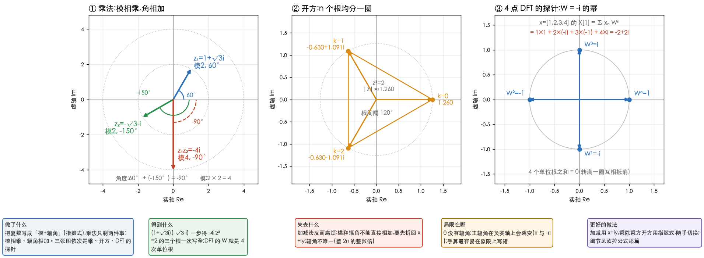

# 复数与复变函数

> 《复变函数与积分变换》(文件名写的是「华中 复变函数与积分变换 第5版」)第 1 章的学习笔记,
> 写给「大学学过复数、十年没碰、基本运算和概念都忘了」的人。
> 本章中学水平就够,除了 §1.5 里极限的 $\varepsilon$–$\delta$ 定义,**没有用到微积分**,是整本书里最轻松的一章 ——
> 轻松,但后面所有章节都踩在它上面。
>
> **动手验证**:文中每个数字、每道过关题的答案,都由
> [`33_complex_ch1.py`](../../../Python-Prototyping/Ch04_Frequency_Domain/33_complex_ch1.py)
> 跑出来;书上的例 1.2–1.8、1.12–1.16 也在里面逐个核对过。
>
> **页码**:文中写的「书 p.N」是**书里印的页码**,PDF 页 = 印刷页 + 10
> (核对过:印刷页 002 对应 PDF 第 12 页)。
> ⚠️ 这本和[信号与系统学习路线](../信号与系统学习路线.md)里提到的高教社那本**不是同一本**,
> 两本页码差不同(那本是 +8),别混用。

---

> **怎么读这篇**
>
> | 有多少时间 | 看哪几节 |
> | :--- | :--- |
> | **只有 10 分钟** | `先讲人话` + `三、三种写法` + `九、小结` —— 记住「乘法 = 旋转 + 伸缩」这一句 |
> | **第一遍学** | 再加 `一、复数怎么算` `二、模与辐角` `四、乘方与开方`,最后做 `七、过关题`:**四则运算会算、辐角不写错象限、开方能写全 n 个根**,第一章就过了 |
> | **踩坑时回来查** | `五、点集与曲线` `六、复变函数` 先认得名词,第 2 章用到再回来;`八、和图像处理的连接` 看这一章在你的主线里为什么重要 |

---

## 先讲人话

你已经有一篇[如何直观理解欧拉公式](../如何直观理解欧拉公式.md),里面讲了「复数乘 $i$ 就是逆时针转 90°」。
第一章做的事,就是**把那句话讲全**:

> **任何复数都可以看成平面上的一个箭头。加法是箭头首尾相接;
> 乘法是「长度相乘、角度相加」—— 也就是旋转加伸缩。**

整章只有两个工具:

- **代数式** $x+iy$:适合**加减**(实部加实部,虚部加虚部)
- **指数式** $r\,e^{i\theta}$:适合**乘除、乘方、开方**(模、角分开算)

会在两种写法之间随手切换,就够了。后面几节(点集、区域、复变函数)是**为第 2 章以后铺路的名词**,
认得就行,不用在这里抠证明。

你为什么要花时间在这一章?因为离散傅里叶变换(discrete Fourier transform,DFT)里
反复出现的探针 $e^{-i2\pi k/N}$,**就是 $N$ 次单位根**,而 $N$ 次单位根是本章 §1.2 的内容。
这是第一章和你的主线最直接的一个接口,见 `八、和图像处理的连接`。

---

## 一、复数怎么算

对应书 §1.1(p.1–4)。

### 复数是什么

复数(complex number)写成 $z=x+iy$,其中 $i^2=-1$。$x$ 叫实部(real part),
$y$ 叫虚部(imaginary part),记作 $\operatorname{Re}z=x$、$\operatorname{Im}z=y$。

- $y=0$ 时就是实数;$x=0$(且 $y\neq 0$)时叫纯虚数。
- 两个复数相等,当且仅当**实部相等且虚部相等**。所以 $z=0$ 当且仅当 $x=y=0$。

书里有一段话值得读一遍(p.3 末):当年人们第一次把 $-1$ 的平方根当「数」用,
觉得它是「想象出来的」,所以叫「虚数」。「复数」的意思是「复合起来的数」——
一个实数加一个纯虚数。**不用再纠结 $i$ 是什么,把它当一个满足 $i^2=-1$ 的记号就行。**

### 复平面

一个复数 $x+iy$ 对应平面上一个点 $(x,y)$:横轴叫实轴,纵轴叫虚轴,
整个平面叫复平面(complex plane)。以后**「复数」「点」「向量」不加区分**,
这是本书最基本的约定。

### 加减乘除

设 $z_1=x_1+iy_1$,$z_2=x_2+iy_2$:

| 运算 | 怎么算 | 例子 |
| :--- | :--- | :--- |
| 加减 | 实部加(减)实部,虚部加(减)虚部 | $(1+i)-(3-2i)=-2+3i$ |
| 乘 | 当多项式展开,$i^2$ 换成 $-1$ | $(2-3i)(4+5i)$:实部 $2\cdot4-(-3)\cdot5=23$,虚部 $2\cdot5+4\cdot(-3)=-2$,得 $23-2i$ |
| 除 | **分子分母同乘分母的共轭**,把分母变成实数 | 见下面 |

除法的例子,手算一遍 $\dfrac{3-2i}{2+3i}$:

$$
\begin{aligned}
\text{分子:}\quad & (3-2i)(2-3i)=6-9i-4i+6i^2=0-13i\\
\text{分母:}\quad & (2+3i)(2-3i)=2^2+3^2=13\\
\text{结果:}\quad & \frac{-13i}{13}=-i
\end{aligned}
$$

为什么要乘共轭?因为 $(x+iy)(x-iy)=x^2+y^2$,是一个实数 —— 分母变成实数,
除法就退化成「实部、虚部各除一个实数」。

### 共轭复数

共轭复数(complex conjugate):$z=x+iy$ 的共轭是 $\bar z=x-iy$,**虚部变号**,
在图上是关于实轴的镜像。用得最多的几条:

- $z\bar z=x^2+y^2$,一定是非负实数(例:$z=3+4i$ 时是 $25$)
- $\operatorname{Re}z=\dfrac{z+\bar z}{2}$,$\operatorname{Im}z=\dfrac{z-\bar z}{2i}$ —— **把实部、虚部「提」出来的办法**
- 和、积、商的共轭,等于各自共轭再做同样的运算:
  $\overline{z_1\pm z_2}=\bar z_1\pm\bar z_2$,$\overline{z_1z_2}=\bar z_1\bar z_2$,$\overline{\left(\dfrac{z_1}{z_2}\right)}=\dfrac{\bar z_1}{\bar z_2}$

书里说这些「都可以自己验证」。脚本第 1 块用随机复数把六条(含例 1.1)各验了一次,误差在 $2.2\times10^{-16}$ 量级。

---

## 二、模与辐角

对应书 §1.2.1–1.2.2(p.4–7)。

### 模

模(modulus)$\lvert z\rvert=\sqrt{x^2+y^2}$,就是箭头的长度、点到原点的距离。几个性质:

- $\lvert z\rvert^2=z\bar z$
- $\dfrac1z=\dfrac{\bar z}{\lvert z\rvert^2}$:例,$z=3+4i$,$\dfrac1z=\dfrac{3-4i}{25}=0.12-0.16i$,模 $0.2=\dfrac15$
- **$\lvert z_1-z_2\rvert$ 就是两点之间的距离**。所以「以 $z_0$ 为圆心、半径 $r$ 的圆盘」就写成 $\lvert z-z_0\rvert<r$

### 辐角

辐角(argument)是箭头与实轴正向的夹角。**它有无穷多个值,彼此差 $2k\pi$**。
书里用两个记号区分:

- $\operatorname{Arg}z$:所有辐角(一族值)
- $\arg z$:其中落在 $(-\pi,\pi]$ 里的那一个,叫主辐角(principal value of the argument)

两者的关系是 $\operatorname{Arg}z=\arg z+2k\pi$($k$ 为任意整数)。
$z=0$ 没有辐角($\lvert z\rvert=0$,没有方向可言)。

### 最容易错的地方:象限

$\arg z=\arctan\dfrac yx$ **只在 $x>0$ 时成立**。书上给了分段公式(p.5),脚本验证它与 `np.angle` 一致
(8 个点,含坐标轴上的):

| 位置 | 主辐角 $\arg z$ |
| :--- | :--- |
| $x>0$ | $\arctan\dfrac yx$ |
| $x=0,\ y>0$ | $\dfrac\pi2$ |
| $x<0,\ y\ge0$ | $\arctan\dfrac yx+\pi$ |
| $x<0,\ y<0$ | $\arctan\dfrac yx-\pi$ |
| $x=0,\ y<0$ | $-\dfrac\pi2$ |

手算一个会错的:$z=-1-i$。$\arctan\dfrac yx=\arctan1=0.7854$(**错**,那是第一象限的角);
它在第三象限,主辐角 $=0.7854-\pi=-\dfrac{3\pi}4=-2.3562$。
负实轴($y=0,\ x<0$)取 $\pi$,不取 $-\pi$。这也是书里思考题 1.3(4) 在问的:
「由 $z=x+iy$ 得 $\operatorname{Arg}z=\arctan\dfrac yx$ 对吗?」不对。

### 三角不等式

由「$\lvert z_1-z_2\rvert$ 是距离」加上「三角形两边之和大于第三边」得到三角不等式(triangle inequality):

$$
\bigl\lvert\,\lvert z_1\rvert-\lvert z_2\rvert\,\bigr\rvert\ \le\ \lvert z_1+z_2\rvert\ \le\ \lvert z_1\rvert+\lvert z_2\rvert
$$

脚本例子:$z_1=3+4i$,$z_2=1-2i$,三个量依次是 $2.7639\le4.4721\le7.2361$。
**取等号的条件**:$z_1$、$z_2$ 在过原点的同一条直线上。例:$z_1=1+i$,$z_2=2+2i$,
$\lvert z_1+z_2\rvert=4.2426=\lvert z_1\rvert+\lvert z_2\rvert$。

⚠️ **复数不能比大小**,$2i<3i$ 没有意义。不等号只能放在**模**(实数)之间。

---

## 三、三种写法

对应书 §1.2.3–1.2.4(p.7–10)。

### 从代数式到指数式

取模 $r=\lvert z\rvert$、辐角 $\theta$,就有 $x=r\cos\theta$,$y=r\sin\theta$,于是:

| 名称 | 写法 | 擅长 |
| :--- | :--- | :--- |
| 代数式 | $x+iy$ | 加、减 |
| 三角式 | $r(\cos\theta+i\sin\theta)$ | 过渡 |
| 指数式 | $r\,e^{i\theta}$ | 乘、除、乘方、开方 |

第三行靠的是欧拉公式 $e^{i\theta}=\cos\theta+i\sin\theta$(见[欧拉公式笔记](../如何直观理解欧拉公式.md))。
书里在 p.7–8 把它当作一个「引进」的记号。

例:$1+i$ 的模是 $\sqrt2$,主辐角是 $\dfrac\pi4$,所以 $1+i=\sqrt2\,e^{i\pi/4}$。
辐角不唯一,$\sqrt2\,e^{i9\pi/4}$ 也是 $1+i$。

### 乘法等于旋转加伸缩

设 $z_1=r_1e^{i\theta_1}$,$z_2=r_2e^{i\theta_2}$,则

$$
z_1z_2=r_1r_2\,e^{i(\theta_1+\theta_2)}\qquad\text{模相乘,辐角相加}
$$

$$
\frac{z_1}{z_2}=\frac{r_1}{r_2}\,e^{i(\theta_1-\theta_2)}\qquad\text{模相除,辐角相减}
$$

(这一步在书里是用 $\cos(\theta_1+\theta_2)$ 的加法公式推出来的,p.9。)
所以「乘以一个复数」只做两件事:**转一个角、拉伸一个倍数**。

两个手算例子(脚本第 3 块):

- **例 1.5**:$(1+\sqrt3\,i)(-\sqrt3-i)$。前者模 $2$、辐角 $\dfrac\pi3$;后者模 $2$、辐角 $-\dfrac{5\pi}6$。
  模 $2\times2=4$,角 $\dfrac\pi3+\left(-\dfrac{5\pi}6\right)=-\dfrac\pi2$,所以结果是 $4e^{-i\pi/2}=-4i$。
- **例 1.6**:$\dfrac{2+i}{1-2i}$。模都是 $\sqrt5$,模比是 $1$;辐角差 $\arctan\dfrac12-\arctan(-2)=\dfrac\pi2$,
  结果是 $i$。

**特例**:乘 $i$(模 $1$、辐角 $\dfrac\pi2$)就是逆时针转 90°:$i(1+i)=-1+i$
($1+i$ 在 45°,结果在 135°);乘 $-i$ 顺时针转 90°。

> 这一节的一句话,是整个信号与系统的起点:**线性时不变系统碰到一个转圈的复指数,
> 只会把它「乘一个复数」—— 也就是缩放加旋转。**

### 加减法回到代数式

加法在图上是**平行四边形法则**(箭头首尾相接),所以**加减法用指数式反而更麻烦**:
模和辐角不能直接相加,要先拆回 $x+iy$。这是两种写法分工的原因。

---

## 四、乘方与开方

对应书 §1.2.5(p.10–12)。

**读图的方法**:图①是上一节的乘法例子(蓝色 $z_1$ 转到绿色 $z_2$ 的方向,
两个模为 2 的箭头相乘得到一个模为 4 的红箭头);图②是本节的开方;图③是下一节要说的 DFT。
底部横幅回答「得到什么、失去什么」:乘除开方变简单,加减变麻烦。

### 乘方:棣莫弗公式

由乘法规则,$z^n=r^n e^{in\theta}$;当 $r=1$ 时,就是棣莫弗公式(De Moivre's formula):

$$
(\cos\theta+i\sin\theta)^n=\cos n\theta+i\sin n\theta
$$

例 1.7:$(1+\sqrt3\,i)^3$,模 $2$、辐角 $\dfrac\pi3$,所以 $=2^3e^{i\pi}=-8$。

一个副产品(书里 p.11):用它推**三倍角公式**。左边展开,实虚部分开比较,就得到

$$
\cos3\theta=\cos^3\theta-3\cos\theta\sin^2\theta,\qquad
\sin3\theta=3\cos^2\theta\sin\theta-\sin^3\theta
$$

(脚本取 $\theta=0.7$ 核对过:两边都是 $-0.504846$、$0.863209$。)

### 开方:$n$ 次方根有 $n$ 个

$z$ 的 $n$ 次方根,就是满足 $w^n=z$ 的复数 $w$。写成指数式:

$$
w=\lvert z\rvert^{1/n}\,e^{\,i(\arg z+2k\pi)/n},\qquad k=0,1,\dots,n-1
$$

关键在 $k$ 取 $0\sim n-1$ 就够了 —— $k=n$ 时角度多转了整整 $2\pi$,和 $k=0$ 重合。
所以**任何非零复数的 $n$ 次方根恰好有 $n$ 个**,均匀分布在一个圆上,是一个正 $n$ 边形的顶点。

例 1.8:解 $z^3=2$。模 $2^{1/3}=1.2599$,辐角 $0$,三个根(图②):

| $k$ | 根 | 辐角 |
| :--- | :--- | :--- |
| 0 | $1.2599$ | $0$ |
| 1 | $-0.6300+1.0911\,i$ | $\dfrac{2\pi}3$ |
| 2 | $-0.6300-1.0911\,i$ | $-\dfrac{2\pi}3$ |

脚本验证三个根的三次方都是 $2.0000$。书上把三个根写成 $\sqrt[3]{2}$、$\sqrt[3]{2}\left(-\dfrac12\pm\dfrac{\sqrt3}2\,i\right)$,数值依次就是上表三行(脚本核对了 $k=1$ 那一行)。
注意:**复数里「$2$ 的三次方根」有 3 个值**,中学里的 $\sqrt[3]{2}$ 只是其中一个(算术根)。

### 单位根

取 $z=1$,方程 $w^n=1$ 的 $n$ 个根就是 $n$ 次单位根(roots of unity):
$e^{i2\pi k/n}$,$k=0,\dots,n-1$。它们有个性质:**加起来等于 0**
(转满一圈互相抵消;脚本验证了 $n=4$、$8$)。

---

## 五、点集与曲线

对应书 §1.3(p.12–16)。**这一节认得名词就行**,到第 2、3 章(解析、积分)才会真用。

### 邻域、开集、区域

| 名词 | 意思 |
| :--- | :--- |
| 邻域 | 到 $z_0$ 的距离小于 $\delta$ 的所有点,即以 $z_0$ 为圆心的一个小圆盘 |
| 内点 | 它周围有个邻域整个落在集合里 |
| 开集 | 每个点都是内点(不含边界) |
| 闭集 | 开集的余集(含边界) |
| 边界点 | 周围**无论多小的**邻域,里面外面都有点 |
| 区域 | **连通的开集**:任意两点能用一条完全在集合里的折线连起来 |

邻域(neighborhood)、开集(open set)、区域(domain)的英文先记下。
**区域不含边界,区域加上边界才叫闭区域**,别混。

### 用不等式描述点集

书上例 1.12 的三个,配图是书里 p.14:

| 写法 | 意思 |
| :--- | :--- |
| $z+\bar z>0$ | $2x>0$,即 $x>0$,右半平面 |
| $\lvert z+2-i\rvert\ge1$ | 到 $-2+i$ 的距离 $\ge1$,以 $-2+i$ 为圆心、半径 $1$ 的圆周**及其外部** |
| $0<\arg z<\dfrac\pi3$ | 两条射线之间的角形区域 |

脚本对第二个取了 5 个点验证:到 $-2+i$ 的距离为 $1.0000$ 的点(在圆周上)算属于,$0.5000$ 的不属于,
$1.5000$、$2.2361$ 的属于。

### 曲线的参数方程

一条曲线写成 $z(t)=x(t)+iy(t)$,$a\le t\le b$:

- 圆周(圆心在原点,半径 $a$):$z=a(\cos t+i\sin t)$,$0\le t\le2\pi$
- 从 $z_1$ 到 $z_2$ 的线段:$z=z_1+(z_2-z_1)t$,$0\le t\le1$
  (例:$z_1=1+i$,$z_2=3+5i$,$t=0.5$ 时是中点 $2+3i$)

### 简单曲线与单连通

- **简单曲线**(又叫若尔当曲线 Jordan curve):自己不和自己相交。起点终点重合的叫简单闭曲线
- **若尔当曲线定理**:简单闭曲线把平面分成**内部**和**外部**两块
- **单连通区域**(simply connected):区域内任何一条简单闭曲线,都能在区域内连续缩成一点 ——
  通俗讲就是**没有洞**;有洞的叫多连通

这个概念到第 3 章的柯西积分定理才用(条件是「在单连通区域内解析」)。先留个印象。

---

## 六、复变函数

对应书 §1.4–1.5(p.16–22)。

### 无穷远点(可跳过)

书 §1.4 把 $\infty$ 定义成 $\dfrac10$,并规定了几条运算($a+\infty=\infty$,$\dfrac a\infty=0$,$a\cdot\infty=\infty$($a\ne0$)),
但 $\infty\pm\infty$、$0\cdot\infty$、$\dfrac\infty\infty$、$\dfrac00$ **没有意义**。复变量的 $\infty$ **不分正负**,
和实数里的 $+\infty$、$-\infty$ 不同。复平面加上一个「无穷远点」叫扩充复平面(extended complex plane);
几何上用一个球面(复球面)把它们一一对应起来。

后面讲留数时偶尔会说「在 $\infty$ 处」,**先知道有这个东西就行**。

### 复变函数的写法

复变函数(function of a complex variable)$w=f(z)$,
把 $z=x+iy$、$w=u+iv$ 代进去,实虚部分开:

$$
w=f(z)=u(x,y)+i\,v(x,y)
$$

所以**一个复变函数 = 一对二元实函数**。例 1.13:$w=z^2+1$,

$$
(x+iy)^2+1=(x^2-y^2+1)+i\,(2xy)\ \Longrightarrow\ u=x^2-y^2+1,\quad v=2xy
$$

代入 $z=1+2i$:$u=1-4+1=-2$,$v=2\cdot1\cdot2=4$,即 $w=-2+4i$,脚本核对一致。

反过来(例 1.14):$u=\dfrac{2x}{x^2+y^2}$、$v=\dfrac{y}{x^2+y^2}$ 合起来是 $w=\dfrac{3}{2\bar z}+\dfrac1{2z}$
(用 $x=\dfrac{z+\bar z}2$,$y=\dfrac{z-\bar z}{2i}$,$x^2+y^2=z\bar z$ 代换)。
$z=1+2i$ 时两边都是 $0.4+0.4i$。

函数也可以看作**映射**:$z$ 平面上的点 $z$ 被映到 $w$ 平面上的点 $w$。
例:$w=z^2$ 把 $z=\dfrac12+\dfrac12 i$ 映到 $w=\dfrac12 i$(模 $\dfrac{\sqrt2}2$ 的平方是 $\dfrac12$,角 45° 翻倍是 90°)。
这是后面共形映射(书第 6 章)的出发点。

### 极限与连续

形式上与微积分一模一样($\varepsilon$–$\delta$ 定义),**唯一的新东西是 $z$ 可以从任意方向趋近 $z_0$,
而且不管哪个方向,$f(z)$ 的值都要趋向同一个 $A$**。

- **定理 1.1**:$f(z)\to A$ 的充要条件是 $u\to u_0$ 且 $v\to v_0$。
  所以复变函数的极限与连续,**都化成两个实函数的极限与连续**。
- **例 1.15**:$f(z)=\dfrac{\bar z}{z}$ 在 $z=0$ 没有极限。沿角度 $\theta_0$ 的射线趋近 $0$,
  $f(z)=e^{-2i\theta_0}$:$\theta_0=0$ 时是 $1$,$\theta_0=\dfrac\pi4$ 时是 $-i$,$\theta_0=\dfrac\pi2$ 时是 $-1$。
  方向不同结果不同,所以没有极限。
- **例 1.16**:$\arg z$ 在负实轴上不连续。从上方趋近 $-1$ 得 $3.1406$,从下方得 $-3.1406$,
  差 $\approx2\pi$。(这就是为什么 $\arg$ 要「剪开」负实轴。)

多项式、有理函数(分母 $\ne0$ 的地方)都是连续的。
有界闭区域上的连续函数有三条性质(有界、模取得最大最小值、一致连续),**先认得**。

---

## 七、过关题

下面题目来自书 p.23 的习题一(1.1、1.3、1.6、1.8)。**先自己算,再看答案**。
答案是脚本算出来的;⚠️ 书末的「部分习题答案」(印刷页 216 起)我没读,没有和它对过。

### 题目

1. **习题 1.1** 计算:(1) $(1+i)-(3-2i)$;(2) $(a-ib)^3$;(3) $\dfrac{i}{(i-1)(i-2)}$;
   (4) $\dfrac{z-1}{z+1}$($z=x+iy\ne-1$,写成 $u+iv$)
2. **习题 1.3** 解方程组 $2z_1-z_2=i$,$(1+i)z_1+iz_2=4-3i$
3. **习题 1.6** 求模与主辐角:(1) $\sqrt3+i$;(2) $-1-i$;(3) $2-i$;(4) $-1+3i$
4. **习题 1.8** 写成三角式:(1) $-3+2i$;(2) $\sin\alpha+i\cos\alpha$;(3) $-\sin\dfrac\pi6-i\cos\dfrac\pi6$
5. **例 1.5 的变体**:不用乘法公式,用「模相乘、角相加」算 $(1+\sqrt3\,i)(-\sqrt3-i)$

### 答案

**1.1**

- (1) $-2+3i$
- (2) 把 $a-ib$ 立方:$(a^3-3ab^2)+i\,(b^3-3a^2b)$。取 $a=2,\ b=3$ 验证:$-46-9i$
- (3) $(i-1)(i-2)=i^2-3i+2=1-3i$,所以 $\dfrac{i}{1-3i}=\dfrac{i(1+3i)}{10}=\dfrac{-3+i}{10}=-0.3+0.1i$
- (4) 分子分母同乘 $\bar z+1$,结果是
  $\dfrac{(x^2+y^2-1)+2iy}{(x+1)^2+y^2}$
  (取 $z=0.7-1.3i$ 验算:两边都是 $0.2576-0.5677i$)

**1.3** 由第一式 $z_2=2z_1-i$,代入第二式:
$(1+i)z_1+i(2z_1-i)=(1+3i)z_1+1=4-3i$,
所以

$$
z_1=\frac{3-3i}{1+3i}=\frac{(3-3i)(1-3i)}{10}=\frac{-6-12i}{10}=-0.6-1.2i,\qquad
z_2=2z_1-i=-1.2-3.4i
$$

代回两式:得 $i$ 和 $4-3i$,对上。

**1.6**

| 复数 | 模 | 主辐角 |
| :--- | :--- | :--- |
| $\sqrt3+i$ | $2$ | $\dfrac\pi6$($0.5236$) |
| $-1-i$ | $\sqrt2$ | $-\dfrac{3\pi}4$($-2.3562$) |
| $2-i$ | $\sqrt5$ | $-\arctan\dfrac12$($-0.4636$) |
| $-1+3i$ | $\sqrt{10}$ | $\pi-\arctan3$($1.8925$) |

**1.8**

- (1) $-3+2i$:模 $\sqrt{13}=3.6056$,主辐角 $\pi-\arctan\dfrac23=2.5536$
- (2) $\sin\alpha+i\cos\alpha=\cos\left(\dfrac\pi2-\alpha\right)+i\sin\left(\dfrac\pi2-\alpha\right)$:模 $1$,辐角 $\dfrac\pi2-\alpha$
  (取 $\alpha=0.4$:$1.1708$)
- (3) $-\dfrac12-\dfrac{\sqrt3}2\,i$:模 $1$,辐角 $-\dfrac{2\pi}3$

**5.** $2e^{i\pi/3}\times2e^{-i5\pi/6}=4e^{-i\pi/2}=-4i$。

---

## 八、和图像处理的连接

| 本章内容 | 后面哪里用 |
| :--- | :--- |
| 乘法 = 旋转 + 伸缩 | 线性时不变系统对复指数的作用(频率响应) |
| $N$ 次单位根 $e^{-i2\pi/N}$ | DFT 的旋转因子。例:$x=[1,2,3,4]$,$W=e^{-i2\pi/4}=-i$,$W$ 的 0–3 次方是 $1,-i,-1,i$,$X[1]=1\cdot1+2\cdot(-i)+3\cdot(-1)+4\cdot i=-2+2i$,和 `np.fft.fft` 一致(图③) |
| 单位根之和为 0 | DFT 的正交性、帕塞瓦尔定理 |
| 共轭:$z\bar z=\lvert z\rvert^2$ | 功率谱 $\lvert X\rvert^2$;实信号 DFT 的共轭对称 $X[N-k]=\overline{X[k]}$ |
| $\operatorname{Re}z=\dfrac{z+\bar z}2$ | $\cos$ 拆成「正转 + 反转」两个复指数(负频率) |
| 开方得 $n$ 个根 | 理解为什么「频率差 $2\pi$ 是同一个频率」 |
| 区域、单连通 | 第 3 章柯西定理的条件(留数那条线) |

---

## 九、小结

书上本章的小结有四条,这里换成人话:

1. **三角式/指数式运算要熟**,并真正理解辐角是多值的、怎么按位置取主值。
2. **复数可以当点、当向量**。向量的旋转 = 乘一个模为 1 的复数。
3. **复数和实数的区别**:开方得 $n$ 个值;不能比大小;「绝对值」(模)是距离,
   且复数有辐角这个实数没有的东西。
4. **区域、单连通、简单曲线**这几个名词,第 2 章起天天用。

**你要带走的只有一句话**:加减看 $x+iy$,乘除看「模相乘、角相加」。

---

## 相关文档

- [如何直观理解欧拉公式](../如何直观理解欧拉公式.md) —— $e^{i\theta}$ 为什么等于 $\cos\theta+i\sin\theta$
- [信号与系统学习路线](../信号与系统学习路线.md) —— 这一章在整条路线里的位置
- [留数定理的本质是什么](../留数定理的本质是什么.md) —— 第 5 章的前瞻(第 3、4 章读完再回头看)
