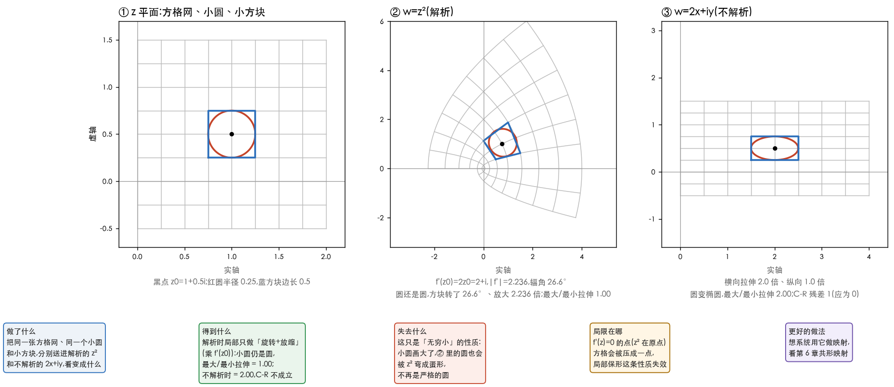

# 解析函数

> 《复变函数与积分变换》(华中科技大学数学系,第 5 版)第 2 章的学习笔记。接着[第 1 章](01-复数与复变函数.md)读:
> 第 1 章把复数讲成了「平面上的箭头」,这一章问:**箭头到箭头的函数,怎么求导?**
> 答案比实数里苛刻得多 —— 而这份苛刻,换来了整门课最漂亮的一批结论。
>
> **动手验证**:文中每个数字、每道过关题的答案,都由
> [`34_complex_ch2.py`](../../../Python-Prototyping/Ch04_Frequency_Domain/34_complex_ch2.py)
> 跑出来;书上的例 2.1~2.13 也在里面逐个核对过。
>
> **页码**:文中写的「书 p.N」是书里印的页码,PDF 页 = 印刷页 + 10。

---

> **怎么读这篇**
>
> | 有多少时间 | 看哪几节 |
> | :--- | :--- |
> | **只有 10 分钟** | `先讲人话` + `三、C-R 方程` 里的「三步判断」+ `九、小结` |
> | **第一遍学** | 再加 `一、导数` `二、解析` `五、指数与对数`,最后做 `八、过关题`:**会判断一个函数在哪可导、在哪解析;会算 $e^z$、$\operatorname{Ln}z$、$z^\alpha$ 的值,知道它们多值在哪** |
> | **踩坑时回来查** | `四、调和函数` 要到第 5 章(留数)与实际应用时才真正用;`六、幂函数` `七、三角函数` 先认得;`九` 里的「和图像处理的连接」看这一章在你的主线里的位置 |

---

## 先讲人话

实数的导数,是「函数值的变化量 ÷ 自变量的变化量」,往左凑或往右凑,结果必须一样,否则就不可导(比如 $\lvert x\rvert$ 在 0 点)。

复数的导数用的是**同一个式子**,可是复数是平面上的点,凑近一个点的方向有无穷多个。于是「可导」要求的是:

> **从平面上任何一个方向凑近,差商都得到同一个复数。**

这条要求苛刻到什么程度?$\lvert z\rvert^2$ 看着多温和,却只在原点一个点可导。反过来,一旦一个函数在**一整片区域**里处处可导(叫「解析」),它立刻变得极其规矩:

- 实部和虚部**不是随便两个函数**,必须满足一组方程(柯西-黎曼方程),并且各自满足拉普拉斯方程(叫调和函数);
- 局部只做一件事:**旋转加放缩**(乘一个复数 $f'(z_0)$),小圆变小圆;
- 后面第 3、4、5 章的积分、级数、留数,全靠这份规矩。

第二个主题是**初等函数**:$e^z$、$\ln z$、$z^\alpha$、$\sin z$ 都被推广到复数上。推广之后出现三件实数里没有的新事:**$e^z$ 有周期**($2\pi i$)、**$\ln z$ 和 $z^\alpha$ 有无穷多个值**、**$\sin z$ 可以大于 1**。

---

## 一、导数

对应书 §2.1.1(p.25~26)。

### 定义

设 $w=f(z)$ 在 $z_0$ 的某个邻域内有定义。若极限

$$
f'(z_0)=\lim_{\Delta z\to0}\frac{f(z_0+\Delta z)-f(z_0)}{\Delta z}
$$

存在(有限的复数),就说 $f$ 在 $z_0$ 处可导(differentiable),极限值记作 $f'(z_0)$。
写成「线性近似」的样子就是 $\Delta w=f'(z_0)\,\Delta z+o(\lvert\Delta z\rvert)$,所以可导也叫可微。可导一定连续。

和实数的唯一区别,就在 $\Delta z\to0$ 里:**$\Delta z$ 可以沿任何方向趋于 0**。

### 只在一点可导的例子

例 2.1:$f(z)=\lvert z\rvert^2$ 在 $z=0$ 处。差商是

$$
\frac{\lvert z\rvert^2-0}{z-0}=\frac{z\bar z}{z}=\bar z\ \to\ 0\quad(z\to0)
$$

所以 $f'(0)=0$。但换到 $z_0=1+i$,差商变成 $\bar z_0+z_0\,e^{-2i\theta}+\bar h$(这里 $\theta$ 是趋近的方向,$h=\Delta z$,最后一项趋于 0),**与方向有关**:

| 趋近方向 | $z_0=1+i$ 处的差商 |
| :--- | :--- |
| 沿实轴($\theta=0$) | $2$ |
| 沿虚轴($\theta=\pi/2$) | $-2i$ |

两个方向给出两个不同的值,所以 $\lvert z\rvert^2$ 在 $z_0=1+i$ 不可导。(脚本第 1 块;公式预测值与数值完全一致。)

### 处处不可导的例子

例 2.2:$f(z)=\operatorname{Re}z$。取任一点 $z_0$,沿**实轴**方向差商恒为 $1$,沿**虚轴**方向差商恒为 $0$,
两个方向一个 1 一个 0,所以在平面上**每一点都不可导**。

### 对照:可导的样子

$f(z)=z^2$ 在 $z_0=1+0.5i$,四个方向($0$、$\pi/4$、$\pi/2$、$\pi$)的差商全是 $2+i$(= $2z_0$),方向无关。这才是「可导」的样子。

---

## 二、解析

对应书 §2.1.2(p.26~27)。

### 定义

若 $f(z)$ 在 $z_0$ 及 **$z_0$ 的某个邻域内**处处可导,就说 $f$ 在 $z_0$ 处解析(analytic);在区域 $D$ 内每点解析,就叫 $D$ 内的解析函数。不解析的点叫奇点(singular point)。

书里强调了两句,值得抄下来:

- **解析是区域上的性质,不是一个点上的性质**。
- 点可导 ≠ 点解析:$\lvert z\rvert^2$ 在原点可导,可它在原点的任何邻域里都不可导,所以原点**不解析**。
  但**在区域内**,「处处可导」和「处处解析」是一回事。

### 求导法则

和实数完全一样(证明也一样),所以不用重学:

$$
(f\pm g)'=f'\pm g',\qquad (fg)'=f'g+fg',\qquad \Bigl(\frac fg\Bigr)'=\frac{f'g-fg'}{g^2},
$$

$$
(z^n)'=nz^{n-1},\qquad \bigl[g(f(z))\bigr]'=g'(f(z))\,f'(z)\quad(\text{复合}),\qquad \varphi'(w)=\frac1{f'(z)}\quad(\text{反函数}).
$$

结论:**多项式处处解析;两个多项式相除,除了分母为 0 的点之外处处解析。**

例 2.3:$f(z)=\dfrac{2z^5-z+3}{4z^2+1}$ 在除去 $z=\pm\dfrac i2$ 的区域里解析,导数是

$$
f'(z)=\frac{24z^6+10z^4+4z^2-24z-1}{(4z^2+1)^2}.
$$

---

## 三、C-R 方程

对应书 §2.1.3(p.27~30)。

### 实部虚部要满足的方程

把 $f(z)=u(x,y)+i\,v(x,y)$ 写成实部虚部。如果 $f$ 在 $z=x+iy$ 可导,把「沿实轴凑近」和「沿虚轴凑近」两个差商令其相等,就得到柯西-黎曼方程(Cauchy–Riemann equations,简称 C-R 方程):

$$
\frac{\partial u}{\partial x}=\frac{\partial v}{\partial y},\qquad
\frac{\partial u}{\partial y}=-\frac{\partial v}{\partial x}
$$

直觉:沿**实轴**走一小步($\Delta z=\Delta x$),差商是 $\dfrac{\Delta u+i\Delta v}{\Delta x}\to u_x+i\,v_x$;沿**虚轴**走一小步($\Delta z=i\,\Delta y$),差商是 $\dfrac{\Delta u+i\Delta v}{i\,\Delta y}\to\dfrac{u_y+i\,v_y}{i}=v_y-i\,u_y$。
两个方向必须给出同一个 $f'$,即 $u_x+i\,v_x=v_y-i\,u_y$,对比实部和虚部就是上面两个等式。

### 定理与导数公式

- **定理 2.1**:$f$ 在 $z$ 处可导 ⇔ $u,v$ 在 $(x,y)$ 处**可微**,并且满足 C-R 方程。
- **定理 2.2 与推论**:在区域 $D$ 内,若 $u,v$ 的四个一阶偏导数存在**且连续**,并满足 C-R 方程,则 $f$ 在 $D$ 内解析。
- 此时导数可以直接算(书式 2.4):

$$
f'(z)=\frac{\partial u}{\partial x}+i\,\frac{\partial v}{\partial x}=\frac{\partial v}{\partial y}-i\,\frac{\partial u}{\partial y}
$$

### 三步判断

1. 拆出 $u(x,y)$、$v(x,y)$,算四个偏导数;
2. 检查 C-R 方程在哪些点成立(得到一个方程组,解出「可导的点集」);
3. 若**在一个区域里**都成立,并且四个偏导数连续 ⇒ 解析;若只在孤立点或曲线上成立 ⇒ 只在这些点可导,**处处不解析**。

### 几个函数对照

用脚本的数值 C-R 残差(越接近 0 越满足,取 3 个点的最大值)对照:

| 函数 | C-R 残差 | 结论 |
| :--- | :--- | :--- |
| $z^2$ | $3.3\times10^{-10}$ | 满足,处处解析 |
| $e^z$ | $4.4\times10^{-10}$ | 满足,处处解析 |
| $\sin z$ | $1.1\times10^{-10}$ | 满足,处处解析 |
| $1/z$ | $1.7\times10^{-10}$ | 满足(除 $z=0$) |
| $\bar z$ | $2.00$ | 不满足,处处不可导 |
| $\operatorname{Re}z$ | $1.00$ | 不满足,处处不可导 |
| $\lvert z\rvert^2$ | $2.40$ | 一般点不满足 |

$\lvert z\rvert^2=x^2+y^2$ 的 $u=x^2+y^2$、$v=0$,C-R 方程变成 $2x=0$、$2y=0$,**只在原点成立**:取 $z=0$ 残差为 $0$,取 $z=1+i$ 残差是 $(2,2)$。所以它只在原点可导,处处不解析。

$e^z$ 的 $u=e^x\cos y$、$v=e^x\sin y$,四个偏导数连续,C-R 成立,所以处处解析,并且在 $z=0.7-0.4i$ 处
$u_x+i\,v_x=1.8548-0.7842i$,恰好等于 $e^z$ 本身 ——「$(e^z)'=e^z$」。

### C-R 的几何含义

**读图的方法**:图①是 $z$ 平面,黑点是 $z_0=1+0.5i$,红圆、蓝方块是它周围的小圆和小方块;图②是送进解析的 $z^2$ 之后的样子,圆还是圆,方块只是**转了 26.6°、放大了 2.236 倍**(正好是 $f'(z_0)=2z_0=2+i$ 的辐角和模);
图③是送进不解析的 $2x+iy$,圆被拉成了椭圆(横向 2 倍、纵向 1 倍,最大/最小拉伸比 2.00)。这就是 C-R 方程的几何含义:**局部只做旋转和放缩**(Jacobian 矩阵是 $\begin{bmatrix}a&-b\\b&a\end{bmatrix}$ 的形状,正好是「乘以复数 $a+ib$」)。

### C-R 成立却不可导

C-R 方程只是**必要**条件,不是充分条件。书上的反例:$u=v=\dfrac{xy}{x^2+y^2}$($u(0,0)=0$)。
原点处四个偏导数全是 $0$,C-R 成立。但这个函数在原点**连续都做不到**:沿实轴趋近得 $0$,沿 $y=x$ 趋近得 $\dfrac{1+i}2=0.5+0.5i$(脚本第 2 块)。不连续,当然不可导。
所以定理里要求 $u,v$「可微」(或推论里的「偏导数连续」)不是多余的。

### 必为常数的三种情形

解析函数 $f$ 在区域 $D$ 内,只要满足下面任何一条,就必为常数:(1) $f'(z)=0$;(2) $\operatorname{Re}f$ 为常数;(3) $\lvert f\rvert$ 为常数。
想想为什么(2)能成立:$u$ 是常数 ⇒ $u_x=u_y=0$ ⇒ 由 C-R 得 $v_x=v_y=0$ ⇒ $v$ 也是常数。
**解析函数的实部虚部,绑得很死。**

---

## 四、调和函数

对应书 §2.2(p.30~34)。

### 拉普拉斯方程

若二元实函数 $\varphi(x,y)$ 有连续二阶偏导数,并满足拉普拉斯方程(Laplace's equation)

$$
\frac{\partial^2\varphi}{\partial x^2}+\frac{\partial^2\varphi}{\partial y^2}=0,
$$

就叫调和函数(harmonic function)。(静电场的电势、无源无旋的流速场里的势函数,都是调和函数。)

**定理 2.3**:解析函数的实部 $u$ 和虚部 $v$ 都是调和函数。证明只有两行:对 C-R 的两个式子,分别对 $y$、$x$ 求偏导,再用「混合偏导可交换」,就得到 $v_{xx}+v_{yy}=u_{xy}-u_{yx}=0$。

### 共轭调和函数

若 $\varphi,\psi$ 都是调和函数,且满足 C-R 方程 $\varphi_x=\psi_y$、$\varphi_y=-\psi_x$,就说 $\psi$ 是 $\varphi$ 的共轭调和函数(harmonic conjugate)。
**定理 2.4**:$u+iv$ 解析 ⇔ $v$ 是 $u$ 的共轭调和函数。

⚠️ 「共轭」是**有方向**的:$\psi$ 是 $\varphi$ 的共轭,**$\varphi$ 不是 $\psi$ 的共轭**,而是 $-\varphi$(这是思考题 2.3、习题 2.8 在问的)。
也不是任意两个调和函数拼起来就解析:习题 2.7 的 $u=x^2-y^2$、$v=\dfrac y{x^2+y^2}$ 各自调和,可是拼成 $u+iv$ 在 $z=1+i$ 处的 C-R 残差是 $(2.000,-2.500)$,不解析。

### 手算验证:离散拉普拉斯

调和函数「二阶偏导之和为 0」,在图像处理里你已经见过它的离散版 —— 5 点拉普拉斯模板

$$
\begin{bmatrix}0&1&0\\1&-4&1\\0&1&0\end{bmatrix}.
$$

拿它扫例 2.6 的 $u=x^3-3xy^2$:在 $(0,0)$、$(2,3)$、$(-4,1)$、$(5,-2)$ 四个点,输出**恰好都是 $0$**(三次多项式的二阶差分是线性的,正好抵消:$x^3$ 的差分是 $6x$,$-3xy^2$ 的是 $-6x$);它的共轭 $v=3x^2y-y^3$ 也一样。
对照不调和的 $u=x^2+y^2$:在 $(2,3)$ 输出 $4$(与 $\Delta=2+2=4$ 一致)。(脚本第 3 块。)

### 偏积分法求解析函数

已知 $u$(是调和函数),求解析函数 $f=u+iv$,方法是:用 C-R 方程把 $v$ 的两个偏导数求出来,**对一个变量积分,再用另一个偏导数定出积分「常数」**。

例 2.6:$u=x^3-3xy^2$,要求 $f(0)=i$。

1. $v_y=u_x=3x^2-3y^2$,对 $y$ 积分:$v=3x^2y-y^3+\varphi(x)$;
2. $v_x=6xy+\varphi'(x)$ 要等于 $-u_y=6xy$,所以 $\varphi'(x)=0$,$\varphi=C$;
3. $f=x^3-3xy^2+i(3x^2y-y^3+C)=z^3+iC$,由 $f(0)=i$ 得 $C=1$,**$f(z)=z^3+i$**。

验证:取 4 个点,$\operatorname{Re}f=u$、$\operatorname{Im}f=v+1$ 全部成立。

同样可以由虚部求实部。例 2.7:$v=e^x(y\cos y+x\sin y)+x+y$,$f(0)=0$,得 $f(z)=z\,e^z+(1+i)z$(脚本取 3 个点验证 $\operatorname{Im}f$ 与已知 $v$ 的最大误差 $0$)。
例 2.8:$u=x^2-y^2+xy$,$f(i)=-1+i$,得 $f(z)=\bigl(1-\tfrac i2\bigr)z^2+\tfrac i2$,代入 $f(i)=-1+i$ 对上。

### 一个小结论

习题 2.5:若 $f$ 解析,则 $\Delta\lvert f\rvert^2=4\lvert f'\rvert^2$。取 $f=z^3+2z$,在 $(0.6,-0.9)$ 处数值算得左边 $43.6804$,右边 $4\lvert f'\rvert^2=43.6804$,完全一样。
这也说明 $\lvert f\rvert^2$ 一般**不调和**(只有 $f'=0$,即常数,才调和)。

---

## 五、指数与对数

对应书 §2.3.1~2.3.2(p.34~38)。

### 指数函数

$$
e^z=e^x(\cos y+i\sin y)\quad(z=x+iy)
$$

当 $y=0$ 时就是实数的 $e^x$,所以复指数是实指数在整个平面上的**解析推广**,并且 $(e^z)'=e^z$。四条性质:

1. $\lvert e^z\rvert=e^x$,$\operatorname{Arg}e^z=y+2k\pi$,所以 $e^z$ **永远不等于 0**。取 $z=0.8-1.3i$:$\lvert e^z\rvert=2.2255=e^{0.8}$,辐角 $-1.3$。
2. $e^{z_1}e^{z_2}=e^{z_1+z_2}$(验证误差 $6\times10^{-17}$)。
3. **以 $2\pi i$ 为周期**:$e^{z+2\pi i}=e^z$。这是实数里**没有**的性质。
4. 当 $z\to\infty$ 时 $e^z$ **没有极限**:沿实轴向右,$e^{10}=22026.5$ 越来越大;沿实轴向左,$e^{-10}=4.54\times10^{-5}$ 趋于 0。

例 2.9:$e^{-3+\pi i/4}=e^{-3}\bigl(\cos\frac\pi4+i\sin\frac\pi4\bigr)=0.035205+0.035205i$。

例 2.10:$\Bigl(\dfrac{-2+i}{1+2i}\Bigr)^{1/3}$。先化简括号:$\dfrac{-2+i}{1+2i}=i$。再开三次方,三个根是

$$
e^{i\pi/6}=0.8660+0.5i,\qquad e^{i5\pi/6}=-0.8660+0.5i,\qquad e^{-i\pi/2}=-i.
$$

### 对数函数

对数定义成指数的反函数:满足 $e^w=z$($z\neq0$)的 $w$,记作 $\operatorname{Ln}z$。解方程得

$$
\operatorname{Ln}z=\ln\lvert z\rvert+i\operatorname{Arg}z=\ln\lvert z\rvert+i(\arg z+2k\pi)
$$

实部 $\ln\lvert z\rvert$ 是唯一的,虚部有无穷多个(辐角多值),所以 **$\operatorname{Ln}z$ 是多值函数,值与值之间相差 $2\pi i$ 的整数倍**。取 $k=0$,得到一个单值的「分支」,叫主值(principal value),记小写 $\ln z=\ln\lvert z\rvert+i\arg z$。

书里提醒要分清三种对数:实变量的 $\ln x$($x>0$)、复变量的 $\operatorname{Ln}z$(多值)、主值 $\ln z$(单值,虚部是主辐角)。当 $z$ 是正实数时,主值就是实数对数。

几个手算例子(例 2.11~2.13):

| 求什么 | 结果 | 数值 |
| :--- | :--- | :--- |
| $\operatorname{Ln}(-1)$ | $(2k+1)\pi i$ | $\ldots,-3.1416i,\ 3.1416i,\ 9.4248i,\ldots$ |
| $\operatorname{Ln}(2-3i)$ | $\tfrac12\ln13-i\bigl(\arctan\tfrac32+2k\pi\bigr)$ | 主值 $1.2825-0.9828i$ |
| $\ln i$ | $\dfrac\pi2 i$ | $1.5708i$ |
| $\ln(-2+3i)$ | $\tfrac12\ln13+i\bigl(\pi-\arctan\tfrac32\bigr)$ | $1.2825+2.1588i$ |

### 对数的性质

- **成立**:$\operatorname{Ln}(z_1z_2)=\operatorname{Ln}z_1+\operatorname{Ln}z_2$(要理解成「两边值的集合相等」)。
  但**只取主值时不一定成立**:$z_1=-1+i$、$z_2=-1+2i$,$\ln(z_1z_2)=1.1513-1.8925i$,而 $\ln z_1+\ln z_2=1.1513+4.3906i$,差正好是 $2\pi i$。
- **不成立**:$\operatorname{Ln}z^2\ne2\operatorname{Ln}z$。取 $z=-1+i$:$\ln z^2=0.6931-1.5708i$,$2\ln z=0.6931+4.7124i$,差 $2\pi i$。
  原因:$\operatorname{Ln}z^2$ 的值是 $2\ln z+2k\pi i$($k$ 任意整数),而 $2\operatorname{Ln}z$ 的值只有 $2\ln z+4k\pi i$(偶数倍)。习题 2.18 就是在考这个。
- **解析性**:主值 $\ln z$ 在**除去原点和负实轴**的平面上解析,并且 $(\ln z)'=\dfrac1z$(取 $z_0=1+i$:数值导数 $0.5-0.5i=1/z_0$ ✓)。
  在负实轴上不连续:$\ln(-1+0.001i)=3.1406i$,$\ln(-1-0.001i)=-3.1406i$,差 $\approx2\pi i$(这就是第 1 章例 1.16 里 $\arg z$ 的跳变)。

---

## 六、幂函数

对应书 §2.3.3(p.38~39)。

幂函数用指数和对数来定义:

$$
z^\alpha=e^{\alpha\operatorname{Ln}z}\qquad(\alpha\ \text{为复常数},\ z\neq0)
$$

因为 $\operatorname{Ln}z$ 多值,$z^\alpha$ 一般也多值。不同的 $\alpha$ 给出不同的「多值程度」:

| $\alpha$ | $z^\alpha$ 有几个值 | 例 |
| :--- | :--- | :--- |
| 正整数 $n$ | 1 个(单值) | $z^n=\lvert z\rvert^n e^{in\arg z}$ |
| $1/n$ | $n$ 个 | 即第 1 章的开 $n$ 次方 |
| 有理数 $p/q$(互素) | $q$ 个 | $8^{2/3}$:$4,\ -2-3.4641i,\ -2+3.4641i$ |
| 无理数或虚部不为 0 的复数 | **无穷多个** | 见下面 |

两个书上的例子:

- $i^i=e^{i\operatorname{Ln}i}=e^{-(\pi/2+2k\pi)}$:$k=0$ 得 $0.20788$,$k=1$ 得 $0.000388$,$k=-1$ 得 $111.318$。**一个纯实数,而且有无穷多个值**。
- $2^{1+i}=2e^{-2k\pi}\bigl(\cos\ln2+i\sin\ln2\bigr)$:$k=0$ 得 $1.5385+1.2779i$,$k=1$ 得 $0.0029+0.0024i$($\ln2=0.6931$)。

$z^\alpha$ 的各个分支,在除去原点和负实轴的平面上都解析。

---

## 七、三角函数

对应书 §2.3.4~2.3.6(p.39~42)。**这一节认得就行**。

### 定义与性质

由欧拉公式 $e^{iy}=\cos y+i\sin y$ 把 $\cos$、$\sin$ 写成指数,再把实数 $y$ 换成复数 $z$,就是定义:

$$
\cos z=\frac{e^{iz}+e^{-iz}}{2},\qquad \sin z=\frac{e^{iz}-e^{-iz}}{2i}
$$

和实数一样的:单值、周期 $2\pi$、$\cos$ 偶 $\sin$ 奇、$\sin^2z+\cos^2z=1$、加法公式、处处解析、$(\sin z)'=\cos z$。
(脚本取 $z=0.7-1.1i$ 验证:$\sin^2z+\cos^2z=1.0000$,$\sin(z+2\pi)-\sin z=0$,数值导数 $(\sin z)'=1.27615+0.86045i=\cos z$。)

### 和实数不一样的

- **不再有界**:$\cos(iy)=\dfrac{e^{-y}+e^{y}}2=\cosh y$,取 $y=3$ 得 $10.0677$,取 $y=10$ 得 $\lvert\cos10i\rvert=11013.2$。「$\lvert\sin x\rvert\le1$」到了复数里**不成立**。
- **$\sin^2z$ 可以是负数**:$\sin^2(-3i)=-\dfrac{(e^3-e^{-3})^2}{4}=-100.3578$。

### 其他

正切、余切等照常用 $\sin/\cos$ 定义。反三角函数(Arccos、Arcsin、Arctan)和双曲函数($\sinh$、$\cosh$ 等)书里也给了定义,例如

$$
\sinh z=-i\sin iz,\qquad \cosh z=\cos iz,\qquad \operatorname{Arccos}z=-i\operatorname{Ln}\bigl(z+\sqrt{z^2-1}\bigr).
$$

用到再查,**先知道它们都能用 $e^z$ 和 $\operatorname{Ln}$ 写出来、反函数都是多值的**就行(验证:$\sinh z=-i\sin iz$,取 $z=0.7-1.1i$ 两边都是 $0.3441-1.1186i$)。

---

## 八、过关题

下面题目来自书 p.43~44 的思考题和习题二。**先自己算,再看答案**。答案是脚本算出来的;⚠️ 书末的「部分习题答案」(印刷页 216 起)我没读,没有和它对过。

### 题目

1. **习题 2.1** 用导数定义求:(1) $f=1/z$;(2) $f=z\operatorname{Re}z$ 的导数(并说明在哪可导)
2. **习题 2.2** 何处可导、何处解析:(2) $x^2+iy^2$;(3) $x^3-3xy^2+i(3x^2y-y^3)$;(4) $\sin x\cosh y+i\cos x\sinh y$
3. **习题 2.3** 求解析区域、奇点和导数:(1) $\dfrac1{z^2-1}$;(2) $\dfrac{az+b}{cz+d}$($c,d$ 不全为 0)
4. **习题 2.9** 由已知条件求解析函数 $f=u+iv$:(2) $v=2xy+3x$;(3) $u=2(x-1)y,\ f(0)=-i$;(4) $u=e^x(x\cos y-y\sin y),\ f(0)=0$
5. **习题 2.13** 解方程:(1) $e^z=1+\sqrt3\,i$;(2) $\ln z=\dfrac{\pi i}2$;(3) $\sin z=i\sinh1$;(4) $\sin z+\cos z=0$
6. **习题 2.14** 求值:(1) $\cos i$;(2) $\operatorname{Ln}(-3+4i)$;(3) $(1-i)^{1+i}$;(4) $3^{3-i}$
7. **习题 2.18** 指出错在哪:(1) $\operatorname{Ln}z^2=2\operatorname{Ln}z$;(2) $\operatorname{Ln}1=\operatorname{Ln}\dfrac zz=\operatorname{Ln}z-\operatorname{Ln}z=0$
8. **思考题 2.1~2.4**:点可导与点解析有什么不同?「实部虚部满足 C-R 的函数是解析函数」成立吗?$\psi$ 是 $\varphi$ 的共轭调和函数,$\varphi$ 是 $\psi$ 的共轭调和函数吗?$\operatorname{Ln}(z_1z_2)=\operatorname{Ln}z_1+\operatorname{Ln}z_2$ 里令 $z_1=z_2=z$,能写成 $\operatorname{Ln}z^2$ 吗?

### 答案

**2.1**

- (1) $f'(z)=-\dfrac1{z^2}$。取 $z_0=0.5-0.4i$:$-0.5354-2.3795i$,和数值差商一致。
- (2) 在 $z=0$ 处可导,导数 $0$;在 $z\neq0$ 处**不可导**:取 $z_0=1+i$,沿实轴差商 $2+i$,沿虚轴差商 $1$,两个方向不同。

**2.2**

- (2) $u=x^2$,$v=y^2$,C-R 方程是 $2x=2y$,所以**只在直线 $y=x$ 上可导,处处不解析**。(数值:$z=0$、$1+i$、$0.5+0.5i$ 残差为 $0$,$z=1$ 残差 $2$。)
- (3) 这是 $z^3$ 的实部虚部,**处处可导、处处解析**。
- (4) $\sin x\cosh y+i\cos x\sinh y=\sin z$(习题 2.15(1) 证明),**处处解析**。

**2.3**

- (1) 奇点 $z=\pm1$,其余处处解析,$f'(z)=\dfrac{-2z}{(z^2-1)^2}$。取 $z=0.3+0.2i$:$-0.52534-0.58527i$,和数值一致。
- (2) 奇点 $z=-\dfrac dc$(当 $c\ne0$),$f'(z)=\dfrac{ad-bc}{(cz+d)^2}$。数值验证一致。

**2.9**

- (2) $v=2xy+3x$ ⇒ $u_x=v_y=2x$,$u=x^2+g(y)$,$u_y=-v_x=-(2y+3)$ ⇒ $g=-y^2-3y$。$f=x^2-y^2-3y+C+i(2xy+3x)=z^2+3iz+C$。
- (3) $u=2(x-1)y$,$f(0)=-i$ ⇒ $f(z)=-i(z-1)^2$。验证:$f(0)=-i$,$\operatorname{Re}f(0.4+0.6i)=-0.72=2(0.4-1)\cdot0.6$。
- (4) $f(z)=z\,e^z$。验证:$f(0)=0$,$\operatorname{Re}f(0.5+0.7i)=-0.1130=u$。

**2.13**

- (1) $z=\operatorname{Ln}(1+\sqrt3\,i)=\ln2+i\bigl(\tfrac\pi3+2k\pi\bigr)$;验算 $e^z=1+1.7321i$。
- (2) $z=e^{i\pi/2}=i$。
- (3) $z=i+2k\pi$ 或 $z=\pi-i+2k\pi$(因为 $\sin(\pi-z)=\sin z$);验算 $\sin i=\sin(\pi-i)=1.1752i=i\sinh1$。
- (4) $\tan z=-1$,$z=-\dfrac\pi4+k\pi$。验算 $\sin+\cos$ 在 $-\pi/4$ 与 $3\pi/4$ 都是 $0$。

**2.14**

- (1) $\cos i=\dfrac{e+e^{-1}}2=\cosh1=1.5431$。
- (2) $\operatorname{Ln}(-3+4i)=\ln5+i\bigl(\pi-\arctan\tfrac43+2k\pi\bigr)$,主值 $1.6094+2.2143i$。
- (3) $(1-i)^{1+i}=\sqrt2\,e^{\pi/4-2k\pi}\bigl[\cos(\tfrac12\ln2-\tfrac\pi4)+i\sin(\tfrac12\ln2-\tfrac\pi4)\bigr]$,主值($k=0$)$2.8079-1.3179i$。
- (4) $3^{3-i}=27\,e^{2k\pi}e^{-i\ln3}$,主值 $12.2805-24.0456i$。

**2.18**

- (1) $\operatorname{Ln}z^2=2\ln z+2k\pi i$($k$ 任意整数),$2\operatorname{Ln}z=2\ln z+4k\pi i$,**值的集合不一样**,不能写等号。例:$z=-1+i$,$\ln z^2$ 与 $2\ln z$ 的虚部差 $2\pi$。
- (2) $\operatorname{Ln}1=2k\pi i$($k$ 任意整数),而「$\operatorname{Ln}z-\operatorname{Ln}z$」只有在两项取同一个分支时才恒为 $0$,取不同分支时是 $2\pi i$ 的整数倍,所以第三个等号写成 $=0$ 只是其中一种取法。

**思考题**

- 2.1:点可导只要求在**一个点**的差商有极限;点解析要求在这个点的**整个邻域**都可导。区域内两者等价,孤立点上不等价($\lvert z\rvert^2$ 在原点可导、不解析)。
- 2.2:**不成立**。C-R 只是必要条件;还要求 $u,v$ 可微(推论里要求偏导数连续)。反例 $u=v=\dfrac{xy}{x^2+y^2}$ 满足原点的 C-R,但原点不连续。
- 2.3:**不是**。$\psi$ 是 $\varphi$ 的共轭调和函数,意思是 $\varphi_x=\psi_y$、$\varphi_y=-\psi_x$;若 $\varphi$ 也是 $\psi$ 的共轭,就还要 $\psi_x=\varphi_y$、$\psi_y=-\varphi_x$,两组符号正好相反,同时成立只能都是常数。
  准确的说法是:**$-\varphi$ 才是 $\psi$ 的共轭调和函数**(习题 2.8)。
- 2.4:$\operatorname{Ln}(z\cdot z)$ **可以**写成 $\operatorname{Ln}z^2$(就是 $z_1z_2=z^2$ 而已);但 $\operatorname{Ln}z+\operatorname{Ln}z$ **不能**写成 $2\operatorname{Ln}z$:
  左边是「两个独立取分支的值相加」,值是 $2\ln z+(k_1+k_2)2\pi i$(含奇数倍),右边 $2\operatorname{Ln}z$ 只有偶数倍。

---

## 九、小结

书上本章的小结有四条,这里换成人话:

1. **解析 = 区域内处处可导**,C-R 方程是判断的主要工具。点可导不等于点解析,区域内才等价。
2. **会由调和函数求共轭**,拼出解析函数。解析函数的实部虚部都调和且互为共轭;随便两个调和函数拼起来不一定解析。
3. **初等函数是实函数的推广**,推广后必须保住的是解析性。$z^n$、$e^z$、$\sin z$、$\cos z$ 处处解析;$\ln z$、$z^\alpha$ 的单值分支在去掉原点和负实轴的平面上解析。
4. **记住复数里和实数不一样的三处**:$e^z$ 有周期 $2\pi i$;$\operatorname{Ln}z$、$z^\alpha$ 多值(分支怎么取);$\sin z$、$\cos z$ 无界。

### 和图像处理的连接

| 本章内容 | 后面哪里用 |
| :--- | :--- |
| $\lvert e^z\rvert=e^x$,$\arg e^z=y$ | 拉普拉斯变换里 $e^{st}$($s=\sigma+i\omega$):**实部 $\sigma$ 管增长衰减,虚部 $\omega$ 管旋转**;DFT 里的 $e^{i\omega n}$ 就是 $\sigma=0$ 的特例 |
| $e^z$ 周期 $2\pi i$ | 离散频率 $\omega$ 与 $\omega+2\pi$ 是同一个频率(采样、混叠、DFT 周期延拓) |
| $\arg z$ 在负实轴上跳变 $\pm\pi$ | 相位谱(DFT 结果的辐角)的「相位解缠」:画出来的相位图有 $\pm\pi$ 的跳变,不一定是信号真的突变 |
| 调和函数 $\Delta\varphi=0$ | 第 3 章的拉普拉斯锐化:5 点模板扫调和函数输出**恰好为 0**(见「四、调和函数」里的手算),也就是对「光滑的调和部分」没有响应,锐化提取的是它之外的细节 |
| 解析函数局部 = 旋转 + 放缩 | 第 6 章共形映射;也是「复数乘法 = 旋转放缩」的升级版 |
| 解析函数的实部虚部绑得很死 | 第 3~5 章积分与留数:解析 + 单连通区域 ⇒ 积分与路径无关 |

**你要带走的一句话**:复数可导,要求任何方向的差商都相同;一个函数在一片区域内可导,就必然「只旋转和放缩」。
