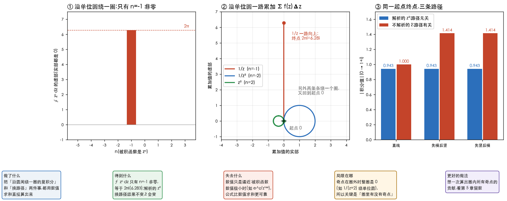

# 复变函数的积分

> 《复变函数与积分变换》(华中科技大学数学系,第 5 版)第 3 章的学习笔记。接着[第 2 章](02-解析函数.md)读:
> 第 2 章问「怎么求导」,这一章问「怎么积分」。答案里有整门课最漂亮的一句话 ——
> **解析函数沿闭曲线绕一圈,积分是 0**;以及它的「反面」:**只有圈里有奇点时,才会有非零的值**。
> 后面第 4、5 章的级数和留数,都是从这一章长出来的。
>
> **动手验证**:文中每个数字、每道过关题的答案,都由
> [`35_complex_ch3.py`](../../../Python-Prototyping/Ch04_Frequency_Domain/35_complex_ch3.py)
> 跑出来;书上例 3.1~3.12 里能数值验证的也在里面核对过。
>
> **页码**:文中写的「书 p.N」是书里印的页码,PDF 页 = 印刷页 + 10。

---

> **怎么读这篇**
>
> | 有多少时间 | 看哪几节 |
> | :--- | :--- |
> | **只有 10 分钟** | `先讲人话` + `三、绕圈的积分` + `八、小结` |
> | **第一遍学** | 再加 `一、复积分` `四、柯西积分定理` `五、柯西积分公式`,最后做 `七、过关题`:**会把复积分化成普通积分算;会判断圈里有没有奇点;会套柯西积分公式** |
> | **踩坑时回来查** | `二、性质与估值` `六、高阶导数` 的证明可以跳过,只记结论;最大模原理、刘维尔定理先认得 |

---

## 先讲人话

实数的积分是「在数轴上一段一段加起来」。复数的积分只多了一件事:**不是在一条线上走,而是在平面上沿着一条曲线走**,每走一小步 $\Delta z$(它是个复数,有长度也有方向),就乘上这一点的函数值 $f(z)$,再把所有的乘积加起来:

$$
\int_C f(z)\,dz=\lim\sum f(\zeta_k)\,\Delta z_k
$$

整章只围着三件事转:

1. **怎么算**:曲线写成参数方程,$z=z(t)$,就化成普通的定积分(§一)。
2. **绕一圈等于几**:$\oint\dfrac{dz}{z-z_0}=2\pi i$,而 $\oint(z-z_0)^n dz$($n\neq-1$)全是 $0$。**这是整章最重要的一个计算,记住它。**
3. **为什么解析函数这么听话**:函数在圈里处处解析 ⇒ 绕一圈等于 0(柯西积分定理);圈里有一个「洞」,值就等于「洞」周围的函数值乘以 $2\pi i$(柯西积分公式)。

跟你的主线的关系:第 3 件事里「转满整圈互相抵消」,和 DFT 里 $\sum e^{i2\pi km/N}=0$ 是**同一件事**(见 `三、绕圈的积分`)。

---

## 一、复积分

对应书 §3.1.1(p.46~49)。

### 定义与化成定积分

设 $C$ 是平面上一条光滑曲线,起点 $A$、终点 $B$,把它切成 $n$ 小段,每段取一点 $\zeta_k$,作和 $\sum f(\zeta_k)\Delta z_k$。让最长的一段趋于 $0$,极限(与取点、切法都无关)就是 $\int_C f(z)\,dz$。
沿 $C$ 的反方向积分,值变号;**闭曲线的正方向是逆时针**,记作 $\oint_C$。

脚本取 $f=z^2$,直线 $0\to3+4i$,每段取左端点,精确值 $\dfrac{(3+4i)^3}3=-39+14.667i$:

| 分段数 $n$ | 4 | 40 | 400 | 4000 |
| :--- | :--- | :--- | :--- | :--- |
| 求和与精确值的差 | $14.3$ | $1.55$ | $0.156$ | $0.0156$ |

$n$ 扩大 10 倍,误差缩小约 10 倍,这就是「极限」的意思。

实际算的时候不用求和。把曲线写成参数方程 $z=z(t)$($a\le t\le b$),代入就变成**普通的定积分**(书式 3.4):

$$
\int_C f(z)\,dz=\int_a^b f\bigl(z(t)\bigr)\,z'(t)\,dt
$$

两个直接可用的写法:线段 $z_1\to z_2$ 用 $z=z_1+(z_2-z_1)t$,圆周用 $z=z_0+re^{i\theta}$。

### 路径有关的例子

例 3.1:$f=\bar z$,从 $1$ 到 $i$。

| 路径 | $\displaystyle\int\bar z\,dz$ |
| :--- | :--- |
| 直线 $1\to i$ | $i$ |
| 折线 $1\to0\to i$ | $0$ |

两条路的值**不一样**。(脚本数值:直线 $1.0000i$,折线 $0.0000$,和书上一致。)
换成解析的 $z^2$:直线与折线都是 $-0.3333-0.3333i$,**一样**。区别就在于 $\bar z$ 不解析 —— 第三节的柯西积分定理会解释为什么。

### 路径无关的例子

例 3.3:$\int_C z\,dz$,$C$ 是 $0\to3+4i$ 的直线。$z=(3+4i)t$,$dz=(3+4i)dt$,

$$
\int_0^1(3+4i)^2\,t\,dt=\tfrac12(3+4i)^2=-3.5+12i
$$

换一条路 $0\to3\to3+4i$(先横后竖),数值算出来是同一个 $-3.5+12i$。

---

## 二、性质与估值

对应书 §3.1.2(p.49~51)。

### 基本性质

线性($\int kf=k\int f$、$\int(f\pm g)$ 拆开)、方向反过来变号、路径可以拆段 $\int_{C_1+C_2}=\int_{C_1}+\int_{C_2}$,都和实数的曲线积分一样,不用重学。

### 估值不等式

$$
\Bigl\lvert\int_C f\,dz\Bigr\rvert\ \le\ \int_C\lvert f\rvert\,ds,\qquad\text{若 }\lvert f\rvert\le M,\ C\text{ 长 }L:\quad \Bigl\lvert\int_C f\,dz\Bigr\rvert\le ML
$$

(因为 $\lvert dz\rvert=ds$:每一小步模不超过弧长,模的和不超过模的最大值乘总长。)

例 3.4:$C$ 是 $0\to3+4i$,估 $\Bigl\lvert\int_C\dfrac{dz}{z-i}\Bigr\rvert$ 的上界。$\lvert\frac1{z-i}\rvert$ 在线段上最大是 $\frac53$,线段长 $5$,所以 $\le\frac{25}3=8.33$。
数值:实际值 $2.7641$,上界 $8.3333$(上界只要求「不小于」)。最大值 $\frac53=1.6667$ 也被数值核对了。

例 3.5:$\displaystyle\lim_{r\to0}\oint_{\lvert z\rvert=r}\frac{z^3}{1+z^2}\,dz=0$。用估值:被积函数的模 $\le\dfrac{r^3}{1-r^2}$,圆周长 $2\pi r$,所以 $\le\dfrac{2\pi r^4}{1-r^2}\to0$。
数值(取 $r=0.5,0.2,0.1,0.05$):上界依次是 $0.524,\ 0.0105,\ 6.35\times10^{-4},\ 3.94\times10^{-5}$,实际积分值都远小于上界(它们其实恰好是 0,因为 $\frac{z^3}{1+z^2}$ 在这些圆里解析)。

估值不等式在后面**证明留数、证明刘维尔定理**时用得很频繁,先记下形状。

---

## 三、绕圈的积分

对应书例 3.2(p.48)。**这是整章最重要的计算。**

### 结论

$C$ 是以 $z_0$ 为圆心、$r$ 为半径的圆周(逆时针),$n$ 是任意整数:

$$
\oint_C\frac{dz}{(z-z_0)^n}=\begin{cases}2\pi i,&n=1\\[2pt]0,&n\neq1\end{cases}
$$

**与圆心 $z_0$ 和半径 $r$ 都无关。**

### 为什么

圆周上 $z=z_0+re^{i\theta}$,$dz=ire^{i\theta}d\theta$,所以

$$
\oint_C\frac{dz}{(z-z_0)^n}=\int_0^{2\pi}\frac{ire^{i\theta}}{r^ne^{in\theta}}\,d\theta=\frac{i}{r^{n-1}}\int_0^{2\pi}e^{-i(n-1)\theta}\,d\theta
$$

最后一个积分是「把一个以整数 $m=n-1$ 的速度转圈的单位向量,转满一整圈加起来」:$m=0$ 时它不动,加起来是 $2\pi$;$m\neq0$ 时转满整圈互相抵消,是 $0$。脚本验证 $m=0,1,2,3$ 分别得 $2\pi,\ 0,\ 0,\ 0$。

脚本还在三个不同的圆(圆心 $0$ 半径 1;圆心 $2+i$ 半径 0.3;圆心 $-1-2i$ 半径 5)上,对 $n=-2,\dots,3$ 各算一遍:**只有 $n=1$ 是 $6.283i$,其余全是 $0$**。

**读图的方法**:图①是 $\oint z^n dz$ 随 $n$ 变化的柱状图,只有 $n=-1$(即 $\frac1z$)那一根柱子,高度 $2\pi$。
图②把一圈切成很多小步,每步的 $f(z)\Delta z$ 首尾相接,画出「一路累加」的轨迹:$\frac1z$ 的每一步方向相同,一路向上到 $2\pi i$(红色);而 $\frac1{z^2}$、$z^2$ 的每一步方向在转,绕一圈之后**回到起点**(蓝、绿)。
图③是同一起点终点、三条不同路径的积分值大小,蓝色(解析的 $z^2$)三条路完全一样,红色(不解析的 $\bar z$)不一样。

> **和 DFT 的关系**:$\sum_{m=0}^{N-1}e^{i2\pi km/N}$ 在 $k\neq0$ 时为 $0$、$k=0$ 时为 $N$,是**同一个** 「转满整圈抵消」。把离散的求和换成连续的积分,就是这里的 $\int_0^{2\pi}e^{-im\theta}d\theta$。
> 所以你在信号与系统里学的「正交性」,和留数定理背后的东西,是同一件事 ——
> 详见[留数定理的本质是什么](../留数定理的本质是什么.md)(第 5 章读完再回头看更顺)。

---

## 四、柯西积分定理

对应书 §3.2(p.51~56)。

### 定理

**柯西积分定理**(Cauchy's integral theorem):$f$ 在**单连通区域** $D$ 内解析,则沿 $D$ 内任意一条简单闭曲线 $C$,

$$
\oint_C f(z)\,dz=0
$$

(单连通就是第 1 章里说的「没有洞」。)

书里的证明用格林公式把积分变成面积分,里面的被积函数正好是 C-R 方程里「应该为 0 的那两个差」:

$$
\oint_C f\,dz=-\iint\Bigl(\frac{\partial v}{\partial x}+\frac{\partial u}{\partial y}\Bigr)dxdy+i\iint\Bigl(\frac{\partial u}{\partial x}-\frac{\partial v}{\partial y}\Bigr)dxdy=0
$$

(这个证明要多假设 $f'$ 连续,完整的证明叫柯西-古尔萨定理,书里略。**这一点不影响用**。)

数值验证:沿单位圆一圈,$z^2,\ e^z,\ \sin z,\ \cos z$ 都是 $0.0000$;奇点在圈外的 $\dfrac1{z^2+4z+4}$(奇点 $-2$)、$\dfrac1{\cos z}$(奇点 $\pm\frac\pi2$)也都是 $0.0000$;
而 $\bar z$、$\dfrac1z$ 都是 $6.283i$(不解析、或圈里有奇点)。

### 积分与路径无关

$f$ 在单连通区域 $D$ 内解析,$z_0$、$z_1$ 是 $D$ 里的两点,则 $\int_{z_0}^{z_1}f\,dz$ **只和起点终点有关,和路径无关**。
(证明很短:两条路径一正一反拼成一条闭曲线,积分是 $0$。)

数值:$\int_0^{1+i}z^2\,dz$,直线、先横后竖、先竖后横三条路,都是 $-0.6667+0.6667i$。

### 原函数与积分公式

固定起点 $z_0$,让终点 $z$ 在 $D$ 里变,$F(z)=\int_{z_0}^zf(\zeta)d\zeta$ 是 $D$ 内的解析函数,且 $F'(z)=f(z)$。满足 $G'=f$ 的 $G$ 叫 $f$ 的**原函数**,于是

$$
\int_{z_0}^{z_1}f(z)\,dz=G(z_1)-G(z_0)
$$

**和实数的牛顿-莱布尼茨公式一模一样,微积分里求不定积分的那一套(分部积分、换元)都能用。**

| 例子 | 做法 | 结果 |
| :--- | :--- | :--- |
| 例 3.6 $\int\sin z\,dz$,$C$ 是圆 $\lvert z-1\rvert=1$ 的上半圆,$0\to2$ | 解析,换成实轴 $0\to2$ | $1-\cos2=1.4161$(沿上半圆数值也是 $1.416147$) |
| 例 3.8 $\int_a^bz^n\,dz$ | 原函数 $\frac{z^{n+1}}{n+1}$ | $\frac{b^{n+1}-a^{n+1}}{n+1}$,取 $n=3,a=1+i,b=2-i$:$-0.75-6i$ |
| 例 3.9 $\int\ln(1+z)\,dz$,$-i\to i$ | 分部积分 | $\bigl(-2+\ln2+\frac\pi2\bigr)i=0.2639i$ |

### 闭路变形与复合闭路

如果区域里有「洞」(有奇点),定理就不能直接用了。书里推广成两个结论:

**闭路变形原理**(定理 3.4):$C_2$ 在 $C_1$ 内部,$f$ 在两圈之间的环形区域内解析,则 $\oint_{C_1}f\,dz=\oint_{C_2}f\,dz$。**在解析区域内,把闭曲线连续变形,积分值不变**。
(脚本:$\oint\frac1zdz$ 沿 $\lvert z\rvert=1$、$\lvert z\rvert=3$、一个把原点围在里面的矩形,三个都是 $2\pi i$;换成不围原点的矩形,是 $0$。)

**复合闭路定理**:大圈 $C$ 里有几个互不相交的小圈 $C_1,\dots,C_n$,圈与圈之间 $f$ 解析,则

$$
\oint_Cf\,dz=\sum_{k=1}^n\oint_{C_k}f\,dz
$$

例 3.7:$\displaystyle\oint_C\frac{2z-1}{z^2-z}dz$,$C$ 是包住 $0$ 和 $1$ 的闭曲线。先拆成 $\dfrac{2z-1}{z^2-z}=\dfrac1z+\dfrac1{z-1}$,在 $0$ 附近画小圆 $C_1$、在 $1$ 附近画小圆 $C_2$:

$$
\oint_C=\underbrace{\oint_{C_1}\frac{dz}z}_{2\pi i}+\underbrace{\oint_{C_1}\frac{dz}{z-1}}_{0}+\underbrace{\oint_{C_2}\frac{dz}z}_{0}+\underbrace{\oint_{C_2}\frac{dz}{z-1}}_{2\pi i}=4\pi i
$$

脚本用一个 $[-2,3]\times[-2,2]$ 的大方框直接数值积分,得 $12.5664i=4\pi i$;两个小圆分别是 $6.2832i$,和为 $12.5664i$,与书一致。

**这就是留数定理的前半截**:圈里每个奇点各贡献一份,把各份加起来。第 5 章会把「各份」命名成「留数」,并给出一个快速算它的办法。

---

## 五、柯西积分公式

对应书 §3.3(p.56~61)。

### 公式

**柯西积分公式**(Cauchy's integral formula):$f$ 在简单闭曲线 $C$ 围成的区域 $D$ 内解析,在 $D\cup C$ 上连续,$z_0$ 是 $D$ 内任意一点,则

$$
f(z_0)=\frac1{2\pi i}\oint_C\frac{f(z)}{z-z_0}\,dz\qquad\Longleftrightarrow\qquad\oint_C\frac{f(z)}{z-z_0}\,dz=2\pi i\,f(z_0)
$$

读法:**一个解析函数在圈内任何一点的值,完全由它在圈上的值决定**。
推导思路(书里的证明):被积函数 $\frac{f(z)}{z-z_0}$ 在 $z_0$ 处有奇点,用闭路变形把大圈缩成以 $z_0$ 为圆心的小圆,小圆很小时 $f(z)\approx f(z_0)$,于是
$\oint\frac{f(z)}{z-z_0}dz\approx f(z_0)\oint\frac{dz}{z-z_0}=2\pi i\,f(z_0)$ —— 用的正是第三节那个「绕圈等于 $2\pi i$」。

数值验证(圈取 $\lvert z\rvert=2$):

| 函数 | $z_0$ | 积分 $\div\,2\pi i$ | $f(z_0)$ |
| :--- | :--- | :--- | :--- |
| $e^z$ | $0.3+0.2i$ | $1.322952+0.268176i$ | $1.322952+0.268176i$ |
| $z^3+2z$ | $-0.5+0.7i$ | $-0.390000+1.582000i$ | $-0.390000+1.582000i$ |
| $\sin z$ | $0.1$(圈 $\lvert z\rvert=1$) | $0.099833$ | $0.099833$ |

$z_0$ 在圈**外**时,$\frac{f(z)}{z-z_0}$ 在圈内解析,积分是 $0$(例:$\oint_{\lvert z\rvert=2}\frac{e^z}{z-5}dz=0.0000$)。

### 平均值公式

取圈为 $\lvert z-z_0\rvert=R$,$z=z_0+Re^{i\theta}$,公式化成

$$
f(z_0)=\frac1{2\pi}\int_0^{2\pi}f\bigl(z_0+Re^{i\theta}\bigr)\,d\theta
$$

**解析函数在圆心的值,等于它在圆周上的平均值**。数值:$e^z$($z_0=0.3+0.2i$,$R=1.5$)圆周平均 $1.322952+0.268176i$,正是圆心的值;$z^2+1$($z_0=1-i$,$R=0.7$)平均 $1-2i$,也是圆心的值。
对照不解析的 $\lvert z\rvert^2$(圆心 $z_0=1$,半径 $0.5$):圆周平均 $1.25$,不等于圆心的值 $1$。

> **和图像处理的连接**:第 2 章里 $x^3-3xy^2$ 在每个像素的 5 点拉普拉斯都是 $0$,它等价于「**上下左右四个邻居的平均,恰好等于自己**」。
> 平均值公式是它的连续版:调和函数(包括所有解析函数的实部虚部)在每一点都等于周围圆周上的平均。**平均不会改变它**,也不会「创造」新的极大值,这是最大模原理的来源。

### 例 3.10

(1) $\displaystyle\oint_{\lvert z\rvert=2}\frac{\sin z}z\,dz=2\pi i\sin0=0$。
(2) $\displaystyle\oint_{\lvert z\rvert=2}\frac z{(9-z^2)(z+i)}\,dz$:奇点是 $\pm3$ 和 $-i$,只有 $-i$ 在圈内。把 $\dfrac z{9-z^2}$ 当 $f(z)$,$z_0=-i$,

$$
=2\pi i\cdot\frac z{9-z^2}\Bigr\rvert_{z=-i}=2\pi i\cdot\frac{-i}{10}=\frac\pi5=0.6283
$$

脚本数值也是 $0.6283$。

### 最大模原理

**定理 3.8**:$f$ 在区域 $D$ 内解析且**不是常数**,则 $\lvert f\rvert$ 在 $D$ **内部**取不到最大值。
(用平均值公式反证:圆心处的模如果最大,平均值公式迫使整个圆上模都一样大,再一路推下去 $f$ 是常数。)
推论:在**有界闭区域**上连续、内部解析的 $f$,$\lvert f\rvert$ 的最大值**一定在边界上**。

数值:$f=z^2+z$,$\lvert z\rvert\le1$:最大 $\lvert f\rvert=2.0000$,在边界 $z=1$;内部 $\lvert z\rvert=0.5$ 圈上的最大只有 $0.7500$。
例 3.11 的 $M(r)=\max_{\lvert z\rvert=r}\lvert f\rvert$ 是 $r$ 的增函数,就是这个原理的应用。

---

## 六、高阶导数

对应书 §3.4(p.61~64)。

### 解析函数的导数还是解析的

实函数里,一阶导数存在不保证二阶导数存在。**复函数完全不同**:只要在区域内可导(即解析),**它的各阶导数都存在,而且都是解析函数**。公式是柯西积分公式「对 $z$ 求导」的结果:

$$
f^{(n)}(z)=\frac{n!}{2\pi i}\oint_C\frac{f(\zeta)}{(\zeta-z)^{n+1}}\,d\zeta\qquad(n=1,2,\dots)
$$

**两个用法**:一是用积分代替求导;二是**反过来,用求导来算积分**:

$$
\oint_C\frac{f(\zeta)}{(\zeta-z_0)^{n+1}}\,d\zeta=\frac{2\pi i}{n!}\,f^{(n)}(z_0)
$$

数值验证:取 $f=e^z$,$z_0=0.3+0.2i$,$n=0,1,2,3,5$,每一阶的 $f^{(n)}(z_0)$ 都应该等于 $e^{z_0}=1.322952+0.268176i$,脚本五次算出来都是这个值;
$f=\sin z$,$z_0=0.5$,$n=3$:算出 $-0.877583$,正是 $-\cos0.5$。

### 例 3.12

(1) $\displaystyle\oint_{\lvert z-i\rvert=1}\frac{\cos z}{(z-i)^3}\,dz=\frac{2\pi i}{2!}(\cos z)''\Bigr\rvert_{z=i}=-\pi i\cos i=-\frac{\pi i}2(e+e^{-1})=-4.8477i$。数值也是 $-4.8477i$。

(2) $\displaystyle\oint_{\lvert z\rvert=4}\frac{e^z}{z^2(z-1)^2}\,dz$:圈里有两个奇点 $0$、$1$,先用复合闭路拆成两个小圈,每个小圈上用高阶导数公式:

$$
=2\pi i\Bigl[\frac{e^z}{(z-1)^2}\Bigr]'_{z=0}+2\pi i\Bigl[\frac{e^z}{z^2}\Bigr]'_{z=1}=6\pi i-2\pi e\,i=2\pi(3-e)i=1.7701i
$$

数值也是 $1.7701i$。

### 柯西不等式与刘维尔定理

**柯西不等式**(定理 3.10):$f$ 在 $\lvert z-z_0\rvert<R$ 内解析,$\lvert f\rvert\le M$,则

$$
\bigl\lvert f^{(n)}(z_0)\bigr\rvert\le\frac{n!\,M}{R^n}
$$

(用高阶导数公式加估值不等式 $ML$ 一步得到。)

**刘维尔定理**(Liouville's theorem):**在整个平面上解析并且有界的函数,一定是常数**。
证明只有一行:取 $n=1$,$\lvert f'(z_0)\rvert\le\dfrac MR$,令 $R\to\infty$ 得 $f'(z_0)=0$。

数值:$e^z$,$z_0=0$,$R=1$,$M=e$:$n=1,2,3,5$ 时 $\lvert f^{(n)}(0)\rvert=1$,上界依次是 $2.718,\ 5.437,\ 16.31,\ 326.2$,都成立。

> 刘维尔定理是「解析函数很刚」的一个极端表现:**在整个平面上有界的光滑函数,只有常数一种**($e^z$ 沿实轴向右无界、$\sin z$ 沿虚轴无界,所以它们不是常数)。
> 它的一个著名推论是代数基本定理(任何一个次数 $\ge1$ 的多项式在复数里一定有根),书里没展开,先知道有这回事。

---

## 七、过关题

下面题目来自书 p.65~66 的思考题和习题三。**先自己算,再看答案**。答案是脚本算出来的;⚠️ 书末的「部分习题答案」(印刷页 216 起)我没读,没有和它对过。**习题 3.10(3) 我没做**:那道题书上的被积函数和路径印得我辨认不清,宁可不写也不去猜。

### 题目

1. **习题 3.1** 计算 $\int_0^{1+i}\bigl[(x-y)+ix^2\bigr]dz$,路径:(1) 直线;(2) 先沿实轴到 $1$ 再垂直到 $1+i$;(3) 先沿虚轴到 $i$ 再水平到 $1+i$
2. **习题 3.2** $\oint_C\dfrac{\bar z}{\lvert z\rvert}dz$,$C$:(1) $\lvert z\rvert=2$;(2) $\lvert z\rvert=4$
3. **习题 3.3** 证明 $\Bigl\lvert\int_C\dfrac{dz}{z^2}\Bigr\rvert\le\dfrac\pi4$,$C$ 是从 $1-i$ 到 $1$ 的直线段
4. **习题 3.4** 沿 $\lvert z\rvert=1$,**用观察法**判断:(1) $\oint\dfrac1{z^2+4z+4}dz$;(2) $\oint\dfrac1{\cos z}dz$;(3) $\oint\dfrac1{z-\frac12}dz$
5. **习题 3.5** $\int_C\dfrac{e^z}zdz$,$C$ 是正向圆周 $\lvert z\rvert=2$ 与负向圆周 $\lvert z\rvert=1$ 组成
6. **习题 3.6、3.7** $\oint_{\lvert z\rvert=2}\dfrac1{z^2-z}dz$;$\oint_{\lvert z\rvert=3}\dfrac1{(z-i)(z+2)}dz$
7. **习题 3.8** (1) $\int_0^{\pi i}\sin z\,dz$;(2) $\int_1^{1+i}ze^z\,dz$;(3) $\int_0^i(3e^z+2z)\,dz$
8. **习题 3.9** $\int_C\dfrac1{z^2}dz$,$C$ 是圆周 $\lvert z+i\rvert=2$ 的右半周,从 $-3i$ 到 $i$
9. **习题 3.10** (1) $\oint_{\lvert z-2\rvert=1}\dfrac{e^z}{z-2}dz$;(2) $\oint_{\lvert z\rvert=2}\dfrac{2z^2-z+1}{z-1}dz$;(4) $\oint_{\lvert z\rvert=r}\dfrac{dz}{(z-1)^n}$($r\neq1$)
10. **习题 3.11** $I=\oint_C\dfrac{z\,dz}{(2z+1)(z-2)}$,$C$:(1) $\lvert z\rvert=1$;(2) $\lvert z-2\rvert=1$;(3) $\lvert z-1\rvert=\frac12$;(4) $\lvert z\rvert=3$
11. **习题 3.13** (1) $\oint_{\lvert z\rvert=1}\dfrac{e^z}{z^{100}}dz$;(2) $\oint_{\lvert z\rvert=2}\dfrac{\sin z}{(z-\frac\pi2)^2}dz$;(3) $\oint\dfrac{\cos z}{z^3}dz$,$C=C_1+C_2$($C_1$:$\lvert z\rvert=2$,$C_2$:$\lvert z\rvert=3$,都正向)
12. **习题 3.14、3.15** 证明:$f$ 在 $\lvert z\rvert\le1$ 上解析,$\lvert z\rvert=1$ 上 $\lvert f(z)-z\rvert<\lvert z\rvert$,则 $\bigl\lvert f'(\frac12)\bigr\rvert\le8$;$f,g$ 在区域 $D$ 解析,在 $D$ 内一条简单闭曲线 $C$ 上相等,则在 $C$ 内处处相等
13. **思考题 3.1~3.3** 复积分与实曲线积分有什么异同?柯西积分定理的条件、结论?柯西积分定理与柯西积分公式有什么联系?

### 答案

**3.1**(被积函数 $(x-y)+ix^2$ 不解析,所以路径不同结果不同)

| 路径 | 结果 |
| :--- | :--- |
| (1) 直线($x=y=t$,$dz=(1+i)dt$) | $\displaystyle\int_0^1it^2(1+i)\,dt=\frac{(1+i)i}3=-\frac13+\frac i3$ |
| (2) 先横后竖 | $-\frac12+\frac56i$ |
| (3) 先竖后横 | $-\frac12-\frac16i$ |

(三个结果的数值都已经和脚本核对。)

**3.2** 圆周上 $\dfrac{\bar z}{\lvert z\rvert}=e^{-i\theta}$,$dz=ire^{i\theta}d\theta$,乘起来是 $ir\,d\theta$,积分 $2\pi i\,r$:
(1) $4\pi i=12.566i$;(2) $8\pi i=25.133i$。

**3.3** 线段 $z=1+it$($-1\le t\le0$),$\lvert z\rvert^2=1+t^2$。$\Bigl\lvert\int\frac{dz}{z^2}\Bigr\rvert\le\int\frac{ds}{\lvert z\rvert^2}=\int_{-1}^0\frac{dt}{1+t^2}=\frac\pi4$,得证。(实际值 $\bigl\lvert-\frac12+\frac i2\bigr\rvert=0.7071<0.7854$。)

**3.4**(1) 奇点 $-2$ 在圈外,$0$;(2) 奇点 $\pm\frac\pi2\approx\pm1.57$ 在圈外,$0$;(3) 奇点 $\frac12$ 在圈内,$2\pi i$。数值依次是 $0.0000$、$0.0000$、$6.2832i$。

**3.5** 圆环的边界(外圈正向、内圈负向)。$\frac{e^z}z$ 在圆环里解析,积分是 $0$。数值也是 $0$(每个圈单独是 $2\pi i$,一正一负相消)。

**3.6** $\dfrac1{z^2-z}=\dfrac1{z-1}-\dfrac1z$,两个奇点都在圈里,$2\pi i-2\pi i=0$。
**3.7** 部分分式后两项的系数是 $\pm\dfrac1{2+i}$,两个奇点都在圈里,相消,$0$。数值都是 $0.0000$。

**3.8**
- (1) $-\cos z\bigr\rvert_0^{\pi i}=1-\cosh\pi=-10.5920$
- (2) 原函数 $(z-1)e^z$,$=i\,e^{1+i}=-2.2874+1.4687i$
- (3) $3e^z+z^2$,$=3e^i-4=-2.3791+2.5244i$

**3.9** 原函数 $-\dfrac1z$:$-\dfrac1i-\Bigl(-\dfrac1{-3i}\Bigr)=\dfrac{4i}3=1.3333i$(沿右半周数值也是 $1.3333i$)。

**3.10**
- (1) $2\pi i\,e^2=46.4268i$
- (2) $f(z)=2z^2-z+1$,$f(1)=2$,所以 $4\pi i=12.5664i$
- (4) $r<1$ 时 1 在圈外,是 $0$;$r>1$ 时 $n=1$ 是 $2\pi i$,$n\neq1$ 是 $0$

**3.11** 奇点是 $z=-\frac12$ 和 $z=2$:
- (1) 圈 $\lvert z\rvert=1$ 内只有 $-\frac12$:$2\pi i\cdot\dfrac{z}{2(z-2)}\Bigr\rvert_{z=-1/2}=\dfrac{\pi i}5=0.6283i$
- (2) 圈内只有 $2$:$2\pi i\cdot\dfrac z{2z+1}\Bigr\rvert_{z=2}=\dfrac{4\pi i}5=2.5133i$
- (3) 圈 $\lvert z-1\rvert=\frac12$ 里一个奇点都没有:$0$
- (4) 都在圈里,两个之和 $\pi i=3.1416i$(数值也是这四个值)

**3.13**
- (1) $f=e^z$,$n=99$:$\dfrac{2\pi i}{99!}$(数值上是 $0$,因为 $99!$ 约 $10^{156}$)
- (2) $\dfrac{2\pi i}{1!}(\sin z)'\Bigr\rvert_{z=\pi/2}=2\pi i\cos\frac\pi2=0$
- (3) 每个圈各 $\dfrac{2\pi i}{2!}(\cos z)''(0)=-\pi i$,两个圈合起来 $-2\pi i=-6.2832i$

**3.14** 圆上 $\lvert f\rvert\le\lvert f-z\rvert+\lvert z\rvert<2$,所以 $M=2$。柯西公式 $f'(\frac12)=\dfrac1{2\pi i}\oint_{\lvert z\rvert=1}\dfrac{f(z)}{(z-\frac12)^2}dz$,圆上 $\lvert z-\frac12\rvert\ge\frac12$,用 $ML$ 估计:$\lvert f'(\frac12)\rvert\le\dfrac1{2\pi}\cdot\dfrac{2}{(1/2)^2}\cdot2\pi=8$。
(举例:$f=1.9z$ 满足 $\lvert f-z\rvert=0.9\lvert z\rvert<\lvert z\rvert$,$f'(\frac12)=1.9\le8$。)

**3.15** 在 $C$ 内任取一点 $z_0$,由柯西积分公式 $f(z_0)=\dfrac1{2\pi i}\oint_C\dfrac{f(z)}{z-z_0}dz$,$g(z_0)$ 同理。因为 $f=g$ 在 $C$ 上,两个积分一样,所以 $f(z_0)=g(z_0)$。**解析函数只要在一条闭曲线上相等,整个里面都相等。**

**思考题**
- 3.1:复积分的实部虚部各是一个实的**第二型曲线积分**(书式 3.3),所以性质基本一样,区别在于 $\int_Cdz$ 是起点终点之差(与路径无关),而 $\int_C\lvert dz\rvert=\int_Cds$ 是弧长(与路径有关)。
- 3.2:柯西积分定理:$f$ 在单连通区域内解析 ⇒ 沿内部任意简单闭曲线积分为 $0$。复合闭路定理:多连通区域里,外圈积分等于各个内圈(都正向)积分之和,证明用的是「作割线,把多连通区域变成单连通区域」。
- 3.3:柯西积分公式是柯西积分定理对 $\dfrac{f(z)}{z-z_0}$ 这个「圈内有一个奇点」的函数用复合闭路定理,把大圈缩成以 $z_0$ 为圆心的小圆,再让半径趋于 0 得到。

---

## 八、小结

书上本章的小结换成人话:

1. **复积分化成两个实的曲线积分**,或者直接用参数方程化成普通定积分。
2. **柯西积分定理**:单连通区域内解析 ⇒ 沿闭曲线是 0;由此得到积分与路径无关,并且有原函数和牛顿-莱布尼茨公式。
3. **多连通区域**:闭路变形原理和复合闭路定理,把大圈拆成圈里每个奇点的小圈。
4. **柯西积分公式**:圈内一点的函数值由圈上的值决定;平均值公式、最大模原理是它的直接推论。
5. **高阶导数公式**:解析函数的导数还是解析的,并且可以反过来用求导算积分;柯西不等式和刘维尔定理是它的推论。
6. **选方法的次序**(书里强调的一件事):先看圈里有没有奇点 —— 没有直接是 $0$;有一个简单的 $\frac1{z-z_0}$ 型,用柯西积分公式;有 $\frac1{(z-z_0)^{n+1}}$ 型,用高阶导数公式;有几个奇点,先拆成小圈再各自用公式。

### 和图像处理的连接

| 本章内容 | 后面哪里用 |
| :--- | :--- |
| $\oint\frac{dz}{(z-z_0)^n}$ 只有 $n=1$ 非零 | 第 4 章洛朗级数里「只有 $\frac1{z-z_0}$ 那一项」会留下;第 5 章留数就是那一项的系数 |
| 转满整圈抵消($\int e^{-im\theta}d\theta=0$) | DFT 的正交性、帕塞瓦尔定理、逆变换里的 $\frac1N$ |
| 闭路变形、复合闭路 | 拉氏逆变换用的回路积分(沿一个大圈,圈里有几个极点就加几份) |
| 平均值公式 | 调和函数在每一点等于周围的平均,连续版的「均值滤波不改变它」;仓库第 3 章空间滤波里的拉普拉斯锐化,提取的是「偏离周围平均」的部分 |
| 估值不等式 $\lvert\int\rvert\le ML$ | 留数定理证明里「半圆弧上的积分趋于 0」,也就是逆拉氏变换和傅里叶逆变换里的约当引理 |

**你要带走的一句话**:解析函数绕圈,只有圈里的奇点会留下东西;最基本的那份,就是 $\oint\dfrac{dz}{z-z_0}=2\pi i$。

---

## 相关文档

- [解析函数](02-解析函数.md) —— 上一章,C-R 方程与初等函数
- [留数定理的本质是什么](../留数定理的本质是什么.md) —— 这一章的 `三、绕圈的积分` 就是它的第一步
- [信号与系统学习路线](../信号与系统学习路线.md) —— DFT 的正交性和这一章的「转满整圈抵消」是同一件事
