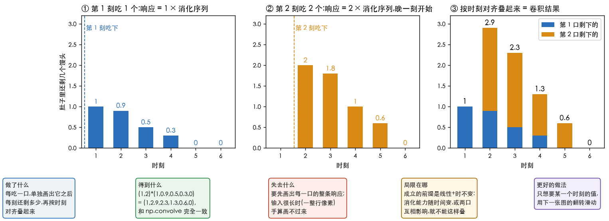
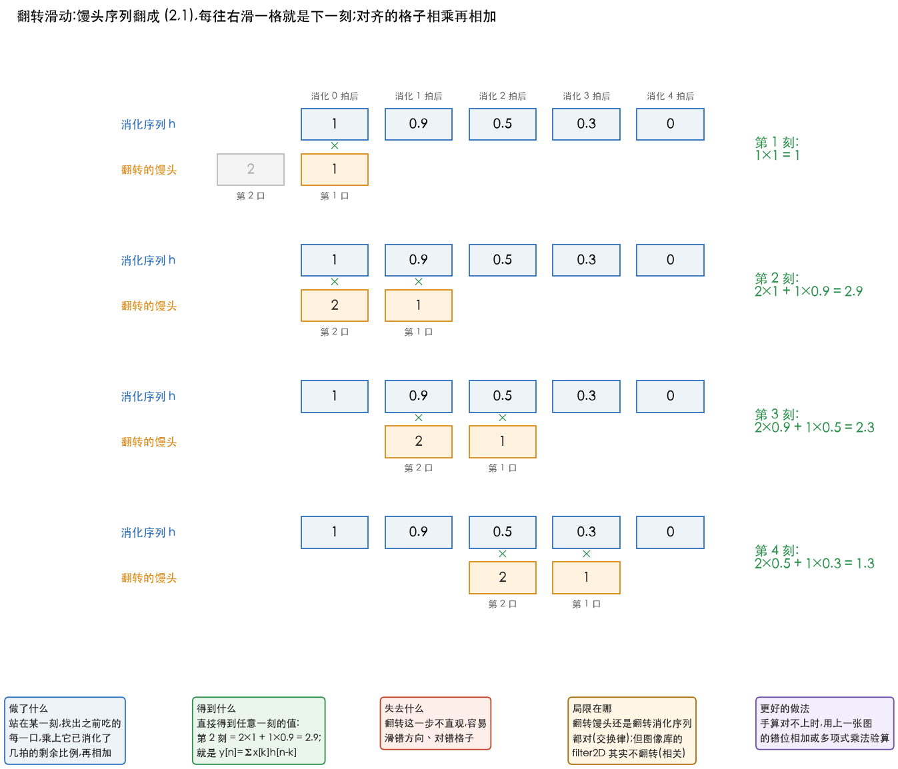
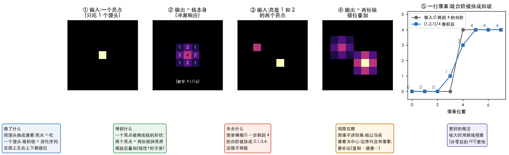

# 理解卷积

> 整理自 B 站一个讲卷积的短视频(水印 `_Wonderful-Days_`,约 9 分 14 秒),用「吃馒头、消化馒头」打比方。
> 我先用 whisper 自动转写了配音,再对照每 15 秒一张截图核对内容。
> 视频里的数字由 [`36_fast_route_checks.py`](../../../Python-Prototyping/Ch04_Frequency_Domain/36_fast_route_checks.py) 第 6 块复算。
> 对应[信号与系统快速路线](../信号与系统快速路线.md)的阶段 1、2。

---

> **怎么读这篇**
>
> | 有多少时间 | 看哪几节 |
> | :--- | :--- |
> | **只有 10 分钟** | `一、馒头比喻` + `二、错位相加` |
> | **第一遍学** | 再加 `三、翻转滑动` `四、两种看法`,手算一遍 `七、完成标准` |
> | **踩坑时回来查** | `五、系统四性质` `六、视频的小错` |

---

## 一、馒头比喻

| 信号与系统里的词 | 馒头比喻 | 视频里的数 |
| :--- | :--- | :--- |
| 输入信号 $x[n]$ | 馒头序列:每个时刻吃几个 | $(1,2)$:第 1 刻吃 1 个,第 2 刻吃 2 个 |
| 系统 | 消化系统 | — |
| 冲激响应 $h[n]$ | 消化序列:**只吃 1 个**馒头,之后每刻还剩多少 | $(1,0.9,0.5,0.3,0)$ |
| 输出 $y[n]$ | 每个时刻肚子里还剩多少馒头 | $(1,2.9,2.3,1.3,0.6,0)$ |

消化序列就是冲激响应(impulse response):只吃 1 个馒头时,$(1)*h=h$,输出就是消化序列本身。
**知道了吃 1 个怎么消化,吃任何序列都能算出来**,算法就是卷积(convolution)。

---

## 二、错位相加

视频的「小学思维」:**按馒头拆**,每一口单独算响应,再加起来。

| 时刻 | 1 | 2 | 3 | 4 | 5 | 6 |
| :--- | :--- | :--- | :--- | :--- | :--- | :--- |
| 第 1 刻吃 1 个的响应 | 1 | 0.9 | 0.5 | 0.3 | 0 | |
| 第 2 刻吃 2 个的响应 | | 2 | 1.8 | 1 | 0.6 | 0 |
| **相加** | **1** | **2.9** | **2.3** | **1.3** | **0.6** | **0** |

关键在「**错位**」:第 2 口是第 2 刻才吃的,它的响应要从第 2 刻开始,不能和第 1 口头对头相加。
吃 2 个的响应是吃 1 个的 2 倍($2,1.8,1,0.6,0$),这用到了线性。

图 ③ 每根柱子里,蓝色是第 1 口剩下的,橙色是第 2 口剩下的。比如第 3 刻:第 1 口剩 0.5,第 2 口剩 1.8,合计 2.3。

---

## 三、翻转滑动

教科书的公式:

$$
y[n]=\sum_k x[k]\,h[n-k]
$$

它换了个角度:**按时刻看**。站在第 $n$ 刻问:此刻肚子里的馒头,来自之前吃的每一口,各剩多少?

- 第 $k$ 刻吃的 $x[k]$ 个,到第 $n$ 刻已经消化了 $n-k$ 拍,每个还剩 $h[n-k]$;
- 把所有 $k$ 加起来就是 $y[n]$。

视频的做法是把馒头序列翻转成 $(2,1)$,在消化序列上一格一格滑:

| 时刻 | 影响它的那几口 | 结果 |
| :--- | :--- | :--- |
| 第 1 刻 | 第 1 口刚吃:$1\times1$ | 1 |
| 第 2 刻 | 第 1 口过了 1 拍:$1\times0.9$;第 2 口刚吃:$2\times1$ | 2.9 |
| 第 3 刻 | $1\times0.5+2\times0.9$ | 2.3 |

看图里每一行的「第 2 口」总是在「第 1 口」左边:第 1 口吃得早,已经消化了更多拍,所以对着消化序列更靠右的格子。

**为什么要翻转**:越早吃的馒头,消化得越久。翻转之后,「最早那一口」正好对上「消化序列靠后的位置」。
翻转馒头序列还是翻转消化序列都行,结果一样(交换律 $x*h=h*x$,脚本实测相同)。

---

## 四、两种看法

| | 错位相加 | 翻转滑动 |
| :--- | :--- | :--- |
| 思考对象 | 每一口馒头 | 每一个时刻 |
| 问的问题 | 这一口之后怎么被消化 | 此刻的结果由哪些输入贡献 |
| 适合 | 理解「为什么卷积成立」(线性 + 时不变) | 写代码、手算某一个输出 |
| 图像里对应 | 一个亮点被核「摊开」成核的形状 | 每个输出像素 = 周围像素的加权和 |

两种算法与 `np.convolve` 结果完全一样,最大差 0(脚本 36 第 6 块)。

换成图像,就是把「一口馒头」换成「一个亮点」:

- ①② 只有一个亮点(只吃 1 个馒头),输出正好是 3×3 的核本身,三行依次是 1 2 1、2 4 2、1 2 1,再除以 16:这就是「冲激响应 = 核」。
- ③④ 两个亮度分别为 1 和 2 的亮点,输出是两份核,按亮度缩放、按位置错开,再叠加:二维的错位相加。
- ⑤ 一行像素从 0 跳到 4,过 $[1,2,1]/4$ 后变成 $0,1,3,4$:图变模糊的原因就在这里。

---

## 五、系统四性质

| 性质 | 馒头比喻 | 一句话 | 图像里 |
| :--- | :--- | :--- | :--- |
| 线性(齐次) | 吃 2 个的消化 = 吃 1 个的 2 倍 | 输入放大,输出同倍放大 | 亮度乘 2,滤波结果也乘 2 |
| 线性(叠加) | 馒头和包子各消化各的,互不影响 | 两个输入之和的响应 = 各自响应之和 | 两张图相加再滤 = 各自滤完再加 |
| 时不变 | 早上吃、晚上吃,消化能力一样 | 输入晚一拍,输出也只晚一拍 | 核在图上每个位置都一样 |
| 因果 | 没吃之前不能先消化 | 输出只依赖现在和过去的输入 | **图像不讲因果**:核以当前像素为中心,左右都用 |
| 稳定 | 吃有限个馒头,不会消化出无限个 | 有界输入得到有界输出 | 核的系数绝对值之和有限即可 |

**卷积能成立,靠的是前两条**:线性允许「按馒头拆开再相加」,时不变保证每一口用的都是同一条消化序列,只是错开时间。
因果和稳定是附加的性质,不影响卷积本身。

---

## 六、视频的小错

| 视频里 | 应该是 |
| :--- | :--- |
| 配音说「第二个时刻还剩 0.5+1.8=2.3」,往后几刻也依次错了一位 | 第 2 刻是 $2+0.9=2.9$,第 3 刻才是 $0.5+1.8=2.3$,第 4 刻 1.3,第 5 刻 0.6。画面最后给出的 $(1,2.9,2.3,1.3,0.6,0)$ 是对的 |
| 公式写成 `y[n] = Σ(x[k] * h[n-k])` | 这里的 `*` 是普通乘法,不是卷积号 |

---

## 七、完成标准

| 题 | 答案 |
| :--- | :--- |
| 用错位相加手算 $(1,2)*(1,0.9,0.5,0.3,0)$ | $(1,2.9,2.3,1.3,0.6,0)$ |
| 晚一刻才吃 1 个,即 $(0,1)*h$ | $(0,1,0.9,0.5,0.3,0)$,整体右移一格(时不变) |
| 用翻转滑动手算 $[1,2,3]*[1,1]$ 的第 3 个输出 | $3\times1+2\times1=5$,全部是 $[1,3,5,3]$ |
| 口述:卷积为什么要「翻转」 | 越早的输入消化得越久,要对上冲激响应靠后的位置 |
| 口述:卷积靠哪两条性质成立 | 线性(能拆开相加)+ 时不变(每口用同一条响应) |

**对应 DIP**:把馒头序列换成图像的一行像素,消化序列换成卷积核,就是第 3 章的空间滤波;
二维只是左右、上下两个方向都错位。详见[空间滤波基础](../../05-spatial-filtering/01-spatial-filtering-basics.md)。

---

## 八、总结

线性时不变系统(LTI 系统)听起来很吓人,其实还可以用小明的肚子来讲。前面说的「肚子消化馒头」,就是一个线性时不变系统。

### 先说系统

系统就是一个**黑盒子**:你往里放东西(输入),它吐出结果(输出)。

- 肚子:输入是「吃了多少馒头」,输出是「肚子里还剩多少」
- 音箱:输入是电信号,输出是声音
- 相机镜头:输入是真实的景物,输出是照片

### 线性是什么

线性包含两条规矩:

**第一条:加倍就加倍。** 吃 1 个馒头,1 小时后剩半个;那吃 2 个,1 小时后就剩 1 个。输入翻倍,输出也翻倍。

**第二条:分开算再加起来,和一起算一样。** 8 点吃的馒头和 9 点吃的馒头,在肚子里各消化各的,互不干扰。所以可以分别算每一批剩多少,最后加起来。

前面「一批一批算,再加起来」(错位相加),能这么做,就是因为肚子是**线性**的。

反例:如果吃太多,胃撑坏了,消化变慢了,那吃 10 个就不是吃 1 个的 10 倍效果,这就**不是线性**了。

### 时不变是什么

就是**规律不随时间变化**。

不管是早上 8 点吃,还是晚上 8 点吃,馒头都是「1 小时剩一半,2 小时剩一点点」。规律一样,只是整体往后挪了几个小时。

反例:如果小明晚上睡觉时消化变慢,那早上吃和晚上吃效果不一样,这就**不是时不变**了。

### 为什么这两条重要

因为满足这两条,就有一个超级方便的结论:

> **只要知道「吃 1 个馒头之后会怎么样」,就能算出「任何吃法之后会怎么样」。**

「吃 1 个馒头之后,剩余量随时间的变化」(剩一个 → 剩半个 → 剩一点点 → 没了),就叫**冲激响应**。它就像这个系统的「身份证」。

- 因为**线性**,吃 3 个就是把这张身份证乘以 3,几批馒头可以分开算再相加
- 因为**时不变**,10 点吃的那批,就是把身份证往后挪到 10 点开始

把每一批都这样算出来再加起来,这个过程正是**卷积**。所以:

> **线性时不变系统的输出 = 输入和冲激响应做卷积。**

这就是为什么学卷积总会和 LTI 系统一起出现:卷积是专门用来计算 LTI 系统的工具。

### 放到图像里

在图像处理里,「时不变」换成了**空间不变**(shift-invariant):图片左上角和右下角用的是同一个模板(卷积核),规则处处一样。

比如用一个「取周围平均」的模板去模糊图片:

- 线性:图片整体亮一倍,模糊后的结果也亮一倍
- 空间不变:图片哪个位置都按同样的方式取平均

这个模板就是图像系统的「身份证」(冲激响应),也叫点扩散函数(point spread function,PSF):意思是一个很亮的小点经过这个系统后,会被「扩散」成什么样子(就是上面图 ①② 里亮点被摊成核的形状)。比如镜头没对准焦时,一个小光点会变成一个模糊的圆斑,这个圆斑就是镜头的点扩散函数。
