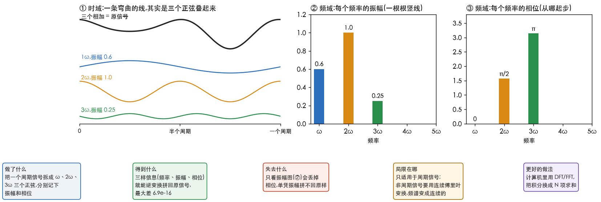
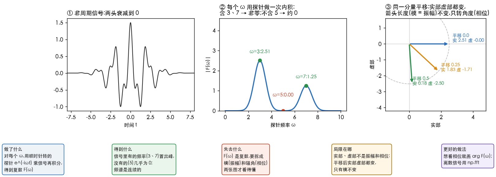
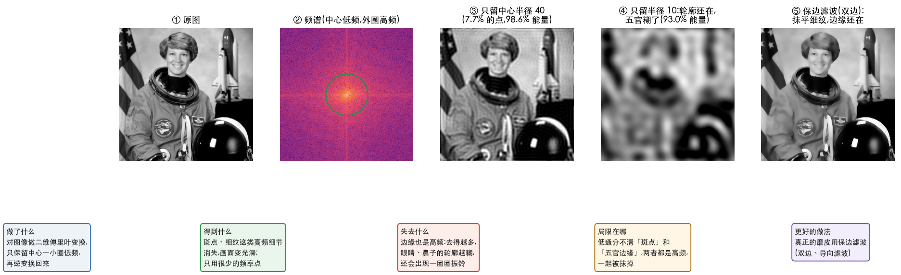

# 理解傅里叶变换

> 整理自李永乐老师的科普视频《傅里叶变换》(约 20 分 19 秒,黑板讲解)。
> 我先用 whisper 自动转写了配音,再对照每 40 秒一张截图核对板书。
> 图和数字由 [`38_fourier_figures.py`](../../../Python-Prototyping/Ch04_Frequency_Domain/38_fourier_figures.py) 生成。
> 对应[信号与系统快速路线](../信号与系统快速路线.md)的阶段 1、3;前一篇是[理解卷积](1.理解卷积.md)。

---

> **怎么读这篇**
>
> | 有多少时间 | 看哪几节 |
> | :--- | :--- |
> | **只有 10 分钟** | `一、先说变换` + `二、傅里叶级数` 的图 + `五、应用` |
> | **第一遍学** | 再加 `三、连续傅里叶变换`,手算一遍 `七、完成标准` |
> | **踩坑时回来查** | `六、视频的订正` |

---

## 一、先说变换

视频从最简单的变换讲起:把图变成数。

| 概念 | 视频的例子 | 一句话 |
| :--- | :--- | :--- |
| 变换 | 向量 A 写成 $(2,1)$,B 写成 $(1,2)$ | 把图变成一组数 |
| 逆变换 | 由 $(2,1)$ 画回向量 A | 把数变回图,两边一一对应 |
| 为什么要变换 | 平行四边形的对角线 C:图上要画,数上 $(2,1)+(1,2)=(3,3)$ | 图上难办的事,换成数就好办 |
| 标准正交基 | $e_x$、$e_y$:长度都是 1,互相垂直,内积 $e_x\cdot e_y=0$ | 任何向量都能拆成它们的组合,A $=2e_x+1e_y$ |

**傅里叶变换做的是同一件事**,只是把 $e_x$、$e_y$ 换成了一组正弦、余弦。

---

## 二、傅里叶级数

1807 年,傅里叶提出:**任何周期函数,都能拆成一系列正弦、余弦的和**。

$$
f(t)=\frac{a_0}{2}+\sum_{n=1}^{\infty}a_n\sin(n\omega t)+\sum_{n=1}^{\infty}b_n\cos(n\omega t)
$$

这里的「正交基」是 $1$、$\sin n\omega t$、$\cos n\omega t$:自己和自己的内积不为 0,和别人的内积都是 0。
只是这里的内积是积分,视频没有展开。

同一个信号换两个方向看:

| 看的方向 | 叫什么 | 看到什么 |
| :--- | :--- | :--- |
| 沿时间轴看(图 ①) | 时域(time domain) | 一条弯弯曲曲的线 |
| 沿频率轴看(图 ②③) | 频域(frequency domain) | 由 $\omega$、$2\omega$、$3\omega$ 三个分量组成,每个有自己的振幅和相位 |

变换后得到**三样信息**:有哪些频率、每个频率的**振幅**、每个频率的**相位**(这个波从哪里起步)。
三样都有,就能逆变换回原信号。脚本实测:从拼好的信号里读回振幅 0.6、1.0、0.25 和相位 0、$\pi/2$、$\pi$,
其余频率的振幅只有 $1.7\times10^{-16}$,逆变换拼回原信号最大差 $6.9\times10^{-16}$。

**周期信号的频谱是一根根分开的竖线。**

---

## 三、连续傅里叶变换

大部分信号都不是周期的。视频的办法是:**把非周期信号看成周期无穷长的周期信号**。

**第一步:转圈的点。** 欧拉公式 $\cos\theta+i\sin\theta=e^{i\theta}$。令 $\theta=\omega t$,
$e^{i\omega t}$ 就是复平面上一个**逆时针**匀速转圈的点;$e^{-i\omega t}$ 是**顺时针**转。

**第二步:用探针做内积。**

$$
F(\omega)=\int_{-\infty}^{\infty}f(t)\,e^{-i\omega t}\,dt
$$

拿频率为 $\omega$ 的转圈探针去乘信号,再积分(就是连续版的内积):

- 信号里**不含**这个频率,结果是 0;
- 信号里**含有**这个频率,结果不为 0,这部分就被「摘出来」了。

图 ② 的信号由 $\cos 3t$ 和 $0.5\cos 7t$ 组成(两头衰减):探针 $\omega=3$ 得 2.51,$\omega=7$ 得 1.25,
$\omega=5$ 只有 0.0013。**非周期信号的频谱是连续的**:每个频率都可能有,只是有多有少。

**第三步:逆变换。** 把 $F(\omega)$ 再乘上 $e^{i\omega t}$ 积分,就拼回原信号:

$$
f(t)=\frac{1}{2\pi}\int_{-\infty}^{\infty}F(\omega)\,e^{i\omega t}\,d\omega
$$

(视频里没写前面的 $\frac{1}{2\pi}$,见第六节。)

---

## 四、两种对比

| | 傅里叶级数 | 连续傅里叶变换 | 离散傅里叶变换(DFT) |
| :--- | :--- | :--- | :--- |
| 适合 | 周期信号 | 非周期信号 | 计算机里的 $N$ 个采样点 |
| 内积怎么算 | 一个周期上积分 | 从 $-\infty$ 到 $\infty$ 积分 | $N$ 项求和 |
| 频谱长什么样 | 一根根竖线 | 连续曲线 | $N$ 个点 |
| 视频讲了没 | 讲了 | 讲了 | 没讲,见快速路线阶段 3 |

---

## 五、应用

### 声音

- 男声的低频成分多,女声的高频成分多,噪声里高频也不少。
- 在嘈杂的市场里,人能分清是谁在说话,还能「滤」掉噪声只听一个人,这叫滤波(filtering)。
- 变声软件:先做傅里叶变换,把频率调高,再逆变换,男声就变成女声。

### 图像

把横轴从时间换成空间位置,信号就成了图像。

| 成分 | 对应什么 | 图里 |
| :--- | :--- | :--- |
| 低频(频谱中心) | 轮廓:脸型、身体 | 图 ② 的中心亮区 |
| 高频(频谱外圈) | 细节:皱纹、斑点、毛发 | 图 ② 的外圈 |

磨皮就是**去掉高频,再逆变换回来**(图 ③)。脚本实测:只留中心半径 40 的一圈,
占 7.7% 的频率点,却保住了 98.6% 的能量,画面已经变光滑;
半径缩到 10(占 0.48% 的点,93.0% 的能量),轮廓还在,五官已经糊掉(图 ④)。
**能量几乎全在低频,但人眼最在意的边缘恰恰在高频。**

视频最后的观点:人看人,先看轮廓(低频)认出是人,再看细节(高频)判断漂不漂亮。

---

## 六、视频的订正

| 视频里 | 应该是 |
| :--- | :--- |
| 板书把 $F(\omega)$ 的**实部**当振幅、**虚部**当相位 | **模** $\lvert F(\omega)\rvert$ 是振幅,**辐角** $\arg F(\omega)$ 是相位。图 ③ 把同一个分量平移 0、0.25、0.5:实部从 2.51 变到 0.18,虚部从 0 变到 −2.50,但模始终是 2.5066,辐角正好转了 $-3\times$ 平移量 |
| 逆变换只写积分 | 用这种写法要乘 $\frac{1}{2\pi}$;也有教材把系数拆成两个 $\frac{1}{\sqrt{2\pi}}$,写法不统一 |
| 「人脑会快速做傅里叶变换」 | 比喻。真正做频率分解的是内耳耳蜗:不同位置对不同频率共振,更像一排带通滤波器 |
| 「噪声是高频」 | 白噪声铺满所有频率,低通只能去掉其中一部分 |
| 「把频率调高,男声变女声」 | 全部频率一起调高会变成「花栗鼠声」。实际变声把**音高**和**音色**(共振峰)分开调,只升音高 |
| 「去掉高频就是磨皮」 | 原理没错,但实际磨皮很少用纯低通:它分不清斑点和五官边缘,会一起抹掉(图 ④)。常用双边滤波、导向滤波这类保边滤波(图 ⑤) |

---

## 七、完成标准

| 题 | 答案 |
| :--- | :--- |
| 傅里叶变换后得到哪三样信息 | 频率、每个频率的振幅、每个频率的相位 |
| 周期信号和非周期信号的频谱有什么不同 | 周期:一根根竖线;非周期:连续曲线 |
| $F(\omega)=\int f(t)e^{-i\omega t}dt$ 在做什么 | 用频率为 $\omega$ 的转圈探针和信号做内积,把这个频率的成分摘出来 |
| $F(\omega)$ 是复数,振幅和相位从哪读 | 振幅 = 模,相位 = 辐角(不是实部、虚部) |
| 为什么去掉高频图会变光滑,去多了五官会糊 | 斑点和边缘都是高频;低通分不清两者,一起抹掉 |
| 口述:傅里叶变换和「向量写成坐标」是什么关系 | 都是把对象拆成一组标准正交基的组合;傅里叶只是把 $e_x$、$e_y$ 换成了正弦、余弦 |

**对应 DIP**:第 4 章频率域。「去掉高频再逆变换」就是 4.7~4.9 的频域低通滤波;
图 ③ 那一圈圈的波纹叫振铃,是「理想低通」的毛病,书里会讲用高斯低通来避免。
