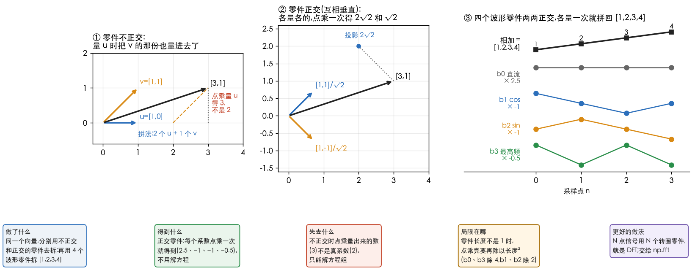
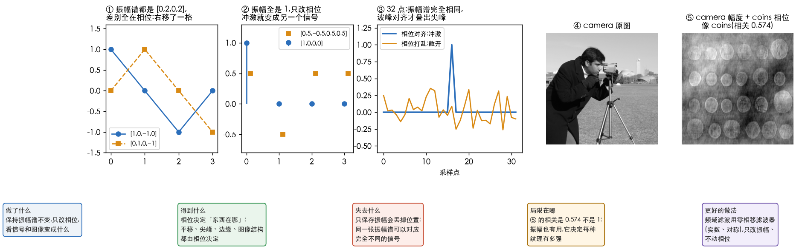

# 正交基与相位

> 接着[理解傅里叶变换](2.理解傅里叶变换.md):那篇里「正交基」和「相位」一笔带过,这篇用四个数的例子掰开讲。
> 每个数字和两张图都由 [`39_basis_phase.py`](../../../Python-Prototyping/Ch04_Frequency_Domain/39_basis_phase.py) 算出。

---

> **怎么读这篇**
>
> | 有多少时间 | 看哪几节 |
> | :--- | :--- |
> | **只有 10 分钟** | 两张图 + `五、一句话总结` |
> | **第一遍学** | 从头读,手算 `二、为什么要正交` 和 `三、傅里叶的零件` 两张表 |
> | **踩坑时回来查** | `四、相位` 的「在 DIP 里管什么」 |

---

## 一、基是一套零件

说向量 A $=(2,1)$,意思是「2 个 $e_x$ 加 1 个 $e_y$」,其中 $e_x=[1,0]$、$e_y=[0,1]$。

**基(basis)就是一套标准零件,坐标就是每种零件用了几个。** 换一套零件,同一个东西的坐标就变了。

要量「某种零件用了几个」,工具是**点乘**,也叫内积(inner product):对应位置相乘再相加。

$$
[3,1]\cdot[1,0]=3\times1+1\times0=3
$$

它的意思是:**$[3,1]$ 在 $[1,0]$ 这个方向上有多少**,也就是投影。

两个零件点乘为 0,就叫**正交**(orthogonal):$e_x\cdot e_y=1\times0+0\times1=0$。在平面上,正交就是互相垂直。

---

## 二、为什么要正交

| | 不正交(图 ①) | 正交(图 ②) |
| :--- | :--- | :--- |
| 零件 | $u=[1,0]$、$v=[1,1]$,$u\cdot v=1$ | $[1,1]/\sqrt2$、$[1,-1]/\sqrt2$,点乘为 0 |
| 拼 $[3,1]$ 的真实系数 | $2u+1v$ | $2\sqrt2$ 和 $\sqrt2$ |
| 用点乘去量 | $[3,1]\cdot u=3$,**量出 3 不是 2** | $[3,1]\cdot[1,1]/\sqrt2=4/\sqrt2=2\sqrt2$,**直接就对** |
| 原因 | $v$ 里也含有 $u$ 的方向,量 $u$ 时把 $v$ 那份也量进去了 | 各零件互不重叠,各量各的 |
| 怎么求系数 | 只能解方程组 | 每个零件点乘一次 |

**正交的全部好处就一句:拆的时候每个零件单独量,不用解方程。**

「标准正交」是再要求每个零件长度为 1。不是 1 也行,点乘完再**除以零件长度的平方**就好(下一节就是这样)。

---

## 三、傅里叶的零件

4 个点的信号,可以用 4 个「波形零件」来拼(图 ③):

| 零件 | 样子 | 是什么 | 长度² |
| :--- | :--- | :--- | :--- |
| $b_0=[1,1,1,1]$ | 不动 | 直流(频率 0) | 4 |
| $b_1=[1,0,-1,0]$ | 转一圈的 cos | 频率 1 | 2 |
| $b_2=[0,1,0,-1]$ | 转一圈的 sin | 频率 1 | 2 |
| $b_3=[1,-1,1,-1]$ | 一正一负交替 | 最高频 | 4 |

两两点乘全是 0,比如 $b_1\cdot b_2=0+0+0+0=0$,以及 $b_0\cdot b_3=1-1+1-1=0$。

### 长度是什么

表里的「长度」就是向量的**模**,也叫范数(norm):每个分量平方、加起来、再开根号。
它和复数的模是同一个东西:$3+4i$ 的模是 $\sqrt{3^2+4^2}=5$,看成平面向量 $[3,4]$ 长度也是 5,
4 个分量只是多加两项。比如 $b_1$:$1^2+0^2+(-1)^2+0^2=2$,长度 $\sqrt2$。

**长度² 就是自己点乘自己**:$b_1\cdot b_1=2$。

### 为什么除以长度²

假设 $x=c_0b_0+c_1b_1+c_2b_2+c_3b_3$,想求 $c_1$,两边同时点乘 $b_1$:

$$
x\cdot b_1=c_0\underbrace{(b_0\cdot b_1)}_{0}+c_1\underbrace{(b_1\cdot b_1)}_{\text{长度}^2=2}+c_2\underbrace{(b_2\cdot b_1)}_{0}+c_3\underbrace{(b_3\cdot b_1)}_{0}
$$

正交让其余三项都变成 0,只剩 $x\cdot b_1=2c_1$,所以 $c_1=\dfrac{x\cdot b_1}{b_1\cdot b_1}$。
**点乘量出来的是「系数 × 长度²」,要除掉长度²。** 不正交时,其余三项不为 0,就会混进来。

两种等价的做法(以 $[3,1]$ 和零件 $[1,1]$ 为例,长度 $\sqrt2$):

| 做法 | 计算 | 系数 | 这一部分 |
| :--- | :--- | :--- | :--- |
| A:零件不缩放 | $[3,1]\cdot[1,1]=4$,除以长度² 2 | 2 | $2\times[1,1]=[2,2]$ |
| B:先缩成长度 1 | $[3,1]\cdot\frac{[1,1]}{\sqrt2}=\frac{4}{\sqrt2}$,长度² 是 1 不用再除 | $2\sqrt2$ | $2\sqrt2\times\frac{[1,1]}{\sqrt2}=[2,2]$ |

两种做法拿到的那一部分完全一样,只是系数写法不同。「标准」正交基就是做法 B:点乘一次就是系数。
第二节用的是 B,这一节的 4 个零件没缩放,用的是 A。

顺带解开 DFT 的 $\frac1N$:DFT 的转圈零件每个分量模都是 1,长度² 正好是 $N$。
正变换只做点乘不除,**逆变换前面的 $\frac1N$ 就是推迟了的「除以长度²」**;有的教材把它放在正变换里,只是提前做了。

### 拆开 1,2,3,4

把 $x=[1,2,3,4]$ 拆开,每个零件**单独量**:

| 零件 | 点乘 | ÷ 长度² | 系数 |
| :--- | :--- | :--- | :--- |
| $b_0$ | $1+2+3+4=10$ | ÷4 | **2.5** |
| $b_1$ | $1-3=-2$ | ÷2 | **−1** |
| $b_2$ | $2-4=-2$ | ÷2 | **−1** |
| $b_3$ | $1-2+3-4=-2$ | ÷4 | **−0.5** |

验算:$2.5b_0-b_1-b_2-0.5b_3=[1,2,3,4]$。

**这就是傅里叶变换,没有别的了**:用一组互相正交的波当零件,每个零件点乘一次,得到「这个频率用了多少」。

和 DFT 的对应:DFT 把同一个频率的 cos 零件和 sin 零件**打包成一个复数**。
$[1,2,3,4]$ 的 DFT 是 $[10,\,-2+2i,\,-2,\,-2-2i]$,其中

$$
X[1]=(x\cdot b_1)-i\,(x\cdot b_2)=-2-i\cdot(-2)=-2+2i
$$

$X[0]=10$ 和 $X[2]=-2$ 是没除长度²的 $b_0$、$b_3$ 点乘。连续的傅里叶变换也是一样,只是点乘换成了积分。

---

## 四、相位

### 相位是什么

一个频率分量写成 $A\cos(\omega t+\varphi)$,三样东西:

| 符号 | 叫什么 | 决定什么 |
| :--- | :--- | :--- |
| $\omega$ | 频率 | 转多快(纹理多细) |
| $A$ | 振幅 | 有多强 |
| $\varphi$ | 相位(phase) | **波峰在哪**:这个波整体往左或往右挪了多少 |

在 DFT 里,$X[k]$ 是复数:**模是振幅,辐角是相位**。

### 只有振幅拼不回来

**例 1:振幅一样,信号不一样**(图 ①)。

| 信号 | DFT | 振幅(模) |
| :--- | :--- | :--- |
| $[1,0,-1,0]$ | $[0,\,2,\,0,\,2]$ | $[0,2,0,2]$ |
| $[0,1,0,-1]$ | $[0,\,-2i,\,0,\,2i]$ | $[0,2,0,2]$ |

两个都是「频率 1 有 2 这么强」,但第二个是第一个右移了一格。**区别全在相位。**

**例 2:同样的配料,摆法不同**(图 ②)。冲激 $[1,0,0,0]$ 的 DFT 是 $[1,1,1,1]$:振幅全是 1,相位全是 0。
振幅不动,只把相位改成 $[1,\,i,\,1,\,-i]$,逆变换得到 $[0.5,\,-0.5,\,0.5,\,0.5]$,**完全是另一个信号**。

**例 3:32 个点**(图 ③)。冲激和「相位打乱」的信号振幅谱完全一样(最大差 $2.2\times10^{-16}$),能量也都是 1;
但冲激的最高点是 1,打乱后最高只有 0.354,能量散到了各处。

### 相位决定东西在哪

冲激的秘密是:**所有频率的波峰都对齐在同一个位置**,叠起来那里特别高,其余地方互相抵消。
图像的边缘也一样:各个频率的波峰在边缘处对齐,才叠出一条陡边。相位一乱,对不齐,边缘就散了。

| | 回答什么问题 |
| :--- | :--- |
| 振幅 | 这张图里有多少粗纹理、多少细纹理 |
| 相位 | 这些纹理**摆在哪**,也就是结构 |

图 ④⑤:camera 的振幅配上 coins 的相位,重建出来**像 coins**(相关 0.574),和 camera 几乎无关(相关 −0.022)。
但 0.574 不是 1:振幅也有用,它决定每种纹理有多强。

### 在 DIP 里管什么

| 场景 | 相位的作用 |
| :--- | :--- |
| 平移 | 图像平移,振幅一点不变,只有相位变(见上一篇 `ft-probe` 图 ③) |
| 频域滤波器 | 书里的低通、高通滤波器都是**实数、对称**的,只改振幅不碰相位,滤完图像不会错位。这叫零相移(zero-phase)滤波器 |
| 自己写滤波器出 bug | 不小心改了相位,边缘会挪位置,甚至出现重影 |

### 和音频经验对照

声音里,人耳对稳定音调的相位通常不太敏感:频谱对了,听起来就差不多,所以音频上常只看频谱。
**图像正好相反**:眼睛对「东西在哪」极其敏感,相位错一点就看得出来。这是从音频转到图像最容易带过来的误区。

---

## 五、一句话总结

| 概念 | 一句话 |
| :--- | :--- |
| 基 | 一套标准零件,坐标是每种零件用了几个 |
| 正交 | 零件点乘为 0,互不重叠,每个系数点乘一次就量出来 |
| 傅里叶变换 | 用一组正交的波当零件去拆信号 |
| 振幅 | 每种零件用了多少 |
| 相位 | 每种零件摆在哪;两样都有才能拼回原图 |

**完成标准**:能手算 $[1,2,3,4]$ 的四个系数 2.5、−1、−1、−0.5;能说出 $[1,0,-1,0]$ 和 $[0,1,0,-1]$ 为什么振幅相同、信号不同。
