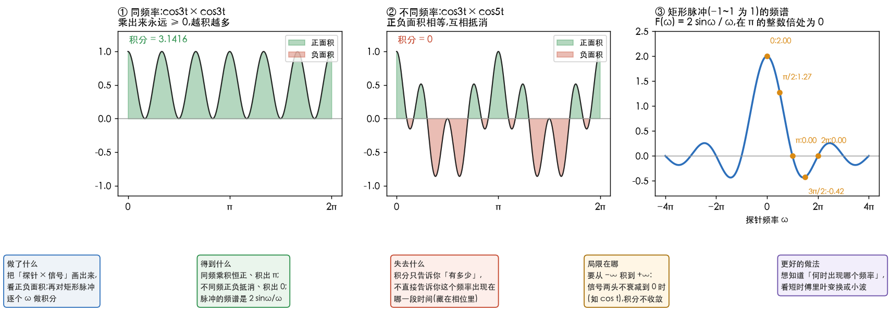

# 理解傅里叶积分

> 接着[理解傅里叶变换](2.理解傅里叶变换.md)和[正交基与相位](3.正交基与相位.md):
> 视频里对非周期信号写了 $F(\omega)=\int_{-\infty}^{\infty}f(t)\,e^{-i\omega t}\,dt$,这一篇把它拆开。
> 数字与配图由 [`40_fourier_integral.py`](../../../Python-Prototyping/Ch04_Frequency_Domain/40_fourier_integral.py) 算出。

---

> **怎么读这篇**
>
> | 有多少时间 | 看哪几节 |
> | :--- | :--- |
> | **只有 10 分钟** | `一、积分就是点乘` + 配图 + `八、一句话` |
> | **第一遍学** | 从头读,手算一遍 `五、手算矩形脉冲` 和 `七、逆变换` 的 x[1] |
> | **踩坑时回来查** | `四、为什么积到无穷` `六、频谱为何连续` |

---

## 一、积分就是点乘

上一篇拆 $[1,2,3,4]$ 时,量 $b_1$ 用的是点乘:**对应位置相乘,再全部加起来**。

$$
x\cdot b_1=\sum_n x[n]\,b_1[n]=1\cdot1+2\cdot0+3\cdot(-1)+4\cdot0=-2
$$

信号如果不是 4 个点,而是一条连续的曲线,就有无穷多个点,「每个点相乘再相加」变成:

$$
\sum_n x[n]\,b[n]\;\longrightarrow\;\int f(t)\,b(t)\,dt
$$

$dt$ 是每一小份的宽度:把曲线切成很细的竖条,每条「高 × 宽」,再全部加起来。
切得越细越准:$\int_0^\pi \sin t\,dt$ 精确值是 2,切 4 条得 2.0523,切 40 条得 2.0005,切 4000 条得 2.0000。

**积分就是连续版的点乘。**

---

## 二、公式三块

| 部分 | 是什么 |
| :--- | :--- |
| $f(t)$ | 要拆的信号 |
| $e^{-i\omega t}=\cos\omega t-i\sin\omega t$ | 探针 = 频率为 $\omega$ 的零件,cos 和 sin 两个零件打包在一起 |
| $\int\cdots dt$ | 点乘:相乘,再全部加起来 |

结果的实部量的是「有多少 $\cos\omega t$」,虚部量的是「有多少 $\sin\omega t$」,合起来是一个复数。
这和 DFT 的 $X[1]=(x\cdot b_1)-i\,(x\cdot b_2)$ 完全一样(见[正交基与相位](3.正交基与相位.md)第三节)。

---

## 三、为何含就不为 0

关键看**两个波相乘之后长什么样**:

| | 乘出来 | 在 $0\sim2\pi$ 上积分 |
| :--- | :--- | :--- |
| 同频率(图 ①) | $\cos3t\cdot\cos3t=\frac{1+\cos6t}{2}$,**永远 ≥ 0** | **π**(3.1416) |
| 不同频率(图 ②) | $\cos3t\cdot\cos5t=\frac{\cos2t+\cos8t}{2}$,一会儿正一会儿负 | **0** |

所以拿探针一个个频率试过去:

- 信号里**有**这个频率:相乘后有一部分「一直为正」,积分冒出一个数;
- 信号里**没有**这个频率:相乘后全是正负交替,积分抵消成 0。

**这就是正交:不同频率的波,点乘(积分)为 0。** 和「8 个箭头首尾相接绕回原点」是同一件事。

---

## 四、为什么积到无穷

- 周期信号:每个周期都一样,积一个周期就够,所以傅里叶级数只在一个周期上积分。
- 非周期信号:没有哪一段能代表全部,**只能整条从头看到尾**,所以从 $-\infty$ 积到 $+\infty$。
- 视频里的信号两头衰减到 0,远处乘出来也是 0,积分得到一个有限的数。
  反过来,$\cos t$ 这种永远不衰减的信号,这个积分不收敛,要用冲激函数另行处理(补全线的内容)。

---

## 五、手算矩形脉冲

信号在 $-1\le t\le1$ 上为 1,其余为 0。外面全是 0,积分只剩中间这一段:

$$
F(\omega)=\int_{-1}^{1}e^{-i\omega t}\,dt
=\left[\frac{e^{-i\omega t}}{-i\omega}\right]_{-1}^{1}
=\frac{e^{-i\omega}-e^{i\omega}}{-i\omega}
=\frac{-2i\sin\omega}{-i\omega}
=\frac{2\sin\omega}{\omega}
$$

| $\omega$ | $F(\omega)$ | 在说什么 |
| :--- | :--- | :--- |
| 0 | **2** | 探针不转,积分 = 脉冲的面积,这就是直流 |
| $\pi/2$ | 1.27 | 探针在脉冲宽度内转了四分之一圈,大部分还同向 |
| $\pi$ | **0** | 宽度 2 的这一段里探针**正好转满一圈**,首尾相接回到原点,完全抵消 |
| $3\pi/2$ | −0.42 | 转了一圈半,多出的半圈留下一点反方向的量 |
| $2\pi$ | 0 | 正好转满两圈,又抵消 |

表里五个值,数值积分(切 20 万条)与公式一致。$\omega=\pi$ 那一行,就是快速路线阶段 1「8 个箭头相加得 0」的连续版。

**结果是实数**:脉冲左右对称,sin 部分左边和右边正好抵消,只剩 cos 部分(图 ③)。

---

## 六、频谱为何连续

- 周期为 $T$ 的信号,只含基频 $2\pi/T$ 的整数倍,频谱是**间隔 $2\pi/T$ 的竖线**:
  $T=2\pi$ 时间隔 1,$T=20\pi$ 时 0.1,$T=200\pi$ 时 0.01。
- 视频说「非周期信号看成周期无穷大」,就是让 $T\to\infty$:间隔 $\to0$,竖线越挤越密,连成一条曲线。
- 所以每个 $\omega$ 都要试一次探针,得到连续曲线 $F(\omega)$。矩形脉冲的 $\frac{2\sin\omega}{\omega}$ 就是这样一条曲线,叫 sinc 函数。

**对应 DIP**:理想低通在频域是一个「矩形」,换回空域就是 sinc 那样带正负波纹的形状,这就是第 4 章理想低通出现**振铃**的原因。

---

## 七、逆变换

**正变换是「量每种零件用了多少」,逆变换是「按量好的数把零件拼回去」**,正交基让这两步都简单。

### 系数乘零件再相加

正变换量出 $[1,2,3,4]$ 的系数 2.5、−1、−1、−0.5,逆变换就是 $x=2.5b_0-b_1-b_2-0.5b_3$,逐个位置:

| 位置 | $2.5b_0$ | $-b_1$ | $-b_2$ | $-0.5b_3$ | 合计 |
| :--- | :--- | :--- | :--- | :--- | :--- |
| 0 | 2.5 | −1 | 0 | −0.5 | **1** |
| 1 | 2.5 | 0 | −1 | +0.5 | **2** |
| 2 | 2.5 | +1 | 0 | −0.5 | **3** |
| 3 | 2.5 | 0 | +1 | +0.5 | **4** |

### 逆变换不用求逆

| | 正变换(拆) | 逆变换(拼) |
| :--- | :--- | :--- |
| 做什么 | 每个零件点乘一次,除以长度² | 系数 × 零件,加起来 |
| 用到什么 | 零件本身 | 还是零件本身 |

零件**不正交**时,拆要解方程组;用矩阵的话说,要算一个逆矩阵。
**正交时,逆矩阵就是零件矩阵转置一下再除以长度²**,几乎不花力气。这就是变换和逆变换能成对出现、而且都很快的根本原因。

### DFT 逆变换的两处不同

$$
X[k]=\sum_n x[n]\,e^{-i2\pi kn/N}\qquad\qquad x[n]=\frac1N\sum_k X[k]\,e^{+i2\pi kn/N}
$$

| 不同处 | 原因 |
| :--- | :--- |
| 多了 $\frac1N$ | 零件长度² 是 $N$;正变换只点乘没除,逆变换补上(见[正交基与相位](3.正交基与相位.md)第三节) |
| 指数由 $-$ 变 $+$ | 零件本身是 $e^{+i2\pi kn/N}$:拼时直接用零件,所以是 $+$;量时复数点乘要先取**共轭**,所以是 $-$ |

取共轭和「$3+4i$ 的模平方要算 $(3+4i)(3-4i)=25$」是同一个道理:乘以共轭才得到长度² 这样的实数。

手算拼回 $x[1]$($e^{+i2\pi k/4}$ 依次是 $1,\,i,\,-1,\,-i$):

$$
x[1]=\tfrac14\big(10\cdot1+(-2+2i)\,i+(-2)(-1)+(-2-2i)(-i)\big)=\tfrac14\big(10+(-2-2i)+2+(-2+2i)\big)=\tfrac84=2
$$

脚本里四个位置都核对过,拼回 $[1,2,3,4]$,与 `np.fft.ifft` 一致。

连续版结构一样:$f(t)=\frac1{2\pi}\int F(\omega)\,e^{+i\omega t}\,d\omega$,
把每个频率的零件乘上 $F(\omega)$ 再全部加起来(积分),$\frac1{2\pi}$ 扮演「除以长度²」。

### 拼得回与拼不回

能**完全**还原要两个条件:零件互相**正交**(量时不互相干扰);零件**够数**($N$ 个点就有 $N$ 个零件,叫完备,complete)。

如果故意**扔掉一些零件**再拼,比如把高频系数设成 0,拼出来的就是「少了细节」的版本 —— **这就是滤波**。
[理解傅里叶变换](2.理解傅里叶变换.md)里的磨皮图,就是「正变换 → 扔掉高频系数 → 逆变换」。
频域滤波的完整流程就三步:**拆(正变换)→ 改系数(乘滤波器)→ 拼(逆变换)**。

---

## 八、一句话

**$\int f(t)e^{-i\omega t}dt$ 就是「信号和频率为 $\omega$ 的转圈零件做点乘」**:同频的部分相乘后一直为正、积累出来;不同频的正负抵消成 0。
**逆变换就是「系数 × 零件,加起来」**:正交让它不用求逆,$\frac1N$ 是推迟了的「除以长度²」,符号相反是因为量时要取共轭。

**完成标准**:能说出 $\int_0^{2\pi}\cos3t\cos3t\,dt$ 为什么是 π、$\int_0^{2\pi}\cos3t\cos5t\,dt$ 为什么是 0;
能手算矩形脉冲的 $F(0)=2$、$F(\pi)=0$,并说出 $F(\pi)=0$ 是因为探针正好转满一圈;
能从 $X=[10,\,-2+2i,\,-2,\,-2-2i]$ 手算拼回 $x[1]=2$。
