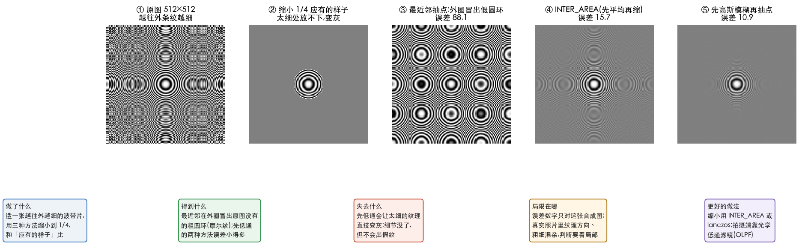
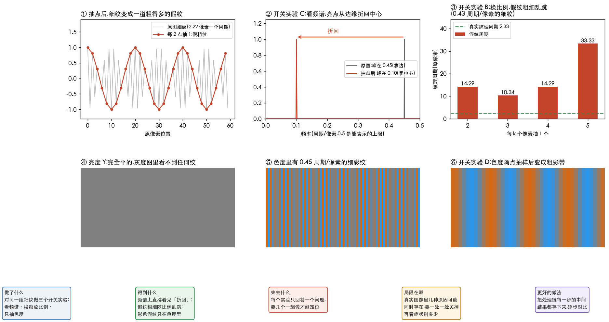
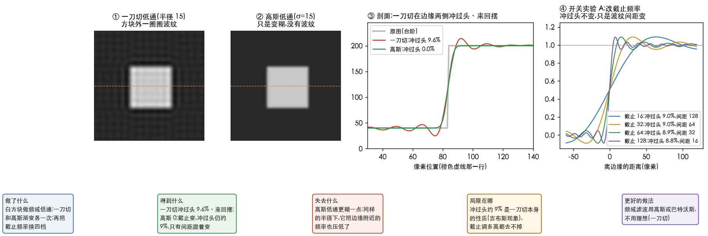
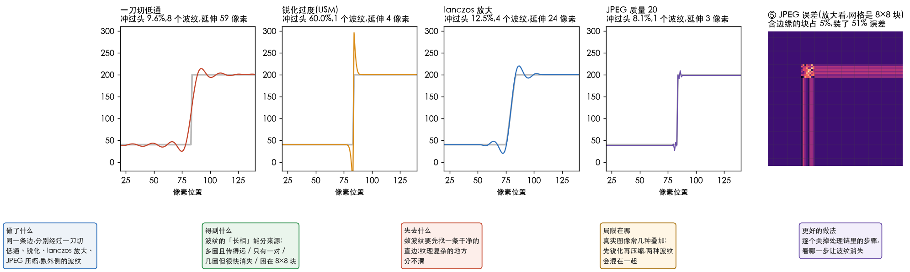

# 从症状找原因

> 目标:**看到一个图像问题,能说出是处理链里哪一步出的错,再用一个小实验证明它。**
> 不推公式,只讲「症状 → 原因 → 实验 → 修复」。目前有两个完整案例:摩尔纹、振铃,以后每种症状按同样格式往后加。
> 案例里的图和数字分别由 [`41_moire_diagnosis.py`](../../../Python-Prototyping/Ch04_Frequency_Domain/41_moire_diagnosis.py)、
> [`43_ringing_diagnosis.py`](../../../Python-Prototyping/Ch04_Frequency_Domain/43_ringing_diagnosis.py) 复现,你可以自己改参数再跑。

---

> **怎么读这篇**
>
> | 有多少时间 | 看哪几节 |
> | :--- | :--- |
> | **只有 10 分钟** | `一、通用套路` + `四、常见症状速查` |
> | **第一遍学** | 把 `二、案例:摩尔纹` `三、案例:振铃` 从头读完,对着图看每个实验 |
> | **踩坑时回来查** | `四、常见症状速查` 找到症状,再看 `五、和 AI 怎么配合` |

---

## 一、通用套路

```text
症状 → 归类(哪种底层问题) → 列出处理链里可能引入它的环节 → 每个环节配一个开关实验 → 修复
```

**开关实验**的原则只有一条:**只改一处,看症状变不变。** 变了,就是这一处;没变,换下一处。

---

## 二、案例:摩尔纹

### 1. 认症状

在细密的重复纹理上(衬衫条纹、砖墙、屏幕、纱窗),出现**原物没有的、更粗的波浪或彩色条纹**;
而且缩放比例一变,假纹的粗细、方向也跟着变。

### 2. 底层原因

**纹理比「采样网格」能表示的还细**,太细的波拍不下来,就被「折叠」成一道粗得多的假波。
这叫混叠(aliasing),摩尔纹(moiré)是它在图像上的样子;音频里 5 kHz 被 8 kHz 采成 3 kHz 是同一件事。

能表示的最细纹理是「两个像素一个周期」(亮、暗各一个像素)。比这还细,就会折叠。

### 3. 复现

自己造一张**越往外条纹越细**的图(波带片,zone plate),缩小到 1/4,看三种缩法:



| 缩法 | 外圈 | 与「应有的样子」的误差 |
| :--- | :--- | :--- |
| 最近邻(直接隔 4 个点取 1 个) | **冒出一圈圈原图没有的假圆环**(图 ③) | 88.1 |
| `INTER_AREA`(先把 4×4 一块平均,再缩) | 接近灰,只剩淡淡残影(图 ④) | 15.7 |
| 先高斯模糊,再隔点取 | 接近灰(图 ⑤) | 10.9 |

「应有的样子」(图 ②)是:新网格放得下的条纹保留,**放不下的变成平均灰**。缩小本来就该丢掉太细的细节,
丢掉是对的,**变成假纹才是错的**。误差按灰度 0~255 计。

### 4. 推测哪一步出错

摩尔纹只会出现在**发生了采样或重新采样**的地方,沿处理链一步步找:

| 可能的环节 | 怎么发生的 |
| :--- | :--- |
| 显示预览 | 看图软件、浏览器把大图缩小显示,**原图其实没问题** |
| 缩放处理 | 缩小前没先模糊(最近邻、快速双线性) |
| 拍摄 | 相机像素网格比物体纹理粗;屏摄是两套网格叠在一起 |
| 编码 | 色度下采样(4:2:0)只按一半分辨率存颜色,出现彩色摩尔纹或色边 |

### 5. 开关实验



| 实验 | 怎么做 | 结果说明什么 |
| :--- | :--- | :--- |
| **A 原尺寸查看** | 按 100% 看原图 | 摩尔纹消失 → 是**显示缩放**,图本身没问题 |
| **A′ 先低通再缩** | 缩前轻微模糊,或换 `INTER_AREA`、ffmpeg 的 `area` / `lanczos` | 消失 → 是**缩放时没先低通**(上面第 3 步就是这个实验) |
| **B 换缩放比例** | 换 2、3、4、5 倍各缩一次 | 假纹粗细乱跳 → 确认是混叠。真实纹理不会这样(图 ③) |
| **C 看频谱** | 原图和缩后各画一次频谱 | 细纹的亮点从边缘「折回」到中心附近 → **最硬的证据**(图 ②) |
| **D 拆开亮度和色度** | 只看亮度 Y,再单独看色度 | 彩色纹只在色度里 → 是**色度下采样**(图 ④⑤⑥) |

几个实验的实测数字:

- **图 ①②**:每 2.22 个像素一个周期的细纹,每 2 个像素取 1 个,
  变成新图里 10 个像素(原图 20 个像素)一个周期的粗假纹;频谱峰从 0.45 折到 0.10(0.5 是上限)。
- **图 ③**:每 2.33 个像素一个周期的细纹,每 2、3、4、5 个像素取 1 个,
  假纹周期分别是原图的 14.29、10.34、14.29、33.33 个像素。**真实纹理的周期永远是 2.33**,假纹却随比例乱跳。
- **图 ④⑤⑥**:亮度完全不变(最大变化 0,灰度图里什么都看不到),只有色度里有细纹;
  色度每 2 个像素留 1 个之后,出现 20 个像素一个周期的粗彩带。这就是色度下采样(chroma subsampling,术语表里叫色度子采样)惹的祸。

### 6. 修复

| 出错环节 | 修法 |
| :--- | :--- |
| 显示预览 | 不用修图,按 100% 检查;或换个缩略图算法好的看图工具 |
| 缩放 | 缩小前先低通,或直接用 `INTER_AREA`、`lanczos` 这类自带低通的算法 |
| 拍摄 | 换个距离或角度、稍微失焦;相机里的光学低通滤镜(OLPF)就是干这个的 |
| 编码 | 关键画面用 4:4:4,或先做轻微色度模糊再下采样 |

---

## 三、案例:振铃

### 1. 认症状

在**锐利的边缘旁边**(文字、天际线、物体轮廓)出现**一圈圈和边缘平行的明暗波纹**;
边缘亮的一侧更亮、暗的一侧更暗,像是「冲过头」又弹回来。叫振铃(ringing),因为剖面像敲钟后的余波。

### 2. 底层原因

**边缘需要很多很细的波叠在一起才「陡」得起来。** 把这些细波硬生生砍掉、或者处理不当,剩下的波拼不出陡边,
就在边缘两侧冲过头、来回摆。这就是[理解傅里叶积分](4.理解傅里叶积分.md)里说的:频域里「一刀切」(矩形),
换回空间就是 sinc 那样带正负波纹的形状。

但振铃**不只一种来源**,长相各不相同,这正是诊断的抓手。

### 3. 复现

白方块,在频域里做低通,一刀切和渐变(高斯)各一次:



| 做法 | 边缘外侧 | 冲过头(占台阶高度) |
| :--- | :--- | :--- |
| 一刀切(只留中心半径 15) | 一圈圈波纹,40 像素内 5 个(图 ①③) | **9.6%** |
| 高斯渐变(σ=15) | 只是变糊,没有波纹(图 ②③) | 0.0% |

图 ④ 是**开关实验 A:改截止频率**。只留最低 16、32、64、128 个频率,冲过头分别是 9.01%、8.96%、8.92%、8.82%,
**几乎不变**;变的只是波纹间距:128、64、32、16 像素,截止翻倍,间距减半。

**截止调多高,一刀切都会冲过头约 9%**,这叫吉布斯现象(Gibbs phenomenon)。所以「把截止调高一点」去不掉振铃,
只能把波纹挤得更密;要去掉,得换掉「一刀切」本身。

### 4. 推测哪一步出错

| 可能的环节 | 怎么发生的 |
| :--- | :--- |
| 频域滤波 | 用了理想低通/高通(一刀切) |
| 锐化 | USM、拉普拉斯锐化力度太大 |
| 放大 | lanczos、bicubic 这类插值核本身带负的部分 |
| 压缩 | JPEG、视频编码把每个 8×8 块的高频量化掉,边缘所在的块里出现杂乱波纹(蚊式噪声,mosquito noise) |

### 5. 开关实验



**开关实验 B:数波纹,看长相。** 同一条边(暗 40、亮 200),四种处理后看暗侧 60 像素:

| 来源 | 冲过头 | 外侧波纹个数 | 延伸多远 | 长相 |
| :--- | :--- | :--- | :--- | :--- |
| 一刀切低通 | 9.6% | 8 | 60 像素外还有 | **多圈、等间距、传得远** |
| 锐化过度(USM 力度 1.5) | 60.0% | 1 | 4 像素 | **只有一对**:亮侧一道亮边、暗侧一道黑边(光晕) |
| lanczos 放大 8 倍 | 12.5% | 4 | 24 像素 | **几圈,很快消失** |
| JPEG 质量 20 | 8.1% | 1 | 3 像素 | **杂乱,困在边缘所在的 8×8 块里** |

对照:双线性放大冲过头 0.00%,不振铃(但更糊)。

**开关实验 C:看误差是不是困在 8×8 块里**(图 ⑤)。JPEG 的误差里,含边缘的 8×8 块只占 4.7%,却装了 51.2% 的误差能量。
一条边如果刚好落在块边界上,压缩振铃会很轻,这也是脚本里把方块边缘放在块中间的原因。

**开关实验 D:逐个关掉。** 实际处理链里常是几种叠加(比如先锐化、再缩放、再压缩)。每次关掉一步,看波纹剩多少:

| 关掉哪一步后波纹消失 | 说明 |
| :--- | :--- |
| 把理想滤波换成高斯 | 频域一刀切 |
| 锐化力度调到 0 | 锐化过度 |
| 放大改成双线性 | 插值核 |
| 码率提高、或换无损 | 压缩 |

### 6. 修复

| 出错环节 | 修法 |
| :--- | :--- |
| 频域滤波 | 用高斯或巴特沃斯(Butterworth)这类边缘渐变的滤波器,不用理想滤波器 |
| 锐化 | 降低力度,加大半径;或只锐化边缘、限制最大冲过头量 |
| 放大 | 需要锐利时用 lanczos 并把结果裁到原范围;怕振铃时用双线性或 area |
| 压缩 | 提高码率;解码端开去块、去振铃滤波(deblocking / deringing) |

**一个取舍**:摩尔纹那节推荐缩小用 `lanczos`,它防摩尔纹好,但自己会带一点振铃;`INTER_AREA` 两样都不出,只是稍糊。
没有哪种缩法同时最锐、最无摩尔纹、最无振铃,看画面里哪种瑕疵更扎眼。

---

## 四、常见症状速查

底层原因其实只有几类。下面先列出来,以后每种按第二、三节的格式补成完整案例:

| 症状 | 底层原因 | 你学过的哪块 |
| :--- | :--- | :--- |
| 摩尔纹、锯齿、闪烁的细纹 | 采样太稀,频率折叠 | 本篇第二节;采样与混叠 |
| 边缘旁一圈圈波纹(振铃) | 频域一刀切、锐化过度、插值核、压缩 | 本篇第三节 |
| 发糊 | 高频被砍掉 | 低通 |
| 噪点变明显、边缘发白边 | 高频被放大 | 锐化、高通 |
| 渐变上一条条色带 | 量化级数不够(8 bit 不够细) | 第 2 章量化 |
| 8×8 方块 | 分块压缩丢了高频 | 第 8 章 DCT 压缩 |
| 彩色边、颜色渗到旁边 | 色度分辨率低 | 本篇实验 D;色度下采样 |
| 图像整体错位、边缘重影 | 滤波器改了相位 | [正交基与相位](3.正交基与相位.md) |
| 频域滤波后边缘像从对面「卷」过来 | 没补零,做成了循环卷积 | 快速路线阶段 3 |

---

## 五、和 AI 怎么配合

| 你给 AI | 为什么 |
| :--- | :--- |
| 原图或截图,**裁一小块按 100% 放大** | 缩略图本身可能就带摩尔纹,会误导判断 |
| 整条处理链和参数(比如完整的 ffmpeg 命令、缩放算法、编码设置) | 才能列出「哪几步可能引入问题」 |
| 你已经做过的实验和结果 | 避免重复,直接往下排查 |

分工:**你负责提出猜测、看实验结果下结论;AI 负责写验证脚本、画频谱、批量跑对比。**
本篇的 `41_moire_diagnosis.py` 就是一个样板:造图 → 复现 → 每个猜测一个实验 → 出对比图。

---

## 六、完成标准

| 题 | 答案要点 |
| :--- | :--- |
| 摩尔纹的底层原因 | 纹理比采样网格能表示的还细,被折叠成粗假纹 |
| 怎么一步判断是不是看图软件的问题 | 按 100% 原尺寸看,消失就是显示缩放 |
| 怎么证明是混叠而不是真实纹理 | 换缩放比例,假纹粗细乱跳;或看频谱,亮点折回中心 |
| 彩色摩尔纹怎么定位 | 拆开亮度和色度,只在色度里 → 色度下采样 |
| 缩小图片的正确做法 | 先低通再缩,或用 `INTER_AREA`、`lanczos` |
| 振铃的底层原因 | 边缘需要的细波被硬砍掉或处理不当,剩下的拼不出陡边,冲过头来回摆 |
| 为什么把截止调高去不掉振铃 | 一刀切总会冲过头约 9%,调高只是让波纹更密 |
| 看到振铃,怎么分来源 | 多圈传得远 → 一刀切;只有一对 → 锐化;几圈很快消失 → 插值;困在 8×8 块 → 压缩 |
