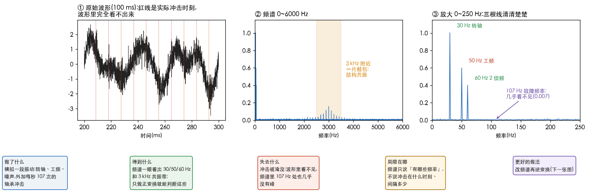
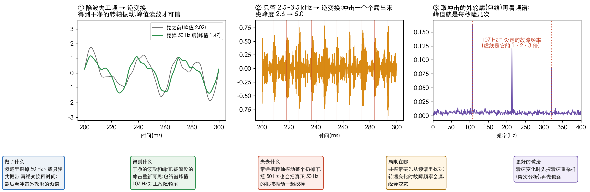
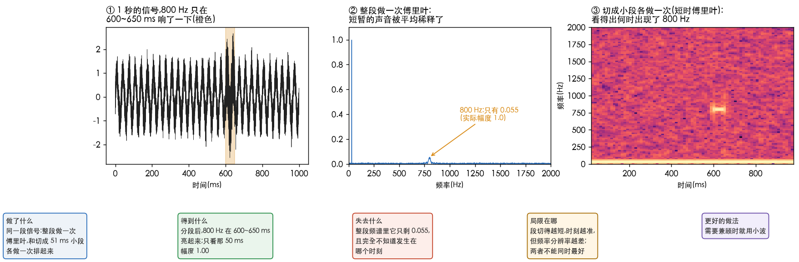

# 振动信号与逆变换

> 问题:一段采集的机械振动信号,杂乱、不是周期的,做傅里叶看到的频谱也是连续的,**那逆变换有什么用?**
> 这一篇用一段模拟的振动信号回答,不写公式。
> 信号、图和数字都由 [`42_vibration.py`](../../../Python-Prototyping/Ch04_Frequency_Domain/42_vibration.py) 生成,可以改参数再跑。

---

> **怎么读这篇**
>
> | 有多少时间 | 看哪几节 |
> | :--- | :--- |
> | **只有 10 分钟** | `一、先说结论` + 第二张图 + `五、一句话` |
> | **第一遍学** | 从头读,对着三张图看每一步 |
> | **踩坑时回来查** | `四、傅里叶的短板` |

---

## 一、先说结论

**只看一眼频谱、判断哪个频率超标,确实用不到逆变换。** 原信号本来就有,原样变过去再变回来,不会多出任何信息。

**逆变换真正的用处:在频域里改了东西之后,回到时间上看结果。** 也就是[理解傅里叶积分](4.理解傅里叶积分.md)里说的「拆 → 改系数 → 拼」的「拼」。

杂乱、非周期不影响这一点:再乱的信号也能拆成一堆波,也能原样拼回。
计算机里拿到的是有限个采样点,频谱其实是很密的一排点,所以看起来像连续的。

---

## 二、模拟一段振动

采样 20 kHz、1 秒,里面混了这些东西:

| 成分 | 设定 | 现实里是什么 |
| :--- | :--- | :--- |
| 转轴振动 | 30 Hz(幅度 1.0)+ 60 Hz(0.4) | 转一圈晃一下,外加 2 倍频 |
| 工频干扰 | 50 Hz(0.6) | 电源线串进传感器 |
| 白噪声 | 所有频率都有一点 | 环境、电路噪声 |
| 轴承故障 | 每秒「磕」107 次,每次激起 3000 Hz 的共振,1.5 ms 内衰减 | 外圈有一个坑,滚珠每滚过一次就撞一下 |

只做正变换,能看到:

- **30、50、60 Hz 三根线**清清楚楚,幅度读出来是 1.004、0.600、0.401,和设定一致(图 ③);
- **3 kHz 附近一片鼓包**:冲击激起的结构共振(图 ②)。

但**故障看不出来**:冲击单独最大只有 0.95,混在最大 3.47 的信号里,波形上完全看不见(图 ①,红线是实际冲击时刻);
频谱里 107 Hz 处的幅度只有 0.007,几乎没有峰。

---

## 三、改频谱再逆变换

### 用法 1:去干扰

频域里只留 200 Hz 以下,再把 50 Hz 那一小段挖掉(陷波,notch),逆变换回时间(图 ①):

| | 挖之前 | 挖之后 |
| :--- | :--- | :--- |
| 50 Hz 的幅度 | 0.600 | 几乎为 0 |
| 与「没有工频的转轴振动」的误差 | 0.424 | 0.012 |
| 峰值读数 | 2.02 | 1.47 |

真实转轴峰值是 1.34,挖之后的 1.47 已经接近,剩下的差是 200 Hz 以下那部分噪声。
**峰值、有效值这些现场要读的数,只能从时间波形上读**;频谱只告诉你「有多强」,不告诉你「最高冲到多少」。

### 用法 2:捞出被淹没的故障

频域里**只留 2.5~3.5 kHz 的共振带**,其余全扔,逆变换回时间(图 ②):冲击一个个露出来,正好对上红线。
尖峰度(kurtosis,衡量波形「尖不尖」:纯噪声约为 3,越大越尖)从 2.6 升到 5.0。

再取这串冲击的**外轮廓**(包络,envelope),看它的频谱(图 ③):**峰值在 107 Hz**,冲击间隔 9.35 ms,
正好是设定的故障频率,后面还跟着 2 倍、3 倍。现实里,不同部位(外圈、内圈、滚珠)的故障频率不同,
由轴承尺寸和转速算出来,**对上哪个就是哪里坏了**。这就是振动诊断里「包络分析」的思路。

### 用法 3:频域里一步做完时域的麻烦事

- 加速度传感器测的是加速度,现场标准常看速度、有时看位移。频域里每个频率按一个简单规则缩放,再逆变换,就得到速度波形。
- 长信号滤波:频域相乘再逆变换,比在时间上逐点卷积快得多。

(这两条本篇没有画图。)

---

## 四、傅里叶的短板

整段做一次傅里叶,得到的是**全程平均**的频率成分,**不告诉你某个频率是什么时候出现的**。

一段 1 秒的信号,800 Hz(幅度 1.0)只在 600~650 ms 响了一下:

| 看法 | 800 Hz 的幅度 | 知不知道何时 |
| :--- | :--- | :--- |
| 整段 1 秒做一次(图 ②) | **0.055**,被平均稀释了 | 不知道 |
| 只看那 50 ms | 1.00 | — |
| 切成小段各做一次排起来(图 ③) | 在 600 ms 附近亮起来 | **知道** |

最后一种叫短时傅里叶变换(short-time Fourier transform,STFT),画出来的图叫时频图;音频里的语谱图就是它。
代价是:段切得越短,时刻越准,但频率越看不细,两者不能同时最好;需要兼顾时用小波(wavelet)。

振动里的**一次撞击**、**启动停机时转速在变**,都属于这种情况。

---

## 五、一句话

| 做法 | 用来干什么 | 需不需要逆变换 |
| :--- | :--- | :--- |
| 只看频谱 | 判断哪个频率超标 | 不需要 |
| 改频谱 + 逆变换 | 去工频、捞出被淹没的冲击、加速度换速度 | **需要** |
| 分段看频谱 | 知道哪个频率在什么时刻出现 | 不需要,但要切段 |

**正变换让你看清「有哪些频率」,逆变换让你把改过的频率「变回能用的波形」。** 不改频谱,就不需要逆变换。

和图像对照:磨皮(去高频)、去周期条纹(陷波)、锐化,也都是「改频谱 + 逆变换」。

**完成标准**:能说出逆变换什么时候用不到、什么时候必须用;能讲出「带通 → 逆变换 → 包络 → 看包络谱」为什么能找到轴承故障;
能说出整段傅里叶为什么会把短暂的撞击稀释掉。
