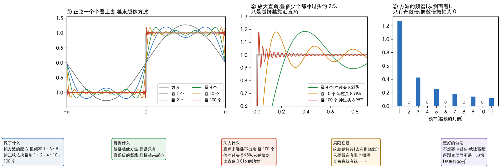
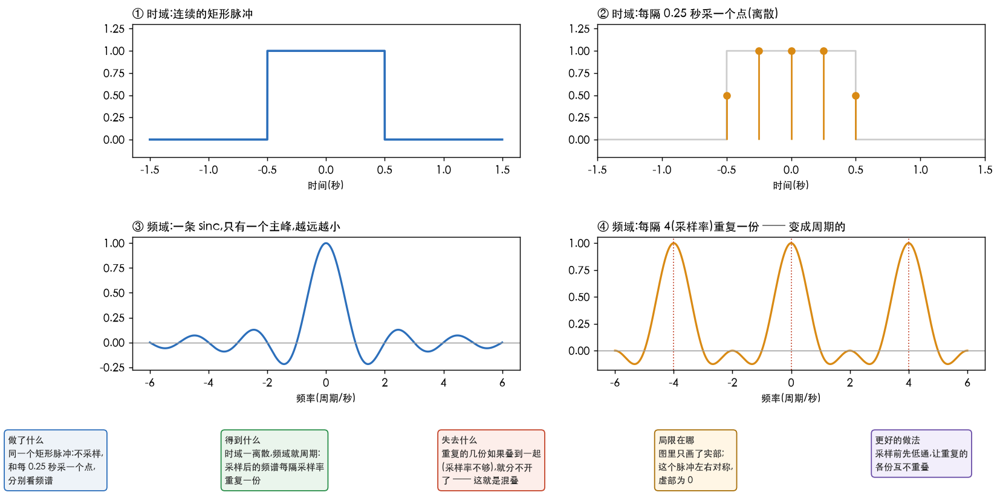

# 知乎傅里叶文章笔记

> 读《如果看了此文你还不懂傅里叶变换,那就过来掐死我吧》的笔记。原作者韩昊(知乎 Heinrich,专栏「与时间无关的故事」),
> 我读的是知乎上的转载版:<https://zhuanlan.zhihu.com/p/149265832>。
> 这里**只用自己的话记要点**,不搬原文和原图;想看原文的生动写法和动图,请读原文。
> 本篇的两张图是自己用 [`44_square_wave.py`](../../../Python-Prototyping/Ch04_Frequency_Domain/44_square_wave.py) 画的,数字也出自它。

---

> **怎么读这篇**
>
> | 有多少时间 | 看哪几节 |
> | :--- | :--- |
> | **只有 10 分钟** | `一、原文要点` 的表 + `四、一句话` |
> | **第一遍学** | 从头读,对着两张图看 `三、要留意的四处` |
> | **踩坑时回来查** | `二、和快速路线对照`,找到对应的那一篇 |

---

## 一、原文要点

原文的承诺是:**不看一个公式,也能理解傅里叶**。全文六章,一章一个比喻:

| 章 | 讲什么 | 比喻 |
| :--- | :--- | :--- |
| 一、什么是频域 | 按时间看世界是时域;按「由哪些频率组成」看是频域 | 音乐:时域是乱晃的波形,频域是乐谱上的音符 |
| 二、频谱 | 正弦一个个叠加能叠出方波;把各分量按频率排开,**从侧面看**,每个频率一根竖线,高度是振幅 | 正弦波 = 转动的圆在直线上的投影;幕布后面无数齿轮在转 |
| 三、相位谱 | 只有振幅不够,波峰位置不同叠出来就不同;**从下面看**,得到每个分量的相位 | 时间差除以周期,折成角度,就是相位 |
| 四、傅里叶变换 | 周期信号 → 离散竖线;非周期信号 → 竖线挤成连续曲线,求和变成积分 | 竖线越挤越密,连成起伏的大海 |
| 五、欧拉公式 | 乘 i 就是转 90°;欧拉公式是一个在复平面上匀速转圈的点,随时间展开成螺旋线 | 螺旋线从两侧投影,一边是余弦,一边是正弦 |
| 六、指数形式 | 余弦 = 一条逆时针螺旋 + 一条顺时针螺旋,各取一半,虚部抵消;逆时针叫正频率,顺时针叫负频率 | 很多螺旋连成的「海螺」曲面,在时域里只是一个矩形脉冲 |

顺带讲的两个用途:

- **滤波**:在时域里从 sin3x+sin5x 中拿掉 sin5x 几乎做不到;在频域里只是删掉一根竖线。
- **解微分方程**:微分、积分在频域里变成乘法、除法。

---

## 二、和快速路线对照

| 原文 | 快速路线里的哪一篇 |
| :--- | :--- |
| 正弦波 = 圆的投影;欧拉公式 = 螺旋线 | [如何直观理解欧拉公式](../如何直观理解欧拉公式.md) |
| 振幅谱从侧面看,相位谱从下面看 | [理解傅里叶变换](2.理解傅里叶变换.md) 的 `ft-series` 图 |
| 「基」「正交基」 | [正交基与相位](3.正交基与相位.md) |
| 竖线挤成大海,求和变积分 | [理解傅里叶积分](4.理解傅里叶积分.md) 第六节 |
| 海螺图在时域是一个矩形脉冲 | 第 4 篇手算的矩形脉冲,它的频谱就是那条 sinc 曲线 |
| 拿掉 sin5x 就是滤波 | [振动信号与逆变换](6.振动信号与逆变换.md);交互页 `Interactive/频谱涂抹.html` |

---

## 三、要留意的四处

### 世界是静止的

原文的金句「在频域里,世界是静止的」,**只对频率不随时间变的信号成立**。
乐谱、语音、启停机时的振动,频率都在变;整段做一次傅里叶会把变化平均掉,要用短时傅里叶(见[振动信号与逆变换](6.振动信号与逆变换.md)第四节)。
原文作者自己也说乐谱比喻「公式上不对」:乐谱是**每个时刻各有自己的音符**,它真正对应的是时频图(语谱图),不是整段的频谱。

### 方波叠加里藏着振铃

原文说「叠到无穷多个就是标准方波」,整体上没错,但直角附近有一个细节:

| 叠几个正弦 | 冲过头(占台阶高度) | 冲过头出现在离直角多远 |
| :--- | :--- | :--- |
| 1 | 13.66% | 1.571 |
| 2 | 10.02% | 0.785 |
| 4 | 9.21% | 0.393 |
| 10 | 8.99% | 0.157 |
| 100 | 8.95% | 0.016 |

**叠得越多,冲过头只是越挤越靠近直角,高度停在约 9% 不降**(图 ②)。这就是[从症状找原因](5.从症状找原因.md)振铃案例里的吉布斯现象:
只要截在有限个频率,直角旁就有这一下。

图 ③ 是方波的频谱:只有 1、3、5、7…倍,振幅 1.273、0.424、0.255、0.182、0.141 越来越小;偶数倍全是 0,对应原文图里那些「振幅为 0 的直线」。

### 打油诗背后的规律

原文有一首打油诗,说的是「连续非周期的信号,没法变成周期离散的」。这句是对的,背后是傅里叶的四种形态:

| 时域 | 频域 | 名字 |
| :--- | :--- | :--- |
| 周期、连续 | 离散、非周期 | 傅里叶级数 |
| 非周期、连续 | 连续、非周期 | 傅里叶变换 |
| 离散(采样过)、非周期 | 连续、**周期** | 离散时间傅里叶变换(DTFT) |
| 离散、周期 | 离散、周期 | DFT(计算机里用的) |

规律只有两句:**一边离散,另一边就周期;一边周期,另一边就离散。**

图里同一个矩形脉冲,每 0.25 秒采一个点(采样率每秒 4 次)之后,频谱在 0.3 和 4.3 处的值都是 0.8424,**每隔 4 重复一次**;
不采样时,4.3 处只有 0.0599,不重复。

**这条规律正好解释了摩尔纹**:时间(或空间)上一采样,频谱就开始周期重复;
采样率不够时,重复的几份叠到一起分不开,就是混叠(见[从症状找原因](5.从症状找原因.md)第二节)。
DFT 两边都离散又都周期,是因为时间上采样了,又只取了有限的一段(等于假装它在重复)。

### 相位在图像里更重要

原文的方波例子里,相位只有 0 和 π 两种,看起来无关紧要。但图像里,**结构和位置主要靠相位**:
[正交基与相位](3.正交基与相位.md)实测过,拿 A 的振幅配 B 的相位,重建出来像 B。

---

## 四、一句话

这篇文章讲透了「**换个方向看同一个信号**」:从侧面看是振幅,从下面看是相位,从正面看是原来的波形。
它没讲的是「**看完怎么用、出了问题怎么查**」,这正是快速路线第 5、6 篇在补的。

**完成标准**:

| 题 | 答案要点 |
| :--- | :--- |
| 振幅谱和相位谱各从哪个方向看 | 振幅从侧面,相位从下面 |
| 为什么叠多少个正弦,方波的直角旁都有一下冲过头 | 截在有限个频率就有吉布斯现象,约 9%,只会挤近不会降低 |
| 「一边离散,另一边就周期」和摩尔纹有什么关系 | 采样让频谱周期重复,重复的几份叠在一起就是混叠 |
| 乐谱更像频谱还是时频图 | 时频图:每个时刻各有自己的音符 |
