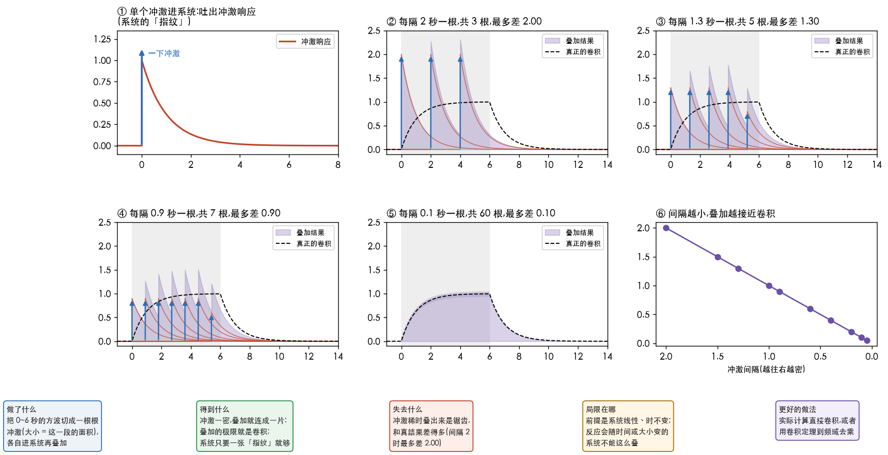
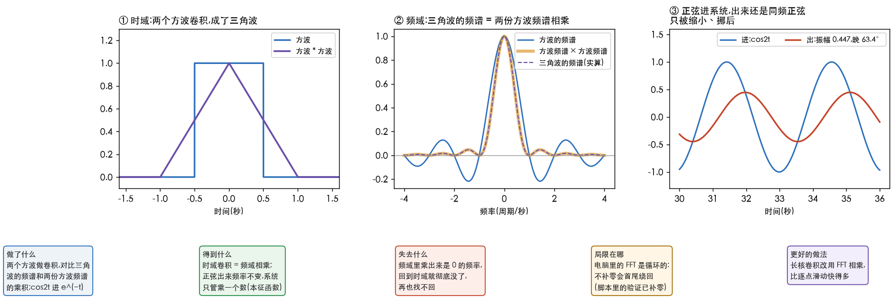
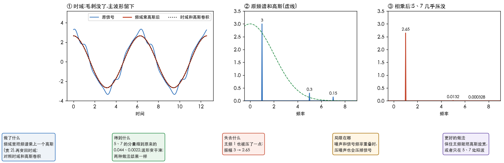

# 卷积定理

> 整理自 B 站科普视频《时域卷积,到了频域变成乘积了?|傅立叶变换卷积定理|低通滤波器工作原理科普》(约 12 分钟,desmos 自制动画)。
> 我先用 whisper 自动转写了配音,再对照截图核对动画。
> 三张图和所有数字由 [`45_convolution_theorem.py`](../../../Python-Prototyping/Ch04_Frequency_Domain/45_convolution_theorem.py) 生成,不是从视频里截的。
> 前置:[理解卷积](1.理解卷积.md)、[理解傅里叶积分](4.理解傅里叶积分.md)。

---

> **怎么读这篇**
>
> | 有多少时间 | 看哪几节 |
> | :--- | :--- |
> | **只有 10 分钟** | 第一张图 + `三、卷积定理` 开头的一句话 + `七、一句话` |
> | **第一遍学** | 从头读,对着三张图看 |
> | **踩坑时回来查** | `五、要留意的三处`、`六、和图像的关系` |

---

## 一、视频讲了什么

| 段 | 讲什么 | 快速路线里的对应 |
| :--- | :--- | :--- |
| 傅里叶回顾 | 一个转圈的「探测器」乘上信号再积分,面积大说明这个频率多;正负面积互相抵消 | 第 2、4 篇 |
| 卷积回顾 | 冲激进系统得到冲激响应,一串冲激的响应叠起来就是卷积;再演示翻转、滑动、算重叠面积 | 第 1 篇 |
| 卷积定理 | 时域里卷积,等于频域里相乘;白板推导一遍 | 本篇第三节 |
| 为什么成立 | 正弦经过卷积,频率不变,只被乘上一个数 | 本篇第三节 |
| 应用 | 3cos t + 0.3cos5t + 0.15sin7t,在频域乘一个高斯,压掉 5 和 7,波形变平滑 | 本篇第四节 |

---

## 二、冲激是积木

视频里最直观的一段:一个「信号时间间隔」滑块,作者从 5.5 一路拖到 0.9。
间隔大时,一根冲激进系统,吐出一个尖起来再衰减的响应,下一根很久以后才来;
间隔变小,前一个响应还没衰减完,后一个就来了,响应开始叠在一起;
再小,紫色的叠加结果连成一片,这就是卷积。

我用脚本把这个过程复现了一遍,系统和视频一样,冲激响应(impulse response)是一条从 1 开始衰减的曲线;输入是 0~6 秒、高度 1 的方波。

| 冲激间隔 | 冲激根数 | 叠出来和真正卷积最多差 |
| :--- | :--- | :--- |
| 2 | 3 | 2.00 |
| 1.3 | 5 | 1.30 |
| 0.9 | 7 | 0.90 |
| 0.1 | 60 | 0.10 |

几个要点:

- **每根冲激的大小 = 它代表的那一小段的面积**(间隔 × 高度)。间隔 2 时每根大小是 2,所以图 ② 里每个响应都从 2 开始。
- **最多差正好等于间隔**:每来一根冲激,输出立刻往上跳一下,跳的高度就是这根冲激的大小。冲激越密,每一跳越小,锯齿就磨平了(图 ⑥ 是一条直线)。
- **极限就是卷积**:间隔 0.1 时,紫色几乎和黑虚线(真正的卷积)重合。

**所以冲激的直观意义是:拆信号用的最小积木。**
任何信号都能看成无数根挨得极近、大小不一的冲激;系统只要是线性时不变(LTI)的,
你只需要知道它对「一下」的反应,剩下的只是挪一挪、按大小缩放、再加起来。
这就是[理解卷积](1.理解卷积.md)里馒头的故事:一个馒头是一根冲激,消化曲线是冲激响应,一天吃好几顿就是一串冲激。

---

## 三、卷积定理

**一句话:时域里滑来滑去算重叠面积,等于频域里逐个频率相乘。** 这就是卷积定理(convolution theorem)。

反过来也成立:频域里两份频谱相乘,变回时域就是两个信号的卷积。

### 方波卷积成三角波

图 ①:两个宽 1、高 1 的方波卷积,得到一个宽 2、最高 1 的三角波。
滑过去的时候,重叠面积先一直变大,正对时最大,再一直变小,所以是三角形。

图 ②:三角波的频谱(紫色虚线,实算)和两份方波频谱的乘积(橙色粗线)完全重合。
比如在频率 0.3 处,方波频谱是 0.8584,平方是 0.7368,三角波的频谱实算也是 0.7368;整个频段最多差 7.7×10⁻⁶。

脚本里还用两串随机数验证了离散版本:直接卷积,和先变到频域相乘再变回来,最大差 2.5×10⁻¹⁴,只是计算机的舍入误差。

### 正弦进去还是正弦

为什么卷积到了频域会变成乘法?视频的解释是第四段,也是这篇最值得记住的地方:

**正弦(复指数)进一个 LTI 系统,出来还是同一个频率的正弦,只被缩放一下、挪一下相位。**

图 ③ 是实测:cos2t 进上面那个系统,出来的波形用频率 2 的正弦拟合,残差只有 10⁻¹⁴ 量级,也就是说完全是频率 2;振幅从 1 变成 0.447,相位晚了 63.4°。
换别的频率,系统乘的数就不一样:

| 频率 | 系统把振幅乘上 |
| :--- | :--- |
| 0.5 | 0.894 |
| 2 | 0.447 |
| 8 | 0.124 |

这张表就是这个系统的「频率响应」:低频几乎原样通过,高频被压小。所以这个系统本身就是一个低通。

于是卷积定理就顺理成章了:

1. 把输入拆成一堆正弦(傅里叶);
2. 每个正弦各自过系统,频率不变,只被乘上一个数;
3. 乘的那个数,正好是冲激响应在这个频率上的傅里叶变换;
4. 所以在频域里,就是「输入的频谱 × 系统的频谱」。

视频把它类比成线性代数里的特征向量(eigenvector):被变换之后方向不变,只被拉长或缩短。
复指数就是卷积这个变换的「特征向量」,放到函数上叫本征函数(eigenfunction)。

---

## 四、应用:低通

视频最后的例子:3cos t + 0.3cos5t + 0.15sin7t。主频 1 决定了大致形状,5 和 7 是上面的小毛刺。

把频谱乘上一个宽 2 的高斯(Gaussian)曲线(图 ② 绿色虚线):

| 频率 | 高斯在这里的值 | 振幅 |
| :--- | :--- | :--- |
| 1 | 0.8825 | 3 → 2.65 |
| 5 | 0.0439 | 0.3 → 0.0132 |
| 7 | 0.0022 | 0.15 → 0.0003 |

**同一件事在时域里做,就是和一个宽 0.5 的高斯核卷积。** 脚本两种都做了,结果最大差 2.2×10⁻¹⁵,完全一样(图 ① 红线和黑点线重合)。

代价也在表里:主频 1 也被压了一点,3 变成 2.65。高斯想压掉高频,就不可能对低频毫无影响;
想保住主频,就把高斯放宽,或者只在 5、7 处挖掉(陷波,见[振动信号与逆变换](6.振动信号与逆变换.md))。

---

## 五、要留意的三处

| 视频说法 | 补充 |
| :--- | :--- |
| 低通「形状就是一个高斯函数」 | 高斯只是一种选择。理想低通是一刀切的矩形,会带来振铃(见[从症状找原因](5.从症状找原因.md)第三节);高斯边缘是渐变的,不振铃 |
| sin 的频谱里那一对冲激「一个倒过来」 | sin 的频谱是纯虚数,正负两侧方向相反;只看振幅时两根一样高 |
| 结尾用「揉面发酵」比喻时域和频域 | 比喻比较松,记住「同一件事,换个方向看」就够了 |

还有一处是视频没讲、但电脑上一定会碰到的:**FFT 算出来的卷积是循环的**。信号的尾巴会绕回开头,所以要先补零。
第三节脚本里那两串随机数的验证就补了零(补到两串长度之和减 1),不补就对不上。

---

## 六、和图像的关系

| 卷积定理说的 | 图像里是什么 |
| :--- | :--- |
| 冲激响应 | 点扩散函数(PSF):拍一个亮点得到的光斑 |
| 冲激响应的频谱 | 镜头、滤波器的频率响应(镜头的频率响应取幅度,就是 MTF) |
| 时域卷积 = 频域相乘 | 拍糊 = 清晰图的频谱 × 镜头的频率响应 |
| 频谱乘出来是 0 的频率 | 彻底丢了,去模糊也找不回 |
| 大核卷积改用 FFT 相乘 | 大半径模糊、大核滤波,走频域更快 |

交互页 `Interactive/频谱涂抹.html` 做的就是「频域相乘」:涂掉的地方乘 0,留下的地方乘 1。

---

## 七、一句话

**冲激是拆信号的积木,冲激响应是系统的指纹;正弦进系统频率不变、只被乘一个数,所以时域里的卷积,到了频域就是相乘。**

**完成标准**:

| 题 | 答案要点 |
| :--- | :--- |
| 为什么只知道冲激响应,就能算系统对任何输入的反应 | 输入能拆成一串冲激,LTI 系统对每根的反应只是挪位置、按大小缩放,再叠加 |
| 两个方波卷积得到什么?频谱是什么 | 三角波;频谱是方波频谱的平方 |
| 正弦进 LTI 系统,什么变了什么不变 | 频率不变;振幅被缩放,相位被挪 |
| 频域里乘一个高斯,时域里相当于做什么 | 和一个高斯核卷积;高斯在频域越窄,时域核越宽,越模糊 |
| 用 FFT 算卷积要注意什么 | FFT 是循环的,先补零 |
