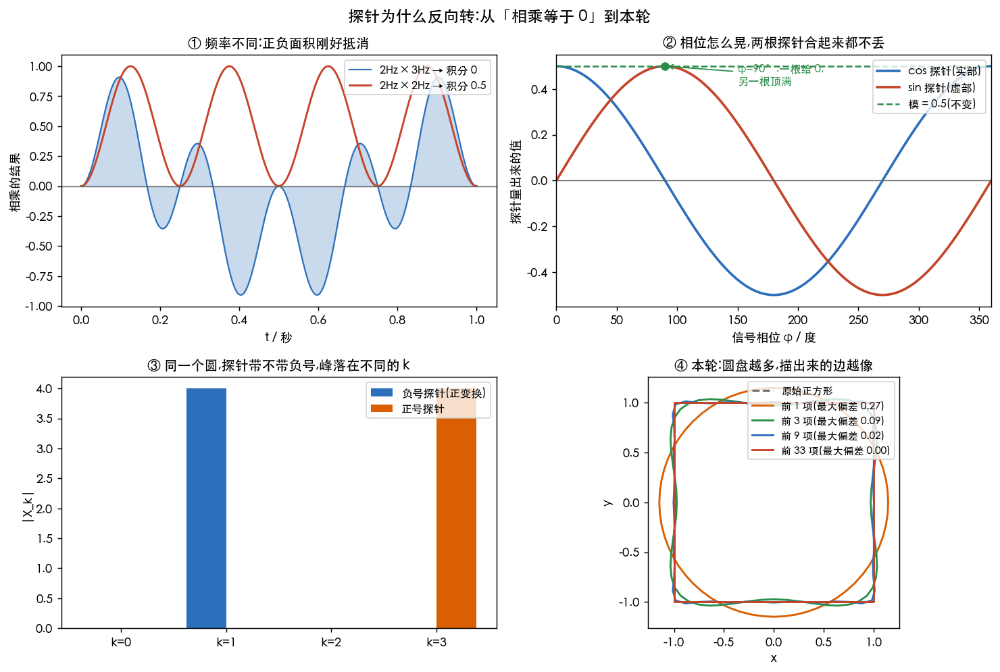

# 探针为什么反向转

> 整理自一段追问到底的对话(原文见 [_archive/gemini-对话-傅里叶变换正交性.md](../../_archive/gemini-对话-傅里叶变换正交性.md)):
> 从「相乘怎么可能等于 0」问到「相位怎么求」,再问到「那个负号到底干嘛用」。
> 每个数字和那张图都由 [`46_fourier_probe.py`](../../../Python-Prototyping/Ch04_Frequency_Domain/46_fourier_probe.py) 算出。
> 前一篇是[卷积定理](8.卷积定理.md);正交基与相位的系统版在[正交基与相位](3.正交基与相位.md),
> 这篇只补那篇没讲到的三件事:**积化和差的抵消**、**atan2 反推角度**、**负号为什么必须是负的**。

---

> **怎么读这篇**
>
> | 有多少时间 | 看哪几节 |
> | :--- | :--- |
> | **只有 10 分钟** | `一、相乘为什么会归零` 的两行公式 + `四、探针为什么反向转` 的对照表 + `七、完成标准` |
> | **第一遍学** | 从头读,手算 `五、手算四个点` 那张表 |
> | **踩坑时回来查** | `四、探针为什么反向转` 的「星际穿越差在哪一步」、`三、由坐标反推角度` 的 atan2 |

---

## 一、相乘为什么会归零

两个函数在一个周期上**相乘再积分**,就是函数版的点乘,叫内积(inner product);
结果等于 0 就叫正交(orthogonal),意思是「你在我身上量一圈,什么也量不出来」。

疑惑通常出在「相乘」这一步:**两个波形都在正有负,凭什么乘完积分就刚好是 0?**
答案在积化和差公式里 —— 相乘不是把两个波混在一起,而是**造出两个新波**:

$$
\sin(2\pi f_1 t)\cdot\sin(2\pi f_2 t)=\tfrac12\cos\big[2\pi(f_1-f_2)t\big]-\tfrac12\cos\big[2\pi(f_1+f_2)t\big]
$$

出来的是一个**差频波** $f_1-f_2$ 和一个**和频波** $f_1+f_2$。
只要 $f_1\neq f_2$,这两个新波在原本那个总周期里都刚好装下**整数个完整波形**,
正半周和负半周一面积一样多,积分时精确抵消。

| 相乘的两项 | 造出来的波 | 在 [0,1] 秒上的积分 |
| :--- | :--- | :--- |
| 2 Hz × 3 Hz | 差频 1 Hz、和频 5 Hz,都是完整周期 | **8.6×10⁻¹⁸**(就是 0) |
| 2 Hz × 2 Hz | 差频 0 Hz(**一个常数!**)、和频 4 Hz | **0.5** |

同频率那一行的关键:差频 $f_1-f_2=0$,造出来的不是波而是**一个不动的常数** ——
$\sin^2(2\pi f t)=\tfrac12-\tfrac12\cos(4\pi f t)$,前面那个 $\tfrac12$ 是直流分量,
它在一个周期里老老实实累加,积分自然不为 0。**这就是「对上暗号」的全部秘密。**

---

## 二、相位一来就瞎了

上面的推导有个大漏洞:它假设探测用的那根波和信号里的波**同相位**。
信号若是 $\cos(\omega t+\varphi)$,只拿一根 $\cos\omega t$ 去量,量出来的是 $\tfrac12\cos\varphi$ ——
$\varphi=90^\circ$ 时它直接给 0,**频率明明对了,却被判成没有**。

修法是老老实实派两根互相正交的探针:一根 cos、一根 sin。
信号 $x(t)=\cos(2\pi t+\varphi)$ 在一个周期上的实测:

| 信号相位 $\varphi$ | cos 探针(实部) | sin 探针(虚部) | 模 | 辐角 |
| :--- | :--- | :--- | :--- | :--- |
| 0° | +0.5000 | 0.0000 | 0.5 | 0° |
| 30° | +0.4330 | +0.2500 | 0.5 | +30.0° |
| 90° | **0.0000** | +0.5000 | 0.5 | +90.0° |

**一根掉下去,另一根必定顶上来**,因为两根探针互相垂直。这也解释了为什么傅里叶系数非得是复数:
它不是故弄玄虚,而是**必须有两个位置来放两根探针的结果**。

两栏的写法说明一下:探针是 $e^{-i\omega t}=\cos\omega t-i\sin\omega t$,
所以**实部** $=\int x\cos$(正的)、**虚部** $=-\int x\sin$(带一个负号) ——
表里 sin 那一栏填的是放进虚部之后的值。这样写的好处是,复数 $X$ 的辐角正好等于 $\varphi$。

---

## 三、由坐标反推角度

既然不知道 $\varphi$,怎么把它读出来?把实部 $A$ 和虚部 $B$ 当成平面上的一个点:

- 横坐标 $A=\tfrac12\cos\varphi$,纵坐标 $B=\tfrac12\sin\varphi$
- **模** $\sqrt{A^2+B^2}$:这就是振幅。它和 $\varphi$ 无关 —— 相位怎么转,能量一分不少
- **辐角** $\mathrm{atan2}(B,A)$:这就是相位

用 `atan2(B, A)` 而不是 `atan(B/A)`,两个很实在的理由:

| 写法 | $A=0$ 时 | 象限 |
| :--- | :--- | :--- |
| `atan(B/A)` | 除以 0,程序直接出 `inf` | 分不清 $(-B)/(-A)$ 和 $B/A$,第二、三象限全错 |
| `atan2(B, A)` | 正常返回 ±90° | 分子分母分开传,四个象限各自认得出来 |

于是那个复数可以写成极坐标形式(polar form),也就是 $X=r\,e^{j\varphi}$:

| 部分 | 是什么 | 在音频里 | 在图像里 |
| :--- | :--- | :--- | :--- |
| $r$(模) | 这个频率有多强 | 均衡器推子推的就是它 | 这张图有多少粗纹理、多少细纹理 |
| $e^{j\varphi}$(辐角) | 这个波摆在什么位置 | 到达两个麦克风的时间差 | 边缘**在哪** |

---

## 四、探针为什么反向转

离散傅里叶变换(DFT)的公式里,探针长这样:

$$
X_k=\sum_{t=0}^{N-1}z(t)\,e^{-j\frac{2\pi k t}{N}}
$$

把它当成一句给指针下的命令,每个符号都有活干:

| 符号 | 干什么 |
| :--- | :--- |
| $e^{j\theta}$ | 复平面上一根转动的指针(欧拉公式) |
| $2\pi$ | 一整圈 |
| $N$ | 走完整个图形一共几步 |
| $t$ | 第几步,从 0 数到 $N-1$ |
| $k$ | 探针编号:走完一轮它转了 $k$ 圈;$k=0$ 不转,量的是直流 |
| **负号** | 反向转,见下 |

### 负号是刹车片

信号里那个成分本身在转,写成 $e^{+j\omega_0 t}$。探针是**乘**上去的,
而同底数的指数相乘,**指数要相加**:

| 探针 | 相乘之后 | 后果 |
| :--- | :--- | :--- |
| 正号 $e^{+j\omega t}$ | $e^{j(\omega_0+\omega)t}$ | 转速**相加**,转得更快,积分照样正负抵消 → 什么都抓不到 |
| 负号 $e^{-j\omega t}$ | $e^{j(\omega_0-\omega)t}$ | $\omega=\omega_0$ 时变成 $e^{0}=1$,**转的东西被定格成常数** → 抓到了 |

一句话:**傅里叶变换不是要让波转得更快,而是要把它刹停。** 刹停之后积分才不会归零。

### 星际穿越差在哪一步

库珀对接空间站用的是**同向同速**,傅里叶探针用的是**反向同速**,两者并不矛盾:

| | 求「相对」的动作 | 同向还是反向 |
| :--- | :--- | :--- |
| 物理对接 | **相减**:$(+10)-(+10)=0$ | 同号才归零 |
| 复指数探针 | **相乘**,指数相加:$\omega_0+(-\omega)=0$ | 异号才归零 |

**同一个「归零」,一个是减法做的,一个是加法做的,所以需要的符号正好相反。**

### 正号去哪了

正号没被丢掉,它被留给了逆变换:负号负责**拆**(刹停、锁定),正号负责**拼**(重新转起来、叠加回原信号)。

---

## 五、手算四个点

拿一个只有 4 个点的圆来走一遍完整流程:$z=[1,\;j,\;-1,\;-j]$(半径 1、逆时针、每周期转 1 圈)。

探针 $k=1$ 在四个时刻的值是 $1,\;-j,\;-1,\;j$。逐项相乘:

| $t$ | $z(t)$ | 探针 $e^{-j\frac{2\pi\cdot1\cdot t}{4}}$ | 乘积 |
| :--- | :--- | :--- | :--- |
| 0 | $1$ | $1$ | $1$ |
| 1 | $j$ | $-j$ | $-j^2=1$ |
| 2 | $-1$ | $-1$ | $1$ |
| 3 | $-j$ | $j$ | $-j^2=1$ |

$$X_1=1+1+1+1=\mathbf{4}$$

四项**全变成了同一个常数 1** —— 这就是「刹停」的字面意思:本来转着的东西被按成了不动的数。
另外两个探针:$k=0$ 得 $1+j-1-j=0$,$k=2$ 得 $1-j-1+j=0$,都对不上。

### 半径不是 4 而是 1

$X_1=4$ 是**累加值**,四个点各贡献了 1。真实的圆盘半径要**除以总点数 $N$**:

$$r=\frac{X_1}{N}=\frac{4}{4}=\mathbf{1}$$

和输入的圆半径 1 分毫不差。**`np.fft.fft` 只做累加不除,所以逆变换前面那个 $\frac1N$ 就是推迟了的这一步**
(有的库放在正变换里,只是提前做了)。

### 换成正号探针会怎样

| 探针 | $k=0$ | $k=1$ | $k=2$ | $k=3$ |
| :--- | :--- | :--- | :--- | :--- |
| 负号(正变换) | 0 | **4** | 0 | 0 |
| 正号 | 0 | **0** | 0 | **4** |

峰从 $k=1$ 挪到了 $k=3$。而 $k=3$ 在 4 个点里就是 $k=-1$:
**同一个逆时针转速 1 的圆,用正号探针会把它读成顺时针转速 1。** 转的东西没变,读出来的方向反了。

---

## 六、本轮

把上面这些系数画出来,就是 3Blue1Brown 那个动画里的**本轮**(epicycles):

| 圆盘上的东西 | 对应系数里的 |
| :--- | :--- |
| 半径 | 振幅 $r$ |
| 转速与转向 | 频率编号 $k$(正转/反转) |
| 初始指向的角度 | 相位 $\varphi$ |

圆盘首尾相接串成一条链,末端的点扫出的轨迹就是原信号 —— 因为每一个圆盘就是 $r\,e^{j(kt+\varphi)}$ 的一项。

实测(正方形轮廓 64 个采样点,按振幅从大到小取前 $K$ 个圆盘):

| 圆盘个数 $K$ | 最大偏差 |
| :--- | :--- |
| 1 | 0.2670 |
| 3 | 0.0919 |
| 9 | 0.0231 |
| 33 | 0(非零的只有 32 个,全装进去了) |

前几个圆盘已经把大概的形状撑起来,后面那些小圆盘只负责把角磨尖 ——
这就是「项数越多越像」的直观版。想亲手拨一拨,见 [`Interactive/傅里叶本轮.html`](../../../Interactive/傅里叶本轮.html)。

---

## 七、完成标准

| 题 | 答案 |
| :--- | :--- |
| 不同频率相乘积分为什么是 0 | 积化和差造出差频波与和频波,它们在周期里都是整数个完整波形,正负面积抵消 |
| 同频率相乘为什么不为 0 | 差频变成 0 Hz,多出一个常数(直流)项,它一直累加 |
| 相位差 90° 时,单根探针为什么失灵 | 它量到的是 $\tfrac12\cos 90^\circ=0$;必须由另一根正交探针顶上 |
| 模和辐角分别是什么 | 模 = 振幅(与相位无关),辐角 = 相位,用 `atan2(虚部, 实部)` 读出来 |
| 为什么正变换用 $e^{-j\omega t}$ | 相乘是指数相加,只有异号才能把转速减到 0、把波刹停成常数 |
| 《星际穿越》的类比为什么看着相反 | 对接是相减(同号归零),探针是相乘(异号归零) |
| 4 点圆 $X_1=4$,圆盘半径是多少 | $4/4=1$:累加值要除以 $N$ |
| 用正号探针测同一个圆会怎样 | 峰挪到 $k=N-1$,也就是把逆时针转速 1 读成顺时针转速 1 |

**对应 DIP**:第 4 章频率域。图像就是二维信号,二维 DFT 做的事情和这里的探针完全一样,
只不过「不同频率」换成了「不同疏密、不同方向的条纹」。
